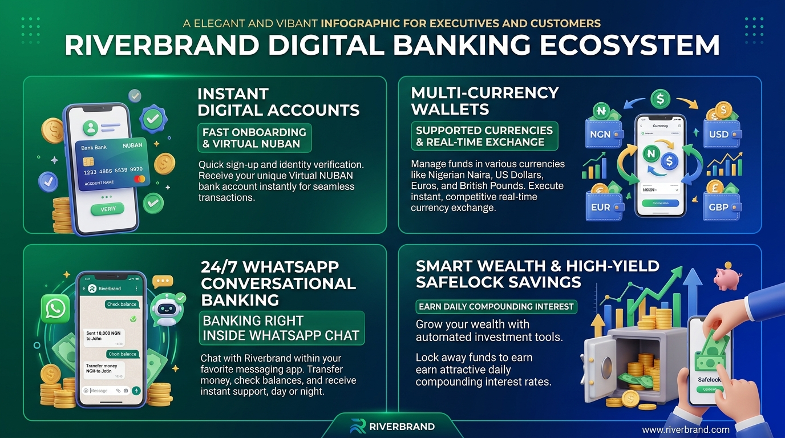
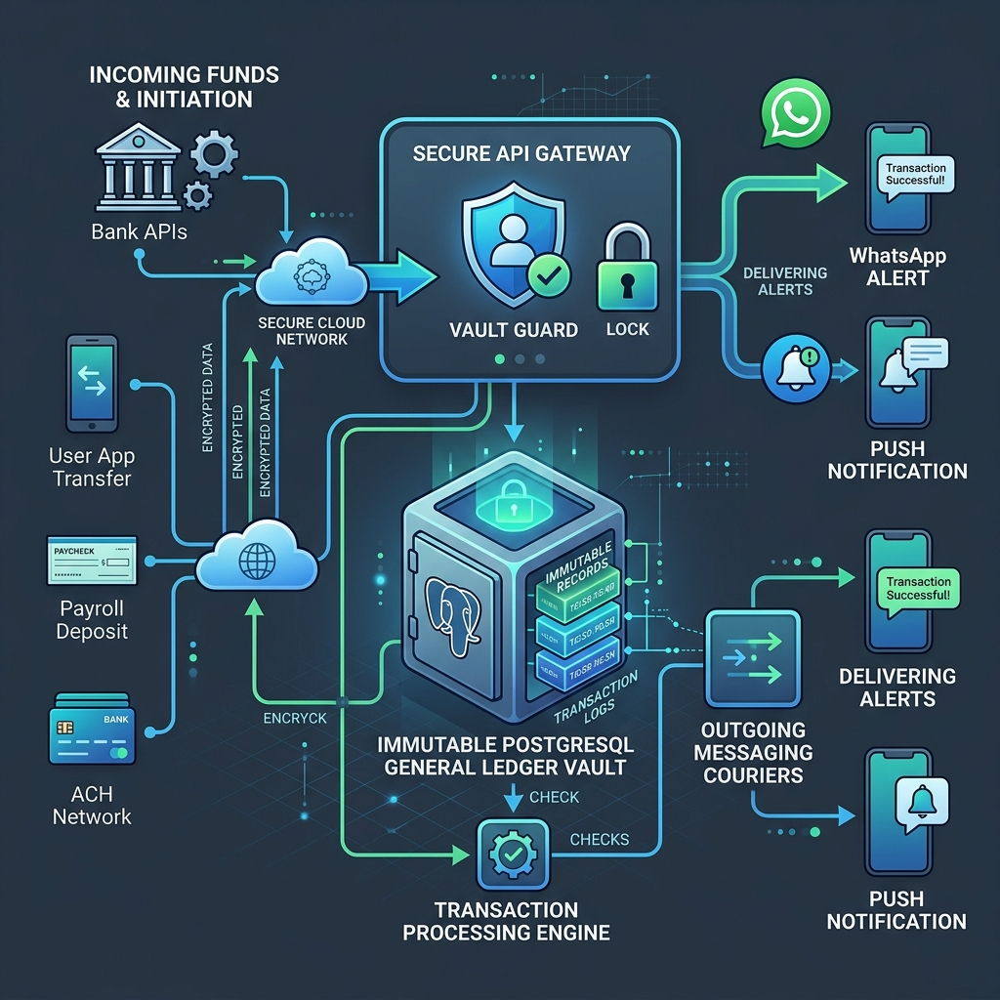
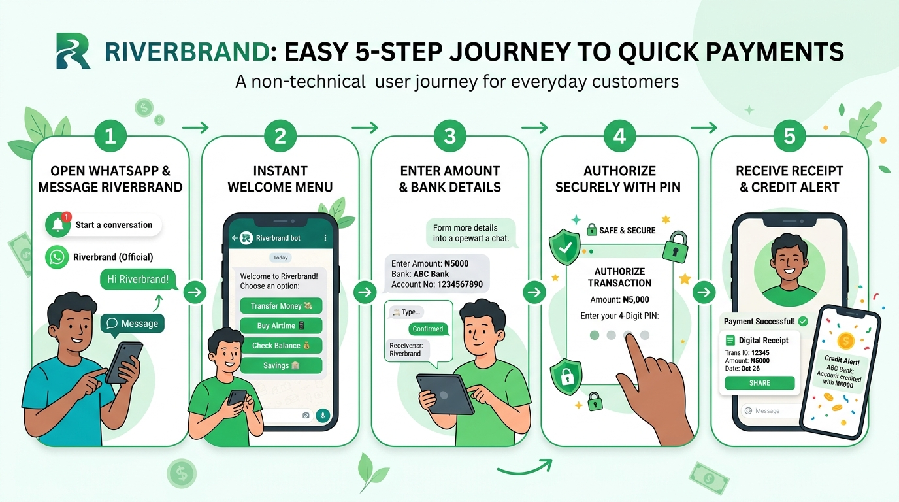
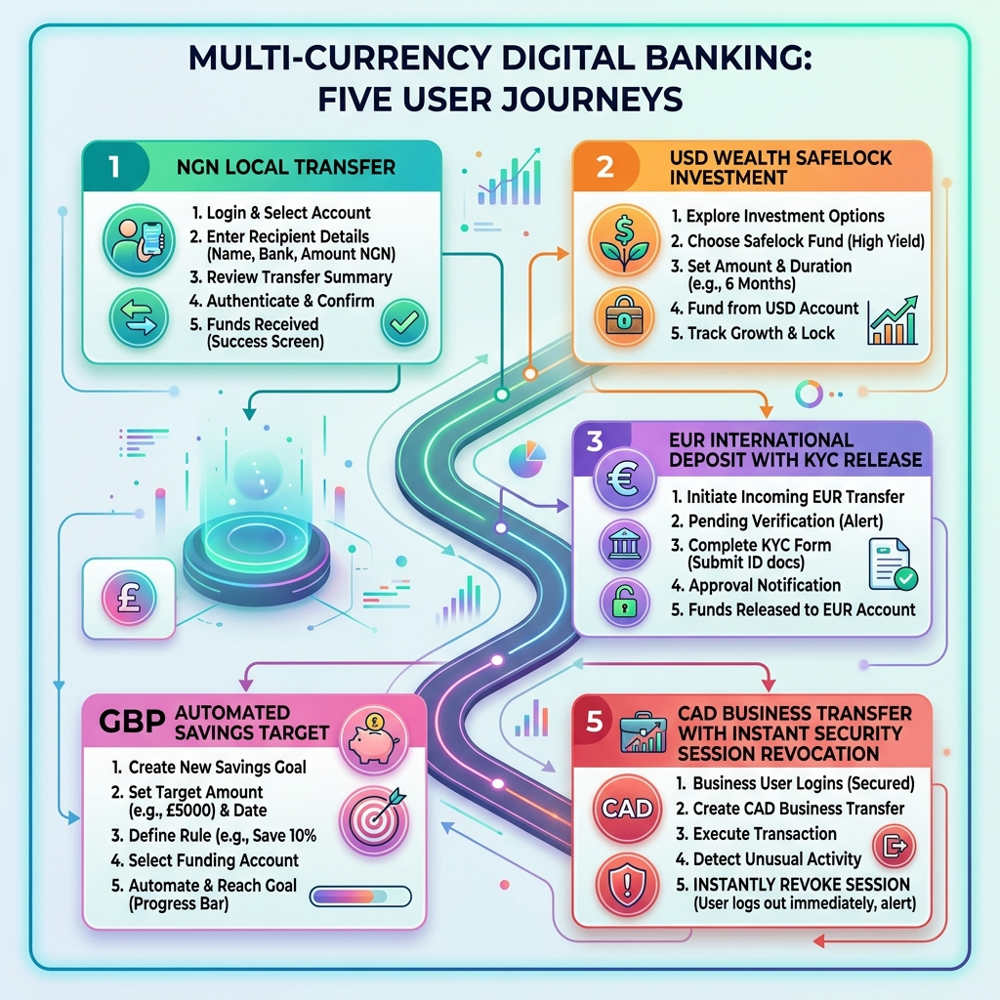

# 📘 Part I: Executive, Product & Non-Technical Guide

> **"What Riverbrand Does, Why We Built It, and How It Breathes"**  
> *A comprehensive, plain-English blueprint for executives, product leaders, risk officers, investors, and everyday users.*

---

## 🧭 1.1 The Master Philosophy: Learn, Unlearn & Relearn

To truly understand digital banking, we must first discard outdated assumptions about how money and software interact in the real world:

```
┌─────────────────────────────────────────────────────────────────────────────┐
│ 🚫 UNLEARN: "Banking software is just a website with a database table."     │
│ In a naive system, changing a balance is just `balance = balance - 100`.    │
│ Reality: A user taps "Send" twice on low Wi-Fi, the query executes twice,    │
│ and the bank loses money to double-spending.                                │
├─────────────────────────────────────────────────────────────────────────────┤
│ 💡 LEARN: "Banking software is a real-time distributed consensus engine."   │
│ Every penny moved is a multi-stage atomic operation involving cryptographic │
│ authorization, distributed concurrency locks, ledger entries, and outbox.   │
├─────────────────────────────────────────────────────────────────────────────┤
│ 🚀 RELEARN & MASTER: "Riverbrand is an Omni-Channel Autonomous Bank Engine."│
│ It orchestrates Mobile, Web, and WhatsApp clients against an immutable      │
│ double-entry ledger with sub-50ms speed, zero double-spending, and auto-KYC.│
└─────────────────────────────────────────────────────────────────────────────┘
```

### 🧠 The Core Mental Models

| Dimension | 🚫 Unlearn (The Naive Way) | 💡 The Real Risk (Why it Fails) | 🚀 Relearn (Riverbrand's Architecture) |
| :--- | :--- | :--- | :--- |
| **Money Movements** | `UPDATE wallet SET balance = balance - 100` | Two rapid taps cause race conditions, resulting in double-spending and negative balances. | **Tier 1 Distributed Redlock** + **Tier 2 Single-Commit SQL Interactive Transactions** + **Immutable Double-Entry Ledger**. |
| **Session Security** | Storing JWTs and waiting for them to expire in 24 hours. | Stolen or lost devices stay logged in for hours, giving attackers free reign. | **Sidecar Session Control** with atomic `jwt_version` bumps that instantly kill all sessions globally on password reset. |
| **Conversational Chat** | A giant 2,000-line `if/else` or `switch` statement for WhatsApp bots. | Unmaintainable, state gets lost on restart, duplicate webhook deliveries cause double transfers. | **Hierarchical Redis State Machine** with strict step transition contracts and idempotent webhook processing. |
| **Background Work** | Calling slow third-party SMS/Email/Push APIs directly inside HTTP request handlers. | If third-party APIs lag or go down, customer HTTP requests hang, timeout, and crash the server. | **Transactional Outbox Pattern** with non-blocking event relay and exponential backoff retry workers. |
| **Database Connections** | Opening 5,000 direct connections to PostgreSQL from Fastify worker threads. | PostgreSQL spawns 5,000 OS processes, eating 50 GB of RAM and bringing the server to a halt. | **PgBouncer Connection Multiplexing** (5,000 clients -> 50 pooled DB connections) + **Prisma Read-Replicas**. |
| **Account Tier Limits** | Freezing customer accounts when deposits exceed KYC tier ceilings. | Innocent customers are locked out, funds are trapped, and customer support gets overwhelmed. | **Quarantined Pending Balance Tank**: Safely holds excess funds and auto-releases on identity verification. |

---

## 🎯 1.2 Executive Vision & Product Mission

### What We Did:
We engineered **RiverbrandBE**—a unified core banking and financial technology platform that powers three front-facing client experiences (**Native Mobile Apps**, **Customer Web Dashboard & Admin Console**, and **24/7 Conversational WhatsApp Banking**) against a single, bulletproof financial ledger.

### Why We Did That:
Traditional financial institutions and early fintechs suffer from fragmented systems: separate mobile apps, disconnected USSD codes, manual back-office tools, and third-party gateways that frequently drop transactions. This fragmentation drives up customer acquisition costs, creates security loopholes, and alienates everyday users who face low phone storage, high data costs, or poor connectivity.

### What We Aim to Achieve:
1. **Universal Financial Access**: Enable anyone with a basic phone and WhatsApp to open an account, verify their identity, deposit funds, transfer money, and pay bills in seconds without downloading a heavy app.
2. **Absolute Financial Integrity**: Guarantee that no customer or merchant can ever spend the same penny twice, even during peak network congestion or rapid double-clicks.
3. **Frictionless Wealth Creation**: Democratize institutional-grade savings products (Safelock fixed deposits, automated Target Savings, and auto-sweeping rules) across multiple local and international currencies (NGN, USD, EUR, GBP, CAD).



---

## ✈️ 1.3 How the Bank Moves: The High-Security Airport & Vault Analogy

To visualize how Riverbrand processes money securely without dropping a single cent, imagine a **World-Class International Airport & High-Security Vault**:

```
[PASSENGER ENTRANCES] ──► [CONCIERGE & QUEUE] ──► [SECURITY AIR-LOCK] ──► [MASTER VAULT] ──► [DISPATCH COURIERS]
 Mobile / Web / WhatsApp       PgBouncer Proxy       Redis Redlock Guard    PostgreSQL DB      Outbox & Alerts
```

1. **The Passenger Entrances (Multi-Channel Gateways)**: Customers arrive through different doors: iOS/Android native apps, Web dashboards, or 24/7 WhatsApp chats.
2. **The Concierge & Queue Manager (PgBouncer Proxy)**: Instead of 5,000 customers rushing into the vault simultaneously and crashing the room, PgBouncer lines up requests smoothly and executes them using 50 ultra-fast teller processes.
3. **The Vault Guard (Redis Redlock & Token Bucket)**: Before anyone touches a balance, the Vault Guard grabs a distributed lock on that specific wallet key. If the user tries to send money twice in 50 milliseconds, the second attempt is locked out instantly.
4. **The Immutable Master Vault (PostgreSQL Database)**: Money moves within an atomic, single-commit transaction. A debit on one account and a credit on another happen together or not at all (ACID compliance).
5. **The Dispatch Couriers (Transactional Outbox & Notifications)**: Once sealed in the vault, background couriers deliver instant confirmation receipts via WhatsApp messages, mobile push alerts, and email notifications without making the customer wait.



---

## 📱 1.4 Omni-Channel Tri-Client Architecture

```
┌─────────────────────────────────────────────────────────────────────────────────────────┐
│                                UNIFIED FASTIFY API BACKEND                              │
│         Single Ledger | Real-Time Balances | Redlock Guard | KYC Limits | Outbox        │
└─────────────────────────────────────────────────────────────────────────────────────────┘
          │                                   │                                   │
          ▼                                   ▼                                   ▼
┌───────────────────────────┐   ┌───────────────────────────┐   ┌───────────────────────────┐
│   📱 NATIVE MOBILE APP    │   │  💻 WEB PORTAL & ADMIN    │   │   💬 24/7 WHATSAPP BOT    │
│      (iOS & Android)      │   │      (Customer & Staff)   │   │   (Conversational Chat)   │
├───────────────────────────┤   ├───────────────────────────┤   ├───────────────────────────┤
│ • Biometric / Face ID Auth│   │ • Customer Web Dashboard  │   │ • Zero-Friction Onboarding│
│ • Flutterwave Card Top-up │   │ • Executive Stats Console │   │ • Conversational Transfers│
│ • Live KYC Camera Uploads │   │ • Staff User Governance   │   │ • Airtime & Utility Bills │
│ • Target Savings Trackers │   │ • Granular RBAC Matrix    │   │ • Instant Chat Receipts   │
│ • FCM Multi-Device Push   │   │ • Non-Blocking Audit Logs │   │ • Multi-Currency Inquiries│
│ • Header: `x-local-token` │   │ • Header: `x-web-token`   │   │ • Webhook HMAC Signature  │
└───────────────────────────┘   └───────────────────────────┘   └───────────────────────────┘
```

### What We Did:
We built a unified core API serving three tailored user channels simultaneously:
1. **📱 Native Mobile App (iOS / Android)**: Built for power retail users with biometric login, live KYC camera uploads, tokenized debit card funding, and push alerts.
2. **💻 Customer Web Portal & Enterprise Admin Console**: Built for web customers and internal bank operations. Provides executive liability dashboards, user governance, staff RBAC permissions, and audit logs.
3. **💬 24/7 Conversational WhatsApp Banking**: A complete, passwordless banking environment inside WhatsApp. Users check balances, execute interbank transfers, buy airtime, pay utility bills, and receive instant rich receipt cards without downloading an app.

### Why We Did That:
- **Zero App Download Barrier**: In emerging markets, smartphone users frequently run out of device storage or face expensive data rates. WhatsApp is pre-installed on virtually 100% of smartphones and is often bundled into free-data carrier packages.
- **Enterprise Accountability**: Bank operations require rigorous administrative segregation. Web admin consoles must enforce granular role-based permissions (`RolePermission`) and non-repudiable audit logging (`AuditAdminAction`).

### What We Aim to Achieve:
Reduce customer onboarding friction to under 60 seconds while providing institutional-grade security across all touchpoints.



---

## 🌍 1.5 Five Real-World Multi-Currency Lifecycle Scenarios



Riverbrand natively manages digital wallets across **NGN, USD, GBP, EUR, and CAD**. Below are five end-to-end user journeys illustrating how different personas interact with the platform:

### 🇳🇬 Scenario 1: NGN Local Retail User Journey
* **User Profile**: Tunde, a retail professional in Lagos.
* **Step 1 (Genesis)**: Tunde texts "Hello" to Riverbrand on WhatsApp. The system verifies his phone number and automatically provisions a dedicated ProvidusBank NUBAN (`9920123456`).
* **Step 2 (Inbound Funding)**: Tunde transfers ₦150,000 NGN from GTBank. An inbound webhook triggers an atomic wallet credit, email receipt, and WhatsApp confirmation card.
* **Step 3 (Everyday Banking)**: Tunde selects "Pay Electricity", enters his meter number, inputs his 4-digit PIN, and receives his recharge token directly in chat in 3 seconds.

### 🇺🇸 Scenario 2: USD Cross-Border Wealth & Safelock Journey
* **User Profile**: Sarah, a remote tech consultant building dollar-denominated wealth.
* **Step 1 (Activation)**: Sarah activates her USD wallet inside the mobile app.
* **Step 2 (FX Swap)**: She deposits ₦1,600,000 NGN and executes an in-app swap to $1,000.00 USD at the active administrative exchange rate (`ExchangeRate`).
* **Step 3 (Safelock Fixed Deposit)**: She locks $1,000 USD into a 180-Day Safelock vault earning 8% p.a.
* **Step 4 (Automated Yield)**: The nightly interest cron job accrues yield. At maturity, $1,040 USD (principal + interest) automatically credits back to her primary USD wallet.

### 🇪🇺 Scenario 3: EUR International Remittance & KYC Pending Hold
* **User Profile**: Amara, a university student receiving tuition and living support from Europe.
* **Step 1 (Inflow)**: Amara receives a €2,500 EUR remittance into her Riverbrand EUR account.
* **Step 2 (Tier 1 Limit Trigger)**: Because Amara is at Tier 1 KYC (daily deposit ceiling of €500 equivalent), the system credits €500 to her active balance and securely quarantines €2,000 in `rbp_brand_pending_balance`.
* **Step 3 (Auto-Release on KYC)**: Amara submits her BVN via the app. Dojah verifies her identity, elevating her to Tier 2. The event handler (`KycTierUpgradedHandler`) immediately and automatically unlocks the €2,000 EUR into her active balance.

### 🇬🇧 Scenario 4: GBP Freelancer & Automated Target Savings
* **User Profile**: David, a freelance software engineer earning in British Pounds.
* **Step 1 (Inflow)**: David receives £1,200 GBP from an international client into his Riverbrand GBP account.
* **Step 2 (Target Setup)**: He creates a target savings goal: "Master's Degree — £5,000 GBP".
* **Step 3 (AutoSave Sweeps)**: He enables AutoSave to sweep £150 GBP every Friday from his active GBP wallet into his Target Savings pool.
* **Step 4 (Progress Tracking)**: Real-time progress bars and milestone push notifications keep him disciplined as he approaches his goal.

### 🇨🇦 Scenario 5: CAD Business Payment & Security Revocation Safeguard
* **User Profile**: Ken, an import-export business manager in Toronto.
* **Step 1 (Payment)**: Ken receives a $10,000 CAD invoice payment into his corporate wallet.
* **Step 2 (Security Threat)**: Ken misplaces his tablet at an airport lounge and immediately resets his password from his laptop.
* **Step 3 (Sidecar Invalidation)**: The sidecar controller (`river_brand_sys_user_session_control`) increments `jwt_version` from `1` to `2`.
* **Step 4 (Protection Verified)**: Any stale access token on the lost tablet is rejected instantly (`401 Unauthorized`) across all API servers, protecting his $10,000 CAD balance.

---

## 📈 1.6 Wealth Accumulation: Safelock, Target Goals & AutoSave

### What We Did:
We built an institutional-grade wealth engine into the core ledger:
- **Safelock Fixed Deposits**: Funds are locked upfront for 30, 90, 180, or 365 days. Capital is strictly inaccessible until maturity, protecting users from impulse spending.
- **Target Savings Goals**: Scheduled daily, weekly, or monthly automatic sweeps toward custom financial targets (e.g., "Car Down Payment", "School Fees").
- **AutoSave Sweeps**: Periodic rule-based sweeping of idle primary wallet balances into high-yield savings pools.
- **Automated Interest Engine**: Daily compounding interest is calculated and recorded into immutable logs (`savings_usersavinginterestlog`) via a scheduled cron job.

### Why We Did That:
Traditional commercial banks offer near-zero interest on checking accounts while imposing hidden maintenance fees. Standalone savings apps, on the other hand, lack primary checking rails. By embedding high-yield wealth products directly alongside everyday payment accounts, users can both spend and grow wealth in one place.

### What We Aim to Achieve:
Cultivate long-term financial discipline for users while building sticky, low-cost capital liquidity for the banking platform.

---

## 🛡️ 1.7 Regulatory Pending-Balance Holding Tank: Zero-Disruption KYC Compliance

### What We Did:
We built a non-disruptive compliance mechanism called the **Pending Balance Holding Tank** (`rbp_brand_pending_balance`):
- **Tier 1 (Basic)**: Phone-verified signup with a daily transfer ceiling of ₦50,000.
- **Tier 2 (Identity Verified)**: BVN & NIN verification via Dojah / Mono, unlocking ₦200,000 daily limits.
- **Tier 3 (Full KYC)**: Residential address verification and government photo ID (`UserDocument`), unlocking ₦5,000,000+ daily volume.
- **The Holding Tank**: If an incoming payment exceeds the customer's current KYC ceiling, the compliant portion is credited immediately, and the excess is safely quarantined with an automated notification. Once the customer completes KYC, the held funds are automatically released.

### Why We Did That:
Traditional banks either bounce excess transfers back into interbank limbo (where money can take 14 days to trace) or place a hard lock on the user's entire account. Both approaches cause panic, damage user trust, and flood customer support.

### What We Aim to Achieve:
Strict compliance with Central Bank AML/CFT regulations while delivering a transparent, zero-panic customer experience.

---

## ⚔️ 1.8 Competitive Landscape & Strategic Market Moat

```
┌────────────────────────────────────────────────────────────────────────────────────────┐
│                        COMPETITIVE POSITIONING MATRIX                                  │
├───────────────────┬──────────────┬──────────────┬──────────────┬───────────────────────┤
│ Feature / Vector  │ Riverbrand   │ Kuda / OPay  │ PiggyVest    │ Traditional Banks     │
├───────────────────┼──────────────┼──────────────┼──────────────┼───────────────────────┤
│ WhatsApp Banking  │ Native 24/7  │ Limited/None │ None         │ Fragmented / Basic    │
│ Multi-Currency    │ Native Multi │ Single (NGN) │ Dollar Only  │ Domiciliary (Complex) │
│ Outbox Resiliency │ Guaranteed   │ Best-effort  │ Standard     │ Batch Mainframe       │
│ KYC Holding Tank  │ Auto-Release │ Hard Freeze  │ N/A          │ Bureaucratic In-Person│
│ Session Kill-Switch│ Instant Sync│ Delayed TTL  │ Delayed TTL  │ Manual Support Call   │
│ App-Free Access   │ Complete     │ App Required │ App Required │ USSD (High Failure)   │
└───────────────────┴──────────────┴──────────────┴──────────────┴───────────────────────┘
```

### Detailed Competitor Benchmarking

#### 1. Riverbrand vs. Kuda Bank ("The App-Only Neo-Bank")
* **Kuda's Model**: Built around native mobile apps. Users with low storage, slow 2G/3G connectivity, or non-smartphone devices face high onboarding friction. Peak-period interbank switch congestion frequently leads to hanging transfers.
* **Riverbrand's Edge**:
  - **Conversational Ubiquity**: Complete banking inside WhatsApp without requiring app downloads.
  - **Multi-Switch Clearing Redundancy**: Pluggable provider routing (Providus, Fincra, Flutterwave) guarantees that transfers fail over to backup settlement rails if a primary switch degrades.

#### 2. Riverbrand vs. OPay & Moniepoint ("The POS Agency Giants")
* **OPay / Moniepoint Model**: Dominate physical cash-in/cash-out merchant terminals. However, their consumer mobile interfaces are heavily cluttered with promotional gambling banners, loans, and non-core utilities.
* **Riverbrand's Edge**:
  - **Clean Wealth & Multi-Currency Focus**: Purpose-built for clean, transparent wealth creation (Safelock, Target Savings, AutoSave sweeps) alongside multi-currency cross-border accounts (NGN, USD, GBP, EUR) for global professionals and diaspora earners.
  - **Enterprise Developer Ergonomics**: Modular Fastify core and OpenAPI/Scalar specifications enable seamless white-labeling and banking-as-a-service embeddability.

#### 3. Riverbrand vs. PiggyVest & Cowrywise ("The Savings Specialists")
* **PiggyVest Model**: Exceptional at automated savings, but lacks primary checking accounts, direct commercial clearing, and dedicated virtual NUBAN settlement rails.
* **Riverbrand's Edge**:
  - **Unified Checking + High-Yield Wealth**: Riverbrand natively unifies everyday high-speed transactional banking (NIP interbank transfers, utility bills, airtime) with institutional-grade Safelock fixed deposits and target goals within a single double-entry ledger.

#### 4. Riverbrand vs. Chipper Cash & Revolut ("Cross-Border Wallets")
* **Chipper / Revolut Model**: Provide international currency wallets, but enforce aggressive automated account freezes when volume spikes exceed basic KYC, leaving funds trapped in customer-support backlogs.
* **Riverbrand's Edge**:
  - **The "Pending Balance Holding Tank"**: Excess funds exceeding tier limits are safely placed in an escrow holding account (`rbp_brand_pending_balance`) rather than triggering an account lock. The moment the customer uploads their BVN or ID, the funds are automatically unlocked.

#### 5. Riverbrand vs. Traditional Tier-1 Commercial Banks (GTBank, Zenith, Access)
* **Traditional Model**: Heavy legacy core banking systems (COBOL/Finacle/Flexcube), cumbersome branch queues, brittle USSD codes that drop sessions mid-transaction with telco toll fees.
* **Riverbrand's Edge**:
  - **Sub-50ms API Latency**: Built with modern Fastify and PgBouncer connection pooling.
  - **Free, Interactive WhatsApp Interface**: Replaces obsolete USSD strings (`*737#`) with interactive button menus, real-time PDF/image receipts, and conversational natural language processing.

---

## 💡 1.9 Relatable Real-World Analogies Reference

To help non-technical stakeholders, auditors, and investors understand Riverbrand's technological mechanics, we frame complex systems using relatable real-world analogies:

### 🏨 Analogy 1: The Modern Hotel Master Keycard (Sidecar Session Revocation)
* **The Problem in Normal Apps**: In naive web apps, when you log in, the app gives you a digital key (JWT) valid for 24 hours. If your phone gets stolen at 10:00 AM, the thief can spend money until midnight because the key itself doesn't expire until then.
* **Riverbrand's Solution**: Think of a modern hotel keycard system. When a guest loses their room card, the front desk doesn't change every physical lock in the hotel; they simply re-key the master digital frequency (`jwt_version`). The moment the frequency bumps from 1 to 2, the lost plastic card immediately stops opening the door. In Riverbrand, resetting your password instantly deactivates all active sessions worldwide in under 1 millisecond.

### 🛡️ Analogy 2: The Two-Door Bank Airlock (Redlock & Concurrency Guard)
* **The Problem in Normal Apps**: A customer with ₦10,000 opens two browser tabs or taps "Transfer" simultaneously on two devices at the exact same millisecond. Both requests read "Balance: ₦10,000", approve two ₦10,000 transfers, and leave the bank with a ₦10,000 loss (double-spending).
* **Riverbrand's Solution**: High-security bank vault airlocks never allow both security doors to be opened at the same time. Riverbrand uses a distributed Redis Mutex Lock (`Redlock`). When Request A enters the airlock, the door slams shut on Request B. Request A finishes the transfer and updates the balance to ₦0. When Request B finally enters, the vault is already empty, and the transaction is cleanly rejected with "Insufficient Balance".

### 📦 Analogy 3: The Guaranteed Postal Courier (Transactional Outbox Pattern)
* **The Problem in Normal Apps**: A user transfers money. The server tries to email a receipt and send a push notification. If the internet connection to the email provider lags, the entire user request hangs for 15 seconds or crashes, leaving the customer terrified that their money vanished.
* **Riverbrand's Solution**: When money moves, the server writes the transfer and the outgoing message into the database simultaneously in the same atomic lockbox. The user gets an immediate success response in 40ms. In the background, an automated postal courier sweeps the lockbox and reliably delivers the receipt, retrying automatically if the email vendor has a brief hiccup.

### ✈️ Analogy 4: The Airport Control Tower (PgBouncer Multiplexing)
* **The Problem in Normal Apps**: If 5,000 airplanes tried to land on a runway simultaneously without a control tower, they would crash into each other and destroy the airport.
* **Riverbrand's Solution**: PgBouncer acts as the expert air traffic control tower. It holds thousands of incoming client connections gracefully in the sky and lands them one by one across 50 high-speed tarmac gates (physical database connections), preventing database process crashes.

---

## 📊 1.10 Business Risk Mitigations & Governance Matrix

| Business Risk | How Riverbrand Mitigates It | Plain-English Explanation |
| :--- | :--- | :--- |
| **Double-Spending & Race Conditions** | Distributed Redis Locks (`Redlock`) + SQL Transactions (`$transaction`) | Prevents a customer from tapping "Transfer" twice simultaneously on two phones to spend the same money twice. |
| **Session Hijacking / Stolen Tokens** | Dual-Token Isolation + Sidecar `jwt_version` Invalidation | If a user loses their phone or changes their password, all active logins across all devices are cut off instantly. |
| **Third-Party Provider Outages** | Multi-Provider WhatsApp Fallback + Transactional Outbox Pattern | If one SMS, WhatsApp, or email vendor experiences downtime, the system dynamically switches to backup gateways without dropping transactions. |
| **Regulatory Non-Compliance (KYC/AML)** | Tiered Limits Tracker (`rbp_brand_daily_limit_tracker`) + Dojah BVN/NIN Gateway | Enforces exact daily transfer ceilings according to government regulations based on verified user identity level. |
| **Unauthorized Admin Abuse** | Non-Blocking Audit Trail + Granular RBAC (`sys_roles`, `sys_permissions`) | Ensures staff can only perform actions assigned to their exact role, and logs every staff click with timestamp and IP address. |

---

*Continue to Part II: [Chapter 02: Architecture & System Topology](./02-architecture-and-design.md) — The Technical Deep-Dive & Engineering Specifications.*
