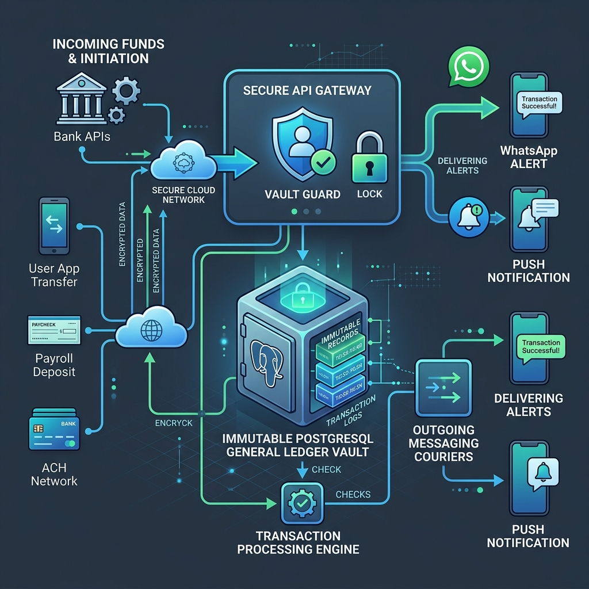
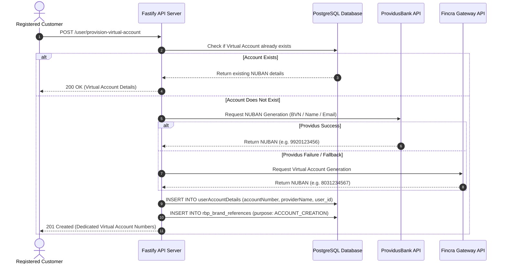

# ⚙️ Chapter 3: Core Banking & Financial Concurrency Engine

> **"Financial Ledger, Atomic Debits & Double-Spending Prevention"**  
> *A comprehensive technical specification on atomic wallet debits, distributed Redlock mutexing, virtual NUBAN generation, double-entry general ledgers, reconciliation jobs, and daily velocity tracking.*

---

## 🧭 3.1 The "Learn, Unlearn, Relearn" Guide to Money Movement

```
┌─────────────────────────────────────────────────────────────────────────────┐
│ 🚫 UNLEARN: "A database transaction alone is enough to stop double spending"│
│ If a user clicks 'Transfer ₦10k' from two phone tabs at the exact same     │
│ millisecond, both read `balance = ₦10k` before either commits, leading to   │
│ negative balances and irreversible bank loss.                               │
├─────────────────────────────────────────────────────────────────────────────┤
│ 💡 LEARN: "Concurrency in distributed systems requires multi-layered guards"│
│ Layer 1: Distributed lock in memory (Redis Redlock) to serialize requests.  │
│ Layer 2: ACID single-commit database transactions ($transaction).           │
│ Layer 3: Balanced General Ledger double-entry lines (GLJournalLine).        │
├─────────────────────────────────────────────────────────────────────────────┤
│ 🚀 RELEARN & MASTER: "Riverbrand's Quantum Ledger Engine"                   │
│ Every debit acquires a 10s Redis mutex lock on `lock:wallet:{walletId}`,    │
│ validates daily limits, mutates balance, writes double-entry ledger rows,   │
│ queues the outbox event, and commits in one atomic step in milliseconds.    │
└─────────────────────────────────────────────────────────────────────────────┘
```

---

## 🏛️ 3.2 System Architecture & Concurrency Guard


```
[Incoming Debit Request] 
         │
         ▼
┌─────────────────────────────────────────────────────────┐
│ TIER 1: Distributed Redis Lock (src/utils/lock.ts)      │
│ Lock Key: `lock:wallet:{walletId}` (TTL: 10 Seconds)    │
└─────────────────────────────────────────────────────────┘
         │
         ├──► [Acquired Lock Successfully]
         │          │
         │          ▼
         │  ┌──────────────────────────────────────────────────────────┐
         │  │ TIER 2: Database Isolation Transaction ($transaction)    │
         │  │  1. Idempotency Check: IdempotencyService                │
         │  │  2. Daily Limit Check: DailyLimitTrackerService          │
         │  │  3. Verify: balance >= (debitAmount + fee)               │
         │  │  4. Decrement Source Wallet Balance                      │
         │  │  5. Increment Destination Wallet Balance                 │
         │  │  6. Double-Entry GL Journal: GeneralLedgerService        │
         │  │  7. Outbox Event Insert: rbp_brand_outbox                │
         │  │  8. COMMIT TRANSACTION (Atomic Execution)                │
         │  └──────────────────────────────────────────────────────────┘
         │          │
         │          ▼
         │  [Release Redis Lock] ──► [Return 200 OK Response]
         │
         └──► [Lock Rejected / Busy] ──► [Return 409 Conflict Response]
```

### 1. What We Have Done:
We built the **Financial Monetary Engine** (`src/services/monetary/financialEngine.ts` — 1,060+ lines) providing atomic execution for interbank transfers, peer-to-peer (P2P) transfers, bill settlements, card funding, and currency swaps.

```typescript
export interface IAtomicDebitPayload {
  userId: number | bigint;
  amount: number;
  idempotencyKey: string;
  sessionId?: string;
  extReferenceId?: string;
  purpose?: ReferencePurpose;
  provider?: string;
  providerFee?: number;
  currency?: string;
  currencyId?: number | bigint;
  chargeType?: TransactionChargeType;
  nature?: TransactionNature;
  description?: string;
  recipientEmail?: string;
  recipientId?: number | bigint;
  saveBeneficiary?: boolean;
  sourceAccountName?: string;
  sourceAccountNumber?: string;
  sourceBankName?: string;
  skipLedger?: boolean;
}

export interface IAtomicDebitResult {
  success: boolean;
  reference: string;
  sessionId?: string;
  previousBalance: number;
  newBalance: number;
  debitedAmount: number;
  fee?: number;
  providerFee?: number;
  realisedFee?: number;
}
```

### 2. Engineering Considerations & Trade-Offs:
- **Consideration**: High network latency or deliberate multi-device exploits can send duplicate transfer requests within milliseconds.
- **Trade-Off**: Database-level row locking (`SELECT FOR UPDATE`) can create database thread bottlenecks and connection exhaustion under high traffic.

### 3. The Approach Taken:
- **Tier 1 (Redis Redlock)**: The engine executes `withDistributedLock` using key `lock:wallet:${walletId}` with a 10,000ms TTL. Duplicate requests are immediately rejected with `HTTP 409 Conflict`.
- **Tier 2 (Interactive `$transaction`)**: Inside `prisma.$transaction`, balance validation, ledger debit, ledger credit, fee deduction (`TransferFeeService`), and outbox insertion occur atomically.
- **Tier 3 (Double-Entry General Ledger)**: Powered by `GeneralLedgerService`, every movement writes debits and credits to `GLJournalEntry` and `GLJournalLine`.

### 4. Why We Have Done That & The Benefits:
- **Zero Double-Spending**: Eliminates negative balances before queries hit PostgreSQL.
- **Execution in Milliseconds to Seconds**: Balance verification and ledger locking execute majorly in milliseconds, while end-to-end clearing and receipt dispatch complete in seconds.

### 5. What We Can Look to Improve in the Future:
- **Distributed Multi-Node Redlock Consensus**: Transition to a 5-node Redlock consensus quorum to withstand Redis master failovers during live transaction locks.

---

## 🏦 3.3 Virtual Account Provisioning Lifecycle

Dedicated virtual bank accounts (NUBANs) allow customers to fund their Riverbrand wallets via instant bank transfers from any commercial bank.





---

## 🏷️ 3.4 Cryptographic Idempotency & Reference Tracking

Every money movement operation is assigned a cryptographically unique reference generated via `src/utils/referenceGenerator.ts`:

| Purpose (`ReferencePurpose`) | Format Example | Description |
| :--- | :--- | :--- |
| `ACCOUNT_CREATION` | `REF-ACT-20260815-9A8B7C` | Dedicated NUBAN virtual account creation reference. |
| `TRANSFER` | `TRF-NGN-20260815-88392011` | Interbank or P2P transfer reference. |
| `DEPOSIT` | `DEP-PRV-20260815-77182900` | Inbound deposit webhook reference from Providus/Fincra. |
| `SAVINGS` | `SAV-FLK-20260815-33411099` | Safelock or Target Savings deposit lock reference. |
| `BILL_PAYMENT` | `BIL-AIR-20260815-44910288` | Airtime, Data, Electricity, or Cable TV bill payment ref. |
| `CARD_PAYMENT` | `CRD-FLW-20260815-11029388` | Debit card funding transaction reference. |

---

## 🛡️ 3.5 Regulatory Pending Balance Tank & Daily Ceilings

```
[Inbound Deposit Webhook (e.g. ₦500,000)]
                   │
                   ▼
┌────────────────────────────────────────────────────────┐
│ Check User KYC Tier Daily Ceiling (rbp_brand_kyc_benefit)│
│ Current User Tier: TIER 1 (Daily Limit: ₦50,000)       │
└────────────────────────────────────────────────────────┘
                   │
         ┌─────────┴─────────┐
         ▼                   ▼
[Within Limit: ₦50,000]   [Exceeds Limit: ₦450,000]
         │                   │
         ▼                   ▼
[Credit Main Wallet]     [Lock in `rbp_brand_pending_balance`]
                             │
                             ▼
                         [Log Audit Trail (`rbp_brand_pending_balance_audit`)]
                             │
                             ▼
       [Customer Uploads BVN / NIN ➔ Upgraded to TIER 2]
                             │
                             ▼
             [Pending Balance Auto-Released to Main Wallet]
```

### KYC Tier Ceilings (`rbp_brand_kyc_benefit`)

| User KYC Tier | Daily Transfer Limit | Maximum Wallet Balance | Verification Requirement |
| :--- | :--- | :--- | :--- |
| **`TIER1`** | ₦50,000.00 | ₦300,000.00 | Phone Number & Email Verification |
| **`TIER2`** | ₦200,000.00 | ₦500,000.00 | BVN or NIN Verification via Dojah Gateway |
| **`TIER3`** | ₦5,000,000.00 | Unlimited | Government Photo ID & Proof of Address |

---

## 🔍 3.6 Automated Settlement & Reconciliation Jobs

To maintain 100% accounting balance between internal wallet balances, general ledger lines, and external partner accounts, Riverbrand runs continuous automated reconciliation jobs:

1. **`ReconciliationJob` (`src/job/reconciliationJob.ts`)**:
   - Compares internal transaction logs against commercial clearing settlement statements.
   - Detects discrepancies, missing inbound webhook events, and unbalanced settlement amounts.
2. **`BillReconciliationJob` (`src/job/billReconciliationJob.ts`)**:
   - Audits airtime, data, and utility bill debits against provider success responses.
   - Automatically initiates refund credits for bills confirmed as failed by telco aggregators.
3. **`GeneralLedgerJob` (`src/job/generalLedgerJob.ts`)**:
   - Takes automated daily snapshots of all GL accounts into `GLBalanceSnapshot`.
   - Validates that Total Assets equal Total Liabilities plus Equity.

---

*Continue to: [Chapter 04: Technical Savings & WhatsApp Channels](./04-savings-investments-and-channels.md)*
