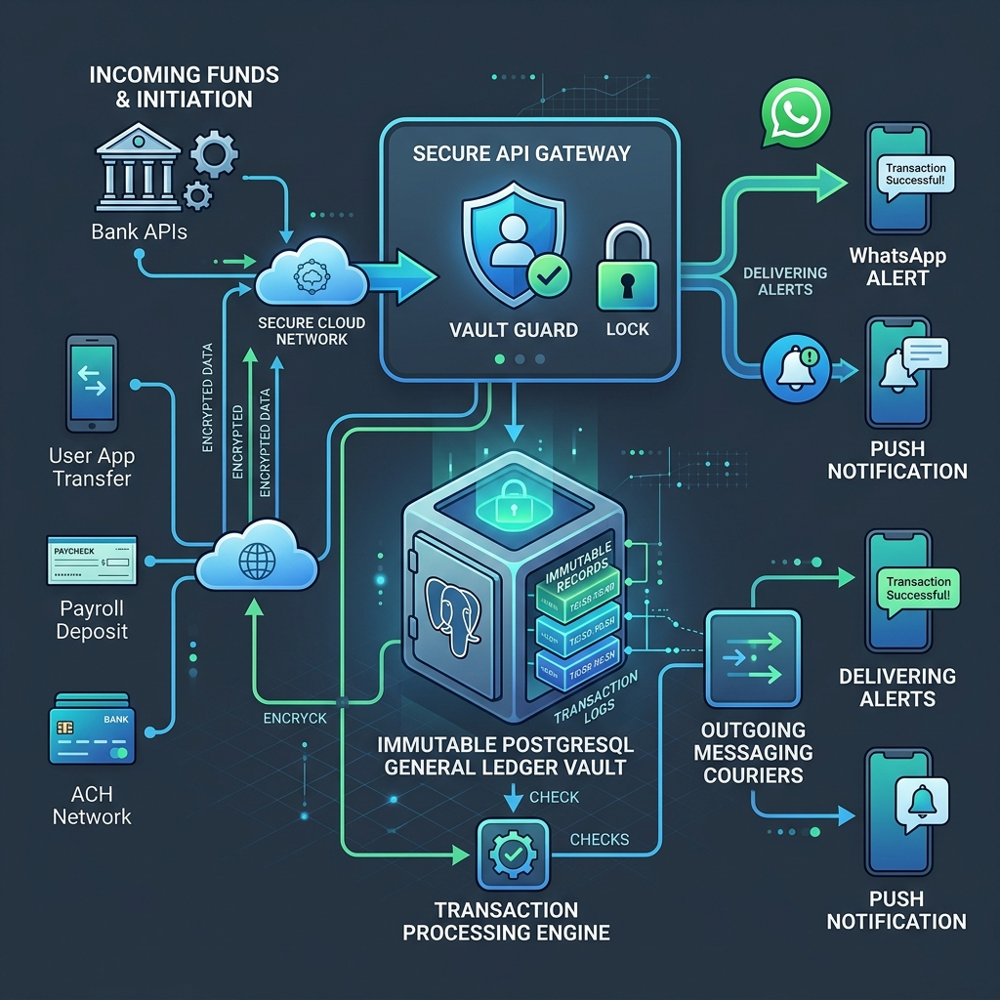

# 📘 Non-Technical Guide: Money Movements & The Vault Airlock

> **"How Riverbrand Moves Money with Zero Double-Spending and Zero Lost Pennies"**  
> *A plain-English guide for executives, product leaders, risk managers, and customers to understand the money pipeline.*

---

## 🧭 3.1 The "Learn, Unlearn, Relearn" Guide to Money Movement

```
┌─────────────────────────────────────────────────────────────────────────────┐
│ 🚫 UNLEARN: "Sending money online is just subtracting a number on a screen."│
│ If a user taps "Send ₦10,000" twice rapidly on a slow Wi-Fi connection,     │
│ a naive app processes both requests, sending ₦20,000 from a ₦10,000 balance!│
├─────────────────────────────────────────────────────────────────────────────┤
│ 💡 LEARN: "Money movement is an interlocking physical airlock."             │
│ Two actions cannot occupy the same wallet at the exact same millisecond.   │
│ Any second tap must wait outside until the first transaction is sealed.     │
├─────────────────────────────────────────────────────────────────────────────┤
│ 🚀 RELEARN & MASTER: "Riverbrand's Dual-Guard Concurrency Vault"            │
│ We combine an in-memory lockbox (Redis Redlock) with single-commit database │
│ atomicity. Money only leaves when all conditions are 100% met.              │
└─────────────────────────────────────────────────────────────────────────────┘
```

---

## 🏛️ 3.2 What We Did, Why We Did It & What We Aim to Achieve

### What We Did:
We engineered an automated **Two-Tier Concurrency Guard** that serializes every debit request and enforces single-commit atomic transactions. When money moves, balances, ledgers, and confirmation receipts are updated together as one indivisible operation.

### Why We Did That:
In high-volume fintech environments, "race conditions" are the single biggest cause of financial loss. When servers experience network latency, users tap buttons repeatedly or attempt deliberate double-spend exploits across multiple devices. Without concurrency guards, digital banks lose millions in unrecoverable negative balances.

### What We Aim to Achieve:
- **Zero Double-Spending**: Absolute mathematical guarantee that a balance cannot be spent twice.
- **Milliseconds-to-Seconds Execution**: Core balance deductions happen majorly in milliseconds, while end-to-end clearing and receipt dispatch complete in seconds without making users wait.
- **Immutable Auditability**: Every penny moved creates permanent, balanced double-entry accounting records.



---

## 🛡️ 3.3 The Real-World Analogy: The Bank Vault Airlock

Imagine walking into a high-security international bullion vault:

```
[CUSTOMER ARRIVES] ──► [DOOR 1: AIRLOCK] ──► [INSIDE VAULT] ──► [DOOR 2: EXIT]
 Tap "Transfer"         Redis Redlock Closes   Atomic Ledger      Instant Receipt
```

1. **You Step Into the Airlock (Door 1)**: As soon as you tap "Transfer ₦10,000", Riverbrand immediately shuts and locks Door 1 behind you (`Redlock`).
2. **The Second Click is Locked Out**: If your finger accidentally tapped twice, the second request bounces off the locked door with a friendly notice: *"Transaction in progress"*.
3. **The Vault Transaction Occurs**: Inside the vault, the teller takes ₦10,000 from your box, puts it into the recipient's box, and writes the record in the master ledger book.
4. **Door 2 Opens**: The transaction is sealed, both doors unlock, and you receive your digital confirmation receipt.

---

## 📦 3.4 The Two-Pocket Escrow Envelope (KYC Compliance)

```
┌─────────────────────────────────────────────────────────────────────────────┐
│ 🧠 MENTAL MODEL: The Two-Pocket Envelope                                    │
│                                                                             │
│ Traditional Bank: You receive ₦500k at Tier 1. The bank panics, freezes    │
│ your entire account, and locks your existing money for 2 weeks.             │
│                                                                             │
│ Riverbrand: We put the allowed ₦50k in your Active Pocket to spend today,   │
│ and put the remaining ₦450k in your Safe Escrow Pocket. The moment you text │
│ your BVN, the escrow pocket instantly opens!                                │
└─────────────────────────────────────────────────────────────────────────────┘
```

### Why This Matters to Customers:
Traditional banks either bounce excess transfers back into interbank limbo (where funds take 14 days to trace) or place a hard freeze on the customer's entire account. Riverbrand's **Pending Balance Holding Tank** (`rbp_brand_pending_balance`) allows the customer to continue using their verified allowance while safely holding excess funds until identity verification is completed.

---

## ⚔️ 3.5 Competitive Benchmarking: Money Movement & Transfers

| Movement Vector | Traditional Commercial Banks | Conventional App-Only Banks | Agency & POS Networks | Riverbrand Platform |
| :--- | :--- | :--- | :--- | :--- |
| **Double-Spend Guard** | Heavy DB locks (Slow) | Best-effort queuing | Local terminal lock | **Dual-Tier Redis Redlock + SQL Atomicity** |
| **Transfer Execution** | 5 – 60 seconds (High latency) | 2 – 5 seconds | 2 – 4 seconds | **Majorly in Milliseconds to Seconds** |
| **KYC Limit Overage** | Account Frozen / Blocked | Hard Reversal / Bounce | In-app KYC Warning | **Quarantined Escrow Tank (Zero Panics)** |
| **Dedicated Virtual NUBAN** | Branch Required | Single Gateway Partner | Proprietary Virtual Account | **Multi-Rail (Providus + Fincra Fallback)** |
| **Receipt Delivery** | Delayed SMS (Toll charges) | Mobile Push Only | Paper Slip / Push | **Instant WhatsApp Chat Card + Push + Email** |

---

*Continue to: [Chapter 04: Wealth Building & WhatsApp Banking](./04-non-technical-savings-and-channels.md)*
