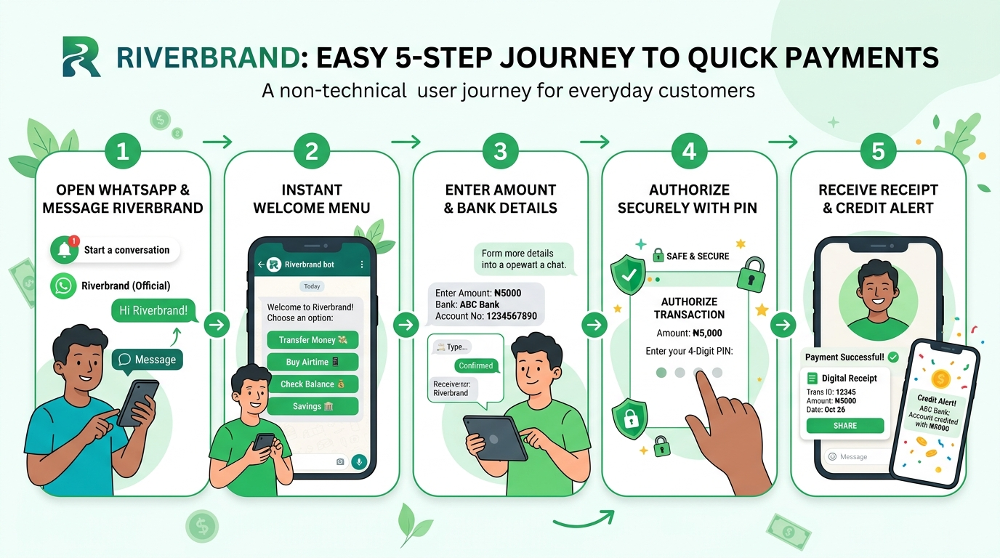

# 📘 Non-Technical Guide: Wealth Building & 24/7 WhatsApp Banking

> **"Banking Without Apps: How Riverbrand Turns WhatsApp into an Institutional Vault"**  
> *A plain-English guide to conversational banking, Safelock fixed deposits, and automated wealth creation.*

---

## 🧭 4.1 The "Learn, Unlearn, Relearn" Guide to Conversational Channels

```
┌─────────────────────────────────────────────────────────────────────────────┐
│ 🚫 UNLEARN: "Every digital bank requires downloading a 100MB mobile app."   │
│ Users run out of storage space, face expensive mobile data costs, or lose   │
│ connection midway through an app store download.                            │
├─────────────────────────────────────────────────────────────────────────────┤
│ 💡 LEARN: "The most powerful banking interface is already in their pocket." │
│ Over 95% of smartphone users in emerging markets keep WhatsApp open all day.│
│ If they can text a friend, they can transfer money, buy power, and save.    │
├─────────────────────────────────────────────────────────────────────────────┤
│ 🚀 RELEARN & MASTER: "Riverbrand's Omni-Channel Conversational Banking"     │
│ We turn WhatsApp into a high-security private teller desk. Zero downloads,  │
│ 4-digit PIN security, instant button menus, and rich digital receipt cards. │
└─────────────────────────────────────────────────────────────────────────────┘
```

---

## 💬 4.2 What We Did, Why We Did It & What We Aim to Achieve

### What We Did:
We built an enterprise **Multi-Provider Conversational Banking Engine** inside WhatsApp paired with an institutional-grade **Wealth Management Suite** (Safelock Fixed Deposits, Target Savings Goals, and AutoSave Sweeps).

### Why We Did That:
- **Zero App Download Friction**: High customer drop-off happens between visiting a website and downloading an app from the Play Store or App Store. WhatsApp eliminates this hurdle entirely.
- **Beating Inflation Through Disciplined Savings**: Standard checking accounts pay zero interest and encourage impulse spending. Safelock allows users to lock away capital upfront for guaranteed, compounding yield.

### What We Aim to Achieve:
- **Instant 60-Second Onboarding**: A user texts "Hi", verifies their phone, receives a virtual bank account number, deposits money, and sends a transfer within one minute.
- **Habit-Forming Wealth Accumulation**: Automatic weekly or monthly sweeps that build long-term personal savings without requiring manual effort.



---

## 🏨 4.3 The Real-World Analogy: The Private Concierge Banker on Speed Dial

Imagine having an experienced, private personal banker who answers your texts within 1 second, 24 hours a day, 365 days a year:

```
[CUSTOMER TEXTS] ──► [CONCIERGE REPLIES] ──► [ENTER SECRET PIN] ──► [INSTANT RECEIPT CARD]
 "Send 5k to Mom"     "Which account?"        4-Digit bcrypt PIN    Delivered in WhatsApp Chat
```

1. **No Queues, No Branches**: You never have to stand in a banking hall or wait on hold with customer support.
2. **Context-Aware Memory**: The concierge remembers your state in conversation. If your phone battery dies while entering an amount, the concierge resumes right where you left off when you power back on.
3. **High-Security Handshake**: Every transfer requires your secret 4-digit transaction PIN, which is verified against high-grade cryptographic hash vaults.

---

## 📈 4.4 Wealth Products Explained in Plain English

```
┌─────────────────────────────────────────────────────────────────────────┐
│                       3 WAYS TO GROW WEALTH IN RIVERBRAND               │
├───────────────────────┬─────────────────────────┬───────────────────────┤
│ 1. 🔒 SAFELOCK VAULT  │ 2. 🎯 TARGET SAVINGS    │ 3. ⚡ AUTOSAVE SWEEPS  │
├───────────────────────┼─────────────────────────┼───────────────────────┤
│ Lock money away for   │ Set a specific goal     │ Automatically sweep   │
│ 30 to 365 days. Funds │ (e.g. "School Fees")    │ spare change or idle  │
│ cannot be touched     │ with scheduled weekly   │ funds from your main  │
│ until maturity. Earns │ automated deposits.     │ balance into savings  │
│ highest compound yield│ Visual progress bars!   │ every Friday night.   │
└───────────────────────┴─────────────────────────┴───────────────────────┘
```

---

## ⚔️ 4.5 Competitive Benchmarking: Savings & Conversational Banking

| Product Capability | Traditional Commercial Banks | Standalone Wealth Apps | Conventional Neo-Banks | Riverbrand Platform |
| :--- | :--- | :--- | :--- | :--- |
| **WhatsApp Banking** | Very limited / Fragile | None (App Only) | None / Support Only | **Native 24/7 Full Banking (Transfers, Bills, KYC)** |
| **Fixed Deposits** | Complex branch paperwork | Mobile App Lockers Only | Simple Fixed Vaults | **In-App & In-Chat Safelock Vaults** |
| **AutoSave Sweeps** | Standing Order Fees | Free Automated Sweeps | Limited rules | **Zero-Fee Automated Multi-Currency Sweeps** |
| **Provider Redundancy**| Single Telco Gateway | N/A | Proprietary Rails | **Hot-Swappable (Meta, Twilio, Termii, WATI)** |
| **Receipt Formats** | Plain Text SMS | In-App Transaction | Push Notification | **Interactive Chat Receipt Cards + PDF Invoices** |

---

*Continue to: [Chapter 05: Security, Stolen Phones & Zero-Trust Safety](./05-non-technical-security-and-governance.md)*
