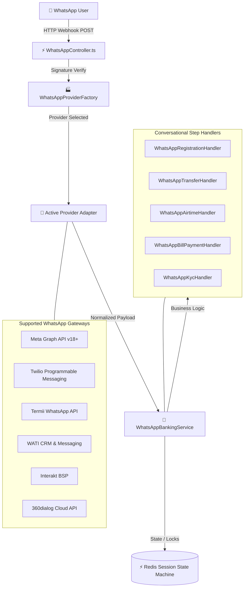
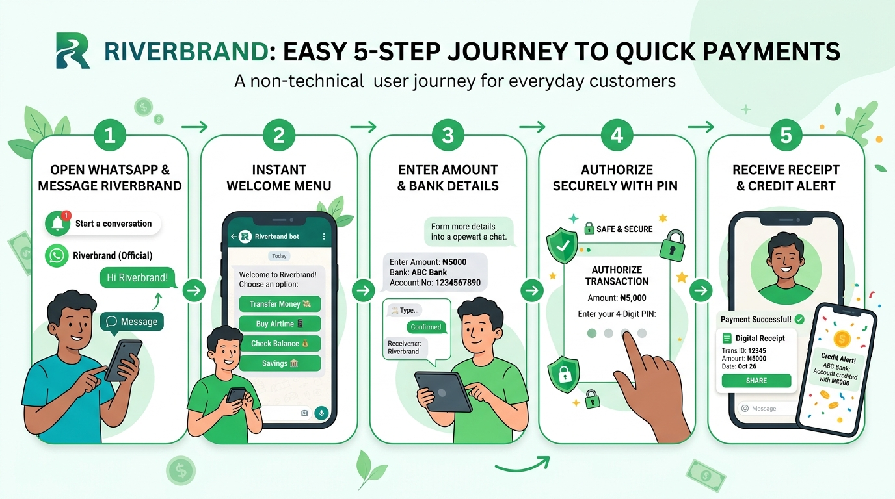
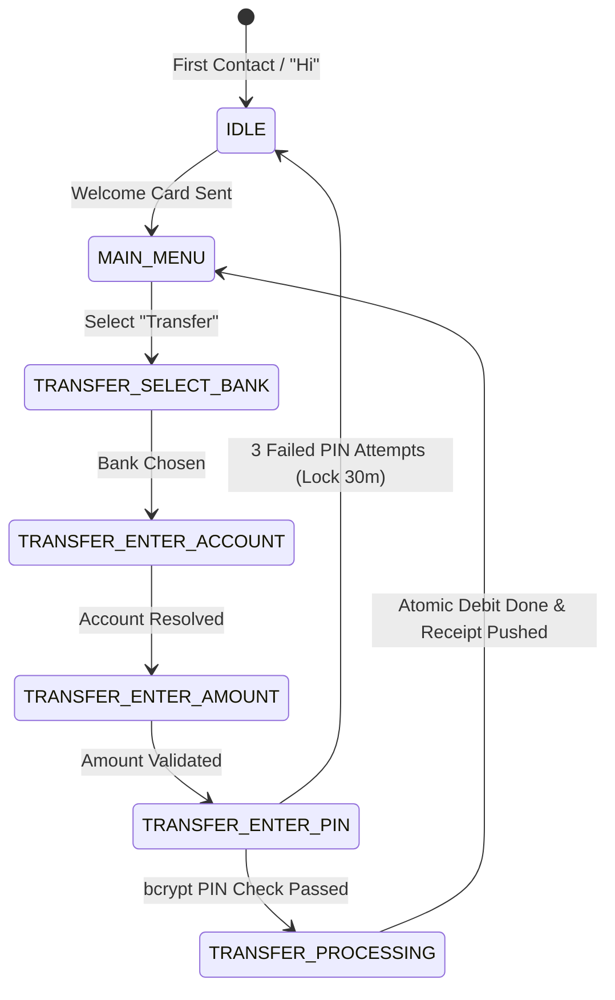

# ⚙️ Chapter 4: Technical Savings & Multi-Provider WhatsApp Channels

> **"Wealth Engine, Multi-Provider Conversational Banking & Push Notifications"**  
> *A comprehensive technical specification on Safelock yield calculations, multi-provider WhatsApp engine (Meta, Twilio, Termii, Wati, Interakt, 360dialog), Redis conversational state machines, and FCM push dispatch.*

---

## 🧭 4.1 The "Learn, Unlearn, Relearn" Guide to Conversational Channels

```
┌─────────────────────────────────────────────────────────────────────────────┐
│ 🚫 UNLEARN: "Building a WhatsApp bot is just a 2,000-line switch statement."│
│ Storing conversational state in database rows or memory variables leads to  │
│ slow response times, race conditions, dropped chats, and bot amnesia.       │
├─────────────────────────────────────────────────────────────────────────────┤
│ 💡 LEARN: "Conversational banking is a distributed finite-state machine."   │
│ Every user phone has an active state in Redis (`wa:session:{phone}`) with a │
│ 30-minute rolling TTL, strict step transition enums, and message dedupe.    │
├─────────────────────────────────────────────────────────────────────────────┤
│ 🚀 RELEARN & MASTER: "Riverbrand's Multi-Provider Conversational Core"      │
│ We abstract Meta, Twilio, Termii, and WATI behind `IWhatsAppProvider`.      │
│ Inbound webhooks verify HMAC signatures, fetch session state, execute the   │
│ domain handler, validate PIN via bcrypt, and reply with interactive buttons.│
└─────────────────────────────────────────────────────────────────────────────┘
```

---

## 📈 4.2 Wealth Management Engine: Safelock, Target Savings & AutoSave

The wealth engine (`src/services/monetary/savings/savings.ts`) enables retail customers to save disciplined funds and earn competitive compounding interest yields while providing the platform with predictable liquidity reserves.

```
┌────────────────────────────────────────────────────────────────────────┐
│                        RIVERBRAND WEALTH ENGINE                        │
│               Compounding Interest Engine & Scheduled Sweeps           │
└────────────────────────────────────────────────────────────────────────┘
                                     │
           ┌─────────────────────────┼─────────────────────────┐
           ▼                         ▼                         ▼
┌─────────────────────┐   ┌─────────────────────┐   ┌────────────────────┐
│  SAFELOCK DEPOSITS  │   │   TARGET SAVINGS    │   │  AUTOSAVE SWEEPS   │
│ • Locked Tenures    │   │ • Goal-Based        │   │ • Daily/Weekly     │
│ • Guaranteed Yield  │   │ • Scheduled Debits  │   │ • Wallet Sweeps    │
└─────────────────────┘   └─────────────────────┘   └────────────────────┘
```

### 1. Safelock Fixed Deposit Engine
- **Upfront Capital Locking**: Customer funds are debited from the main wallet (`Wallet`) and locked inside a `Target` record where `savingsType = SAFELOCK`.
- **Compound Interest Calculation Formula**:
  $$\text{Daily Yield} = \frac{\text{Principal Amount} \times \text{Annual Interest Rate (\%)}}{365 \times 100}$$
- **Daily Interest Accrual Job (`src/job/savings.ts`)**: Runs every night at 00:00 UTC via `SavingsJob`. Iterates through active locked deposits, calculates the daily yield, updates `currentAmount`, and records an entry in `savings_usersavinginterestlog`.
- **Maturity Auto-Payout (`src/events/handlers/SafelockMaturedHandler.ts`)**: On the maturity date (`endDate`), principal plus net accrued interest is credited back to the customer's primary wallet automatically.
- **Early Breakage Penalty Math**: If a customer requests emergency liquidation prior to maturity, a breakage penalty rate (`breakage_rate`, typically 20-30% of accrued interest) and government tax (`govern_withdrawal_tax_amount`) are deducted, returning only net principal + remaining interest.

### 2. Target Savings & Automated Sweeps
- **Target Savings**: Customers set automated daily, weekly, or monthly debit schedules toward custom goals (`Target`). Debits run via scheduled cron jobs.
- **AutoSave Sweeps**: Periodic rule-based sweeping of idle primary wallet balances into high-yield savings pools, enabling effortless capital accumulation.

---

## 💬 4.3 Multi-Provider WhatsApp Conversational Banking Engine

Riverbrand features an enterprise-grade conversational banking engine (`src/whatsapp-banking/`) designed with a **Pluggable Multi-Provider Architecture**. Rather than hardcoding the banking logic to a single WhatsApp BSP (Business Solution Provider), Riverbrand exposes a unified contract (`IWhatsAppProvider`) allowing dynamic runtime switching across providers.




### The `IWhatsAppProvider` Interface Contract

```typescript
export interface IWhatsAppProvider {
  parseIncomingWebhook(body: any, headers: Record<string, string>): Promise<IIncomingMessage>;
  sendTextMessage(to: string, text: string): Promise<boolean>;
  sendInteractiveButtons(to: string, header: string, body: string, buttons: IButtonOption[]): Promise<boolean>;
  sendInteractiveList(to: string, title: string, sections: IListSection[]): Promise<boolean>;
  verifyWebhookSignature(rawBody: string, headers: Record<string, string>): boolean;
}
```

### Supported Provider Implementations:
1. **`MetaWhatsAppProvider`**: Direct Meta Graph API v18+ integration with SHA-256 HMAC signature validation (`x-hub-signature-256`).
2. **`TwilioWhatsAppProvider`**: Twilio Programmable Messaging API with `X-Twilio-Signature` authentication.
3. **`TermiiWhatsAppProvider`**: African telecommunications gateway optimized for direct Nigerian telco routing.
4. **`WatiWhatsAppProvider`**, **`InteraktWhatsAppProvider`**, **`ThreeSixtyDialogProvider`**: Enterprise BSP connectors.
5. **`WhatsAppProviderFactory`**: Factory resolver that dynamically instantiates the active provider based on environment configuration (`WHATSAPP_ACTIVE_PROVIDER`).

---

## 🔄 4.4 WhatsApp Session State Machine & Domain Handlers

User interaction state is stored in Redis under key `wa:session:${phoneNumber}` with a rolling TTL of 15 minutes.





### Conversational Domain Handlers:
1. **`WhatsAppRegistrationHandler`**: Captures user name, sends and verifies email OTP, verifies BVN with Dojah, captures photo selfie, sets 4-digit bcrypt transaction PIN, and triggers virtual account generation.
2. **`WhatsAppTransferHandler`**: Interbank transfers, commercial bank code lookup, live recipient name resolution, wallet balance validation, PIN authorization, and receipt push.
3. **`WhatsAppAirtimeHandler`**: Direct mobile top-up and data bundles across MTN, Airtel, Glo, and 9mobile.
4. **`WhatsAppBillPaymentHandler`**: Prepaid electricity token vending, postpaid power clearance, and DSTV/GOTV smartcard renewals.
5. **`WhatsAppKycHandler`**: NIN verification, residential document upload, and real-time balance queries across NGN, USD, EUR, and GBP.

---

## 📱 4.5 Real-Time Push Notification Engine (Firebase Cloud Messaging)

Multi-device real-time push notification delivery is managed by `DeviceTokenService` and `PushNotificationService`:

```
[Mobile / Web Client] ──► POST /user/device-token ──► [Save in `DeviceToken`]
                                                               │
                                                               ▼
[Transaction Event Occurs] ──► [PushNotificationService.sendToUser(userId, title, body)]
                                                               │
                                                               ▼
                                             [Firebase Admin SDK Dispatch]
                                                               │
                                         ┌─────────────────────┴─────────────────────┐
                                         ▼                                           ▼
                                 [Device Online]                             [Device Uninstalled]
                                         │                                           │
                                         ▼                                           ▼
                             [Deliver Push Alert]                    [FCM Error: `registration-token-not-registered`]
                                                                                     │
                                                                                     ▼
                                                                     [Auto-deactivate token (`is_active = false`)]
```

### Multi-Channel Notification Matrix

| Notification Channel | Delivery Mechanism | Fallback Handling |
| :--- | :--- | :--- |
| **WhatsApp Chat Alerts** | Active WhatsApp Provider (`IWhatsAppProvider`) | Retried via Transactional Outbox. |
| **FCM Push Notification** | Firebase Admin SDK (`DeviceToken`) | Self-healing invalidation on uninstall. |
| **Email SMTP Alert** | Mailpit (Dev) / SendGrid / Brevo (Prod) | Retried automatically via Outbox Queue. |
| **In-App Notification Center** | `Notification` Table in Database | Persisted for in-app inbox display (`isRead = false`). |

---

*Continue to: [Chapter 05: Technical Security, Sidecar & Auditing](./05-security-compliance-and-auditing.md)*
