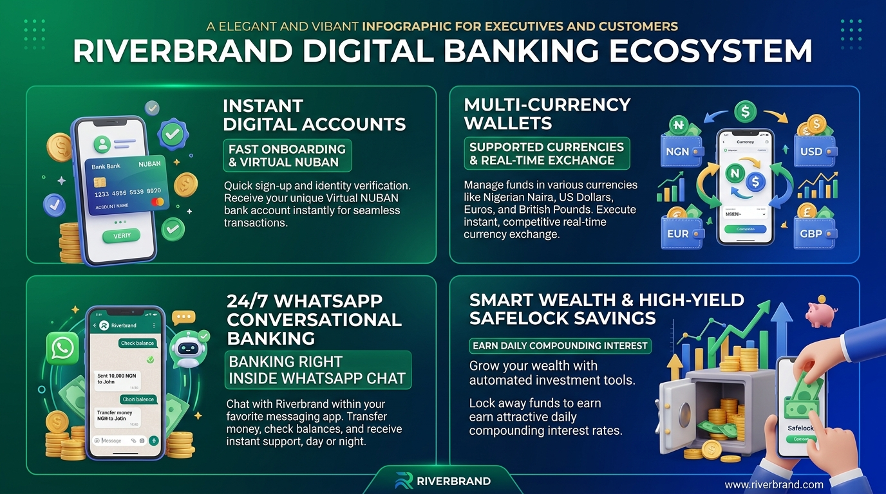
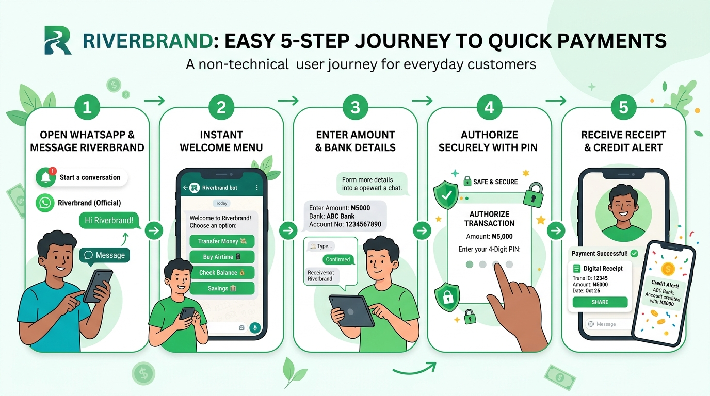
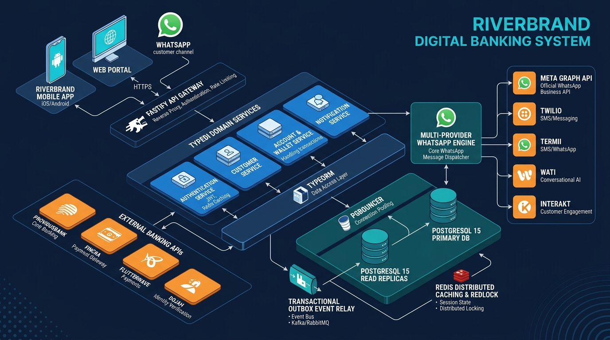
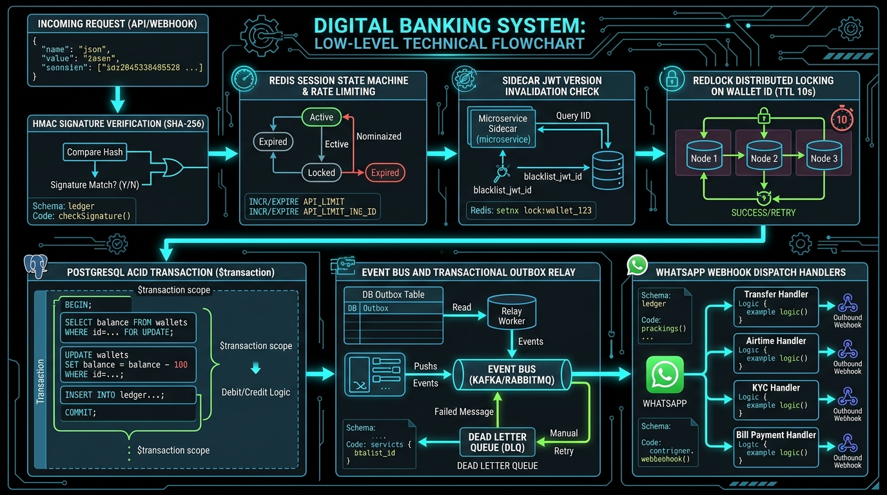

# 🏦 Riverbrand Banking System: The Authoritative Knowledge Book

> **"A Living Blueprint for Modern, Autonomous Financial Technology"**  
> *Platform Version: 1.0.0 Enterprise Release | Node.js v20 / Fastify / TypeScript / PostgreSQL 15 / Redis 7 / Docker*

---

## 🌟 Welcome to the Book

Welcome to the official, end-to-end knowledge base for the **Riverbrand Banking Engine** (`RiverbrandBE`).

Whether you are an executive evaluating commercial viability, an investor assessing product differentiation, a risk officer auditing regulatory compliance, an architect examining concurrency models, or a core software engineer building financial features—**this book is organized specifically for your perspective**.

Digital banking is often misunderstood as merely *"a database table holding balance numbers with an app on top."* In reality, resilient financial software is an **orchestration of distributed consensus, cryptographic trust, non-blocking asynchronous event relays, and zero-loss financial ledgers**.

---

## 🧭 The Core Pedagogical Framework: Learn, Unlearn & Relearn

Throughout every chapter of this documentation—across both technical and non-technical domains—we apply the **Learn, Unlearn, Relearn** framework:

```
┌─────────────────────────────────┐     ┌─────────────────────────────────┐     ┌─────────────────────────────────┐
│         1. UNLEARN 🚫           │ ──► │          2. LEARN 💡            │ ──► │         3. RELEARN 🚀           │
│  Discard naive assumptions,     │     │  Understand real-world failure  │     │  Master Riverbrand's resilient, │
│  myths & traditional shortcuts  │     │  modes, race conditions & traps │     │  enterprise-grade architecture  │
└─────────────────────────────────┘     └─────────────────────────────────┘     └─────────────────────────────────┘
```

| Domain | 🚫 Unlearn (The Naive Way) | 💡 The Real Risk (Why it Fails) | 🚀 Relearn (Riverbrand's Solution) |
| :--- | :--- | :--- | :--- |
| **Money Movements** | `UPDATE wallet SET balance = balance - 100` | Rapid double-taps cause race conditions, double-spending, and negative balances. | **Tier 1 Distributed Redlock** + **Tier 2 Atomic SQL Transactions** + **Immutable General Ledger**. |
| **Session Security** | Storing JWTs and waiting for them to expire in 24 hours. | Stolen or lost devices stay logged in for hours, giving attackers free reign. | **Sidecar Session Control** with atomic `jwt_version` bumps that kill all sessions globally in <1ms. |
| **Conversational Chat** | A giant 2,000-line `if/else` or `switch` statement for WhatsApp bots. | Unmaintainable, state drops on restart, duplicate webhook deliveries cause double charges. | **Hierarchical Redis State Machine** with strict step transition contracts and idempotent webhook processing. |
| **Background Work** | Calling slow third-party SMS/Email/Push APIs directly inside HTTP handlers. | Third-party lag blocks customer HTTP requests, causing timeouts and app crashes. | **Transactional Outbox Pattern** with non-blocking event relay and exponential backoff retry workers. |
| **Database Connections**| Spawning direct connections to PostgreSQL from worker threads. | PostgreSQL spawns OS processes for every connection, consuming 50+ GB RAM and crashing. | **PgBouncer Multiplexing** (5,000 clients -> 50 pooled connections) + **Prisma Read-Replicas**. |
| **Regulatory Limits** | Hard-freezing user accounts when an inbound transfer exceeds KYC limits. | Customers panic, money is trapped in support backlogs, and user retention plummets. | **Quarantined Pending Balance Tank**: Auto-holds excess funds and auto-releases upon KYC upgrade. |

---

## 🔀 Choose Your Reading Track

To give every reader the most relevant experience, this book is bifurcated into two dedicated master tracks:

```
                                  ┌───────────────────────────────┐
                                  │   🏦 RIVERBRAND KNOWLEDGE HUB │
                                  └───────────────┬───────────────┘
                                                  │
                 ┌────────────────────────────────┴────────────────────────────────┐
                 ▼                                                                 ▼
 ┌───────────────────────────────────────────────┐   ┌───────────────────────────────────────────────┐
 │       📘 PART I: THE NON-TECHNICAL TRACK      │   │        ⚙️ PART II: THE TECHNICAL TRACK        │
 │                                               │   │                                               │
 │  Target: Executives, Investors, Product Leads,│   │  Target: Solutions Architects, Lead Engineers,│
 │  Operations, Regulators & Everyday Users      │   │  Security Auditors, DevOps & Backend Devs     │
 ├───────────────────────────────────────────────┤   ├───────────────────────────────────────────────┤
 │ • Executive Vision & Product Mission          │   │ • Modular Architecture & System Topology      │
 │ • High-Security Airport & Hotel Analogies     │   │ • Concurrency, Redlock & Atomic Transactions  │
 │ • Omni-Channel Accessibility (Mobile/Web/Chat)│   │ • Sidecar Session Invalidation & RBAC Matrix  │
 │ • Multi-Currency 5-Lifecycle Scenarios        │   │ • Multi-Provider WhatsApp Engine & State Mach.│
 │ • Wealth Products (Safelock, Target Savings)  │   │ • Transactional Outbox Pattern & DLQ Workers  │
 │ • Comprehensive Competitive Landscape         │   │ • PgBouncer Pooling & Prisma Read Replicas    │
 │   (Kuda, OPay, PiggyVest, Revolut, Banks)     │   │ • Complete Service Catalog & System Deep-Dive │
 │ • Business Risk Mitigations & Governance      │   │ • Future Scalability & Architecture Roadmap   │
 └───────────────────────┬───────────────────────┘   └───────────────────────┬───────────────────────┘
                         │                                                   │
                         ▼                                                   ▼
            [Enter Non-Technical Guide](01-executive-overview.md)           [Enter Technical Deep-Dive](02-architecture-and-design.md)
```

---

## ⚡ The 5 Master Lifecycles of Riverbrand

Everything in Riverbrand flows through five core lifecycles:

```mermaid
graph TD
    subgraph L1["1. Genesis Lifecycle"]
        UserReg[User Registration] --> KycVal[BVN / NIN Identity Verification]
        KycVal --> NubanGen[Virtual NUBAN Auto-Provisioning]
    end

    subgraph L2["2. Quantum Money Lifecycle"]
        TxInit[Transfer Initiated] --> Redlock[Acquire Redis Redlock]
        Redlock --> AtomicTx[Atomic DB Debit + Credit]
        AtomicTx --> LedgerPost[Immutable Ledger Posting]
        LedgerPost --> OutboxEvent[Enqueue Outbox Event]
    end

    subgraph L3["3. WhatsApp Brain Lifecycle"]
        HookIn[Incoming WhatsApp Webhook] --> HmacCheck[HMAC Signature Verification]
        HmacCheck --> StateLookup[Redis Session State Lookup]
        StateLookup --> HandlerExec[Conversational Handler Execution]
        HandlerExec --> ChatReply[Rich Interactive Chat Response]
    end

    subgraph L4["4. Zero-Trust Security Lifecycle"]
        ClientReq[API Request] --> TokenIso[Client Type Isolation: Mobile vs Web]
        TokenIso --> JvCheck[Sidecar jwt_version Invalidation Check]
        JvCheck --> RateLimit[Token Bucket Rate Limiter]
        RateLimit --> AuditLog[Non-Blocking Audit Trail]
    end

    subgraph L5["5. Outbox Relay Lifecycle"]
        OutboxPoll[Outbox Background Worker] --> EventDispatch[Dispatch Notifications / Webhooks]
        EventDispatch --> AutoRetry[Dead-Letter Queue & Exponential Retry]
    end

    L1 --> L2
    L3 --> L2
    L2 --> L5
    L4 --> L2
```



---

## 🖼️ Master Visual Architecture & Gallery

The platform's dynamics are visualized across four perspectives:

| Perspective | Diagram & Visual Reference | Target Audience |
| :--- | :--- | :--- |
| **Non-Technical High-Level** |  | C-Level Executives, Investors, Product Leads |
| **Non-Technical Low-Level** |  | Product Managers, Operations, Customer Support |
| **Technical High-Level** |  | CTOs, Solutions Architects, Lead Engineers |
| **Technical Low-Level** |  | Core Backend Engineers, Security Auditors, DevOps |

---

## 📚 Complete Book Index

### 📘 Part I: The Non-Technical Journey (Executive, Product & Market)
1. 📄 [**01. Executive & Product Blueprint**](./01-executive-overview.md)
   - *1.1 The Master Mental Model: Learn, Unlearn, Relearn*
   - *1.2 Executive Vision & Product Mission: What We Built & What We Aim to Achieve*
   - *1.3 How the Bank Moves: The Airport Air-Lock Analogy & System Movement Flow*
   - *1.4 Omni-Channel Accessibility: Mobile, Web, and WhatsApp Banking*
   - *1.5 Five-Currency User Journeys (NGN, USD, EUR, GBP, CAD)*
   - *1.6 Wealth Accumulation: Safelock, Target Goals & AutoSave*
   - *1.7 Regulatory Balance Tank: Zero-Disruption KYC Compliance*
   - *1.8 Competitive Landscape & Strategic Market Moat (Riverbrand vs. Kuda, OPay, PiggyVest, Chipper, Revolut, Banks)*
   - *1.9 Relatable Real-World Analogies Reference (Hotel Keycard, Vault Airlock, Postal Courier, Escrow Envelope)*
   - *1.10 Business Value & Risk Governance Matrix*

---

### ⚙️ Part II: The Technical Deep-Dive (Engineering, Systems & Architecture)
2. 📄 [**02. Architecture & System Topology**](./02-architecture-and-design.md)
   - *Engineering Considerations, Fastify vs. Express, PgBouncer Connection Multiplexing, Prisma Read Replicas, Pluggable Providers, and Execution Flows.*
3. 📄 [**03. Core Banking & Financial Engine**](./03-core-banking-and-financial-engine.md)
   - *Distributed Redis Locks (`Redlock`), Atomic SQL Transactions, Immutable Double-Entry Ledger (`GLAccount`), Interbank & P2P rails, and KYC daily limit tracking.*
4. 📄 [**04. Savings Engine & Multi-Provider Channels**](./04-savings-investments-and-channels.md)
   - *Safelock fixed deposits, daily compound interest jobs, multi-provider WhatsApp factory (Meta, Twilio, Termii, Wati, Interakt, 360dialog), and Redis state machines.*
5. 📄 [**05. Security, Revocation & Auditing**](./05-security-compliance-and-auditing.md)
   - *Dual-token isolation (`x-local-access-token` vs. `x-web-access-token`), sidecar `jwt_version` instant revocation, Argon2/bcrypt PINs, and non-blocking audit logging.*
6. 📄 [**06. Future Strategic Upgrade Roadmap**](./06-future-upgrade-roadmap.md)
   - *Next-generation enhancements: Kafka event streaming, multi-region distributed SQL, Autonomous AI Banking agents, GNN fraud detection, PAPSS/SEPA rails, and BaaS.*
7. 📄 [**07. Developer & Operations Manual**](./07-developer-and-operations-manual.md)
   - *Local Docker setup, environment variables dictionary, database migration playbooks, WhatsApp webhook debugging, and troubleshooting runbooks.*
8. 📄 [**08. Complete Backend Service Catalog**](./08-service-catalog-and-deep-dive.md)
   - *Line-by-line service specifications for all 36+ core backend services, WhatsApp handlers, DTOs, entities, error codes, and configuration switches.*

---

## 🎯 Quick Navigation by Role

- **C-Suite, Founders & Investors**: Start with [Chapter 01: Executive & Product Blueprint](./01-executive-overview.md) and review Section 1.8 for the Competitive Moat.
- **Product Managers & Channel Leads**: Read Chapter 01 (Omni-Channel and 5-Currency Journeys) and [Chapter 04: Savings & Channels](./04-savings-investments-and-channels.md).
- **Security & Compliance Officers**: Study [Chapter 05: Security, Revocation & Auditing](./05-security-compliance-and-auditing.md) and [Chapter 03: Core Banking Engine](./03-core-banking-and-financial-engine.md).
- **Backend Engineers & Architects**: Deep-dive into [Chapter 02: Architecture & Topology](./02-architecture-and-design.md), [Chapter 03: Core Banking](./03-core-banking-and-financial-engine.md), and [Chapter 08: Service Catalog](./08-service-catalog-and-deep-dive.md).
- **DevOps & Infrastructure Engineers**: Follow [Chapter 07: Developer & Operations Manual](./07-developer-and-operations-manual.md) and [Chapter 06: Future Upgrade Roadmap](./06-future-upgrade-roadmap.md).

---

## ⚖️ Intellectual Property & Governance

Copyright © 2026 **Riverbrand Partners**. All Rights Reserved.  
Confidential and proprietary documentation for internal systems engineering, executive governance, and authorized technical partner integration.
