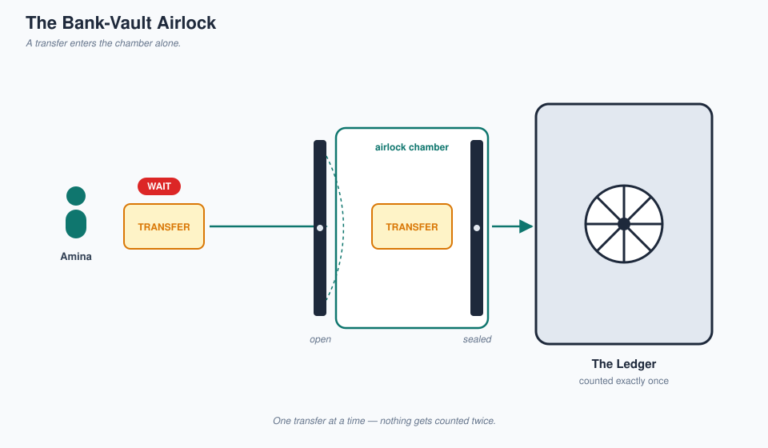
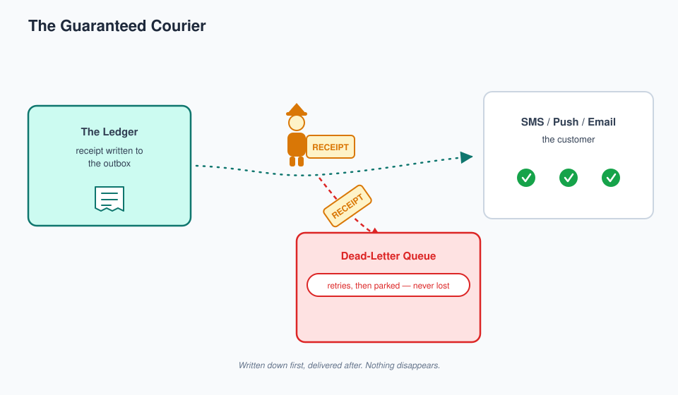
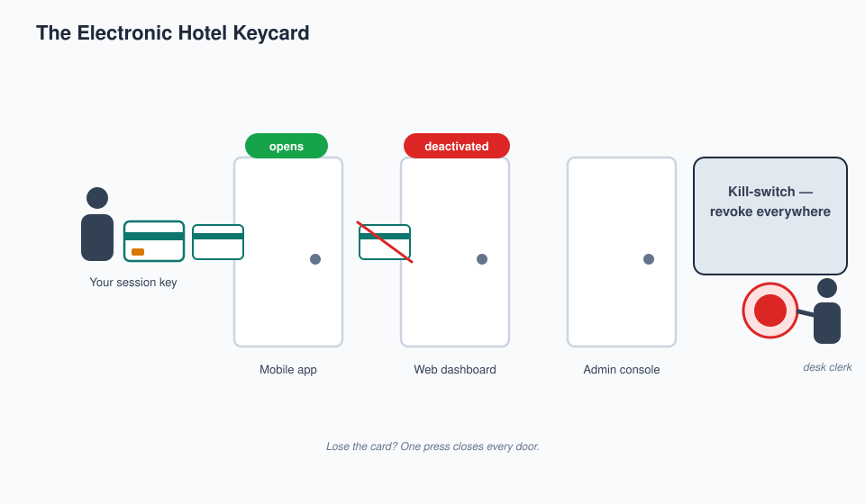
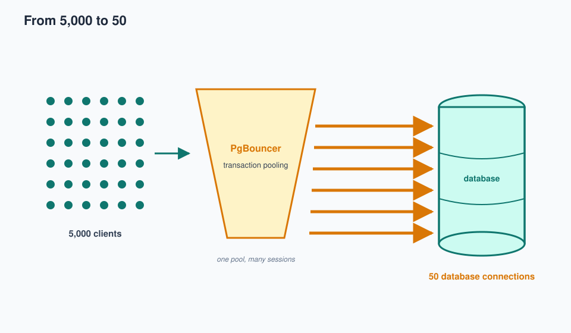

# Appendix F: Analogy Atlas

This appendix is the **only home** of Riverbrand's core explanatory analogies. Elsewhere in this book, a chapter may name an analogy in a single line and link here — "the bank-vault airlock (see [Appendix F](app-f-analogy-atlas.md))" — but the story itself is told once, in full, on this page. The old documentation told each of these stories in three or four places with slightly different details; consolidation here is deliberate. If you are a non-engineer, this atlas is your mechanism map: each story below is paired with an honest table showing exactly which real system part each story element stands for, and with a short list of places where the story is *wrong on purpose*.

The five stories here are: the Bank-Vault Airlock (concurrency), the Guaranteed Postal Courier (reliable messaging), the Electronic Hotel Master Keycard (session revocation), the Airport Control Tower (database connection pooling), and — as a supporting fifth — the Multi-Engine Jetliner (provider redundancy). Each section ends with a link to the engineering chapter where the mechanism is specified. Figures referenced below are supplied as illustrations in the web book.

## F.1 The Bank-Vault Airlock: The Two-Tier Concurrency Guard

**The story.** Amina has ₦10,000 in her wallet. She taps "Transfer ₦10,000" on her phone — and her finger bounces, or she opens a second tab on her laptop and taps again at the same instant. In a naive system, both requests read "Balance: ₦10,000" before either has finished, both approve the transfer, and the bank has just paid out ₦20,000 it never had. This is the double-spend problem, and it is the oldest way to lose money in digital banking.

Now picture a high-security bullion vault with an airlock: two doors with a sealed chamber between them, and a rule painted over the entrance — *never both doors open at once*. Amina steps into the airlock. The moment she does, Door 1 slams shut and locks behind her. Her second tap arrives a heartbeat later and bounces off the locked steel with a calm notice: "Transaction in progress." Inside the vault, a teller walks to Amina's box, moves ₦10,000 into the recipient's box, and writes both movements in the master ledger book in one continuous, indivisible stroke of the pen. Only then does Door 2 open. Amina steps out with a receipt; the airlock resets; the next customer may enter.

**The mechanism this maps to.** The airlock is Riverbrand's two-tier concurrency guard. Tier one is a distributed mutex lock — engineers call it the Redlock pattern — that serializes access to a wallet so only one money movement per wallet is in flight at a time. A second request for the same wallet is refused immediately with a "conflict" response (HTTP 409) rather than being let in to double-spend. Tier two is the atomic ledger transaction inside the vault: balance checks, the debit, the credit, and the immutable ledger entries all commit as one single-commit database transaction, or none of them commit. The lock is per-wallet, held briefly (a ten-second safety timeout), and always released after the transaction seals.

**Figure F.1 — The Bank-Vault Airlock.** Door 1 is the distributed lock; the sealed vault is the single-commit ledger transaction; Door 2 is the receipt and the lock release.

| Story element | System component |
|---|---|
| The airlock chamber | The per-wallet distributed lock (Redlock) that admits one request at a time |
| Door 1 slamming shut | Lock acquisition when a transfer begins; a duplicate tap receives HTTP 409 Conflict |
| The second tap bouncing off | Concurrent requests rejected with "Transaction in progress" |
| The teller moving coins box to box | The atomic debit and credit on wallet balances |
| The master ledger book, one stroke | The immutable double-entry ledger entries written in the same single-commit transaction |
| Door 2 opening | Lock release after commit, and the customer's confirmation receipt |
| "Never both doors open" | The two-tier invariant: the lock serializes, and the single transaction guarantees consistency |

**Where the analogy bends.** A real vault airlock stops armed robbers; this one only serializes money movement. It does not prove that Amina is Amina — that is the job of her PIN and her session (the hotel keycard of [§F.3](#f3-the-electronic-hotel-master-keycard-sidecar-session-revocation)). The "door" is also not physical: it is a software lock with a timeout, so if a server dies mid-transfer the lock expires on its own and safety then rests entirely on tier two — the database transaction being truly atomic. And there is not one vault for the whole bank: every wallet has its own airlock, so millions of transactions proceed in parallel; the analogy suggests a single room, which understates the throughput. The picture is right about the *rule* and wrong about the *scale*.

**The technical home.** [Chapter 5, §5.1 The Two-Tier Concurrency Guard](../chapters/ch05-engineering-transaction-engine.md#51-the-two-tier-concurrency-guard). Ledger entries are specified in [§5.2](../chapters/ch05-engineering-transaction-engine.md#52-the-immutable-double-entry-ledger).

## F.2 The Guaranteed Postal Courier: The Transactional Outbox and Dead-Letter Queue

**The story.** Tunde transfers rent money on a Friday night. The money moves — and then the naive server tries to email a receipt and push a notification at the same time. The email vendor's connection lags. Fifteen seconds pass with the spinner turning. The app crashes. Tunde is left staring at a frozen screen, terrified that his rent money vanished into the void. Nothing was wrong with the transfer; the *side effect* of the transfer dragged the whole experience down.

Riverbrand refuses to let the post office sit inside the bank counter. When the money moves, the server writes two things into the same atomic lockbox in one stroke: the transfer record, and the outgoing message — receipt, alert, WhatsApp confirmation. The customer gets a success response immediately, in tens of milliseconds. Then the guaranteed postal courier arrives. It sweeps the lockbox, collects every sealed envelope, and delivers each one to its vendor: the email gateway, the push service, the WhatsApp channel. If a vendor is down, the courier does not shrug and walk away. It keeps the envelope, retries on a regular round, and only after repeated failures — more than five attempts — files the envelope into the dead-letter holding office, where a dispatcher can inspect it and replay it later. Every message is eventually delivered, or visibly stranded where operators can see it. Nothing silently disappears.

**The mechanism this maps to.** The lockbox is the transactional outbox: financial operations insert a message record in the same database transaction as the money movement itself, so the message cannot exist without the transfer, and the transfer cannot commit without its message. The courier is the background outbox processor — a worker that polls for pending envelopes in batches every few seconds and dispatches them to providers. The dead-letter holding office is the dead-letter queue (engineers call this the DLQ), a table of messages that exhausted their retries, together with a replay job that lets operations re-send them once the vendor recovers. Fast API responses are possible precisely because delivery is decoupled: the customer's request never waits on a third party.

**Figure F.2 — The Guaranteed Postal Courier.** Envelopes are written in the same lockbox as the transfer; the courier sweeps, retries, and files failures in the dead-letter office.

| Story element | System component |
|---|---|
| The atomic lockbox | The transactional outbox record written in the same database transaction as the debit/credit |
| The sealed envelope | A pending outbox event (transfer receipt, push alert, WhatsApp confirmation) |
| The courier's regular sweep | The background outbox worker polling pending rows in batches |
| The postal round every few minutes | The relay cadence — pending events are polled every 5 seconds |
| A vendor outage | Third-party provider downtime (email, push, WhatsApp gateway) |
| Automatic redelivery attempts | Retry dispatch while attempts remain (the threshold is 5) |
| The dead-letter holding office | The dead-letter queue table of messages that exhausted their retries |
| The dispatcher who replays stranded mail | The dead-letter replay job that re-sends recovered messages |
| Tunde's instant success response | Fast API responses because notification delivery is decoupled from the transfer |

**Where the analogy bends.** A real postal service promises exactly one delivery per letter; the outbox pattern is *at-least-once*, so a vendor hiccup plus a retry can produce a duplicate receipt — harmless for a notification, and exactly why the courier never carries money. That is the second bend: the courier's "guaranteed delivery" covers messages only. Tunde's rent money moved inside the vault of [§F.1](#f1-the-bank-vault-airlock-the-two-tier-concurrency-guard) at commit time; the courier cannot lose it, late-deliver it, or refund it. Finally, "guaranteed" here means *eventual and observable*, not instant: a message can sit minutes in a vendor backlog or wait for an operator in the dead-letter office. The analogy flatters the latency; it tells the truth about the durability.

**The technical home.** [Chapter 5, §5.4 The Outbox and Dead-Letter Queue](../chapters/ch05-engineering-transaction-engine.md#54-the-outbox-and-dead-letter-queue). The worker fleet that runs the courier is inventoried in [Chapter 11, §11.3 The Background Jobs Fleet](../chapters/ch11-engineering-operations-manual.md#113-the-background-jobs-fleet).

## F.3 The Electronic Hotel Master Keycard: Sidecar Session Revocation

**The story.** Chidi's phone is stolen at 10:00 in the morning. In the naive banking app he used before, his login was a digital key valid for 24 hours — and the thief holding the phone now holds a valid key. Changing the password would not help much: the old key is a self-contained pass, valid until midnight no matter what Chidi does. The thief has all day.

Now recall how a modern hotel handles a lost keycard. The brass-lock era meant a locksmith, a new cylinder, an hour of work. The electronic era replaced the cylinder with a frequency. When Chidi reports the card missing, the front desk does not touch his door. The clerk punches one button: the master digital frequency for that room bumps from 1 to 2. The plastic card in the thief's hand still *looks* valid — but the lock on the door now checks every card against the new frequency, and the old card flashes red. Useless instantly. No locksmith. No waiting.

**The mechanism this maps to.** Riverbrand runs the same trick in software. Every login session carries a token — the plastic card — but the door (the banking backend) never trusts the card alone. A small sidecar record beside each account holds a version number: the master frequency. When Chidi resets his password, resets his PIN, or logs out everywhere, the system bumps that version number. From that instant, every request presenting the old card is checked against the new frequency and refused — sessions die in under a millisecond by design, worldwide, at once. There is a second layer in the lobby: dual-token isolation means a mobile-app card cannot open the web-console door and vice versa, so a stolen browser session is not a stolen phone.

**Figure F.3 — The Electronic Hotel Master Keycard.** The front desk bumps the master frequency; every door re-checks the card on the spot.

| Story element | System component |
|---|---|
| The plastic room keycard | The login session token issued at sign-in |
| The door lock | The backend session check that guards every request |
| The master digital frequency | The per-account session version number (the revocation counter) |
| The front desk "bump" button | Password reset, PIN reset, or global logout |
| The old card flashing red | The stale token failing its version check and being rejected with 401 Session Revoked |
| The whole hotel re-keyed at once | Instant worldwide revocation of every active session for the account |
| The brass-lock locksmith era | Naive long-lived tokens that survive a password change until expiry |
| Different cards for room vs. spa locker | Dual-token isolation between the mobile channel and the web console |

**Where the analogy bends.** Hotel door locks evaluate the card offline, inside the door; Riverbrand re-checks the version on *every* request against the server sidecar. That is strictly stronger — the thief's card cannot even be *tried* against an offline lock — but it means a session needs connectivity to work at all. A second bend: bumping the frequency does not only kill the thief's card; it kills *all* the guest's cards. After a reset, Chidi must log in again on his laptop and his tablet too. The hotel analogy makes this sound effortless; in practice it is one brief inconvenience the customer feels. And the card never was the safe: the room safe has a separate combination, just as the transaction PIN is verified against its own cryptographic hash storage and is not protected by session revocation at all.

**The technical home.** [Chapter 9, §9.2 Sidecar Session Control and the Kill-Switch](../chapters/ch09-engineering-security-architecture.md#92-sidecar-session-control-and-the-kill-switch). The two card types are specified in [§9.1 Dual-Token Client Isolation](../chapters/ch09-engineering-security-architecture.md#91-dual-token-client-isolation).

## F.4 The Airport Control Tower: PgBouncer Multiplexing

**The story.** Imagine 5,000 airplanes converging on a single runway with no air traffic control. Pilots see the strip, dive for it, and collide. That is a naive web bank at peak hour: every incoming request opens its own private line to the database, the database runs out of room to think, and every customer's transaction crashes together.

The airport solved this with a control tower. Five thousand planes are not denied travel — they are held gracefully in the sky, in orderly stacks, while the tower lands them one at a time across a fixed number of tarmac gates. No plane crashes because another plane landed first. No runway is ever torn up to make room for more gates; the tower simply sequences arrivals over the gates that physically exist.

**The mechanism this maps to.** PgBouncer is the tower. Riverbrand's web servers open thousands of client connections — up to 5,000 — but those connections stop at the tower. PgBouncer multiplexes their queries onto a small pool of physical database connections (our configuration: 50), reusing a gate the instant the previous transaction rolls out. The database sees 50 orderly landings instead of 5,000 simultaneous dives; memory per connection collapses (measured at roughly a 90% reduction in database memory versus un-pooled access), and peak-hour spikes queue at the tower instead of detonating the database process. The tower runs in transaction-pooling mode on its own port (6432), meaning a gate is held only for the duration of one transaction, then immediately handed to the next plane.

**Figure F.4 — The Airport Control Tower.** Client connections hold in the sky; the tower lands them one transaction at a time onto the pooled connections.

| Story element | System component |
|---|---|
| Airplanes arriving in the sky | Up to 5,000 open client connections from the web tier |
| The control tower | PgBouncer, the connection pooler in front of PostgreSQL |
| The holding stack | The queue of client requests waiting for a free pooled connection |
| Tarmac gates | The pool of 50 physical database connections |
| Landing one plane at a time per gate | Transaction-pooling mode: one transaction per pooled connection at a time |
| A plane leaving the gate immediately after touchdown | The connection returning to the pool the moment the transaction ends |
| The runway that never gets torn up | The fixed database process set that no longer needs to grow per client |
| Crashes from uncontrolled approaches | Database process and memory exhaustion under connection storms |

**Where the analogy bends.** The tower does not fly the planes or choose their destinations — application logic does both, and the tower never evaluates a query. Nor is "50 gates" a law of aviation: it is our configuration, tunable with load. The analogy also suggests clean serialization — one landing, then the next — while real pooling interleaves *transactions*: a long-running transaction can hold a gate far longer than a quick one, exactly as a plane with landing-gear trouble can block a runway. Finally, towers are staffed by humans making judgment calls; PgBouncer is mechanical. When the analogy speaks of an "expert" tower, the expertise lives in the configuration and the runbooks around it, not in the software.

**The technical home.** [Chapter 11, §11.2 Ports, Health, and API Documentation](../chapters/ch11-engineering-operations-manual.md#112-ports-health-and-api-documentation). Load behavior under failure is catalogued in [Chapter 5, §5.7 Failure-Mode Matrix](../chapters/ch05-engineering-transaction-engine.md#57-failure-mode-matrix).

## F.5 The Multi-Engine Jetliner: Provider Failover and Redundancy

**The story.** Nobody boards a transatlantic jetliner trusting a single engine. A modern aircraft carries four. When Engine 1 loses oil pressure somewhere over the Atlantic, the flight does not fall out of the sky and the captain does not announce a swim: Engine 2, 3, and 4 hold altitude without a visible glitch, and the flight continues. The passenger may never learn there was a problem. Reliability in that cockpit is not optimism about engines — it is the refusal to depend on one.

Riverbrand flies the same way. If the Providus banking gateway develops a delay, virtual-account generation routes to Fincra instead. If Meta's WhatsApp API suffers regional downtime, customer messages route through Twilio or Termii. If the email provider lags, the courier of [§F.2](#f2-the-guaranteed-postal-courier-the-transactional-outbox-and-dead-letter-queue) tries the backup gateway or simply queues the envelope for the next round. No single provider's bad afternoon becomes the customer's bad afternoon.

**The mechanism this maps to.** Each engine is a pluggable provider behind one interface: settlement rails for bank transfers and account numbers, messaging gateways for WhatsApp and SMS, mail gateways for receipts. The engine-control system is the provider routing layer that detects degradation and redirects to a healthy engine, and the pre-flight checklist is the retry and queue discipline — backed by the outbox — that lets the switch happen without dropping transactions. Altimeters and gauges map to the health probes and metrics the operations team watches before passengers notice anything.

| Story element | System component |
|---|---|
| Four independent engines | Redundant providers per channel (Providus/Fincra for settlement; Meta/Twilio/Termii for WhatsApp; SendGrid/Brevo for email) |
| Engine 1 losing oil pressure | A primary provider gateway degrading or going down |
| The seamless handoff to Engine 2 | Provider routing failover to the backup gateway |
| Passengers noticing nothing | Customer transactions and messages continue without dropped transfers |
| The engine gauges and altimeters | Health probes and metrics (internal monitoring port 9095) |
| The pre-flight checklist | Retry discipline and queued delivery via the outbox and dead-letter queue |
| The maintenance log after landing | Post-failover reconciliation of provider-side records |

**Where the analogy bends.** A jet cannot swap engines in mid-air for free — and neither can a bank switch providers for free: transfers already in flight with a degraded provider must be reconciled after landing, which is why a reconciliation job follows every failover. The analogy also suggests all engines are identical, but providers are not: a fallback messaging gateway may support a different subset of interactive message types than the primary. And a jetliner with all engines out can glide; a platform with every provider down has no designed glide — it falls back on queued, durable messaging (the courier again) and, at worst, a maintenance window. The story is honest about *redundancy of engines* and silent about *reconciliation on landing*.

**The technical home.** Failover cases live in [Chapter 5, §5.7 Failure-Mode Matrix](../chapters/ch05-engineering-transaction-engine.md#57-failure-mode-matrix); the operational response lives in [Chapter 11, §11.6 Runbooks and Troubleshooting Playbook](../chapters/ch11-engineering-operations-manual.md#116-runbooks-and-troubleshooting-playbook).

## How to Use This Atlas

Cite these stories; do not re-tell them. A chapter that needs to explain the concurrency guard should say "the bank-vault airlock (see [Appendix F, §F.1](app-f-analogy-atlas.md#f1-the-bank-vault-airlock-the-two-tier-concurrency-guard))" and move on to its own domain. The mechanism mapping tables above are the bridge for readers crossing from the non-technical track to the engineering one: read the story for intuition, the table for precision, the limits paragraph for honesty, and the chapter link for the specification. For how these mechanisms compare against the market, see [Appendix E: Consolidated Competitive Matrix](app-e-competitive-matrix.md).
