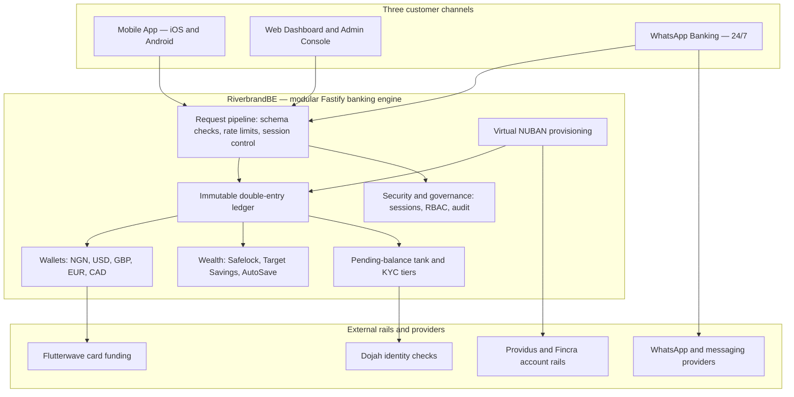
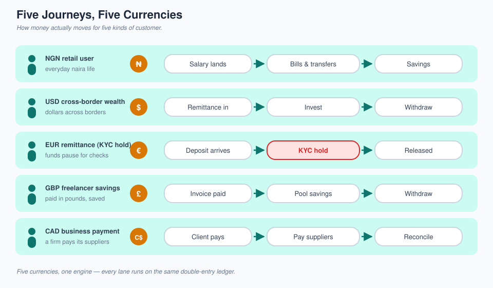

# Chapter 1 — The Riverbrand Story: Vision, Market, and Product Map

> *Unlearn The simple story you were told about banking systems. Learn the real forces: ledgers, limits, and rails. Relearn how Riverbrand answers them.*

## Recap

- **Unlearn:** The comforting story that a bank is a balance number behind a nice screen, and that "going digital" just means putting that screen on a phone.
- **Learn:** The real forces every banking system must serve: a ledger that never lies, money that cannot move twice, regulatory ceilings, and rails and providers that fail.
- **Relearn:** Riverbrand as it actually is — one modular banking engine, three channels, five currencies, wealth and security built in — and how this book will teach it to both tracks.

## 1.1 Why This Book

Every system worth understanding was built by people who were solving a real problem under real constraints. The Riverbrand Banking System is no exception. It was engineered to answer a set of failures that customers hit every week: transfers that hang when a payment provider stutters, accounts frozen without explanation when a deposit crosses a regulatory line, banking apps too heavy to download on a full phone, and USSD sessions that drop halfway through a transaction. Those failures shaped the architecture. But until now, the reasoning behind the architecture lived only in dense engineering notes, written quickly, by engineers, for engineers — dense where they should have been clear, thin where they should have been rich, and occasionally sweeping in claims where they should have shown evidence.

This book is the record that the system deserves. It is written as a textbook, not a wiki dump: one idea per chapter, a repeatable method for understanding banking systems, and an honest distinction between what we have designed for, what we have verified, and what we have not yet proven.

Three chapters of foundation come first — this one, the method in [Chapter 2](ch02-learn-unlearn-relearn.md), and the domain language in [Chapter 3](ch03-domain-primer.md). They are shared by every reader: the executive sizing the business, the product manager planning a roadmap, the compliance officer checking controls, and the engineer about to open the codebase. After that, the book splits into two tracks — plain-language chapters and engineering chapters — that cover the same ground back to back. Chapter 1 earns its place at the front for a simple reason: before anyone argues about locks, jobs, or table names, they need to agree on what the product is, who it is for, and which problems it refuses to solve badly.

A word on tone. This chapter is deliberately plain, but it is not thin. Where a technical term is unavoidable, it is defined at first use. Where a claim cannot be backed by the documentation record, it is marked **UNVERIFIED** rather than rounded up. The goal is that both audiences finish this chapter with the same map in their heads — one drawn with different pencils.

## 1.2 The Problem with Core Banking Today

Start with the market as customers experience it, not as architecture diagrams pretend it is. In many institutions and early-stage fintechs, banking is a patchwork: a mobile app here, a disconnected USSD channel there, manual back-office tools in the middle, and third-party payment gateways that drop transactions at the worst possible moment. Each seam is a place where money can stall, where support tickets pile up, and where a customer with a cheap phone and an expensive data plan simply gives up. Fragmentation also raises customer-acquisition cost and widens the attack surface, because every additional channel is another thing to secure, reconcile, and explain.

Beneath the visible fragmentation sits a deeper misunderstanding — the one this book exists to dismantle. The naive mental model says a bank is a balance stored in a database row, and moving money is just arithmetic: read the number, subtract 100, write it back. On a quiet demo, that model works. In production it fails in at least four recurring ways, and those four failure themes follow us through every chapter of this book:

| Failure theme | The naive assumption | What actually happens |
|---|---|---|
| **Race conditions** | "Balance updates are instantaneous and single-file." | Two taps on a weak connection, or two devices at once, both read the same balance and both approve the payment. Money is spent twice. |
| **Provider outages** | "The SMS, email, or payment provider is always up." | A slow third-party call inside the customer's request hangs the page, times out, or crashes the server while the customer watches a spinner. |
| **Duplicate credits** | "A webhook means the money definitely arrived." | Payment notifications are delivered more than once. An unguarded system credits the wallet twice and never notices. |
| **Regulatory ceilings** | "Compliance is a background checkbox." | A legitimate deposit exceeds the customer's verification tier. The naive system hard-freezes the account, traps funds in interbank limbo — sometimes for two weeks — and floods support. |

Notice that none of these failures are exotic. They are ordinary: concurrency under load, dependence on other people's infrastructure, retried messages, and law. A banking system earns trust not by looking modern on a launch screen but by being boring and correct in all four situations at once.

There is a second market problem, less technical but just as costly. Too many products treat the screen as the product. Dashboards are redesigned while the record underneath stays ambiguous; promotional banners accumulate while transfers still settle in overnight batches. The screen is not the product. The product is an honest record of who owns what, and the movement of money according to the rules of the moment — regulatory, operational, and contractual. Everything else is a window onto that record. When the windows are prioritized over the record, customers eventually find the cracks: statements that disagree with receipts, balances that take hours to reflect a deposit, and "pending" states nobody can explain.

Finally, access itself is unequal. In the markets Riverbrand is built for, many people face low device storage, high data costs, and poor connectivity. Requiring a heavyweight app download before someone can receive their own salary is a product decision with real human cost. The problem statement, then, is not "we need a nicer app." It is: **build one honest money system, reachable from the devices people already own, that survives concurrency, provider failure, duplicate messages, and regulatory limits without punishing the customer.**

## 1.3 What Riverbrand Is: The Product Map

Riverbrand is two named things. The **Riverbrand Banking System** is the product this book documents. **RiverbrandBE** is the codebase that implements it: a modular banking engine built on Fastify, a fast web framework for Node.js that validates every request against a schema before any code touches money. Underneath sits a PostgreSQL database holding the system's single source of truth — an **immutable double-entry ledger**, meaning a record in which every movement of value is written once as balanced debits and credits, never edited after the fact, and always reconcilable (see [§3.1](ch03-domain-primer.md#31-double-entry-in-plain-words)). All channels, screens, and bots read from that one ledger. None of them keep a private copy of a customer's money.

**Figure 1.1 — The Riverbrand product map: three channels, one engine, one ledger.**

The map above is the whole product in one picture. Walk it from left to right.

**Three channels, one engine.** The native mobile app (iOS and Android) serves everyday retail customers: biometric login, card top-up through Flutterwave, live identity-document capture, savings trackers, and push alerts. The web portal and admin console serve customers who prefer a browser and, just as importantly, the bank's own staff: executive dashboards, role-based permissions, and staff audit logs. The 24/7 WhatsApp channel is the access story of the platform — a complete, passwordless banking environment inside a chat window that nearly every smartphone in the market already carries. A customer can open an account, verify their identity, receive money, transfer money, pay bills, and get a receipt without installing anything.

**One ledger beneath all three.** A transfer started on WhatsApp and checked on the mobile app is the same transfer, because both channels are views onto the same ledger. The engine is deliberately modular — bounded internal services with strict contracts, rather than a tangle of screens calling each other — so that a channel can be improved or replaced without forking the truth about anyone's money.

**Five currencies.** Riverbrand manages wallets in Nigerian naira (NGN), US dollars (USD), British pounds (GBP), euros (EUR), and Canadian dollars (CAD). Customers can hold, receive, and send in these currencies, and swap between naira and dollars in-app at a recorded administrative exchange rate. Currency support is a product commitment with ledger consequences: every swap is itself a balanced movement of value, not a cosmetic conversion.

**Wealth products on the same rails.** The engine carries institutional-style savings next to everyday spending: Safelock fixed deposits (funds locked for 30, 90, 180, or 365 days so they cannot be spent impulsively), Target Savings goals with scheduled sweeps, AutoSave rules that move idle cash into higher-yield pots, and an interest engine that accrues yield on a nightly schedule and records every accrual in the log rather than overwriting a balance. The point is ordinary people being able to spend and grow money in one place, instead of shuttling between a checking app and a separate savings app.

**Virtual account numbers.** Each customer can be provisioned a dedicated **NUBAN** — a NUBAN (Nigeria Uniform Bank Account Number) is a standard ten-digit bank account number that other banks can pay into as if it were an ordinary account. Riverbrand provisions these virtually through Providus, with Fincra as a fallback rail, so that inbound transfers from any other Nigerian bank land directly in the customer's wallet. When the payment network reports an inbound transfer, the engine credits the wallet atomically, sends a receipt, and confirms in chat.

**Security and governance, not as decoration.** Access is protected by two separate kinds of credentials for two different kinds of client, so that a leaked web token cannot impersonate a mobile session and vice versa. Resetting a password re-keys every active session immediately — the hotel-keycard idea, where a lost card stops working the moment the desk re-keys the lock (the full analogy lives in the [Analogy Atlas](../appendices/app-f-analogy-atlas.md)). Staff actions run through role-based permissions and a written audit trail. Customer identity runs through KYC — "know your customer," the identity verification regulation requires — in tiers: a phone-verified tier with modest daily limits, a verified-identity tier (BVN and NIN checked through Dojah) with higher limits, and a full-KYC tier for large volumes. When a legitimate payment exceeds the current tier, the engine does not freeze the account. The compliant portion lands immediately and the excess is parked in a pending-balance holding tank, then released automatically the moment the customer's identity level rises (see [§3.4](ch03-domain-primer.md#34-kyc-tiers-and-limits) and [§5.6](ch05-engineering-transaction-engine.md#56-the-pending-balance-holding-tank-and-kyc-ceilings)).

**The product in five journeys.** The map becomes concrete in five short customer stories — one per currency. Each is a designed user journey recorded in the original product documentation; the Phase 5 artwork for this overview is reserved here:

| Journey | Who | What happens | What the engine does underneath |
|---|---|---|---|
| **NGN retail** | Tunde, a professional in Lagos | He texts "Hello" on WhatsApp, gets a dedicated account number, receives ₦150,000 from his other bank, then buys electricity and gets the recharge token back in chat. | Provisions a virtual NUBAN; on the inbound notification, credits the wallet once and confirms in chat and by email; bill payment authorizes with his PIN. |
| **USD cross-border** | Sarah, a remote consultant | She activates her USD wallet, swaps ₦1,600,000 for $1,000, and locks it in a 180-day Safelock earning a stated 8% per annum. | Records the swap as ledger movements at a recorded rate; a nightly job accrues interest into an immutable log; at maturity the principal and accrual return to her USD wallet. |
| **EUR remittance with a KYC hold** | Amara, a student in Nigeria | She receives €2,500 from Europe while at the first KYC tier, whose daily ceiling is €500 equivalent. | Credits €500 now and parks €2,000 in the pending-balance tank; when she verifies her identity and the tier rises, the held funds release automatically. |
| **GBP freelancer savings** | David, a freelance engineer | A client pays him £1,200; he sets a "Master's Degree — £5,000" target and sweeps £150 every Friday. | Books the inbound credit to his GBP wallet; the scheduled sweep moves value from wallet to the target pot on schedule; progress is tracked against the goal. |
| **CAD business payment** | Ken, an import-export manager in Toronto | A $10,000 CAD invoice lands; he then loses his tablet and resets his password from his laptop. | Records the inbound corporate credit; the password reset bumps the session control version so the tablet's old token is rejected across every server immediately. |

These five journeys are the rest of this book in miniature: concurrency, ledgers, savings, compliance ceilings, and session security, each already visible from the customer's side. Chapters 4 through 6 tell them slowly.

## 1.4 The Dual-Track Promise

This book makes one promise to two different readers: **you will get the depth you need without wading through the depth you don't.**

The two tracks share one story and two vocabularies. The non-technical track — chapters 4, 6, 8, 10, 12, and 14 — explains what the bank does and why, in plain English, through named people and everyday analogies. The technical track — chapters 5, 7, 9, 11, 13, 15, and 16 — explains the mechanism: interfaces, tables, state diagrams, failure-mode matrices, and runbooks. Chapters 1 through 3 are shared foundations, and every chapter ends with a cross-link so you are never more than one click from the other side of the aisle. A compliance officer can read [§4.4](ch04-for-everyone-how-money-moves.md#44-the-quarantined-balance) on the quarantined balance and step sideways into [§5.6](ch05-engineering-transaction-engine.md#56-the-pending-balance-holding-tank-and-kyc-ceilings) for the mechanism; an engineer can do the reverse.

The promise comes with rules, summarized here and detailed in [How to Read This Book](../front-matter/f05-how-to-read.md):

- **One home per idea.** The Learn / Unlearn / Relearn method lives in [Chapter 2](ch02-learn-unlearn-relearn.md) and is only echoed elsewhere. The four core analogies live in the [Analogy Atlas](../appendices/app-f-analogy-atlas.md). The competitive comparison lives in the [Competitive Matrix](../appendices/app-e-competitive-matrix.md). Nothing important is retold at length in five places.
- **Analogy before jargon.** Non-technical chapters explain each mechanism through a real-world story before naming anything technical; technical chapters may use the full implementation vocabulary, but they define it.
- **Evidence over hype.** Where we cannot cite a test or a measurement, the text says "designed to" rather than "guaranteed to". Anything not yet confirmed against the RiverbrandBE codebase carries an inline **UNVERIFIED** marker.
- **Recap blocks.** Every chapter opens with a three-line reminder of its unlearn / learn / relearn arc, so the method becomes a habit rather than a slogan.

Reading paths matter too. An executive with an hour should take the preface, this chapter, then chapters 4, 6, 12, and 14. A new engineer should take this chapter, Chapter 2, the domain primer, then the onboarding and transaction-engine chapters. Those paths are laid out step by step in [How to Read This Book](../front-matter/f05-how-to-read.md#persona-reading-paths); this chapter is the common door.

## 1.5 Success Metrics, Honestly Stated

The original documentation loved certainty. It spoke of a ledger that could "never" fail and throughput figures that sounded like benchmarks. This edition refuses to round claims upward. Here is what we can state, at the confidence we can defend.

**What the design is built to do.** The engine is designed so that a payment authorized once executes once: concurrent taps are serialized by a distributed lock and a single database commit, so the second attempt sees the spent balance and is refused (the mechanism in [§5.1](ch05-engineering-transaction-engine.md#51-the-two-tier-concurrency-guard)). It is designed so that slow providers never block a customer's request: confirmations and alerts are written alongside the money movement and delivered by background workers with retries, so a hiccup at an email or messaging vendor delays a receipt, not a transfer (the guaranteed-courier idea in [§4.5](ch04-for-everyone-how-money-moves.md#45-the-guaranteed-courier), the mechanism in [§5.4](ch05-engineering-transaction-engine.md#54-the-outbox-and-dead-letter-queue)). It is designed so that inbound payment notifications can arrive twice without crediting twice. It is designed so that regulatory ceilings hold funds safely instead of freezing customers.

**What the engineering record reports.** The architecture notes document a connection pooler that keeps thousands of client conversations open while multiplexing them across roughly fifty physical database connections — the design figure of 5,000 to 50 — and report a substantial reduction in database memory under load after pooling and read replicas were introduced. Those figures come from the original engineering record and describe the tested configuration; they are not a promise about every future deployment. Core execution is designed to run in milliseconds to seconds for ordinary money movements; the product goal for account onboarding was set at under sixty seconds end to end. Interest for savings products is accrued by scheduled jobs, nightly, with every accrual recorded in its own log row.

**What we are deliberately not claiming.** No uptime percentage. No perfect-security or "never loses money" phrasing — sentences this book bans outright, because they describe hopes, not measurements. No unbacked throughput number. Production service-level objectives and independent load-test results are not part of the current documentation record; where the text needs them later, they will carry the **UNVERIFIED** marker until a measurement is attached. If you see a number in this book, it is either quoted from the engineering record with its context, or it is marked as unverified. If you see a promise, check whether it says "designed to" or "verified in" — the difference is intentional.

**The metric that matters most.** For a banking engine, the primary metric is not speed, it is integrity: the ledger must remain internally consistent while concurrency, retries, and provider failures do their worst. That is a property we design for at every layer and verify against a published failure-mode matrix (see [§5.7](ch05-engineering-transaction-engine.md#57-failure-mode-matrix)). Speed and reach are real product goals — channels in three shapes, five currencies, instant chat receipts — but they are only worth having on top of a record that stays true. Everything in the following fifteen chapters is an attempt to keep that ordering honest.

## Key Takeaways

- A banking system is an honest ledger and a safe way to move value — screens and apps are only views onto that record.
- Four failure themes recur everywhere: race conditions, provider outages, duplicate credits, and regulatory ceilings. Ordinary systems fail them in ordinary traffic.
- Riverbrand is one modular Fastify banking engine (RiverbrandBE) serving three channels — mobile, web/admin, and 24/7 WhatsApp — over one immutable double-entry ledger.
- The product map covers five currencies (NGN, USD, GBP, EUR, CAD), wealth products (Safelock, Target Savings, AutoSave), virtual NUBANs, and layered security and governance, including a pending-balance tank instead of punitive freezes.
- This book is dual-track by design — plain-language and engineering chapters on the same ground — and it states metrics at their evidence level: "designed to", "verified in", or **UNVERIFIED**.

## Frequently Asked Questions

### Is Riverbrand a bank, a software platform, or both?

It is a banking platform: the Riverbrand Banking System is the product customers and staff use, and RiverbrandBE is the engine that implements it. In this book, "Riverbrand" names the product and the project; "RiverbrandBE" names the codebase. Regulatory status and licensing are business matters outside the scope of this documentation set — this book documents the system, not a charter.

### Do I need to install the mobile app to bank with Riverbrand?

No. The WhatsApp channel is a full banking environment: onboarding, transfers, bill payments, and receipts in a chat window, with no app download. The mobile app adds richer experiences — biometric login, card funding, document capture, savings trackers — and the web portal adds browser access plus the staff console. All three speak to the same engine and the same ledger.

### Which currencies does Riverbrand support, and can I hold more than one?

Five: NGN, USD, GBP, EUR, and CAD. A customer can hold wallets in these currencies and swap between naira and dollars at a recorded administrative rate. The five journeys in §1.3 show each currency in action. Currency additions beyond these five are roadmap, not current product — see the future-roadmap chapters for what is being planned.

### What happens when a payment to me exceeds my KYC limit — do I lose the money?

No. That situation is exactly what the pending-balance tank exists for. The portion within your current tier's ceiling is available immediately; the excess is held safely in a quarantined balance and released automatically when your verification level rises — for example, after your BVN and NIN are verified. Traditional alternatives bounce the transfer back into a long interbank trace or freeze the whole account; Riverbrand is designed to do neither. The mechanism is covered in [§4.4](ch04-for-everyone-how-money-moves.md#44-the-quarantined-balance) and [§5.6](ch05-engineering-transaction-engine.md#56-the-pending-balance-holding-tank-and-kyc-ceilings).

### Why should I trust the numbers in this book?

Because of the policy, not the prose. Figures are quoted from the engineering record with their context, design intent is labeled "designed to", and anything not yet confirmed against the codebase is marked **UNVERIFIED** in place. Hype phrases — perfect-security claims, bare availability percentages, promises of invulnerability — are banned by the book's content standard and by a checker that enforces it. If a claim in this book seems stronger than its evidence, that is a defect worth reporting.

## Where to Go Next

- **For every reader:** [Chapter 4 — For Everyone: How Money Moves](ch04-for-everyone-how-money-moves.md) follows a salary through the system and makes the ledger real. Before that, [Chapter 2](ch02-learn-unlearn-relearn.md) introduces the method this book teaches with, and [Chapter 3](ch03-domain-primer.md) defines the domain words.
- **For engineers:** [Chapter 5 — Engineering: The Transaction Engine](ch05-engineering-transaction-engine.md) opens the mechanism — concurrency guards, idempotency, the outbox, and the failure-mode matrix behind every claim in §1.5.
