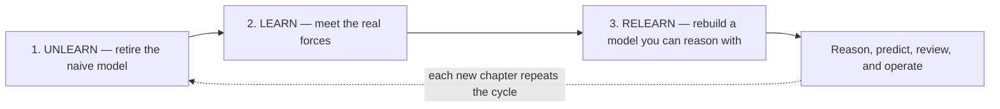

# Chapter 2 — Learn, Unlearn, Relearn: A Method for Banking Systems

> *Unlearn The simple story you were told about banking systems. Learn the real forces: ledgers, limits, and rails. Relearn how Riverbrand answers them.*

## Recap

- **Unlearn:** The habits that feel like expertise but are really shortcuts — treating a balance as truth, a screen as a product, a double-spend as someone else's problem, and a webhook as money.
- **Learn:** The four failure forces that actually govern banking systems — race conditions, provider outages, duplicate credits, and regulatory ceilings — and the vocabulary for reasoning about them.
- **Relearn:** A working mental model of Riverbrand you can think with, plus the recap-block convention that keeps the method alive in every chapter that follows.

## 2.1 The Pedagogy

This chapter is the only home of the method this book is built on. [How to Read This Book](../front-matter/f05-how-to-read.md#the-master-method-learn-unlearn-relearn) summarizes it in a page; every other chapter merely echoes it. So take the method seriously here once, and the rest of the book will move faster.

The method has three stages, and the order is the point: **unlearn, then learn, then relearn.** Most technical education skips the first stage and pays for it. It hands you new facts — a lock here, a queue there — while the old mental model is still standing underneath, quietly reinterpreting every fact to fit itself. You end up able to recite the architecture and unable to predict what it will do when a provider drops a request at the worst moment. Unlearning first clears the ground. Learning second supplies the real forces. Relearning third rebuilds a model you can reason with.

**Figure 2.1 — The Learn / Unlearn / Relearn cycle applied to banking systems.**

**Unlearn** targets assumptions, not competence. The experienced banker who says "a balance is a number in a row" and the junior engineer who says "a transfer is an API call" are both carrying models that worked in simpler contexts. The unlearning is specific and respectful: show the exact traffic pattern in which the model breaks, and let the reader retire it themselves. Chapter 1 began this work for the product as a whole; this chapter names the four assumptions worth retiring explicitly.

**Learn** is where the real syllabus lives, and in banking systems the syllabus is short and merciless. Four failure forces account for most of what goes wrong in production and most of what regulation is about:

| Failure force | The question it forces |
|---|---|
| **Race conditions** | What happens when two valid requests touch the same money at the same instant? |
| **Provider outages** | What happens when a dependency you do not control stalls, times out, or lies? |
| **Duplicate credits** | What happens when the same event is reported to you twice — or zero times? |
| **Regulatory ceilings** | What happens when the law caps a transaction and the naive response punishes the customer? |

Every chapter in this book is, at bottom, an answer to one or more of these four. The learning stage teaches each force in its own vocabulary — concurrency, idempotency, outboxes, KYC tiers — and, just as importantly, teaches the trade-offs. There are no free locks and no perfect providers; understanding a banking system means understanding what each choice costs.

**Relearn** is the stage that separates readers who can quote the design from readers who can defend it. By the end of a chapter you should be able to predict the system's behavior in a failure you have never seen described: if the WhatsApp provider returns the same delivery notification twice, what does the ledger record? If a customer taps "send" on two devices at once, which request wins and what does the other see? If a deposit crosses a KYC ceiling on a Friday night, where does the money sleep? Those predictions are the real test of a relearned model, and they are exactly the questions this book keeps asking.

The method is aimed at two audiences at once, deliberately. Bankers — executives, product managers, operations leads, compliance officers — need the unlearning most, because their intuitions were trained by interfaces rather than by ledgers. Builders — backend engineers, SREs, security auditors — need the relearning most, because they are the ones who will hold the invariants at three in the morning. Both groups travel the same three stages; only the vocabulary depth changes. That is the design behind the book's two tracks (see [§1.4](ch01-riverbrand-story.md#14-the-dual-track-promise)), and it is why this chapter is shared rather than duplicated.

One more property of the method: it is per-chapter, not one-time. You do not graduate from unlearning. Each new domain — the transaction engine, the channel fabric, security, operations — arrives with its own naive story ("outages are rare", "audit logs are overhead") that must be retired before the real forces can land. The cycle in Figure 2.1 is meant to turn, not complete.

## 2.2 What Bankers and Builders Must Unlearn

Four assumptions deserve specific retirement. They are common, they are costly, and each maps directly onto one of the four failure forces.

**The balance-in-a-row myth.** The naive model says money is a number in a database row, and moving it is arithmetic: read the balance, subtract, write it back. Everything about that sentence is wrong in production. A balance is not truth; it is a **summary** of truth. The truth is the ledger — the append-only record of every movement, in which every debit is matched by a credit (see [§3.1](ch03-domain-primer.md#31-double-entry-in-plain-words)). When the summary and the record disagree, the record wins. The myth also hides time: between "read the balance" and "write it back" sits a window in which any other request can do the same thing, and on a busy system one always does. That is the race condition, and it is not bad luck — it is arithmetic with an unstated assumption of single-file traffic. Unlearned properly, the lesson generalizes: wherever you see a cached number presented as the state of the world, ask what record it summarizes and what happens when two writers overlap.

**"Screens are the product."** Teams that ship banking software under this assumption polish dashboards while the record underneath stays ambiguous: receipts that disagree with statements, "pending" states nobody can explain, balances that lag deposits. The screens are windows. The product is the movement and record of value under the rules of the moment — operational, contractual, and regulatory. Riverbrand runs three channels (mobile, web/admin, WhatsApp) deliberately as **views** onto one ledger, which is the direct architectural consequence of retiring this myth (the product map is in [§1.3](ch01-riverbrand-story.md#13-what-riverbrand-is-the-product-map)). For bankers, the unlearning is this: a channel request is not a product requirement in itself; the requirement is that the same truth be visible and the same invariants hold in every window.

**"Double-spend can't happen to us."** It can, and it does, in traffic far below "peak scale". A customer on weak Wi-Fi taps "send" twice and the app retries a third time. A user opens two devices and pays from both in the same second. A bank's own retry logic re-fires a request it believes was lost. Each of these produces two legitimate-looking requests holding the same balance snapshot; a naive system approves both. This is the race condition from the customer's side of the glass, and the response is not better luck or a heavier server — it is serialization: one request at a time against a given wallet, with balance validation and the ledger write inside a single commit (the design in [§5.1](ch05-engineering-transaction-engine.md#51-the-two-tier-concurrency-guard), the customer story in [§4.2](ch04-for-everyone-how-money-moves.md#42-the-bank-vault-airlock)). The unlearning here is emotional as much as technical: "it hasn't happened to us" is not evidence; if the code allows it, assume it is happening quietly.

**"A webhook is a transfer."** A webhook is a message — someone else's claim that something happened, delivered over a network that can duplicate, delay, reorder, and lose. Treating it as the transfer itself creates two distinct disasters. Inbound: a payment provider notifies your system twice about one deposit, and a naive handler credits the wallet twice — a duplicate credit the bank discovers at reconciliation, if ever. Outbound: your system "completes" a transfer by sending a notification or an email and returns success to the customer while the money has not moved at all. Both disasters come from confusing a report of an event with the event. The disciplined version separates them: the money movement is recorded once in the ledger under an idempotency key that makes a second delivery a no-op (see [§5.3](ch05-engineering-transaction-engine.md#53-idempotency-references)); notifications are dispatched afterwards by background workers so that a provider outage delays a receipt, not a payment (see [§4.5](ch04-for-everyone-how-money-moves.md#45-the-guaranteed-courier) and [§5.4](ch05-engineering-transaction-engine.md#54-the-outbox-and-dead-letter-queue)). Unlearned properly: a message is a witness, never the deed.

**Compliance as a back-office checkbox.** A fifth assumption is worth retiring explicitly because the regulatory ceiling punishes it so quickly: the idea that KYC limits and anti-money-laundering rules are screens for the compliance team, bolted on after the fun parts ship. When a legitimate deposit crosses a tier ceiling, the naive product response is a hard freeze or a bounced transfer that can sit in interbank limbo for days. That is a design failure dressed as prudence. The rules are real, but the response is a product choice — and the better choice quarantines only the excess, releases it automatically when the customer's verification level rises, and tells the customer what is happening (see [§3.4](ch03-domain-primer.md#34-kyc-tiers-and-limits) and [§5.6](ch05-engineering-transaction-engine.md#56-the-pending-balance-holding-tank-and-kyc-ceilings)). Unlearn "compliance is someone else's layer". In a money system, every limit is an invariant the product must design around.

## 2.3 What Engineers Relearn

If §2.2 clears the ground, this section is the load-bearing frame engineers rebuild on it. Five relearned principles carry the rest of the technical track. Each is stated here as an idea; each has a mechanical home later in the book.

**Immutability: the ledger is written once and never edited.** A ledger entry that can be updated is not a record — it is an opinion with a write lock. Riverbrand's ledger is append-only: corrections are new entries that reference the old ones, statements are projections of the record, and every interest accrual, fee, and transfer leaves its own row (see [§5.2](ch05-engineering-transaction-engine.md#52-the-immutable-double-entry-ledger)). Engineers relearn the discipline this imposes: no in-place "fix the balance" patches, no silent updates in migration scripts, and a healthy suspicion of any table whose rows are routinely rewritten.

**Idempotency: safe retries are a design input, not an afterthought.** Networks retry. Clients retry. Humans retry. A money-moving request that cannot be safely repeated will eventually be repeated, and the second execution becomes a duplicate credit or a duplicate debit. The relearned habit is to give every such request a stable reference up front and record its outcome so that a re-delivery returns the first result instead of executing again (see [§5.3](ch05-engineering-transaction-engine.md#53-idempotency-references)). The same habit applies one layer out: webhooks ingested idempotently, jobs that can run twice without doubling effects, and reconciliation that notices when zero deliveries arrive instead of two.

**Consensus of one ledger.** Modern systems literature is full of consensus algorithms among many machines. Riverbrand's first consensus is simpler and stricter: there is **one** authoritative record of value, and every channel, service, and report agrees with it or is wrong. Nothing important is decided by which screen the customer happened to use. Engineers relearn the consequences: writes are funneled through the ledger's invariants rather than scattered across service-local balances; reads may be cached or replicated for speed, but the cache is always a summary that can be rebuilt from the record (see [§3.1](ch03-domain-primer.md#31-double-entry-in-plain-words)). When someone proposes a second source of truth — a channel-local balance, a provider's dashboard as reconciliation — the question is not "is it faster?" but "what happens when the two disagree at midnight?"

**Failure-first design.** Assume every external dependency will stall, return garbage, duplicate a callback, or go dark during your busiest hour — because the four failure forces say so. Riverbrand's response is pattern-shaped rather than heroic: work that can block a customer is moved off the request path into an outbox with retries and a dead-letter queue for the truly stuck (see [§5.4](ch05-engineering-transaction-engine.md#54-the-outbox-and-dead-letter-queue)); messaging providers sit behind a swappable interface with named fallbacks so one vendor's outage is a switch, not an incident ([§6.4](ch06-for-everyone-wealth-and-channels.md#64-when-a-provider-fails)); and the failure modes are enumerated in a matrix before they are discovered in production (see [§5.7](ch05-engineering-transaction-engine.md#57-failure-mode-matrix)). Engineers relearn that writing the failure paths **is** writing the feature.

**Operations as product.** Reliability is not what happens after the product ships; for a bank it is the product's spine. Scheduled jobs that accrue interest nightly, health checks, metrics, audit trails, and runbooks are features with users — the operations team, the auditor, and ultimately the customer whose money depends on them. The design culture behind Riverbrand treats this as architecture, not janitorial work: connection pooling that keeps thousands of client conversations multiplexed onto a small set of database connections is a product decision, because it is the difference between staying up and collapsing under ordinary attention. The engineering chapters carry the mechanism ([Chapter 11](ch11-engineering-operations-manual.md)) and the plain-language chapters carry the customer consequence ([Chapter 10](ch10-for-everyone-reliability.md)).

These five principles, plus the four failure forces, are the whole method in action. The table below is the map many engineers keep open while reading:

| Failure force | Unlearned assumption | Relearned answer | Where it lives |
|---|---|---|---|
| Race conditions | A balance row is the truth; single-file traffic | Serialized, single-commit movements against an append-only ledger | [§5.1](ch05-engineering-transaction-engine.md#51-the-two-tier-concurrency-guard), [§5.2](ch05-engineering-transaction-engine.md#52-the-immutable-double-entry-ledger) |
| Provider outages | The provider is up, and its call belongs in the request | Outbox, retries, dead-letter queue, swappable providers | [§5.4](ch05-engineering-transaction-engine.md#54-the-outbox-and-dead-letter-queue), [§6.4](ch06-for-everyone-wealth-and-channels.md#64-when-a-provider-fails) |
| Duplicate credits | A webhook is a transfer | Idempotent ingestion keyed to a recorded movement | [§5.3](ch05-engineering-transaction-engine.md#53-idempotency-references) |
| Regulatory ceilings | Compliance is a back-office checkbox | Tiered limits with a pending-balance tank and automatic release | [§5.6](ch05-engineering-transaction-engine.md#56-the-pending-balance-holding-tank-and-kyc-ceilings) |

Readers on the non-technical track can stop at the first two columns and still leave with the method intact; the analogies for these same answers live in the [Analogy Atlas](../appendices/app-f-analogy-atlas.md) and are told, not referenced, in the plain-language chapters.

## 2.4 The Recap-Block Convention

A method nobody practices is a poster. This book practices it structurally: **every chapter opens with the same two elements**, and together they are the recap-block convention.

**The epigraph.** A one-line reminder of the arc — unlearn a story, learn the forces, relearn the answer — that sets the chapter's contract with the reader.

**The Recap block.** Three bullets, one per stage, rewritten to be specific to that chapter's ground. Chapter 1's recap retired the "bank as a balance behind a screen" story; this chapter's recap retires expertise-as-shortcut; [Chapter 3's](ch03-domain-primer.md#recap) will retire the habit of using domain words without definitions. The bullets are not decoration and not a summary of the prose that follows — they are the **arc** of the chapter in three moves, so a skimmer can see the shape before climbing it and a returning reader can re-find their place in seconds.

Why a convention rather than a stylistic whim? Three reasons, all practical. First, retrieval: naming the unlearned assumption before the content forces the reader to notice their own model, which is when learning actually happens. Second, shared language across the two tracks: when a compliance officer and a backend engineer both open chapters with the same three moves, they can argue about substance instead of vocabulary. Third, authorship discipline: a writer who cannot state a chapter's unlearned assumption in one line does not yet know what the chapter is for — the recap block is the cheapest design review in the book.

The recap block is the most visible member of a small family of conventions, all described in [How to Read This Book](../front-matter/f05-how-to-read.md#conventions-used-in-this-book):

- **In Plain Words sidebars** — plain-language chapters pause for a one-paragraph translation of the hard part.
- **Cross-link boxes** — every chapter ends by pointing to its twin track, so depth is a choice rather than a wall.
- **The UNVERIFIED badge** — any fact not yet confirmed against the RiverbrandBE codebase is marked in place rather than smoothed over.
- **§-references** — every claim about another part of the book links to it, so the map is navigable.
- **Numbered figures** — diagrams carry figure numbers and appear in the List of Figures.

And one governing rule ties the family together: **one home per idea**. The full method lives here. The four analogies live in the [Analogy Atlas](../appendices/app-f-analogy-atlas.md). The competitive comparison lives in the [Competitive Matrix](../appendices/app-e-competitive-matrix.md). Everywhere else, ideas are echoed and linked, never retold at length — which is why this chapter's ending is short, and why the next chapter can spend all of its words on domain language instead of pedagogy.

For readers who will write or review documents against this standard (see [Appendix H](../appendices/app-h-contribution.md)): the recap block is the first thing you write and the first thing you check. If the three bullets are generic enough to fit any chapter, they belong to no chapter. Make them hurt a little.

## Key Takeaways

- The method is **unlearn → learn → relearn**, in that order: retire the naive model before attaching new machinery to it, then rebuild a model you can reason and predict with.
- The syllabus is four failure forces — race conditions, provider outages, duplicate credits, and regulatory ceilings — and every chapter answers at least one of them.
- Bankers must unlearn four myths in particular: the balance-in-a-row, "screens are the product", "double-spend can't happen to us", and "a webhook is a transfer".
- Engineers relearn five disciplines: immutability, idempotency, consensus of one ledger, failure-first design, and operations as product.
- The recap-block convention (epigraph + three chapter-specific bullets) keeps the method turning in every chapter; the full method lives only here.

## Frequently Asked Questions

### Is "learn, unlearn, relearn" just a catchy slogan?

No — it is a reading and writing protocol with a fixed order and testable outcomes. The unlearn stage names a specific assumption and the traffic pattern in which it breaks; the learn stage teaches the real force and its trade-offs; the relearn stage leaves you able to predict system behavior in a failure nobody has described to you yet. If a chapter cannot pass that test, it is not finished.

### Do non-technical readers really need this chapter?

Yes, and it is written for them first. The four myths in §2.2 are product and operations beliefs far more often than they are engineering beliefs, and the method is what lets a non-technical reader press on an architecture decision and get a real answer. No implementation jargon is required here; the technical vocabulary arrives in its own track.

### Why does unlearning come first? Isn't that discouraging to experts?

Unlearning attacks assumptions, not competence. The assumptions are usually ones the reader was never taught — they absorbed them from simpler systems and demos. Naming them is respectful: it says "your experience is real, and here is the exact edge where this particular model stops paying rent". Experts tend to find the stage relieving rather than insulting, because it explains failures they have already lived through.

### How does this method relate to the four failure themes from the product story?

They are the same thing at two altitudes. Chapter 1 introduced race conditions, provider outages, duplicate credits, and regulatory ceilings as the problems the market hits; this chapter promotes them to the book's syllabus. When you meet a new mechanism — a lock, an idempotency key, an outbox, a KYC tank — you can always ask which force it answers and why it costs what it costs.

### How should I use the recap blocks while reading?

Read the three bullets first and make a private prediction: what naive assumption is about to fall, and how? Then read the chapter and compare. On a second pass — or when you return after a break — the recap block is the fastest way back in. If you are contributing a chapter to this book, write its recap block first; it is the cheapest way to find out whether the chapter knows what it is for.

## Where to Go Next

- **[Chapter 3 — Domain Primer: Ledgers, NUBANs, KYC, and Rails](ch03-domain-primer.md)** — the shared vocabulary the rest of the book assumes: double-entry in plain words, the account and identity acronyms, the five-currency wallet model, KYC tiers, and the data map. Every reader continues here.
- After the primer, the tracks split: everyone continues to [Chapter 4](ch04-for-everyone-how-money-moves.md); engineers continue to [Chapter 5](ch05-engineering-transaction-engine.md).
