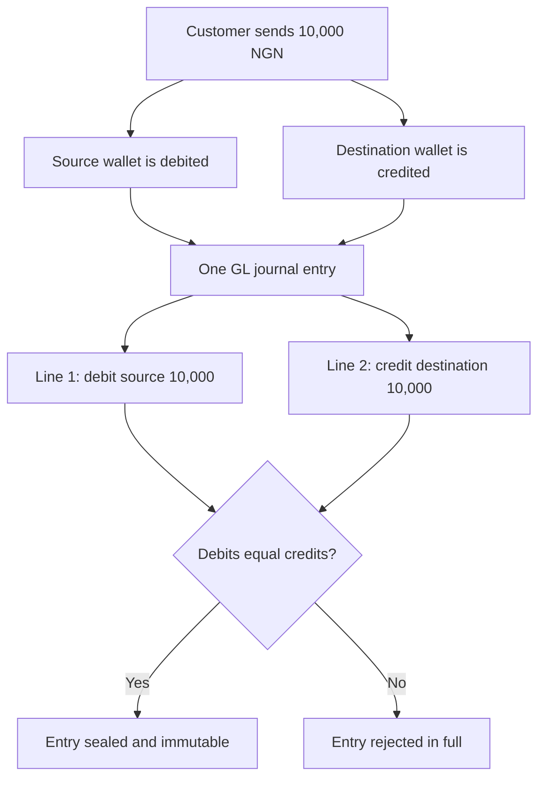
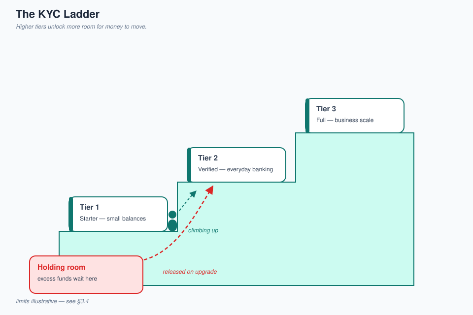

# Chapter 3 — Domain Primer: Ledgers, NUBANs, KYC, and Rails

> *Unlearn The simple story you were told about banking systems. Learn the real forces: ledgers, limits, and rails. Relearn how Riverbrand answers them.*

## Recap

- **Unlearn:** A balance is one number in one row, and "sending money" means overwriting that number.
- **Learn:** Every movement of money is a pair of immutable ledger entries, wrapped in account numbers, identity tiers, and national payment rails.
- **Relearn:** How Riverbrand books each transfer twice, provisions a NUBAN over the NIP rail, and parks surplus funds in quarantine until a customer's KYC tier catches up.

This chapter is the vocabulary lesson of the book. Everything that follows — the concurrency guards of [§5.1](../chapters/ch05-engineering-transaction-engine.md#51-the-two-tier-concurrency-guard), the product stories of [§4.1](../chapters/ch04-for-everyone-how-money-moves.md#41-aminas-salary-lands-a-persona-story), the security posture of [§9.1](../chapters/ch09-engineering-security-architecture.md#91-dual-token-client-isolation) — is written in the words defined here: *ledger*, *NUBAN*, *wallet*, *KYC tier*, *pending balance*. Read it once carefully, and the rest of the book reads faster. Terms are also collected, with one-line definitions, in [Appendix A: Glossary](../appendices/app-a-glossary.md).

## 3.1 Double-Entry in Plain Words

Open any banking app and one number stares back at you: your balance. The comfortable mental model is that this number *is* your money — that the bank stores `balance = 45,000` somewhere and edits it when you spend. That model is wrong in a way that matters. In every serious banking system, the balance is not the truth. The balance is a **summary** of an unbroken history of entries, and the entries are the truth.

An **entry** is a single line in the bank's book recording one side of a movement of value. A **ledger** is the book itself: the ordered, append-only collection of those lines. If you could freeze time and replay every entry since a customer opened their account, you would arrive, exactly, at their current balance. That replayability is the whole design.

**The T-account.** Accountants have drawn the same diagram for centuries: a capital letter T on a page, with the account name above it. The left side is called **debit**; the right side is called **credit**. That is all those words mean — *left* and *right*. Debit does not mean "bad" and credit does not mean "good"; a debit to your wallet is bad for you but perfectly good bookkeeping. When money moves, the accountant writes one line on the left of one T and one line on the right of another T.

**Why every transfer is two entries, never one.** Imagine recording only "Tunde's wallet: minus ₦10,000." The book now knows Tunde is poorer but has no idea where the money went. It is an open loop — a hole in the record. Now record a second line: "Amina's wallet: plus ₦10,000." The loop closes. Nothing was created and nothing vanished; value changed hands. This pairing is called **double-entry bookkeeping**, and its discipline is strict: for every debit there is an equal credit somewhere else, and when you sum every line in the book, total debits equal total credits. That single identity is what makes the book self-checking. A one-sided write is not a partial transaction — it is an error that the system must refuse to record.

**Immutability.** Ledger lines are written once and never edited or deleted. If a mistake is discovered, the fix is a **reversing entry** — a fresh pair of lines that cancels the wrong pair — not an edit of history. The reason is evidential: an editable ledger is just a mutable opinion. Regulators, auditors, and dispute processes all depend on being able to replay exactly what happened, in the order it happened. Riverbrand's ledger is written this way: once an entry is sealed, the next correction can only be another entry.

**What Riverbrand writes.** Every movement — a transfer, a deposit, a bill payment, a currency swap — produces one journal entry with balanced lines. The domain service responsible is the general ledger service, and the records are the journal entry header and its journal lines (engineers know them as `GLJournalEntry` and `GLJournalLine`, written through `GeneralLedgerService`). A nightly job snapshots every ledger account into `GLBalanceSnapshot` and checks the accounting identity behind the whole system: total assets equal total liabilities plus equity. Mechanically, this all happens inside the single-commit transaction described in [§5.2](../chapters/ch05-engineering-transaction-engine.md#52-the-immutable-double-entry-ledger) — the diagram below shows the shape of the bookkeeping itself.

**Figure 3.1 — One transfer, two balanced entries.**

**In plain words.** Think of the ledger as a notebook that never erases. Every time money moves, the notebook gets exactly two new lines — one saying where it left, one saying where it arrived — and the two always add up to zero. Your balance is just the running total of your lines. If the two lines disagree, the page is torn up before it is written.

## 3.2 NUBAN, NIP, NIBSS, BVN, and NIN

Five acronyms carry most of the everyday business of Nigerian banking. They describe two different things: *how money arrives* (the account number and the rail) and *who you are* (the identity numbers).

**NUBAN — the account number.** A NUBAN (Nigeria Uniform Bank Account Number) is a virtual account number provisioned per customer: a real, routable account number at a partner bank that belongs to exactly one Riverbrand customer. In practice it behaves like any bank account number — a friend can send money to it from any Nigerian bank, using their usual transfer app, and the funds land in that customer's Riverbrand wallet. Riverbrand provisions each NUBAN through **ProvidusBank**, with **Fincra** as the fallback gateway if Providus is unavailable or refuses the request. Provisioning is idempotent: if the customer already has a NUBAN stored, the system returns the existing one rather than minting a duplicate. The account details are persisted in `userAccountDetails`, and the creation is recorded as a reference with purpose `ACCOUNT_CREATION` in `rbp_brand_references`. Engineers can trace the full lifecycle in [§5.5](../chapters/ch05-engineering-transaction-engine.md#55-virtual-nuban-lifecycle).

**NIP and NIBSS — the rail.** When money actually moves from that friend's bank to the NUBAN, the instruction travels over **NIP** (NIBSS Instant Payments), Nigeria's instant payment rail — the switch that clears interbank transfers in seconds rather than in the batch windows of older systems. **NIBSS** (Nigeria Inter-Bank Settlement System) is the shared infrastructure company that operates the rail. In the Riverbrand codebase and docs, "NIP transfer" and "interbank transfer" mean the same journey: value leaving one commercial bank and landing in a Riverbrand NUBAN across the NIP rail. A deposit that arrives this way reaches Riverbrand as a webhook from the payment provider, and only then does the ledger get its two lines.

**BVN and NIN — the identity.** A **BVN** (Bank Verification Number) is the identity number that ties a person to their bank accounts across the Nigerian banking system. A **NIN** (National Identification Number) is the national identity number issued by Nigeria's national identity scheme. They are issued by different authorities for different purposes, but in Riverbrand's KYC flow either one is accepted as the identity step that lifts a customer from Tier 1 to Tier 2. Both are verified through the **Dojah** gateway — Riverbrand sends the number and the customer's details to Dojah, and only a confirmed verification raises the tier. Identity verification is what the next section is about; the account number and the rail are what this section is about. Keep them separate in your head: the NUBAN says *where money goes*, the BVN or NIN says *who may hold it*.

**In plain words.** A NUBAN is like a dedicated PO box for your money — one number, yours alone, that anyone can pay into. NIP is the courier network that moves the parcel between banks in seconds. BVN and NIN are the ID cards you show before the box is unlocked for larger amounts.

## 3.3 Wallets and the Five Currencies

A **wallet** is a customer's balance container for one currency. The mental picture that works is a safe deposit box room: a customer can hold several boxes side by side — one for naira, one for dollars — and each box has its own contents and its own history. Riverbrand manages wallets across five currencies: **NGN, USD, GBP, EUR, and CAD**. Each currency is its own wallet with its own ledger lines; there is no single pooled balance wearing a currency tag.

This matters for bookkeeping. When money enters the system in one currency and leaves in another, it is not one entry with a footnote — it is two movements joined by a conversion. The conversion happens at an **exchange rate**, and where the rate comes from is a product decision with real consequences. In Riverbrand today, FX is **admin-driven**: exchange rates are set by operators and stored in the `ExchangeRate` record, and in-app currency swaps execute at the active administrative rate. The canonical example from the product journeys: Sarah deposits ₦1,600,000 and swaps to $1,000.00 USD at the active admin rate — her NGN wallet is debited, her USD wallet is credited, and the rate used is written into the transaction so the swap can be replayed and audited later.

Two consequences follow. First, a swap is still a double-entry movement: debit one currency's wallet, credit the other's, balanced in the journal. Second, because the rate is administrative rather than market-fetched, the rate table is part of the operational surface — someone owns it, and audits can ask when it last changed. A deeper treatment of wallet semantics per currency lives in [§7.5](../chapters/ch07-engineering-channel-fabric.md#75-multi-currency-wallet-semantics); the customer-facing stories live in [§4.1](../chapters/ch04-for-everyone-how-money-moves.md#41-aminas-salary-lands-a-persona-story).

**In plain words.** A wallet here is not one account with five labels; it is five boxes in the same safe. Moving money between boxes means converting at a rate your bank set — and both sides of the move are recorded, so nothing evaporates in the exchange.

## 3.4 KYC Tiers and Limits

**KYC** — Know Your Customer — is the process of establishing who a customer is before a bank lets them hold and move larger sums. Every regulator that supervises payments pairs KYC with **limits**: ceilings on how much a customer may move per day and hold in total, scaled to how much identity they have proven. The reasoning is straightforward. Unverified accounts are where fraud, money laundering, and impersonation do the most damage, so the system starts with low ceilings and raises them as evidence accumulates.

Riverbrand implements three tiers. The ceilings live in the KYC benefit table (`rbp_brand_kyc_benefit`), and a running daily total per customer is tracked in `rbp_brand_daily_limit_tracker` so the system knows how much of a day's allowance is already spent.

| KYC tier | Daily transfer ceiling | Maximum wallet balance | Verification required |
| :--- | :--- | :--- | :--- |
| **TIER1** | ₦50,000.00 | ₦300,000.00 | Phone number and email verification |
| **TIER2** | ₦200,000.00 | ₦500,000.00 | BVN or NIN verification via the Dojah gateway |
| **TIER3** | ₦5,000,000.00 | Unlimited | Government photo ID and proof of address |

In plain words: prove a phone and an email, and you may move ₦50k a day; add a BVN or NIN, and the ceiling rises to ₦200k; add government ID and an address, and it rises to ₦5M a day with no balance cap. These are the ceilings the whole product is built around — every transfer, every deposit, every savings sweep consults them.

**The pending-balance holding tank.** Now the question that breaks naive systems: what happens when money arrives *above* a customer's ceiling? Hard-rejecting the inbound transfer is brutal — the funds hang in clearing limbo between banks, sometimes for weeks, and the customer's salary or tuition money is trapped. Freezing the whole account is worse. Riverbrand takes a third path, which this book calls the **pending balance holding tank** (engineers see the table `rbp_brand_pending_balance` and the status `QUARANTINED`).

Imagine a customer on Tier 1 receiving ₦500,000. The portion inside the day's ceiling — ₦50,000 — credits their wallet immediately. The surplus, ₦450,000, is parked in the holding tank: not lost, not rejected, but quarantined on Riverbrand's books with a full audit trail in `rbp_brand_pending_balance_audit`. The customer is told what happened and what to do: upload a BVN or NIN. When Dojah confirms the identity and the tier upgrades, a domain event fires and the held funds are swept automatically into the active wallet. No ticket, no manual release, no reversal queue.

The quarantine is also, in effect, a light form of **escrow**: funds are held in a controlled account against a condition (a higher KYC tier) and released when the condition is met. That is why this book groups "escrow" and "KYC quarantine" together in the glossary. For the customer-facing telling of the same mechanism see [§4.4](../chapters/ch04-for-everyone-how-money-moves.md#44-the-quarantined-balance); for the transaction-level mechanics see [§5.6](../chapters/ch05-engineering-transaction-engine.md#56-the-pending-balance-holding-tank-and-kyc-ceilings); for the compliance framing see [§8.3](../chapters/ch08-for-everyone-safety-and-compliance.md#83-what-a-kyc-tier-means-for-a-customer).

**In plain words.** Think of the tier ceiling as the size of the envelope your account can open in a day. If a larger payment arrives, you are not punished for it — the bank opens the envelope as far as your tier allows, and the rest waits in a locked drawer with your name on it until you show a stronger ID. Then the drawer opens by itself.

## 3.5 The Schema-Prefix Map

The last piece of vocabulary is not banking vocabulary at all — it is the naming language of the database. Riverbrand's data layer grew through more than one generation of code, and the table names show it. The canonical map, used consistently in this book:

| Prefix or name | What lives there | Status |
| :--- | :--- | :--- |
| `rbp_brand_*` | Riverbrand domain tables — the product's own records | Canonical; use for all new domain work |
| `river_brand_sys_*` | Platform and session sidecar tables | Canonical; system machinery beside the domain |
| `savings_*` | Legacy savings tables | Legacy — flagged to be renamed |
| `user_user` | Legacy user account table | Legacy — flagged to be renamed |
| `userAccountDetails` | NUBAN account details store | Legacy mixed-case name |

`rbp_brand_*` is the heart of the domain: `rbp_brand_outbox` and `rbp_brand_deadletter` for asynchronous delivery, `rbp_brand_pending_balance` and `rbp_brand_pending_balance_audit` for the holding tank, `rbp_brand_kyc_benefit` and `rbp_brand_daily_limit_tracker` for limits, `rbp_brand_references` for idempotency references, `rbp_brand_beneficiaries` for saved recipients. If a table carries this prefix, it is current domain design.

`river_brand_sys_*` is deliberately *beside* the domain rather than inside it. Its main member, `river_brand_sys_user_session_control`, holds the session version used for instant token revocation — the mechanism covered in [§9.2](../chapters/ch09-engineering-security-architecture.md#92-sidecar-session-control-and-the-kill-switch). The sidecar exists so that session-control features could be added without altering the legacy user tables; see that section for why that separation was worth the extra table.

`user_user` and `savings_*` (for example `savings_usersavinginterestlog`, `savings_config`) are inherited names from earlier iterations of the codebase. They are documented as-is in this book because that is what the code says today, and they are flagged as **to-be-renamed** so that nobody mistakes them for the target design. `userAccountDetails`, the NUBAN store, sits in the same category: camelCase, legacy, working.

Engineers will also meet un-prefixed Prisma model names in the code — `Wallet`, `Target`, `ExchangeRate`, `GLJournalEntry`, `GLJournalLine`, `GLBalanceSnapshot`, `DeviceToken` — which map to the general-ledger, wallet, FX, and device tables described earlier in this chapter. The rule of thumb when writing new code or new docs: copy the `rbp_brand_` convention for domain tables, keep platform concerns in `river_brand_sys_`, and never introduce a new name that looks like the legacy ones. A per-table breakdown lives in [Appendix C: Data Dictionary](../appendices/app-c-data-dictionary.md).

**In plain words.** Table names are the filing labels on the bank's cabinets. The `rbp_brand_` cabinets are the current office, the `river_brand_sys_` cabinets hold the security logbook kept next to them, and the old `user_user` / `savings_` cabinets are the inherited ones everyone has agreed to relabel.

## Key Takeaways

- **A balance is a summary, not the truth.** The truth is an append-only ledger of entries; the balance is what those entries add up to.
- **Every transfer is two entries.** A debit and an equal credit, sealed together, or nothing is written at all — that is double-entry, and it is what makes the book self-checking.
- **A NUBAN is a per-customer virtual account number** provisioned via ProvidusBank (Fincra as fallback); **NIP**, run by **NIBSS**, is the instant rail that carries money to it; **BVN** and **NIN**, verified via Dojah, say who may hold it.
- **Wallets are per-currency** (NGN, USD, GBP, EUR, CAD), and FX happens at admin-driven rates recorded with the swap.
- **KYC tiers gate volume**: ₦50k / ₦200k / ₦5M daily ceilings, and money above the ceiling waits in the pending-balance holding tank until the customer's tier rises.
- **Table prefixes tell you the generation**: `rbp_brand_*` is current domain, `river_brand_sys_*` is platform sidecar, `savings_*` and `user_user` are legacy and flagged to be renamed.

## Frequently Asked Questions

### Is a NUBAN a real bank account?

Yes — it is a real account number at a partner bank (provisioned via ProvidusBank, with Fincra as fallback), dedicated to one customer. Anyone can transfer to it from any Nigerian bank. What makes it "virtual" is that the customer never walks into a branch to open it; Riverbrand provisions it programmatically and the balance it receives is credited to the customer's wallet.

### Why does every transfer need two ledger entries instead of one?

Because a single entry only describes half of what happened. One debit line says money left; the matching credit line says where it arrived. Recorded as a pair, the books balance and the movement is complete; recorded alone, there is a hole in the record that no amount of later arithmetic can fill.

### What happens to money that arrives above my KYC limit?

It is not rejected and it is not lost. The portion within your tier's ceiling is credited to your wallet immediately, and the surplus is quarantined in the pending-balance holding tank with a full audit trail. When you complete BVN or NIN verification and your tier is upgraded, the held amount is released to your wallet automatically.

### Why are some database tables named `user_user` or `savings_*`?

Those names are inherited from earlier iterations of the codebase. They are documented as-is because the code still uses them, and they are flagged as to-be-renamed. New domain tables follow the `rbp_brand_*` convention; platform and session machinery lives under `river_brand_sys_*`. [§3.5](#35-the-schema-prefix-map) is the map.

### Where does the exchange rate come from when I swap currencies?

From an admin-driven rate record. Operators set the active rates, and in-app swaps execute at the active administrative rate, with the rate used recorded on the transaction so the swap can be replayed and audited.

## Where to Go Next

- **For everyone:** [Chapter 4 — For Everyone: How Money Moves](../chapters/ch04-for-everyone-how-money-moves.md) turns this vocabulary into Amina's story — the airlock, the quarantine, and the guaranteed courier, in plain language.
- **For engineers:** [Chapter 5 — Engineering: The Transaction Engine](../chapters/ch05-engineering-transaction-engine.md) takes the same concepts down to the mechanism: the two-tier concurrency guard, the immutable ledger write, idempotency references, the outbox and dead-letter queue, and the pending-balance holding tank.
- Either way, keep [Appendix A: Glossary](../appendices/app-a-glossary.md) open in a tab — every term in this chapter is defined there in one line.
