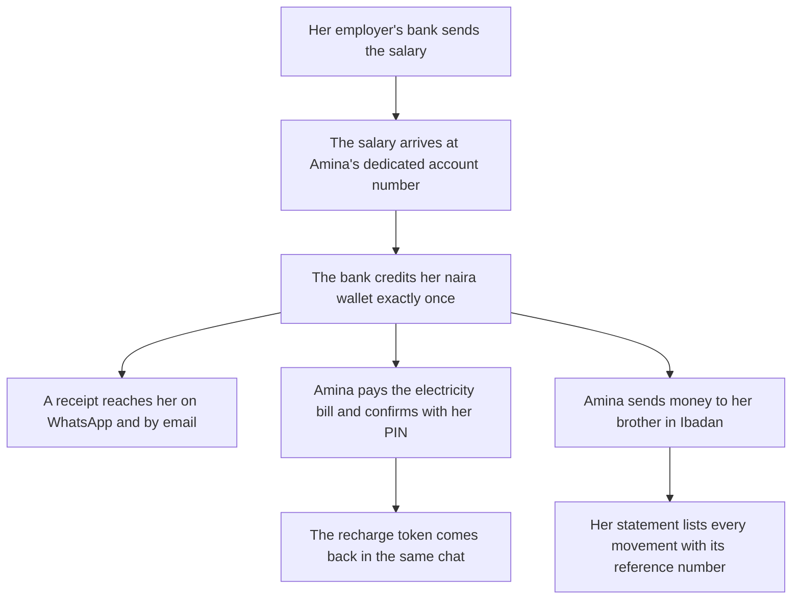

# Chapter 4 — For Everyone: How Money Moves

> *Unlearn the idea that banking features are just screens and balance numbers. Learn the real journeys, rules, and risks behind each feature. Relearn what Riverbrand actually built for people, and why it holds.*

## Recap

- **Unlearn:** The idea that moving money is a number changing on a screen — tap, subtract, done — and that the interesting work is in the screens.
- **Learn:** The four rules every real money journey runs under: one movement at a time per wallet, nothing ever counted twice, ceilings that hold money safely instead of freezing it, and receipts that arrive even when a delivery vendor stumbles.
- **Relearn:** How the Riverbrand Banking System actually moves an ordinary salary — Amina's, below — and why each of those rules exists for her rather than for the engineers.

## 4.1 Amina's Salary Lands: A Persona Story

Amina Okonkwo is a hospital administrator in Lagos. She is thirty-four, paid monthly, and until last year she kept two banking apps on a phone that never had enough storage for both. Today she banks through Riverbrand, and her salary story is the cleanest way to see what this chapter is about: not features, but the journeys, rules, and risks underneath them.

On payday, her employer's bank sends ₦185,000 to a ten-digit account number that belongs to Amina alone. That number is a **NUBAN** — a NUBAN (Nigeria Uniform Bank Account Number) is a standard account number that any other Nigerian bank can pay into as if it were an ordinary account at a branch. Amina does not open an app to receive her own salary. The transfer crosses the payment network like any other bank transfer, and it lands.

The moment the payment network reports the inbound transfer, two things happen in order. First, the bank records the money exactly once in Amina's **wallet** — her money pocket inside the system, one pocket per currency, in this case her naira pocket. Second, the paperwork follows: a receipt reaches her on WhatsApp, and a matching notification goes to her email. She sees a chat card that says her salary has arrived, with the amount, the sender, and a reference number she can quote if she ever needs to ask a question.

That evening Amina does the two things salary months are made of. She pays the electricity bill: she selects the bill, enters her meter number, confirms with her PIN, and the recharge token comes back to her in the same chat. Then she sends ₦25,000 to her brother Emeka, a student in Ibadan. She types his account number, confirms, and the money leaves her wallet and arrives in his. When she opens her statement before bed, every movement from the day is listed in order — the salary in, the bill paid, the transfer out — each line carrying its own reference number, and the closing balance matches what she remembers.

**Figure 4.1 — Amina's salary journey: one credit, everyday spending, and a receipt for every move.**

Nothing in that evening felt dramatic, and that is the point. Underneath the calm are four rules that a naive banking system breaks in ordinary traffic: two taps on a slow connection must not spend the same money twice; one deposit reported twice must not credit twice; a payment larger than her current verification level must not freeze her life; and a slow email provider must not turn a finished transfer into a panicked customer. The next four sections take those rules one at a time, in Amina's language. Engineers can step sideways into [Chapter 5](ch05-engineering-transaction-engine.md) at any point for the mechanism underneath.

## 4.2 The Bank-Vault Airlock

Start with the rule Amina never thinks about because it always holds: **for a given wallet, one money movement happens at a time.** Not two. Not "almost" one. One.

Picture a high-security bank vault with an airlock — a small sealed room between the public hall and the strongroom, with two doors that are never open at once. When Amina taps "Send ₦25,000", her request steps into the airlock and the first door closes behind it. If her finger taps twice because the network was slow, or she repeats the tap on a second device, that second request finds the door already shut and waits outside. By the time it enters, the first movement is sealed: the balance has moved, the record is written, and the second request sees the truth — the money is already gone — and is refused with a clear message rather than a silent double-payment. The full picture of the airlock, including what happens when someone leans on both doors at once, lives in the [Analogy Atlas](../appendices/app-f-analogy-atlas.md); the rule to carry away here is the one above.

**In Plain Words.** *The bank refuses to let two movements of the same money run side by side. The second attempt is not lost or ignored — it is queued at the door and then judged against the result of the first. Engineers call this a concurrency guard; the mechanism is in [§5.1](ch05-engineering-transaction-engine.md#51-the-two-tier-concurrency-guard).*

Why this matters to Amina: the failure it prevents is the one customers describe as "the app sent my money twice". It usually was not the app sending twice — it was the bank allowing two valid-looking requests to draw on the same balance at the same instant. Serializing the movements means that on a weak connection, at a busy hour, or across two phones, the worst Amina sees is a message saying a transfer is already in progress and she should wait a moment. Her money moves once.

The trade-off is honest: while one movement is inside the vault, a second movement on that same wallet waits. That wait is measured in moments, not minutes — ordinary money movements are designed to run in milliseconds to seconds inside the system — but the wait is real, and it is the price of never spending a naira twice. The design goal is not "instant, always"; it is "once, and quickly".

## 4.3 Nothing Gets Counted Twice

The second rule answers a quieter risk: the same event being **reported** twice. When Amina's salary crossed the payment network, the network's report of "money arrived" can be delivered more than once — networks retry, connections drop and replay, and a notification that seems lost often turns up late. A naive system treats each report as fresh money and credits her wallet twice. She would notice only when the bank noticed, and the correction would look like the bank taking money back.

Riverbrand answers this with something every human already understands: **a receipt number the bank never forgets.** Every money movement is issued a unique reference before it happens — a string like `TRF-NGN-20260815-88392011` for a transfer, `DEP-PRV-20260815-77182900` for an inbound deposit. Before any movement is recorded, the bank checks that reference against its own book of receipts. If the reference has been seen before, the bank does not do the work again; it returns the result it already gave the first time. The second delivery of the same news becomes a no-op — a polite "already handled" — instead of a second credit.

**In Plain Words.** *Give every request a receipt number up front. If the same number comes back, show the same answer again; never redo the work. Engineers call this idempotency, and its reference book is described in [§5.3](ch05-engineering-transaction-engine.md#53-idempotency-references).*

This protects Amina in three directions. Inbound: her salary reported twice is credited once. Outbound: when her transfer times out on the screen and the phone offers "try again", the retry carries the same receipt number, so a movement that actually succeeded is not performed a second time while she watches. And internally: the bank's own scheduled work — checks, sweeps, reconciliations — can safely run again after a crash without doubling effects, because each run is anchored to references it has already booked.

The reference numbers also make support humane. When Amina calls about a bill payment, she is not asked to reconstruct her afternoon; she quotes `BIL-AIR-20260815-44910288`, and the bank can say exactly what happened to that one movement, once. The unlearned habit this rule replaces is worth naming: a message is a witness, never the deed. The payment network's report is not the money; the money is the record the bank keeps under a reference it can recognise again.

## 4.4 The Quarantined Balance

The third rule is the one customers meet most abruptly: **the law caps how much money a person at a given verification level can move in a day.** KYC — "know your customer", the identity checks regulation requires — comes in levels, and each level carries its own ceiling. In Riverbrand's naira terms, the first level, reached with just a verified phone and email, allows roughly ₦50,000 of movement a day. The second level, reached when a customer's BVN and NIN have been checked, allows roughly ₦200,000 a day. The full level, reached with a government photo ID and proof of address, allows ₦5,000,000 a day and above (the exact ladder is set out in [§3.4](ch03-domain-primer.md#34-kyc-tiers-and-limits)).

Now the part that decides whether a bank is kind. Amina is at the second level. In March, her cooperative paid her a ₦500,000 share-out — a legitimate, ordinary payment that simply exceeds the ceiling her current level carries. A naive system has two bad habits here. Some banks freeze the entire account "for safety", so Amina cannot buy food or pay school fees while the money she already earned sits locked behind a compliance flag. Others bounce the payment back into the interbank system, where a reversal can take two weeks to trace and nobody can tell her where her money is sleeping.

Riverbrand does neither. The portion within her ceiling — ₦200,000 — lands in her wallet immediately and is hers to spend today. The excess — ₦300,000 — waits in a **holding room** for money beyond the current verification level: a quarantined balance, safe on the bank's books, visible to Amina, and not spendable yet. A message explains exactly what happened and what will release it. When she completes the full level by uploading a government photo ID and proof of address, the holding room opens and the ₦300,000 is released into her wallet automatically — no ticket queue, no branch visit, no re-asking for the transfer.

<!-- FIGURE: fig-ch04-quarantine-tank.svg | Figure 4.2 — The quarantine tank -->

**In Plain Words.** *Money beyond your level does not vanish and does not get thrown back at the sender. It waits in a holding room, visible and safe, and moves into your wallet the moment your verification level rises.*

Two details make this rule livable rather than merely legal. First, the customer keeps spending: the compliant portion is never withheld as collateral for the excess. Second, nothing is hidden: the statement shows the quarantined amount beside the spendable one, so Amina's question is never "where did my money go?" but "what do I do to unlock the rest?" — and the answer is a single upload. The mechanism behind the room — the running daily total, the ceilings, and the automatic release when a level rises — is described for engineers in [§5.6](ch05-engineering-transaction-engine.md#56-the-pending-balance-holding-tank-and-kyc-ceilings).

This is the difference between compliance as a punishment and compliance as a designed path. The ceiling is the law's; the response is the bank's. Riverbrand's response is designed to hold only the excess, release it automatically, and tell the truth about it while it waits.

## 4.5 The Guaranteed Courier

The fourth rule is about paperwork that must never be lost. When Amina's salary landed, her receipt had to reach her. When she paid the bill, the recharge token had to come back. If the bank made the transfer and then tried to send those messages inside the same moment — and the email vendor was slow, or the messaging provider had a hiccup — her transfer would hang on somebody else's bad afternoon. Worse, if the bank treated "we sent the receipt" as "the money moved", a failed message could be mistaken for a failed payment.

The design Riverbrand ships separates the deed from the delivery. The money movement and a small delivery note are recorded together, at the same instant, in the bank's own book. The customer's request finishes there. Afterwards, background couriers pick up the delivery notes and carry the receipts to their destinations — WhatsApp, push notification, email — retrying automatically if a vendor is briefly unavailable. The image to keep is the guaranteed courier in the [Analogy Atlas](../appendices/app-f-analogy-atlas.md): a parcel logged at the counter cannot be lost by the post office, only delayed; and if a particular address fails again and again, that parcel is set aside for a human to look at rather than quietly dropped.

**In Plain Words.** *Confirmations are written down at the same moment as the money, then delivered by workers who retry. A vendor's outage delays a receipt; it does not unmake a transfer. Engineers call this the outbox pattern — see [§5.4](ch05-engineering-transaction-engine.md#54-the-outbox-and-dead-letter-queue).*

What Amina experiences is simple: the transfer completes in moments, and the receipt arrives "instantly" often enough to feel instant — but if her email is slow that evening, the transfer is still finished and the receipt still arrives, a little later. She never watches a spinner waiting on a messaging company. And the rule the bank will not bend: money is never recorded as moved because a message went out, and a message is never dropped because a vendor failed. Those are two separate promises, kept separately.

## 4.6 What We Built, Why, and Where It Goes

**What we built.** One honest money path for ordinary people: a dedicated account number anyone can pay into, a wallet that credits inbound money exactly once, everyday spending and transfers serialized so no naira is spent twice, receipts issued under reference numbers the bank never forgets, a holding room for money beyond a customer's current verification level, and confirmations delivered by couriers who retry instead of dropping. Amina's salary evening — salary in, bill paid, brother supported, statement that agrees with memory — is the product in one scene.

**Why it matters.** The failures this chapter retires are the ones that fill support queues and destroy trust: money sent twice on a slow connection, a deposit credited twice, an account frozen over a legitimate payment, a transfer left hanging because an email provider stumbled. None of them are exotic. They happen in ordinary traffic, to ordinary customers, and each one is a design choice rather than bad luck. Building the four rules in from the start is how a bank stays boring in exactly the situations where boring is the highest compliment.

**What we aim for.** Money movements that execute once and show their work; ceilings that hold only the excess and release it automatically; receipts that are late at worst, never lost; and a statement a customer can read without calling anyone. The engineering record reports that core movements are designed to complete in milliseconds to seconds inside the system, with end-to-end clearing and receipt dispatch in seconds — figures from the tested configuration, not a promise for every hour of every day. Integrity first, speed close behind.

**The approach ahead.** The rules in this chapter get stronger rather than softer. The roadmap envisions an event backbone that dispatches confirmations even faster than the current couriers, richer fraud and identity checks that raise verification levels without paperwork, and new rails for pan-African and cross-border money — all moving money the same way: once, under a reference, with the receipt guaranteed. The engineering side of that future is in [Chapter 15 — Engineering: The Upgrade Roadmap](ch15-engineering-roadmap.md); the customer side is in [Chapter 14 — For Everyone: The Future of Autonomous Global Banking](ch14-for-everyone-future-roadmap.md).

## Key Takeaways

- A money journey is not a balance changing on a screen: it is an inbound transfer, a single credit to a wallet, everyday spending and transfers, and a statement that agrees with the customer's memory.
- One movement at a time per wallet — the bank-vault airlock — is what stops a double tap on a slow connection from spending the same money twice ([§4.2](#42-the-bank-vault-airlock)).
- A receipt number the bank never forgets makes retries safe and duplicate reports harmless: the same request returns the same answer instead of moving money again ([§4.3](#43-nothing-gets-counted-twice)).
- Money beyond your verification level waits in a holding room — safe, visible, and released automatically when you level up — instead of freezing your account or bouncing the payment into limbo ([§4.4](#44-the-quarantined-balance)).
- Confirmations are recorded with the money and delivered by couriers that retry: a vendor's outage delays a receipt, it never unmakes a transfer ([§4.5](#45-the-guaranteed-courier)).

## Frequently Asked Questions

### What exactly is a NUBAN, and do I need a special app to use one?

A NUBAN (Nigeria Uniform Bank Account Number) is a standard ten-digit account number that other banks can pay into just like any account. Riverbrand provisions one for you, so your employer, your family, and your customers can send you money with an ordinary bank transfer — no app required on their side, and no branch visit on yours. Receiving money does not depend on you having the app open; it lands, and the receipt finds you.

### I tapped "send" twice because the network was slow. Did I send the money twice?

No. Movements against a wallet are handled one at a time, exactly as described in [§4.2](#42-the-bank-vault-airlock). The first tap does the work; the second is met at the door and judged against the finished result — typically refused with a "transfer already in progress" message, or returned as the same completed movement if it was the same request retried. If you ever see a doubt on your statement, the reference number on that line settles it.

### Someone paid me more than my current limit. Is the money gone?

No. That situation is what the holding room exists for. The portion within your current verification level is available immediately, and the excess waits safely under your name until your level rises — for example, after your BVN and NIN are checked, or after you upload a government photo ID and proof of address. The release is automatic. What you will never get from Riverbrand is a silent freeze of your whole balance or a payment thrown back into a two-week interbank trace (see [§4.4](#44-the-quarantined-balance)).

### Why do receipts sometimes arrive a moment after the transfer is done?

Because the money and the paperwork are deliberately separate promises. The movement is recorded first and is finished when the bank says it is finished; the receipt is then carried to you by workers that retry if a messaging or email provider is slow. In practice this feels instant. On a bad day for a vendor, the receipt is late — but the transfer is not unmade and the receipt is not lost ([§4.5](#45-the-guaranteed-courier)).

### Can I hold money in more than one currency?

Yes. Wallets exist per currency — naira, US dollars, British pounds, euros, and Canadian dollars — and every movement in this chapter works the same way in each of them, under the same four rules. Currency journeys beyond naira are the subject of [Chapter 6](ch06-for-everyone-wealth-and-channels.md), and the product map is in [§1.3](ch01-riverbrand-story.md#13-what-riverbrand-is-the-product-map).

## Where to Go Next

*For engineers, see [Chapter 5 — Engineering: The Transaction Engine](ch05-engineering-transaction-engine.md) — the concurrency guard, the ledger, the reference book, the outbox courier, and the failure-mode matrix behind every promise in this chapter.*
