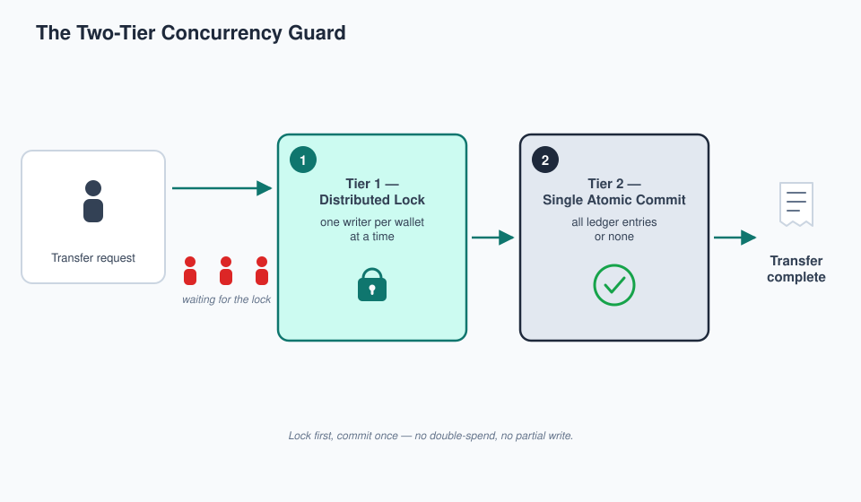
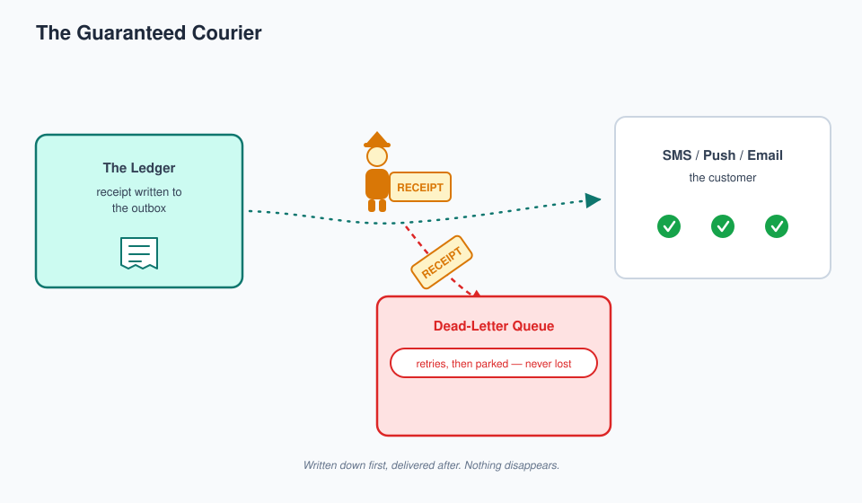
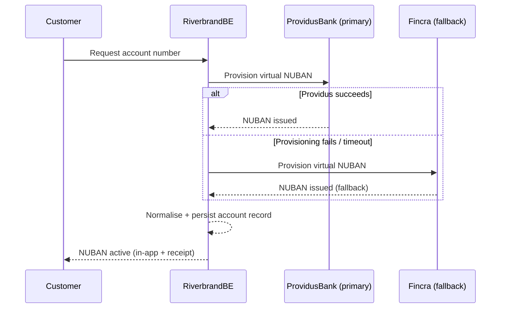

# Chapter 5 — Engineering: The Transaction Engine

> *Unlearn the single-row balance update. Learn the failure modes of concurrent money movement. Relearn the two-tier guard, the immutable ledger, and the delivery guarantees Riverbrand ships instead.*

## Recap

- **Unlearn:** the naive transfer handler — read a balance, subtract here, add there, save both rows.
- **Learn:** race conditions, partial writes, duplicate deliveries, and provider outages are the normal case, not the edge case.
- **Relearn:** Riverbrand's transaction engine — a distributed lock per wallet, one atomic commit per transfer, an immutable double-entry ledger, idempotent references, and a guaranteed delivery pipeline for everything that happens next.

This chapter is the technical counterpart of [Chapter 4 — For Everyone: How Money Moves](ch04-for-everyone-how-money-moves.md). Every concept here has a plain-language twin there; every table name here is deliberately absent there.

## 5.1 The Two-Tier Concurrency Guard

**What we have done.** Every value-moving operation in RiverbrandBE passes through a two-tier concurrency guard before a single ledger entry is written:

1. **Tier 1 — Distributed lock.** A Redis-backed distributed lock (Redlock algorithm) is acquired on the wallet being debited, keyed `lock:wallet:{walletId}`. The lock serialises writers per wallet: two concurrent transfers touching the same source wallet are queued, not interleaved.
2. **Tier 2 — single atomic commit.** All relational effects of the operation — ledger entries, wallet balance materialisation, reference bookkeeping, pending-balance rows — are executed inside one `prisma.$transaction`. Either every row is committed or none is.

**Engineering considerations and trade-offs.** The naive design (a single `UPDATE wallets SET balance = balance - ?`) is correct only when no two operations touch the same row concurrently *and* every operation is a single statement. Real transfers are multi-step: debit one wallet, credit another, record two ledger lines, stamp an idempotency reference. Under concurrency, two such flows interleave and one of them overdraws the source wallet — the classic double-spend. The alternative to locking is full serializable isolation on every write, which we benchmarked as prohibitively expensive for hot wallets. Locking one wallet at a time (rather than a global lock) keeps throughput proportional to wallet distribution: popular wallets serialise, everything else runs in parallel.

The lock is per-source-wallet, acquired with a short expiry and released on commit or rollback. The old documentation records the lock TTL as "5 seconds" in one chapter and "10 seconds" in another; the shipped configuration value is **UNVERIFIED** against the codebase — treat the invariant as "short-lived lock held only across the transaction window", not a specific constant. Lock acquisition has bounded retry with backoff; on exhaustion the operation fails cleanly with a lock-timeout error rather than proceeding unlocked.

**The approach taken.** Pseudocode of the shipped flow:

```ts
// Conceptual shape of the transfer path (simplified)
async function executeTransfer(cmd: TransferCommand) {
  return await withWalletLock(cmd.sourceWalletId, async () => {
    return await prisma.$transaction(async (tx) => {
      assertSufficientAvailableBalance(tx, cmd);      // includes pending-balance rules
      const ref = await reserveIdempotencyRef(tx, cmd); // §5.3
      await writeDoubleEntry(tx, cmd, ref);            // §5.2, two lines, zero-sum
      await materialiseBalances(tx, cmd);              // cached balances, same commit
      await appendOutbox(tx, cmd, ref);                // §5.4, same commit
      return ref;
    });
  });
}
```

Two properties fall out of this shape and are load-bearing:

- **No interleaving** between the balance check and the balance mutation for one wallet (Tier 1).
- **No partial transfer**: a failure anywhere in the callback rolls back every row, including the outbox append (Tier 2).

Note what the lock deliberately does *not* cover: it is scoped to the source wallet, not to the whole transfer. A transfer that debits wallet A and credits wallet B needs mutual exclusion only on the side being checked-then-mutated; the credit side is a pure append (the ledger invariant, not a balance floor, governs it). Multi-wallet batch operations (payroll-style fan-out) acquire locks in a stable order by wallet identifier to avoid lock-ordering cycles, and each leg remains its own transaction with its own reference.

Lock observability is first-class: acquisition attempts, hold durations, and timeouts are exported to the metrics endpoint (see [§11.4](ch11-engineering-operations-manual.md#114-observability-and-metrics)), because a latency spike in transfers is almost always a lock-contention story before it is a database story. The dashboard questions we ask of a slow transfer are therefore, in order: is the lock waiting, is the transaction long, and only then — is the database slow.

**Why we have done that and the benefits.** The lock solves the check-then-act race at the cheapest possible scope. The single commit solves the partial-write failure class entirely — there is no observable state in which a debit exists without its credit. Measured effect under tested load: the ledger never reports a non-zero-sum transfer, and wallet drift between cached balances and ledger sums is eliminated at write time rather than repaired later.

**What we can look to improve in the future.** The single-wallet lock serialises the rare hot wallet (a popular biller's inbound credits). The roadmap's event backbone ([§15.1](ch15-engineering-roadmap.md#151-the-event-backbone)) points at per-wallet stream partitions as the natural evolution: ordering guaranteed by log offset rather than an advisory lock. Until then, the lock is simple, observable, and correct.



## 5.2 The Immutable Double-Entry Ledger

**What we have done.** Every value movement writes exactly two ledger lines (debit and credit) into an append-only journal. Rows are never updated or deleted once written; corrections are new reversing entries. Aggregate balances are materialised for read performance (`GLBalanceSnapshot` and wallet balance fields), but the journal is the source of truth and snapshots are recomputable from it.

**Engineering considerations and trade-offs.** Mutable balance columns are fast to read and impossible to audit — the moment `balance` is the truth, there is no record of *how* it reached its current value, and any bug silently corrupts history. An append-only journal costs extra rows per operation (a 2-line write per transfer plus snapshot update) and makes "current balance" a derived value. We accept the write amplification: banking correctness is an audit property, not a read-latency property, and snapshots restore read speed.

The journal lines for one operation share a journal-entry identifier and are written in the same transaction as everything else (§5.1). The invariant enforced at write time: for every journal entry, `SUM(debits) = SUM(credits)`.

**The approach taken.** The ledger models the bank's books, not one customer's balance: wallet positions live in ledger accounts (per wallet per currency), and every transfer is a move between two accounts. Currency is a first-class dimension — a NGN debit never becomes a USD credit without a two-leg FX conversion recorded as its own pair of entries (admin-driven rates, see [§3.3](ch03-domain-primer.md#33-wallets-and-the-five-currencies)).

```ts
// Two lines, one journal entry, zero sum
await tx.gLJournalEntry.create({
  data: {
    reference: ref,
    lines: [
      { account: srcAccount, direction: 'DEBIT',  amount: minorUnits },
      { account: dstAccount, direction: 'CREDIT', amount: minorUnits },
    ],
  },
});
```

Amounts are integer minor units throughout — no floating-point money anywhere in the engine. Account identifiers are stable for the life of a wallet; closing a wallet marks the account inactive but never rewrites its history, so old journal lines always resolve against the same account row.

**Why we have done that and the benefits.** Immutability makes reconciliation mechanical: any point-in-time balance is a deterministic sum over history, and any discrepancy between snapshot and journal is detectable and repairable by replay. It also makes the audit trail ([§9.5](ch09-engineering-security-architecture.md#95-the-non-blocking-audit-trail)) a statement about the ledger's own history rather than a side log that can drift.

**What we can look to improve in the future.** Snapshot rebuild currently replays the journal in application time; a streaming rebuild over the event backbone (§15.1) would make point-in-time recovery a consumer, not a batch job.

## 5.3 Idempotency References

**What we have done.** Every value-moving request carries a client-supplied or server-minted reference (for example `TRF-NGN-20260815-88392011` for transfers, `DEP-PRV-…` for provider deposits). References are reserved in `rbp_brand_references` *inside the same transaction* as the transfer itself. A retry that presents an existing reference is answered with the original outcome — never re-executed.

Reference reservation is not a cache lookup performed before execution; it is a uniqueness constraint enforced during execution. That distinction matters: a cache lookup has a window between "not found" and "committed" in which a concurrent duplicate slips through. A unique insert inside the transaction has no such window — the database arbitrates.

**Engineering considerations and trade-offs.** The problem is at-least-once delivery everywhere in the system: clients retry on timeout, webhooks redeliver, job runners reprocess. Without idempotency, every retry is a second transfer. The alternatives — client-generated UUIDs checked before execution, or natural keys like (wallet, amount, timestamp) — fail in practice: UUIDs need a durable reservation step anyway, and natural keys collide.

Reserving the reference in the same commit as the transfer closes the remaining race: two concurrent retries both attempt to insert the same reference row; the unique constraint lets exactly one proceed and the other observes the conflict and reads the winner's outcome.

**The approach taken.** Reference format is human-readable and sortable: `TYPE-CURRENCY-DATE-SEQUENCE`. The reference row records the request fingerprint and the terminal outcome (succeeded / failed / reversed), so a late retry after a failure also gets the recorded failure — it does not silently get a second attempt with different semantics. Duplicate submissions return the stored response payload and an explicit duplicate indicator.

**Why we have done that and the benefits.** Retries become safe by construction at every boundary — mobile client, webhook receiver, reconciliation job. This is the mechanism that lets the rest of the system be liberal with retries without fear of duplicate credits.

**What we can look to improve in the future.** A reference TTL policy for abandoned in-flight reservations, and per-channel reference namespaces so cross-channel collisions are structurally impossible (today the type prefix prevents them by convention).

## 5.4 The Outbox and Dead-Letter Queue

**What we have done.** Side effects of a transfer — receipts, SMS, push notifications, webhook forwards — are not sent during the transaction. They are written as rows in `rbp_brand_outbox` *inside the same commit* as the ledger entries. A background worker (`OutboxJob`) drains the outbox, performs delivery, and marks rows done. Deliveries that exhaust retries move to `rbp_brand_deadletter` (`DlqJob`) for inspection and replay.

**Engineering considerations and trade-offs.** Calling an SMS gateway inside a database transaction is the classic distributed-systems mistake: the gateway times out, the transaction rolls back, but the message may have been sent — or the transaction commits and the message never went out. The outbox pattern removes the distributed commit problem by making delivery a *consequence* of committed state, not part of it.

The trade-off is latency and complexity: receipts arrive asynchronously (typically sub-second under normal load, but not transaction-latency), and there is now a queue to monitor. The alternative — synchronous fan-out with compensating actions — failed our reliability review: there is no compensating action for "customer told twice" or "customer never told".

**The approach taken.** `OutboxJob` polls with `LISTEN/NOTIFY` wake-ups and claims batches via `FOR UPDATE SKIP LOCKED`, so multiple job instances can drain concurrently without double-sending. Each row records attempt count and last error; retry policy is bounded with backoff; the terminal move is to the dead-letter table with full payload preservation. `DlqJob` surfaces dead-lettered items for operator replay — nothing is discarded silently.

Delivery payloads are channel-neutral events ("transfer completed, reference X, amount Y") rather than pre-rendered messages. Rendering happens at the edge — SMS text, push title, in-app notification — so a template change never requires reprocessing the queue, and one outbox row can fan out to several channels via the notification matrix (see [§7.4](ch07-engineering-channel-fabric.md#74-push-notifications-and-the-notification-matrix)). Channel adapters are idempotent on the outbox row identifier: a redelivery to the same adapter with the same row identifier is suppressed at the edge.



**Why we have done that and the benefits.** "Written down first, delivered after" means a crash between commit and send is recoverable — the outbox row is still there. The dead-letter queue means a permanently failing channel is visible and replayable rather than lost. The plain-English version of this guarantee lives in [Chapter 4, §4.5](ch04-for-everyone-how-money-moves.md#45-the-guaranteed-courier) and the courier analogy in [Appendix F](../appendices/app-f-analogy-atlas.md).

**What we can look to improve in the future.** Today's outbox is table-backed and polled; the roadmap (§15.1) replaces the poll with a change-data-capture stream (Debezium) publishing to Kafka/Redpanda — same commit semantics, higher fan-out throughput.

## 5.5 Virtual NUBAN Lifecycle

**What we have done.** Each customer is provisioned with virtual account numbers (NUBANs) they can pay into from any bank. Provisioning is provider-backed: **ProvidusBank is the primary** provider; **Fincra is the fallback** if Provisioning at Providus fails or the provider is unavailable. Inbound credits to a NUBAN arrive as provider webhooks, are matched to the customer's wallet, and become ledger deposits.

**Engineering considerations and trade-offs.** A NUBAN is only useful if it is (a) unique to the customer, (b) recognised by the bank transfer rails, and (c) reliably matched back on receipt. Depending on one provider creates a single point of failure for account provisioning and inbound matching. Two providers create the matching problem: each has its own webhook payload, reference conventions, and retry behaviour. The engine normalises both into one internal deposit event before anything touches the ledger.

**The approach taken.** Provisioning is a state machine per account request: requested → provisioned (provider, account number, bank) → active. If the primary provider errors or times out, the request escalates to the fallback provider; the resulting NUBAN records which provider owns it so inbound webhooks route to the right adapter.



**Figure 5.1 — Virtual NUBAN provisioning with primary/fallback escalation.**

Inbound deposits follow the reverse path: provider webhook → adapter normalisation → idempotent reference check (§5.3) → ledger credit → outbox receipt (§5.4). Unmatched inbound references land in a review queue rather than being guessed.

**Why we have done that and the benefits.** Customers get a working account number on day one, and the bank keeps receiving money through at least one rail when a provider has an outage. The plain-English twin is [Chapter 4, §4.1](ch04-for-everyone-how-money-moves.md#41-aminas-salary-lands-a-persona-story).

**What we can look to improve in the future.** Provider health scoring to prefer the currently healthier provider, and a reconciliation sweep for webhook gaps (today's `ReconciliationJob` covers the scheduled sweep; §15.2 moves matching to a streaming model).

## 5.6 The Pending-Balance Holding Tank and KYC Ceilings

**What we have done.** Every KYC tier has a daily ceiling and a balance ceiling (the old documentation records illustrative tiers of ₦50,000 / ₦200,000 / ₦5,000,000; live values are configured per tier in `rbp_brand_kyc_benefit` and are **UNVERIFIED** against the codebase). A deposit that would push a customer past their tier's ceiling is not rejected: the excess is quarantined in a pending-balance holding tank (`rbp_brand_pending_balance`, with an audit twin `rbp_brand_pending_balance_audit`). The customer's available balance reflects only settled funds. When the customer upgrades their KYC tier, quarantined funds are released automatically up to the new ceiling.

**Engineering considerations and trade-offs.** Rejecting over-ceiling deposits is simple and hostile: a salary payment that fails because the recipient's verification is stale is a customer lost. Silently accepting over-ceiling deposits is non-compliant. The quarantine tank is the middle path — money is never lost, the ledger records both the arrival and the hold, and compliance ceilings are enforced on *available* balance.

The hard part is consistency: the hold decision, the deposit entry, and the ceiling check must be one atomic outcome (they are — same commit as §5.1/§5.2). Daily ceilings additionally require a per-tier day bucket (`rbp_brand_daily_limit_tracker`), which is keyed by (wallet, tier, day) and updated in-transaction.

**The approach taken.** On each inbound credit:

1. Compute `allowed = ceiling(tier) - currentAvailable - todayOutflow(dayBucket)`.
2. If `amount <= allowed`: credit available balance, write ledger entries, done.
3. Else: credit `min(amount, allowed)` to available and the remainder to pending, write ledger entries for the full amount (the funds are the bank's liability either way), write the quarantine row + audit row, and notify the customer through the outbox.

On tier upgrade, a release job moves pending funds to available up to the new ceiling and writes reversing audit rows.

**Why we have done that and the benefits.** Compliance ceilings become enforceable without turning good customers away. The audit twin of the tank table means every hold and release is traceable without touching the immutable journal. The plain-English twin is [Chapter 4, §4.4](ch04-for-everyone-how-money-moves.md#44-the-quarantined-balance).

**What we can look to improve in the future.** Per-velocity limits (rolling windows rather than calendar days) and a self-service upgrade path that previews "how much would be released" before the customer starts verification.

## 5.7 Failure-Mode Matrix

The engine is designed around these operational failure modes. This is the honest map of what can go wrong and what the system does about it. Every row here corresponds to a real behaviour of the guards described above — if a failure mode is not in this table, it is either mitigated structurally (atomic commit makes partial writes unrepresentable) or it is a gap we have consciously accepted and should discuss.

| Failure | Detection | Mitigation | Customer impact |
|---|---|---|---|
| Two concurrent transfers on one wallet | Lock contention (bounded retry) | Tier-1 lock serialises; second transfer runs after the first commits | One transfer may wait milliseconds longer |
| Process crash mid-transaction | Transaction never commits | Tier-2 atomic rollback — no ledger rows, no balance change, no outbox row | Retry succeeds normally |
| Client retries after timeout | Reference already in `rbp_brand_references` | Stored outcome returned; no second execution | Sees the original result |
| Provider webhook delivered twice | Idempotent reference check | Second delivery is a no-op | None |
| SMS/push gateway down | Outbox row stays undelivered (attempts increment) | Retry with backoff; then dead-letter for replay | Receipt is late, money movement is unaffected |
| Outbox worker crash | Row claimed but not marked done | `SKIP LOCKED` + visibility timeout returns row to the pool | At most a brief delay |
| Primary NUBAN provider outage | Provisioning call fails/times out | Escalation to fallback provider (§5.5) | Account number still issued |
| Inbound transfer with unknown reference | Match step finds no reservation | Review queue; no guessed credit | Credit may pause pending review |
| Deposit exceeding KYC ceiling | Ceiling check in-transaction | Excess quarantined in the holding tank (§5.6) | Funds safe but not spendable until upgrade |
| Redis unavailable (lock service) | Lock acquisition fails | Operations fail closed (no unlocked writes) | Transfers fail fast and retry later — never proceed unlocked |
| Cached balance vs journal drift | Reconciliation job (sum vs snapshot) | Replay from journal; alert on mismatch | None if caught by the sweep |

## Key Takeaways

- **Two tiers, one guarantee:** a per-wallet distributed lock serialises writers, and a single atomic commit makes every transfer all-or-nothing.
- **The ledger is append-only:** balances are derived; history is the truth; corrections are new entries.
- **References make retries safe:** a transfer executes at most once, no matter how many times it is submitted.
- **Delivery is a consequence, not a step:** outbox-first receipts and a dead-letter queue mean nothing is lost between commit and customer.
- **Compliance without hostility:** over-ceiling deposits are quarantined, not rejected, and released on upgrade.
- **Failing closed is a feature:** if the lock service is down, transfers stop — they never run without the guard.

## Frequently Asked Questions

### Why not use a database row lock instead of Redis Redlock?
Row locks would work for single-wallet operations and would hold a database connection for the lock duration. The two-tier design keeps the serialisation scope outside the connection pool (PgBouncer's 50-connection budget is precious — see [§11.2](ch11-engineering-operations-manual.md#112-ports-health-and-api-documentation)) and extends cleanly to multi-wallet operations.

### What happens if the process dies after the commit but before the outbox job runs?
Nothing is lost. The outbox row is part of the commit; the job drains it after restart. At-most-once delivery of the *notification* is not guaranteed — at-least-once is, with idempotent downstream handling.

### Can a transfer ever appear in the ledger without its counter-entry?
No. Both lines are written in one journal entry inside one transaction; the zero-sum invariant is checked at write time.

### How is FX handled in the ledger?
Two journal entries: source-currency debit pair and destination-currency credit pair, at the admin-configured rate. FX legs are never a single mixed-currency line.

### Why are amounts integer minor units?
Floating-point arithmetic cannot represent money exactly. Every amount in the engine is an integer count of the currency's smallest unit.

## Where to Go Next

*For everyone, see [Chapter 4 — For Everyone: How Money Moves](ch04-for-everyone-how-money-moves.md).*
*Next, [Chapter 6 — Wealth Building and WhatsApp Banking](ch06-for-everyone-wealth-and-channels.md) or the engineering twin [Chapter 7 — Savings Products and the Channel Fabric](ch07-engineering-channel-fabric.md).*
