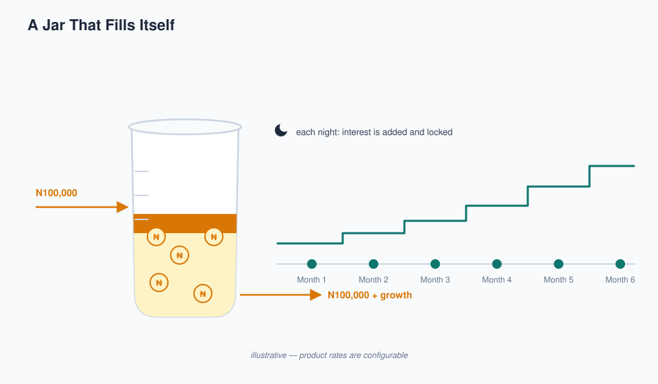

# Chapter 6 — For Everyone: Wealth Building and 24/7 WhatsApp Banking

> *Unlearn the idea that banking features are just screens and balance numbers. Learn the real journeys, rules, and risks behind each feature. Relearn what Riverbrand actually built for people, and why it holds.*

## Recap

- **Unlearn:** The idea that a savings feature is just another balance on a screen, and that banking always starts with a heavy app download.
- **Learn:** The real journeys behind each product — money that locks away on purpose, sweeps that run while you sleep, interest that grows night by night — and a chat channel that can fail and be switched.
- **Relearn:** What Riverbrand actually built for people: three wealth products and a 24/7 chat window with spare wiring behind it, and why that design holds.

## 6.1 Safelock, Target Savings, and AutoSave Stories

This chapter follows three customers. None of them is a banker. Each of them wanted the same two things: a place where money could grow without constant willpower, and a way to bank without fighting with their phone.

**Chinelo, the fabric trader, and the locked vault.** Chinelo sells wax prints in Aba. Her business runs on cash flow: money arrives in bursts after market days, and it disappears just as fast — restocking, transport, school runs, an uncle's naming ceremony. She had tried saving by "keeping money aside" in her everyday account. It never survived the month. So when her bank offered her a **Safelock** — a savings vault that she could lock shut for a fixed stretch of time — she moved ₦250,000 of post-market spare cash into a 180-day lock. The money left her everyday wallet the moment she locked it. For the next six months it could not be spent, transferred, or quietly eaten by a bad week. It sat in the vault earning a slice of interest every single night. Chinelo could still see the balance growing; she just could not touch it. On the day the lock ended, the principal plus the interest came back to her everyday wallet automatically. She did not stand in a queue, file a form, or remember a maturity date. The vault opened on schedule and paid her out.

There is one honest catch, and Chinelo knew it before she locked. If she had been forced to break the lock early — a genuine emergency — the vault would open, but not on the same terms. A breakage penalty, documented at roughly 20 to 30 percent of the interest she had earned so far, would be deducted, along with any government withdrawal tax that applies. She would get her principal back and the remainder of the interest. That penalty is not a punishment; it is the price of the promise. A lock that anyone can open at any time is not a lock, and the whole point is to protect Chinelo from her own worst market week. Safelock locks can run from 30 to 365 days, so she can choose a horizon that matches the cash she can truly spare.

**Emeka, the student, and the ₦200,000 target.** Emeka is in his third year at university. His school fees for the coming session are ₦200,000, due in nine months. He does not have a lump sum; he has a part-time tutoring income that arrives weekly and evaporates weekly. So he opened a **Target Savings** goal — the goal was named "School Fees," the target was ₦200,000 — and he set an automatic sweep: every week, a fixed amount moves from his everyday wallet into the goal, without him lifting a finger. Some weeks he adds extra when a client pays early. The goal shows him where he stands against the ₦200,000 line. The discipline is not in his memory; it is in the schedule. Automated daily, weekly, or monthly sweeps toward a named target are exactly what Target Savings is for. Emeka's case is a school-fee goal; the same shape works for a car down payment, a rent advance, or a wedding. The point is the same: name the goal, name the schedule, and let the schedule do the remembering.

**The Okonkwo family and the invisible habit.** The Okonkwos — a dual-income household in Lagos with two children — did not want a lock and did not want a goal with a date. They wanted the family to stop arriving at December with nothing. They turned on **AutoSave**, a rule that watches their everyday wallet and sweeps a slice of idle money into a savings pool automatically: on a schedule, and as inflows land. When salary arrives, the rule skims the agreed share before anyone can spend it. When the wallet sits idle above a level they set, the surplus gets swept too. Paying yourselves first is old advice; AutoSave is the version that does not depend on remembering the advice at 11 p.m. on payday. The family barely notices the sweeps. What they notice is that the pool at the end of the year is no longer empty.

**In Plain Words.** Safelock is a timed vault: you lock money away for 30 to 365 days, it earns interest while it is locked, and it comes back to you automatically at the end — with a penalty if you break it early. Target Savings is a goal with a schedule: you name an amount and a date, and money moves toward it on a rhythm you choose. AutoSave is a habit on autopilot: spare money in your everyday wallet is swept into savings without a decision in the moment. All three sit on the same honest record of who owns what — the bank's ledger, explained in [Chapter 3, §3.1](ch03-domain-primer.md#31-double-entry-in-plain-words) — so a sweep, a lock, and a payout are all entries in one book, not promises scribbled in another.

## 6.2 Compounding Made Tangible

Interest is easy to quote and hard to feel. Percentages in a brochure do not look like anything. So let us walk through one worked example, slowly, the way the money actually arrives — night by night, like a jar filling.

Take ₦100,000 in a Safelock vault at an annual rate of 8 percent, locked for six months (180 days). Before the arithmetic, two honest disclaimers. First, this example is illustrative: the rate a customer actually earns is product-configurable, set by the bank's savings configuration and disclosed at the moment of locking, not fixed by this book. Second, the example uses 8 percent because it matches the kind of rate the product documentation uses in its worked scenarios; your vault may show a different number. The mechanism — a slice earned every night — is what matters.

At 8 percent per year, the slice earned each night works out to roughly:

> ₦100,000 × 8 ÷ 365 ÷ 100 ≈ **₦21.92 per night**

Now watch the jar. On night one, a small drop lands. On night two, another. The drops are almost boringly small — nobody wakes up rich from ₦21.92. But the jar does not stop filling:

| After… | Nights passed | Interest added (roughly) | Vault holds |
|---|---|---|---|
| One week | 7 | ₦153 | ₦100,153 |
| One month | 30 | ₦658 | ₦100,658 |
| Three months | 90 | ₦1,973 | ₦101,973 |
| Six months | 180 | ₦3,945 | ₦103,945 |

That final row is the whole lesson: a sum Chinelo would never have "found" by saving manually has appeared through nothing but time and a lock she did not open. If the interest earned each night is folded back into the balance so that later nights earn on a slightly larger jar, the fill is a little faster near the end — on the order of ₦104,030 instead of ₦103,945 at this rate — and that folding-back is what "compounding" means in plain words: the jar starts earning on the drops, not just on the original fill. Either way, the money lands automatically. The nightly run recalculates the slice for every active vault, adds it to the balance, and writes down what it added, so the growth is not a rounding story told after the fact — it is a dated record. At maturity, principal plus interest returns to the everyday wallet with no paperwork.

The habit is the point, not the rate. A higher rate fills the jar faster; a longer lock keeps the jar closed longer. But a customer who locks a little every quarter, or sweeps a little every week into a goal, builds the same shape of discipline that institutional savers pay advisors to enforce. That is what "wealth building" means in this book: not stock tips, not speculation — a closed jar, a nightly slice, and a schedule that outlasts moods.

## 6.3 Banking in a Chat Window

Picture a private concierge banker who answers within a second, at any hour, on any day of the year — no appointment, no queue, no hold music. Now picture that banker living inside an app you already have open: WhatsApp. That is the shape of Riverbrand's chat channel. You text, the bank replies, you confirm with your secret 4-digit PIN, and a receipt arrives in the same conversation.

What can a customer do in the chat window? The full everyday loop:

- **Register.** Text "Hi" to the bank. Verify your phone number, give your name, confirm your email with a one-time code (a code sent once and used once), complete identity checks, set your PIN — and receive your own account number (a NUBAN, the standard Nigerian virtual account number) without ever visiting a branch. The design goal is onboarding measured in about a minute; treat that as an aim we are driving at, not a number we have proven at scale.
- **Check balances.** Ask where you stand, across the currencies you hold.
- **Transfer money.** Send to any Nigerian bank account. The chat resolves the recipient's real name before you confirm — so "send ₦5,000 to Mom" ends with you seeing whose account is actually about to be debited.
- **Buy airtime and data.** Top up any of the major networks — MTN, Airtel, Glo, 9mobile — for yourself or anyone else.
- **Pay bills.** Electricity (prepaid tokens and postpaid clearance), and television subscriptions such as DSTV and GOTV, delivered into the chat as tokens and receipts.
- **Complete identity checks.** Submit your NIN, upload what is asked for, and watch your limits rise (see [Chapter 8](ch08-for-everyone-safety-and-compliance.md)).

Every money movement requires your 4-digit PIN, and every completed action earns a receipt card in the conversation — not a text message you cannot find later, but a record in the same thread you asked in.

**Why this matters for market reach.** The naive plan says: build a beautiful app, put it on the stores, and wait for downloads. In the markets Riverbrand is built for, that plan leaks customers at every step. Phones are full — a 100-megabyte download is a real decision when storage is scarce. Data is expensive — app-store updates and long installs cost money that people would rather keep. Connectivity is uneven — a download that dies at 80 percent is a customer who gives up. WhatsApp is already installed, already open, already trusted for daily life. If someone can text a friend, they can bank. That is the reach argument: the chat window meets people on the device behavior they already have, instead of taxing them for a new one.

There is one more quiet detail that customers feel without naming. The conversation remembers where it was. If your phone dies while you are typing an amount, you can come back and resume roughly where you left off, within a timeout window, rather than starting the whole dance again. The banker, in other words, does not get amnesia between your messages. For the plain-language version of how money moves safely inside these flows, see [Chapter 4](ch04-for-everyone-how-money-moves.md); the mechanism lives in [Chapter 7](ch07-engineering-channel-fabric.md).

## 6.4 When a Provider Fails

A chat channel is only as open as the wiring behind it. If the bank is plugged into exactly one messaging company — one WhatsApp service provider — then that company's bad day becomes your bad day: messages stop arriving, replies vanish, and a customer staring at a silent chat assumes the bank itself is gone. Single-vendor dependence is the power-strip problem. One socket, one plug, one failure.

Riverbrand is wired like a power strip with several outlets. The bank keeps live connections to more than one messaging provider — the market names are Meta's own WhatsApp Business service, Twilio, Termii, Wati, Interakt, and 360dialog — and if one of them drops, the conversation moves to another. The customer does not see the switch. What they see is a chat that keeps answering. This is the multi-plug story from the analogy collection in [Appendix F](../appendices/app-f-analogy-atlas.md): when one socket dies, you move the plug to the next one instead of waiting for an electrician.

Two properties make the switch real rather than aspirational. First, the memory of your conversation — where you were in a transfer, what you had typed so far — belongs to the bank, not to the middleman carrying the messages. It is kept in the bank's own short-term conversation store, so moving to another provider does not erase your session. Second, the switch itself is designed to be a configuration change, not a code rewrite: operations can point the channel at a different provider and leave the banking logic untouched. The engineering behind both properties — the provider factory and the conversation state machine — is the twin chapter, [§7.2](ch07-engineering-channel-fabric.md#72-the-whatsapp-provider-factory) and [§7.3](ch07-engineering-channel-fabric.md#73-the-conversation-state-machine).

To be honest about the trade-off: keeping several adapters means more code to maintain and more ways for message formats to drift, and switching mid-conversation is a choreographed move, not magic. It is also possible for WhatsApp itself — the platform all of these providers sit on — to have a bad day, and no amount of spare wiring helps then. What the redundancy buys is narrower and still valuable: the bank is not hostage to one reseller's downtime, pricing change, or sudden API deprecation. Failures get routed around instead of broadcast to customers.

## 6.5 What We Built, Why, and Where It Goes

**What we built.** A wealth engine with three plain products — Safelock, the timed vault; Target Savings, the goal with a schedule; and AutoSave, the invisible habit — sitting beside everyday spending on one honest record. And a 24/7 chat window that carries the full everyday loop (register, check, transfer, airtime, bills, identity) with spare wiring behind it, so a provider failure is a shrug instead of an outage. Nightly interest accrual, automatic maturity payouts, automatic sweeps, and in-chat receipts are all part of the same design: the routine work of wealth building should not depend on a customer remembering to do it.

**Why it matters.** Ordinary people are asked to choose between a checking account that pays nothing and a savings app that cannot pay a bill. Riverbrand refuses that choice. A trader can lock spare cash away from her own impulses, a student can fund next session's fees on a schedule, and a family can save without noticing — all reachable from the chat window they already keep open. Discipline gets automated; access gets widened; the record stays honest.

**What we aim for.** Onboarding measured in about a minute of chat. Savings habits that form without friction. A channel that answers at 2 a.m. and keeps answering when a provider stutters. Progress that is visible — a goal filling, a jar rising — so customers feel the compounding instead of being quoted it. Honest metrics only: these are the outcomes the design is pointed at, and they are the outcomes we intend to measure as the product runs.

**The approach ahead.** The next chapters of the product are already mapped. Natural-language chat — typing "send ₦5,000 to Tunde from my dollar savings" instead of tapping menus — is on the roadmap, along with more currencies, more rails, and open-banking connections. The plain-language version of that future is [Chapter 14](ch14-for-everyone-future-roadmap.md); the engineering timeline is [Chapter 15 — Engineering: The Upgrade Roadmap](ch15-engineering-roadmap.md). What must not change on the way there is the shape proven in this chapter: money that grows through schedules instead of willpower, reachable through a window that stays open.

## Key Takeaways

- **Safelock is a timed vault** (30 to 365 days): money locks away on purpose, earns interest nightly, and returns automatically at maturity — with a documented penalty, roughly 20 to 30 percent of interest earned so far, if broken early.
- **Target Savings and AutoSave automate discipline**: scheduled daily, weekly, or monthly sweeps toward a named goal, and rule-based sweeps of idle money, so saving does not depend on remembering to save.
- **Compounding is a jar filling nightly**, not a slogan: a worked example of ₦100,000 at an illustrative 8 percent grows by roughly ₦21.92 a night, on the order of ₦4,000 over 180 nights — rates are product-configurable, the nightly habit is the point.
- **WhatsApp banking is a private concierge**: register, check balances, transfer, buy airtime, and pay bills with no app download — meeting customers on the device behavior they already have.
- **The channel has spare wiring**: if one messaging provider drops, the conversation moves to another, because the customer's session belongs to the bank, not the middleman.

## Frequently Asked Questions

### What happens if I need my Safelock money before the lock ends?

You can ask for an early break, and the vault will open — but on different terms. A breakage penalty, documented at roughly 20 to 30 percent of the interest you have earned so far, is deducted, along with any applicable government withdrawal tax. You receive your principal plus the remaining interest. The penalty exists so that the lock actually protects you from impulse spending; it is disclosed before you lock, not discovered at the exit.

### Do I have to download an app to use Riverbrand?

No. The everyday loop — registering, checking balances, transferring money, buying airtime, and paying bills — is designed to run entirely inside a WhatsApp chat. A mobile app is one window onto the same account, not a requirement to own one. This is deliberate: storage limits, data costs, and interrupted downloads are real barriers, and the chat window removes them.

### What happens if the messaging service behind the chat goes down?

The bank is wired to more than one messaging provider at once. If one drops, the conversation is designed to move to another, and because your session is held by the bank rather than the provider, you keep your place in the conversation. There is a residual risk no one can wire away: if WhatsApp itself is unavailable worldwide, chat is quiet until it returns — your money is still safely recorded either way.

### Is my money earning interest while I save toward a goal?

Interest accrual as documented runs nightly on locked Safelock deposits; Target Savings and AutoSave are primarily accumulation tools — automatic sweeps toward a goal or into a savings pool. Whether those pools earn the same nightly yield is **UNVERIFIED** against the product record as of this writing; check the rate disclosure shown when you open a goal. Safelock's yield and schedule are disclosed at the moment you lock.

### What if I change phones or lose my phone mid-conversation?

Your account and your money live on the bank's record, not on your phone. A new phone can reach the same account through the same chat channel after verification. Mid-conversation, the session is held for a timeout window so you can resume rather than restart; after the window, you simply begin again — nothing is lost except the unfinished step. If your phone is stolen, [Chapter 8](ch08-for-everyone-safety-and-compliance.md) covers locks, PINs, and how quickly access can be shut off.

## Where to Go Next

*For engineers, see [Chapter 7 — Engineering: Savings Products and the Channel Fabric](ch07-engineering-channel-fabric.md).*
