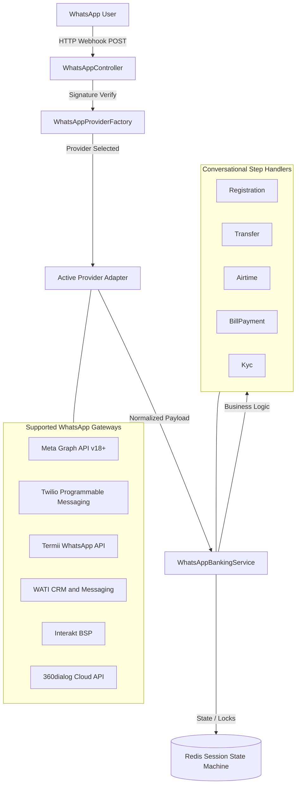
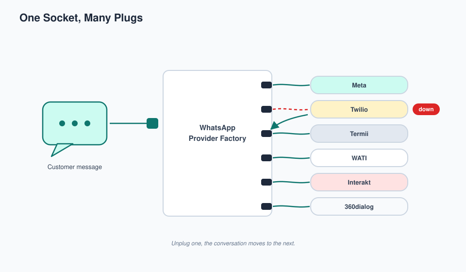
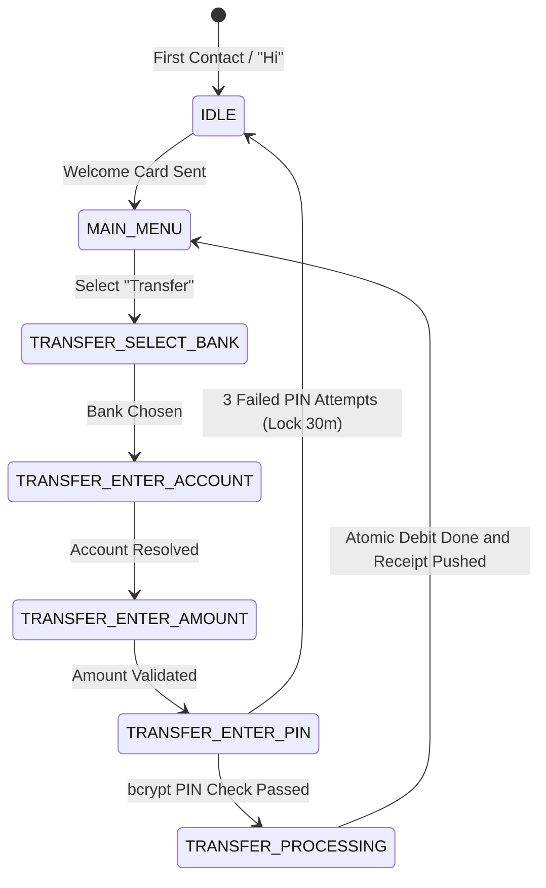

# Chapter 7 — Engineering: Savings Products and the Channel Fabric

> *Unlearn the naive implementation you would write first. Learn the failure modes and race conditions that break it. Relearn the architecture Riverbrand ships instead.*

## Recap

- **Unlearn:** The naive implementation you would write first — a nightly loop that mutates balances in place, and a chat bot hardcoded to a single WhatsApp vendor with its state stashed in whatever variable is nearest.
- **Learn:** The failure modes and race conditions that break it: double-run interest, provider outages and webhook replays, dropped sessions, dead device tokens, and conversion math that drifts away from the admin's rate table.
- **Relearn:** The architecture Riverbrand ships instead — an interest job that writes dated rows behind every accrual, a provider factory behind one interface, a conversation state machine in Redis, a self-healing push pipeline, and admin-driven multi-currency wallet semantics.

## 7.1 SavingsJob and the Compounding Math

The wealth engine lives in `SavingsService` (`src/services/monetary/savings/savings.ts`) and serves three products over one wallet: **Safelock** fixed deposits, **Target Savings** goals with automated sweeps, and **AutoSave** rule-based sweeps. All three debit and credit ordinary `Wallet` balances; the difference is what happens in between.

**Safelock locking.** `createSafelock(userId: bigint, amount: Decimal, tenureDays: int)` debits the customer's main wallet and locks the funds inside a `Target` record where `savingsType = SAFELOCK`. Tenures run **30 to 365 days**, with 30, 90, 180, and 365 as the documented tiers. The locked capital is inaccessible until maturity by design — the product's job is impulse control as much as yield. A matured deposit is released by `liquidateMaturedSafelock(safelockId: bigint)`: on the maturity date (`endDate`), principal plus net accrued interest is credited back to the customer's primary wallet automatically by the maturity handler (`SafelockMaturedHandler`).

**The daily yield formula.** Accrual is daily, computed from the annual rate:

$$\text{Daily Yield} = \frac{\text{Principal Amount} \times \text{Annual Interest Rate (\%)}}{365 \times 100}$$

For a worked line: ₦100,000 at 8% p.a. yields ₦100,000 × 8 ÷ (365 × 100) ≈ **₦21.92 per day**. Over a 180-day tier at the documented 8% example rate, nightly accrual adds roughly ₦3,945 against the opening principal; if each night's yield is folded into `currentAmount` before the next computation, the closing balance lands near ₦104,032. The exact rate is product-configurable (the record documents 8% p.a. in the USD Safelock journey of [§1.3](ch01-riverbrand-story.md#13-what-riverbrand-is-the-product-map)) — treat the numbers as worked examples, not published pricing. The customer-facing version of this arithmetic is [Chapter 6, §6.2](ch06-for-everyone-wealth-and-channels.md#62-compounding-made-tangible).

**The nightly accrual job.** `SavingsJob` (`src/job/savings.ts`) runs at **00:00 UTC** on a daily cron (`0 0 * * *`). It iterates through active locked deposits, calculates the daily yield for each, updates `currentAmount`, and records a row in **`savings_usersavinginterestlog`**. That last step is the part a naive implementation skips, and the part worth defending: the interest log is the dated trail of what was accrued and when. Reconciling "why does this vault hold ₦103,945?" becomes a query over immutable rows instead of a re-derivation of history. The job is listed in the platform's jobs fleet alongside `OutboxJob`, `DlqJob`, `ReconciliationJob`, and the rest (see [Chapter 11](ch11-engineering-operations-manual.md)).

**Target Savings and AutoSave.** Target Savings stores a customer-defined goal as a `Target` record and runs **scheduled daily, weekly, or monthly debits** via cron jobs, moving money from the everyday wallet toward the goal. AutoSave is the sibling rule: periodic, rule-based sweeping of idle primary-wallet balances into savings pools. Neither product invents new money mechanics — both are scheduled wallet-to-wallet movements with their own records — but they move the decision out of the customer's moment of weakness and into configuration set once.

**Early breakage.** If a customer liquidates before `endDate`, the payout is net of two deductions recorded on the product: a **breakage penalty** (`breakage_rate`, typically 20–30% of accrued interest) and a **government withdrawal tax** (`govern_withdrawal_tax_amount`). The customer receives net principal plus remaining interest. Note the semantics: the penalty bites the interest, not the principal — the design punishes breaking the habit, not taking back your own capital.

**Schema note.** The tables this section names (`savings_usersavinginterestlog`, `Target`, `savings_config`) carry legacy prefixes: `savings_*` and `user_user` are flagged as to-be-renamed against the canonical prefix map in [§3.5](ch03-domain-primer.md#35-the-schema-prefix-map). Read them as-is today; do not build new tables on those prefixes.

**Failure modes.** The interest path is simple enough to break in boring ways:

| Failure mode | What the naive job does | What the record shows | Residual risk |
|---|---|---|---|
| Job runs twice for the same night | Double-accrues interest; vault balance inflates | One dated row per accrual in `savings_usersavinginterestlog` makes the duplication visible and auditable | Idempotency enforcement across re-runs is **UNVERIFIED** in the docs |
| Job misses a night (deploy, crash) | Silent gap; customer under-earned | Gap detectable by comparing vault tenure to log rows | Automatic catch-up logic is **UNVERIFIED** |
| Maturity lands while job is mid-run | Payout reads a half-updated `currentAmount` | Maturity payout is an event-driven handler on `endDate`, separate from accrual | Interaction between the two is **UNVERIFIED** under concurrent execution |
| Early break during accrual | Penalty computed on a stale interest figure | Breakage math keys off accrued interest rows | Exact ordering vs. the nightly job is **UNVERIFIED** |

None of these are exotic. They are the reason the accrual writes a row every night instead of mutating a balance and hoping — the same ledger-first instinct the transaction engine takes in [Chapter 5](ch05-engineering-transaction-engine.md).

## 7.2 The WhatsApp Provider Factory

Conversational banking in Riverbrand lives under `src/whatsapp-banking/`, and its central design decision is a refusal: never hardcode the banking logic to one WhatsApp Business Solution Provider (BSP). Provider downtime, pricing changes, and sudden API deprecations are all routine in this market (the trade-off, documented in the architecture notes, is that maintaining several adapters risks code duplication and inconsistent webhook parsing). The answer is a pluggable architecture behind one contract.

**The `IWhatsAppProvider` interface.** Every gateway adapter implements the same five-method contract:

```typescript
export interface IWhatsAppProvider {
  parseIncomingWebhook(body: any, headers: Record<string, string>): Promise<IIncomingMessage>;
  sendTextMessage(to: string, text: string): Promise<boolean>;
  sendInteractiveButtons(to: string, header: string, body: string, buttons: IButtonOption[]): Promise<boolean>;
  sendInteractiveList(to: string, title: string, sections: IListSection[]): Promise<boolean>;
  verifyWebhookSignature(rawBody: string, headers: Record<string, string>): boolean;
}
```

The contract is deliberately narrow: normalize whatever the provider posts (`parseIncomingWebhook`), prove the post is authentic (`verifyWebhookSignature`), and send three outbound shapes (text, interactive buttons, interactive lists). Everything banking-specific — sessions, PINs, ledger entries — happens above this line, in code that does not know or care which carrier is underneath.

**The six adapters.** The implementations documented for the factory are:

1. **`MetaWhatsAppProvider`** — direct Meta Graph API v18+ integration, with SHA-256 HMAC signature validation on `x-hub-signature-256`.
2. **`TwilioWhatsAppProvider`** — Twilio Programmable Messaging, authenticated via `X-Twilio-Signature`.
3. **`TermiiWhatsAppProvider`** — African telecommunications gateway optimized for direct Nigerian telco routing.
4. **`WatiWhatsAppProvider`**, **`InteraktWhatsAppProvider`**, **`ThreeSixtyDialogProvider`** — enterprise BSP connectors behind the same interface.

**The factory.** `WhatsAppProviderFactory` (`src/whatsapp-banking/providers/WhatsAppProviderFactory.ts`) resolves the active adapter at runtime from environment configuration. The developer manual's env block reads:

```bash
WHATSAPP_PROVIDER="meta" # Options: meta, twilio, termii, wati, interakt, 360dialog
WHATSAPP_PHONE_NUMBER_ID="…"
WHATSAPP_ACCESS_TOKEN="…"
WHATSAPP_VERIFY_TOKEN="…"
WHATSAPP_APP_SECRET="…"
```

The architecture notes name the same switch `WHATSAPP_ACTIVE_PROVIDER`; treat the two names as the one env-driven selector and confirm the exact key against the codebase before automating around it (**UNVERIFIED** which name ships). Either way the operational property is the documented one: switching providers is a configuration change with zero code changes and no redeploy of banking logic.

**The inbound path.** A WhatsApp user's message arrives as an HTTP webhook POST at the controller, which verifies the provider's HMAC signature (`x-hub-signature-256` for Meta, `X-Twilio-Signature` for Twilio) over the raw body *before* decoding anything, asks the factory for the active adapter, and hands a normalized payload to the conversational engine. Outbound, the engine calls the same adapter's send methods, so a receipt card is written once and rendered per provider.

**Figure 7.1 — The WhatsApp provider factory: one contract, six gateways, one engine.**





The customer-facing metaphor for this wiring is the power strip in [Chapter 6, §6.4](ch06-for-everyone-wealth-and-channels.md#64-when-a-provider-fails): several outlets, one appliance. The engineering guarantee it buys is narrower than "never down" and more useful: the bank is not hostage to a single reseller's outage or deprecation, and the failover is a config flip.

**Provider failure modes.**

| Failure mode | Blast radius with a hardcoded vendor | With the factory |
|---|---|---|
| BSP outage | All chat banking stops; support floods | Retarget `WHATSAPP_PROVIDER` to a live adapter; engine and sessions untouched |
| Webhook replay / duplicate delivery | Duplicate message handling ad hoc, per vendor | Dedupe layer above the adapter (see §7.3); adapters only normalize |
| Signature spoofing | Depends on whoever wrote the one adapter | `verifyWebhookSignature` is part of the interface contract — unsigned payloads die at the door |
| API deprecation or price change | Rewrite and retest the whole bot | Port one adapter; interface and handlers unchanged |
| Message-format drift between BSPs | Leaks vendor quirks into business logic | Confined to adapters; engine sees `IIncomingMessage` only |

Two caveats belong in the open. First, adapter count is not free: six connectors mean six webhook dialects to keep honest, and the docs flag the duplication risk explicitly. Second, every one of these providers sits on top of WhatsApp itself; a platform-level outage is outside this design's reach (the notification matrix in §7.4 is where alternate channels earn their keep).

## 7.3 The Conversation State Machine

A WhatsApp banking session is a distributed finite-state machine, not a switch statement. Every step of a flow — choosing a bank, typing an amount, entering a PIN — is a named state, and every message is a transition request that must be validated against the current state before anything moves.

**Where state lives.** Sessions are held in Redis, keyed per phone number. The two source specs disagree on the key format: the channel spec writes `wa:session:${phoneNumber}` and the service catalog agrees (`wa:session:*`, alongside `wa:lockout:*` and `wa:msg:*`), while the architecture notes write `whatsapp:state:${phone}`. The TTL is likewise documented two ways — a **15-minute** rolling TTL in the architecture notes and channel spec body, a **30-minute** TTL in the channel spec's summary box and the service catalog. Both values are in the record; which one ships is **UNVERIFIED** — treat the TTL as configurable and confirm against code before relying on it. Either design, the property is the same: state lives in memory with a rolling expiry, outside any one server process, so restarts and horizontal scaling do not give the bot amnesia mid-transfer. That is the crash-proofing argument the architecture notes make for putting sessions in Redis rather than in process memory or database rows on the hot path.

**The session service.** `WhatsAppSessionService` (`src/whatsapp-banking/services/WhatsAppSessionService.ts`) owns the contract:

- `getSession(phoneNumber)` — retrieve or initialize a `WhatsAppUserSession` with TTL.
- `saveSession(session)` — persist step state and dynamic step data (`sessionData`), refresh TTL.
- `isDuplicateMessage(messageId)` — dedupe webhook retries with 24-hour Redis markers (`wa:msg:*`). Providers retry; without this, one "Send ₦5,000" becomes two.
- `recordFailedPinAttempt(phoneNumber)` — increment the counter; at **3 failed PIN attempts**, trigger a **30-minute lockout** (`wa:lockout:*`).
- `clearSession(phoneNumber)` — reset to `WhatsAppStep.IDLE`.

Global navigation keywords (`HI`, `MENU`, `CANCEL`, `RESET`) are detected before step dispatch, so a user can always escape a stuck flow without waiting for the TTL to expire. PINs themselves are verified against bcrypt hashes — the conversation layer sees a boolean, never the plaintext.

**The transfer session.** The shape below is the money-movement flow; other domains (airtime, bills, KYC) follow the same skeleton with their own steps.

**Figure 7.2 — A transfer session through the conversation state machine.**



Note the terminal edge: three failed PIN attempts do not just bounce the user back a step — they drop the session to `IDLE` and arm the lockout. And note the success edge: `TRANSFER_PROCESSING` only returns to `MAIN_MENU` after the **atomic debit** is done and the receipt is pushed. The state machine never advances on "we sent the request"; it advances on "the ledger says it happened" — the same single-commit discipline the transaction engine documents in [Chapter 5, §5.1](ch05-engineering-transaction-engine.md#51-the-two-tier-concurrency-guard).

**Domain handlers.** `WhatsAppBankingService` (`src/whatsapp-banking/services/WhatsAppBankingService.ts`) orchestrates: `handleIncomingMessage(parsedMessage)` deduplicates by message ID, checks lockout status, maps phone numbers to verified accounts (`user_user`), detects the global keywords, and dispatches to the registered step handler. `handleIdleStep(...)` renders the contextual home menu — a guest onboarding menu or an authenticated dashboard menu depending on authentication status. The step handlers, per the service catalog:

| Handler | File | Responsibility |
|---|---|---|
| `WhatsAppRegistrationHandler` | `src/whatsapp-banking/services/handlers/WhatsAppRegistrationHandler.ts` | Chat onboarding: name capture, email OTP dispatch and validation, BVN verification via Dojah, selfie capture, bcrypt hashing of the 4-digit transaction PIN, automatic Providus/Fincra NUBAN provisioning (the account lifecycle is [§5.5](ch05-engineering-transaction-engine.md#55-virtual-nuban-lifecycle)) |
| `WhatsAppTransferHandler` | `src/whatsapp-banking/services/handlers/WhatsAppTransferHandler.ts` | Interbank money movement: NUBAN entry, commercial bank code lookup, live recipient-name resolution, multi-currency wallet selection (NGN, USD, EUR, GBP), balance validation, PIN authorization, distributed `Redlock` acquisition, atomic ledger execution |
| `WhatsAppAirtimeHandler` | `src/whatsapp-banking/services/handlers/WhatsAppAirtimeHandler.ts` | Mobile top-up and data bundles across MTN, Airtel, Glo, and 9mobile, with PIN authentication |
| `WhatsAppBillPaymentHandler` | `src/whatsapp-banking/services/handlers/WhatsAppBillPaymentHandler.ts` | Prepaid electricity token vending, postpaid power clearance, DSTV/GOTV smartcard renewals |
| `WhatsAppKycHandler` | `src/whatsapp-banking/services/handlers/WhatsAppKycHandler.ts` | NIN verification, residential/document upload, real-time balance queries across NGN, USD, EUR, and GBP |

`WhatsAppResponseService` (`src/whatsapp-banking/services/WhatsAppResponseService.ts`) renders the outbound half: `sendInteractiveButtons`, `sendInteractiveList` (bank lists, telco plans), `sendTopLevelMenu`, and `sendReceiptCard` for monospaced financial receipts. Response formatting is separated from business logic so a provider's rich-message quirks cannot leak into a transfer handler.

**The full inbound sequence**, in order: webhook POST → HMAC signature verification (§7.2) → `parseIncomingWebhook` normalization → message dedupe (`isDuplicateMessage`) → lockout check → session fetch (`getSession`) → keyword routing or step dispatch → domain handler (PIN check, `Redlock`, atomic ledger write) → `saveSession` → response render → provider send. The ordering matters: signature before parse kills forgeries at the boundary; dedupe before dispatch kills provider retries; lockout before PIN check stops brute-forceers before they touch hashing.

**Failure modes.**

| Failure mode | Naive bot | This design |
|---|---|---|
| Webhook delivered twice (provider retry) | Transfer executed twice | 24-hour message-ID markers in `wa:msg:*` collapse retries to one dispatch |
| Server restart mid-transfer | Chat state vanishes; user re-starts from zero | State in Redis survives process death; session resumes within TTL |
| Two devices, same number, same minute | Two sessions interleave steps | One session key per phone number; last write wins the step state |
| PIN brute force | Unlimited guesses | 3 attempts → 30-minute lockout keyed in `wa:lockout:*` |
| User stuck in a dead-end step | Must wait for timeout | `HI` / `MENU` / `CANCEL` / `RESET` keywords reset to `IDLE` |

What the docs do **not** fully pin down: exactly-once semantics between Redis session writes and the ledger transaction (a crash between `saveSession` and the debit's commit), and the precise interaction of the 30-minute PIN lockout with the session TTL. Both deserve verification against `RiverbrandBE` before anyone promises behavior at those seams.

## 7.4 Push Notifications and the Notification Matrix

Chat is the primary channel, but it is not the only one. Riverbrand's real-time alerting is a multi-device push pipeline managed by `DeviceTokenService` and `PushNotificationService`, over **Firebase Cloud Messaging (FCM)**.

**Token registration.** `DeviceTokenService` (`src/services/DeviceTokenService.ts`) registers per-device FCM tokens across iOS, Android, and Web: the client posts to `/user/device-token`, the server persists the token. The storage table is `sys_device_tokens` in the service catalog and `DeviceToken` in the channel spec — two names for one registry; confirm against schema (**UNVERIFIED** which ships) and mind the prefix map in [§3.5](ch03-domain-primer.md#35-the-schema-prefix-map). Multi-device is the point: a customer with a phone and a laptop is one user with two live delivery endpoints, not two accounts.

**Dispatch.** When a transaction event occurs, `PushNotificationService.sendToUser(userId, title, body)` hands the payload to the Firebase Admin SDK, which fans out to the user's active tokens. The dispatch path is deliberately fire-and-track rather than blocking: the business transaction does not wait on Google's response time (the outbox pattern in [§5.4](ch05-engineering-transaction-engine.md#54-the-outbox-and-dead-letter-queue) is the family resemblance here).

**Self-healing token invalidation.** The interesting failure is not "push failed" — it is "push failed forever because the app was uninstalled months ago." When FCM returns `registration-token-not-registered`, the service marks the token inactive (`is_active = false`). Dead tokens are deactivated at the moment of their first definitive failure instead of being retried into infinity and skewing delivery metrics. A reinstalled app registers a fresh token and the customer is back on the list.

**The multi-channel notification matrix.** No single channel is trusted with a customer's awareness. Each event class can fan out across four channels with explicit fallback handling:

| Notification channel | Delivery mechanism | Fallback handling |
|---|---|---|
| **WhatsApp chat alerts** | Active WhatsApp provider (`IWhatsAppProvider`, §7.2) | Retried via the transactional outbox |
| **FCM push notification** | Firebase Admin SDK, tokens in `DeviceToken` / `sys_device_tokens` | Self-healing invalidation on uninstall (`registration-token-not-registered` → `is_active = false`) |
| **Email SMTP alert** | Mailpit (dev) / SendGrid / Brevo (prod) | Retried automatically via the outbox queue; exhausted retries land in the DLQ |
| **In-app notification center** | `Notification` table in the database | Persisted for inbox display (`isRead = false`) until the user reads it |

The matrix encodes one principle: transient channels (chat, push, email) retry and degrade; the persistent channel (in-app inbox) is the durable record a customer can always come back to. A WhatsApp outage (the power-strip problem from §7.2) does not silence the customer's alerts — push and email still land. A dead FCM token does not hide a debit — the in-app inbox still holds it. Failure modes worth naming: a silent uninstall accumulates undelivered pushes (handled by invalidation), an email provider outage drains the outbox's retry budget (handled by DLQ alerting, [§5.4](ch05-engineering-transaction-engine.md#54-the-outbox-and-dead-letter-queue)), and a customer who reads nothing anywhere is a support problem no matrix can solve.

## 7.5 Multi-Currency Wallet Semantics

Riverbrand wallets are multi-currency from the schema up. The product map defines five currencies — **NGN, USD, GBP, EUR, CAD** ([Chapter 1, §1.3](ch01-riverbrand-story.md#13-what-riverbrand-is-the-product-map)) — and the executive scenarios exercise all five (Sarah's USD Safelock, Amara's EUR remittance, David's GBP target, Ken's CAD invoice). The wallet service itself (`WalletService`) is documented against `Wallet`, `WalletCurrency`, and `ExchangeRate` with NGN/USD/EUR/GBP named in the catalog entry and in the WhatsApp handlers' wallet selection; **CAD coverage inside the wallet service is UNVERIFIED** against the service catalog even though the product map and the CAD journey both assume it.

**Rate semantics.** `convertCurrency(amount: Decimal, fromCurrency: string, toCurrency: string)` fetches the rate from the **admin-driven `ExchangeRate` matrix** and computes the net conversion value. This is the single most important sentence in this section: FX is not floated, not auto-sourced from a market feed, and not hardcoded in the service. An administrator maintains the rate table; the service reads it; conversion math is a deterministic function of the stored rate. The executive scenarios describe the same thing from the customer side — Sarah deposits ₦1,600,000 and swaps to $1,000.00 "at the active administrative exchange rate." Operationally, that means a stale admin rate is a pricing bug with money attached, and rate updates need the same care as any other privileged write (the RBAC and audit layers of [Chapter 9](ch09-engineering-security-architecture.md) are where that care is enforced).

**Wallet and KYC semantics.** Multi-currency does not mean unlimited. Each wallet is subject to the KYC tier ceilings documented in [§3.4](ch03-domain-primer.md#34-kyc-tiers-and-limits) and enforced with the pending-balance tank in [§5.6](ch05-engineering-transaction-engine.md#56-the-pending-balance-holding-tank-and-kyc-ceilings):

| KYC tier | Daily transfer limit | Maximum wallet balance | Verification |
|---|---|---|---|
| `TIER1` | ₦50,000 | ₦300,000 | Phone and email verification |
| `TIER2` | ₦200,000 | ₦500,000 | BVN or NIN via Dojah |
| `TIER3` | ₦5,000,000 | Unlimited | Government photo ID and proof of address |

An inbound remittance that crosses a tier ceiling is not rejected — the excess is quarantined in the pending-balance tank until the customer's KYC tier rises, then auto-released (Amara's €2,500 journey in the executive overview is the canonical walkthrough). For wallet semantics this matters across currencies: the ceiling is a NGN-denominated regulatory rule with equivalents applied per currency, so a EUR wallet at Tier 1 is bounded by the same tier logic as an NGN one. The exact per-currency conversion of those ceilings is **UNVERIFIED** in the record.

**The WhatsApp surface.** The conversational handlers expose this wallet model directly: `WhatsAppTransferHandler` does multi-currency wallet selection (NGN, USD, EUR, GBP) before an interbank move, and `WhatsAppKycHandler` answers real-time balance inquiries across NGN, USD, EUR, and GBP. CAD is not named in either handler's documented scope — if CAD chat support ships, it is not in the channel spec as written.

**What the wallet layer promises, and what it does not.** Promised: one wallet model across five currencies, deterministic conversion against an admin-owned rate table, KYC ceilings that quarantine rather than reject, and chat-level access to balances and transfers. Not promised, and **UNVERIFIED** where claimed elsewhere: live market FX rates, same-second conversion consistency during a rate change (the read of `ExchangeRate` and the write of the conversion should be examined for snapshot behavior in code), and CAD parity with the four currencies the wallet service names. Cross-currency Safelock (Sarah locks USD, not NGN) is documented in the scenarios; whether every wealth product is currency-agnostic or NGN-first is **UNVERIFIED**.

## Key Takeaways

- **Interest accrual is a job, not a number**: `SavingsJob` runs nightly at 00:00 UTC (`0 0 * * *`), computes Daily Yield = Principal × Annual Rate ÷ (365 × 100), updates `currentAmount`, and writes a dated row to `savings_usersavinginterestlog` — the log is what makes growth auditable.
- **Safelock is 30–365 days of enforced discipline**: wallet debit into a `Target` record (`savingsType = SAFELOCK`), automatic maturity payout, and early breakage that nets out `breakage_rate` (20–30% of accrued interest) plus withdrawal tax.
- **The provider factory is a refusal to hardcode**: `IWhatsAppProvider` (five methods) implemented across Meta, Twilio, Termii, Wati, Interakt, and 360dialog, resolved by `WhatsAppProviderFactory` from `WHATSAPP_PROVIDER` — provider failure is a config flip, not an incident.
- **Conversation state is a finite-state machine in Redis**: per-phone sessions with rolling TTL, 24-hour message dedupe, 3-failure → 30-minute PIN lockout, and domain handlers that advance state only after the ledger has committed.
- **Notifications fan out four ways with fallbacks**: WhatsApp, FCM push (with self-healing dead-token invalidation), SMTP email, and a persistent in-app inbox — no single channel is trusted with customer awareness.
- **Wallets are five currencies over one admin-driven rate table**: `convertCurrency` reads the `ExchangeRate` matrix; KYC ceilings quarantine excess into the pending-balance tank instead of rejecting it.

## Frequently Asked Questions

### Why write an interest-log row every night instead of just adding to the balance?

Because a mutated balance is a claim; a dated log is evidence. With `savings_usersavinginterestlog`, "why does this vault hold ₦103,945?" is a query over 180 immutable rows — one per night — rather than a reconstruction from the current number. It also makes the failure modes legible: a double-run or a missed night shows up as a wrong row count against the tenure, not as invisible drift.

### What actually happens when we switch WhatsApp providers?

The env switch (`WHATSAPP_PROVIDER`, documented as `WHATSAPP_ACTIVE_PROVIDER` in the architecture notes) changes which adapter `WhatsAppProviderFactory` instantiates. No banking code changes: the engine still talks to `IWhatsAppProvider`, sessions still live in Redis, handlers are untouched. Active conversations survive the switch because their state is held by the bank, not the provider. The residual chore is per-provider webhook configuration (URLs, verify tokens, signature secrets) on the new BSP's dashboard.

### Is the Redis session state machine not overkill for a chatbot?

The naive bot — a switch statement with the "current step" in a variable — works right up until the moment a user sends two messages while a deploy is rolling, or a webhook retries, or a phone dies mid-transfer. Then it double-spends, loses the user's place, or both. A state machine with explicit steps, dedupe markers, and lockout counters is the minimum structure that survives provider retries and server restarts honestly. The docs' own framing: conversational banking *is* a distributed finite-state machine, whether you draw one or not.

### How are multi-currency conversions priced?

Deterministically, from the admin-owned `ExchangeRate` matrix. `convertCurrency` fetches the stored rate and computes the net value — there is no market feed in the path. This makes conversion auditable and testable, and it makes rate freshness an operational responsibility: an admin rate that lags is a pricing bug, governed by the same RBAC and audit controls as any other privileged change.

### What happens to push tokens when a customer uninstalls the app?

FCM answers `registration-token-not-registered` for that token on the next dispatch, and the service marks it inactive (`is_active = false`) — self-healing invalidation. The notification is not lost: the matrix routes awareness across WhatsApp, email, and the persistent in-app inbox precisely so no single dead endpoint can hide a transaction.

### Which conversation state key and TTL should I code against?

The record disagrees with itself: `wa:session:${phone}` with a 30-minute TTL in the service catalog and channel-spec body versus `whatsapp:state:${phone}` with 15 minutes in the architecture notes. Both are documented; which ships is **UNVERIFIED**. Read the code before you build anything that depends on the key layout or expiry timing, and treat the TTL as configurable either way.

## Where to Go Next

*For everyone, see [Chapter 6 — For Everyone: Wealth Building and 24/7 WhatsApp Banking](ch06-for-everyone-wealth-and-channels.md).*

