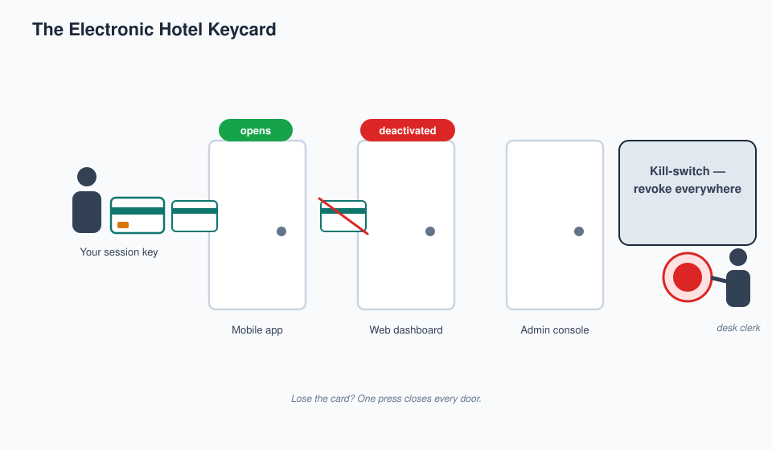

# Chapter 8 — For Everyone: Safety, Privacy, and Compliance

> *Unlearn the idea that banking features are just screens and balance numbers. Learn the real journeys, rules, and risks behind each feature. Relearn what Riverbrand actually built for people, and why it holds.*

## Recap

- **Unlearn:** The idea that safety is a strong password and a lock screen, and that compliance is a form you fill in once at signup.
- **Learn:** The real risks behind everyday banking — a phone snatched at 10 a.m., a deposit that crosses a regulatory ceiling, a staff member with more power than their job needs — and the rules that exist to answer them.
- **Relearn:** What Riverbrand actually built for people: login access that can be cancelled everywhere at once, different keys for different devices, verification tiers that hold money safely instead of freezing it, and a permanent written record behind every sensitive action.

## 8.1 The Hotel-Keycard Story

Folake is a school administrator in Ibadan. At 10:00 on a Tuesday morning she leaves her phone on a bus. By the time she reaches work and borrows a colleague's phone to log in, her mind is racing: someone has her device, her banking app was unlocked, and payday was yesterday.

This is the scenario every banking security design is ultimately judged on. Not a team of hackers in a movie — one lost phone, one unlocked screen, and a few hours of opportunity.

**The comfortable story most apps tell.** When you log in, the app hands your device a digital key — a pass that says "this is Folake's phone, logged in and approved." In many systems that pass stays valid for a fixed period, sometimes a full day, whether or not Folake still has the phone. If the pass is valid until midnight, a thief has until midnight. The lock screen on the phone is irrelevant once the phone is already unlocked in their hand.

**The story Riverbrand is built on.** There is a well-known real-world answer, and it comes from hotels. A modern hotel does not hand out brass keys that must be physically replaced when one goes missing. It hands out electronic keycards, and the front desk holds a master control: when a guest reports a lost card, the desk does not touch the door. It re-keys the lock. The old plastic card in the thief's hand stops opening that door immediately, even though the card itself has not changed. The full telling of this analogy lives in the [Analogy Atlas](../appendices/app-f-analogy-atlas.md) — here we only need its point: **control belongs at the desk, not at the door.**

Riverbrand applies the same idea to your login. Every active login is recorded centrally, and any one of them can be cancelled for every door at the same time. The practical version of Folake's morning goes like this: she borrows a device, resets her password (or asks support to), and the moment she does, every open login on every device — the lost phone included — stops working. The person holding her phone is now staring at a screen that will not do anything useful. The system is designed to complete that cancellation in well under a second after the reset, so "until the key expires" never becomes the answer.

Two details matter for trust. First, Folake does not need to recover the physical phone for this to work; the cancellation happens at the bank's side, not on the device. Second, the cancellation is not a special favor from a friendly employee — it is the same mechanism that fires whenever anyone changes their password, and it fires for everyone, every time.

**In plain words.** Your login is a hotel keycard, not a brass key. The front desk — the bank's own systems — can kill every copy of it instantly, and the lost card becomes a piece of plastic.

What the keycard story does *not* solve is the first few minutes, or a thief who acts before you notice the loss. That is why the next layer exists: making sure that even a live key opens only the one door it was cut for.

## 8.2 Two Doors for Two Devices

Riverbrand reaches customers through several doors: a phone app, a web dashboard, a staff console, and a chat channel. A natural design would hand out one universal key — the same login pass for every entrance. That design is convenient, and it is exactly what attackers hope for.

**Two differently cut keys.** Riverbrand instead issues two separate kinds of access pass: one cut for the phone app, and one cut for the web dashboard (including the staff console behind it). A key cut for one door cannot open the other. The app's pass is bound to the native phone experience; the web pass belongs to the browser session. Neither can be carried across.

Why does this matter in real life? Because the two doors face different weather:

- **The web door faces browser attacks.** Tricks that ride on a web page — a malicious site trying to borrow your browser's own logged-in state — are aimed at web-style access. Even if such a trick succeeds against a browser session, the pass it captures is a web pass. It cannot be pasted into the phone app's door and used there.
- **The phone door faces device theft.** The pass on a stolen phone is a phone pass. It cannot be replayed against the web dashboard, where the staff tools and the richest account views live.
- **Each door checks its own kind of pass.** The bank's entrance does not ask "is this a valid pass?" and stop there. It asks "is this a valid pass *for this door*?" — and a pass presented at the wrong door is refused.

**A hotel version of the same rule.** Many hotels give you one card for your room and a different card for the gym or the executive floor. A gym card does not open your minibar, and your room card does not open the gym. The hotel is not being difficult; it is making sure that one lost card is a small loss. Riverbrand's two-key design has the same shape: one leaked or stolen pass is damage at one door, not at every door.

**In plain words.** The phone key opens the phone door and nothing else. The web key opens the web door and nothing else. Losing one is losing one.

A note on honesty: two-key isolation is a damage-limiter, not a shield wall. If an attacker steals the phone *and* the phone is unlocked *and* they act before the login is cancelled, they are inside the phone door — which is what the keycard cancellation of [§8.1](ch08-for-everyone-safety-and-compliance.md#81-the-hotel-keycard-story) is for. The two controls work together: isolation narrows what any single stolen key can do, and cancellation destroys every key at once when you say so.

For customers, both layers are invisible on a good day. They only become visible on a bad one — and on a bad day they are the difference between an hour of inconvenience and a week of damage.

## 8.3 What a KYC Tier Means for a Customer

KYC stands for "know your customer" — the identity checks that financial regulation requires before an account can move serious money. It is easy to treat KYC as friction: another form, another photo upload, another wait. It is better understood as a ladder. Each rung unlocks more of the bank, and the rules are the same for everyone.

**The three rungs, in plain words.**

| Tier | What you show | What you can do |
|---|---|---|
| **Tier 1 — Basic** | A working phone number | Open the account, receive money, and move money up to a daily ceiling of ₦50,000 |
| **Tier 2 — Identity verified** | Your identity numbers — the BVN and NIN that Nigerian identity systems issue — checked through a verification partner | Daily movement up to ₦200,000 |
| **Tier 3 — Full KYC** | Where you live and a government photo ID | Daily volumes of ₦5,000,000 and above, for customers whose legitimate money needs it |

Two words to fix in mind. **BVN** is the Bank Verification Number, and **NIN** is the National Identification Number — the two identity anchors that Nigerian financial services use to confirm a person is who they say they are. Checking them does not expose your money to anyone; it simply confirms your identity against the national record.

**Why limits exist at all.** The ceilings are not the bank distrusting you. They are the shape of anti-money-laundering law: the lower the verification, the lower the volume a person can move anonymously. Every regulated bank enforces ceilings like these. What varies is *how* they enforce them — and this is where most banks disappoint.

**What most banks do when you cross a line.** Two bad options dominate. The first is to bounce the incoming payment back — into interbank limbo, where tracing money can take fourteen days and three phone calls. The second is to freeze the whole account until "compliance" is satisfied, trapping salary, rent, and grocery money along with the disputed amount. Both options turn a paperwork gap into a customer emergency.

**What Riverbrand does instead — the holding tank.** When a legitimate payment arrives that exceeds your current tier's ceiling, the engine splits it. The part that fits inside your ceiling lands in your wallet immediately — you can see it, spend it, and prove it arrived. The excess is parked in a **holding tank**: a quarantined balance that is still yours, clearly reported to you, and not lost in anyone's backlog. You are told what happened and what will release it.

The release is the elegant part. The holding tank is wired to your verification level. The moment you complete the next tier — for example, when your BVN and NIN check clears and you move from Tier 1 to Tier 2 — the held money is released automatically into your wallet. Nobody files a ticket. Nobody "forgets." The rule that held the money is the same rule that frees it. The mechanism has a technical side — engineers call it the pending-balance holding tank (see [§5.6](ch05-engineering-transaction-engine.md#56-the-pending-balance-holding-tank-and-kyc-ceilings)) — but for you it is simply: **the money waits in a visible, named place, and upgrading opens the gate.**

**In plain words.** Your tier is your current speed limit. Cross it and the bank does not punish you — it holds the excess in a labeled waiting room and opens the door the moment your papers clear.

A short FAQ-grade clarification, because it causes real anxiety: money in the holding tank is not a fee, not a fine, and not confiscated. It is your money in a compliance pause. You can see that it exists, you can see why it is waiting, and the path to release it is the same verification step the tier system already asked of you. The design goal is exactly what the original product documentation stated: strict compliance with anti-money-laundering rules and a zero-panic experience at the same time — see the customer-side story in [§4.4](ch04-for-everyone-how-money-moves.md#44-the-quarantined-balance) and the tier definitions in [§3.4](ch03-domain-primer.md#34-kyc-tiers-and-limits).

## 8.4 The Audit Trail

Imagine every sensitive action in the bank — every login, every password reset, every staff approval, every override — being written into a book in permanent ink. Not a suggestion box, not a debug log an engineer reads on Tuesdays: a record. Who did it, what they did, when they did it, and what the record looked like before and after. That is the audit trail, and it is one of the oldest ideas in banking, kept for the most modern of reasons.

**What gets written.** The record covers three kinds of event, and each answers a different question:

- **What customers do.** Logins, password resets, changes to the secret you use to authorize payments, and changes to which devices are trusted. The question this answers: "was it really you?"
- **What staff do.** Suspending or unsuspending an account, approving a verification level by hand, changing a fee, overriding a transfer. Each staff entry carries which staff member acted, from where, and the before-and-after of what changed. The question this answers: "who touched this account, and why?"
- **What the system itself does.** Lifecycle events, switches from one payment or messaging provider to another, and the routing of messages that needed retrying. The question this answers: "what did the machinery do while nobody was watching?"

**Why 'permanent ink' matters.** A record that can be quietly edited is not a record — it is a decoration. The audit entries are written once and kept, so that during a dispute, an investigation, or a routine regulatory review there is a single story of what happened, told in the order it happened. When a customer says "I never authorized that," the answer is not a debate. It is an entry. When a regulator asks "show me every manual approval last quarter," the answer is a list, not a reconstruction.

**And it does not slow you down.** This is the part people find surprising. Writing a permanent record sounds like it should cost time — like a hotel clerk who must finish the night-audit book before helping the next guest. Riverbrand's audit entries are written in the background, the way a clerk can greet a guest while an assistant files the paperwork beside them. The banking you see — the transfer, the receipt, the balance update — is never waiting on the ink to dry. Engineers describe this as a non-blocking trail (the mechanism is in [§9.5](ch09-engineering-security-architecture.md#95-the-non-blocking-audit-trail)); for you it means the book of record is always being written, and your banking never stands still to let it happen.

**In plain words.** Every important move leaves a smudge-proof note — who, what, when — and the note is filed while you keep banking.

One honest boundary: the audit trail is a record, not a conscience. It makes every action *visible* and *attributable*; it does not by itself make every action wise. What it does is change the math for anyone considering an abuse of power — a staff member who knows that every click carries their name, their network address, and a diff of what they changed is a staff member making a different decision. That is governance by daylight, and it is the bridge to the next section.

## 8.5 Regulatory Posture and Governance

Compliance in most software projects is a phase at the end: a binder, a checklist, a lawyer's review of the screenshots. In a banking engine it cannot be that, because the rules do not live in the binder — they live in the behavior of the system at 2 a.m. on a public holiday. Riverbrand's posture is that **compliance is designed in, not bolted on**: the regulatory rules are enforced by the engine itself, continuously, whether or not anyone is at their desk.

**Not one person can do everything.** The oldest control in banking is separation of duties — the person who can approve a large movement of money should not be the same person who can rewrite the record of it. Riverbrand organizes staff access around roles, and each role sees and does only what its job requires. In plain terms:

- **The super administrator** can configure the system and perform any administrative action — and every one of those actions is recorded.
- **The compliance lead** owns the identity side: reviewing accounts, suspending for compliance reasons, and approving the highest verification level. They do not rewire fee structures for fun.
- **The support agent** helps customers with everyday problems — looking up an account, explaining a transaction. They cannot suspend accounts on a whim, approve identity levels, or touch transfers.
- **The financial auditor** reads. Statements, records, the audit book. An auditor who can change what they are auditing is not an auditor.

These roles are defined by the system itself and enforced on every request — not written on a wiki page and hoped for. A support agent who tries an action outside their role is refused, and the attempt itself is visible. Approving a top-tier verification or overriding a transfer requires the right role *and* leaves the permanent record described in [§8.4](ch08-for-everyone-safety-and-compliance.md#84-the-audit-trail). The engineering side of this model is in [§9.4](ch09-engineering-security-architecture.md#94-role-based-access-control).

**The risk matrix, trimmed for governance.** The product documentation carries a full business risk matrix; here is the governance-facing trim of it — the five risks a board, a regulator, or a nervous customer actually asks about, and the designed answer to each:

| Risk | How Riverbrand answers it | What it means for you |
|---|---|---|
| **A lost or stolen phone, or a stolen login pass** | Every login can be cancelled at once (the keycard move of [§8.1](ch08-for-everyone-safety-and-compliance.md#81-the-hotel-keycard-story)), and passes are cut per door ([§8.2](ch08-for-everyone-safety-and-compliance.md#82-two-doors-for-two-devices)) | One lost device is a cancelled login, not a drained account |
| **The same money spent twice** | Concurrent attempts to move one balance are serialized so the second attempt sees the spent money and is refused ([§4.2](ch04-for-everyone-how-money-moves.md#42-the-bank-vault-airlock)) | Double-taps and two-device races cannot spend your money twice |
| **A payment or messaging provider goes down** | Confirmations and alerts are queued for reliable delivery and backup gateways are used, so a vendor outage delays a receipt, not a transfer ([§4.5](ch04-for-everyone-how-money-moves.md#45-the-guaranteed-courier)) | Your money movement does not hang on a third party's bad day |
| **A deposit crosses your verification tier** | Tier ceilings plus the holding tank ([§8.3](ch08-for-everyone-safety-and-compliance.md#83-what-a-kyc-tier-means-for-a-customer)) | Limits hold the excess visibly and release it when you upgrade — no frozen account, no lost transfer |
| **A staff member oversteps their role** | Role-based permissions plus the non-blocking permanent audit record | Abuse is hard to hide and easy to attribute |

**Why 'designed in' is the stronger posture.** A bolted-on compliance review checks the system occasionally. A designed-in one checks it on every request: the ceilings are enforced where money moves, the roles are enforced where staff click, the audit is written where actions happen, and the session cancellation fires where logins live. None of these depend on someone remembering to run the checklist. That does not make the bank perfect — no system is, and this book bans the word-games that pretend otherwise — but it means the rules run at machine speed and machine consistency, which is the only speed and consistency regulators actually test.

## 8.6 What We Built, Why, and Where It Goes

**What we built.** A safety and compliance layer with four visible behaviors: login access that can be cancelled for every device at once (the hotel-keycard move, told in the [Analogy Atlas](../appendices/app-f-analogy-atlas.md)); two separately cut keys so a phone pass and a web pass cannot impersonate each other; a KYC ladder whose ceilings hold excess money in a named, releasable place instead of freezing accounts; and a permanent, non-blocking audit record of every sensitive customer action, staff action, and system event — with staff access split into roles so no one person holds every key.

**Why it matters.** For Folake and everyone in her situation, the difference is measured in hours instead of weeks: a lost phone becomes a password reset instead of a drained balance. For customers brushing a regulatory ceiling, the difference is visible money instead of interbank limbo. For the bank and its regulators, the difference is evidence — an attributable record and enforced roles — instead of assurances.

**What we aim for.** Safety that is boring in the best sense: the mechanisms fire without drama, the limits are predictable before they bind, and the record is complete enough that an investigation is a query rather than an archaeology dig. Zero-panic compliance — strict about the rules, gentle with the customer — remains the design target the product documentation set out.

**The approach ahead.** The roadmap sharpens all of this rather than replacing it: stronger, device-bound ways to prove a login really belongs to your phone (so even a stolen pass becomes a dead thing), fraud-detection intelligence layered on the audit stream, and open-banking controls that keep the same role-and-record discipline as the perimeter widens. Those are planned directions, not current product — see [Chapter 14 — For Everyone: Future Roadmap](ch14-for-everyone-future-roadmap.md) — and the engineering twin of this chapter explains the mechanisms underneath every claim here.

## Key Takeaways

- Your login is a hotel keycard, not a brass key: report the loss or reset your password, and every copy stops working everywhere at once — the story lives in the [Analogy Atlas](../appendices/app-f-analogy-atlas.md).
- Riverbrand cuts two different keys — one for the phone app, one for the web dashboard — so one leaked key is damage at one door, not every door.
- KYC ("know your customer") is a three-rung ladder: phone-verified (₦50,000 a day), identity-verified (₦200,000), fully verified (₦5,000,000 and above). The ceilings are law, not distrust.
- Money that crosses your ceiling is not lost or frozen: the allowed part lands at once, the excess waits in a visible holding tank, and upgrading your tier releases it automatically.
- Every sensitive action — customer, staff, or system — is written in permanent ink (who, what, when), in the background, so the record never slows your banking; staff powers are split into roles so nobody can do everything alone.

## Frequently Asked Questions

### What should I do first if my phone is stolen?

Reset your password from any other device — a borrowed phone, a laptop, or with help from support. That single action cancels every open login everywhere, including the one on the stolen phone, and the system is designed to complete the cancellation in well under a second. You do not need to recover the phone first. Then change the secrets that authorize payments when your account is restored to a device you trust.

### When a payment crosses my KYC limit, is the bank holding my money hostage?

No. The part within your current ceiling is available immediately, and the excess sits in a holding tank that is still yours — visible, explained, and released automatically when you complete the next verification step. The alternatives the industry often uses (bouncing the payment back into a long interbank trace, or freezing your entire account) are exactly the outcomes this design avoids. The customer-side story is in [§4.4](ch04-for-everyone-how-money-moves.md#44-the-quarantined-balance).

### Can a Riverbrand staff member move my money or see my payment secret?

Staff access is split into roles, and ordinary support staff can look up accounts but cannot move your money, approve identity levels, or read your payment secret. Powerful actions require specific roles — for example, approving the highest verification level or overriding a transfer — and every staff action is written into the permanent audit record with who did it and what changed. The design cannot promise that no employee will ever try something wrong; it is designed to make wrong actions hard to perform and hard to hide.

### Why are there different limits at different verification levels?

Because financial regulation ties how much you can move to how well the bank knows who you are. Lower verification means lower anonymous volume — this is anti-money-laundering law in every regulated market, not a Riverbrand invention. The ladder is deliberately climbable: each step is one identity check, and each step raises your daily ceiling.

### Does writing the audit record slow down my transfers?

No. The record is written in the background, in parallel with your banking, so the transfer and its receipt never wait for the paperwork. Engineers call this a non-blocking trail; the practical effect is that the book of record is always being written and your banking never stands still to let it happen. The mechanism is described in [§9.5](ch09-engineering-security-architecture.md#95-the-non-blocking-audit-trail).

## Where to Go Next

*For engineers, see [Chapter 9 — Engineering: Security Architecture](ch09-engineering-security-architecture.md).*
