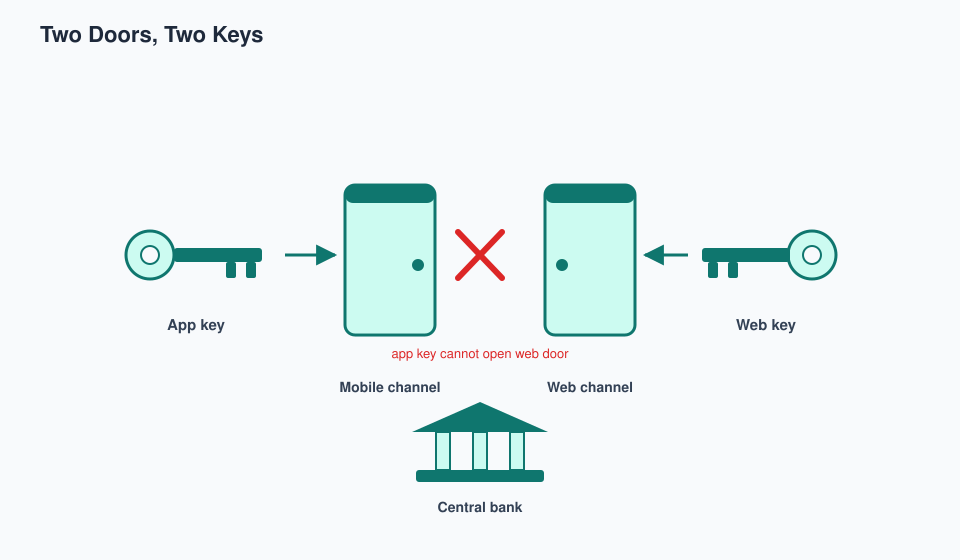
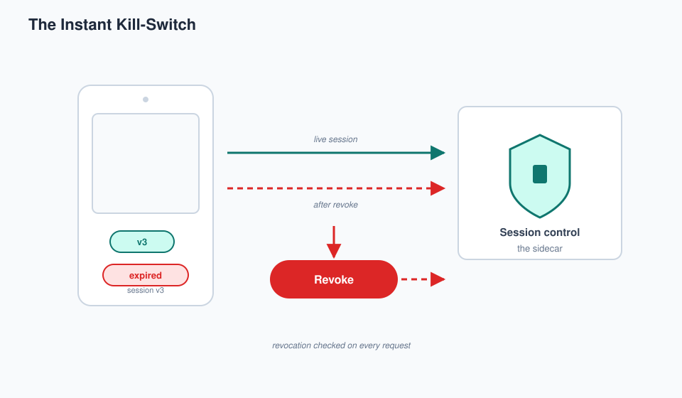
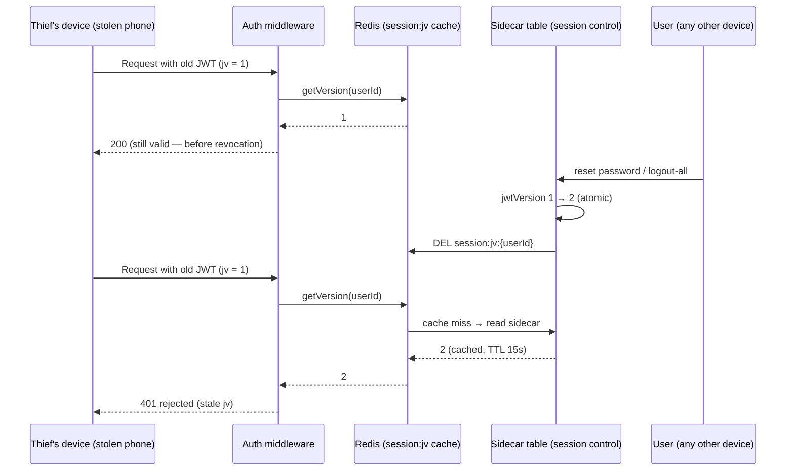

# Chapter 9 — Engineering: Security Architecture

> *Unlearn the naive implementation you would write first. Learn the failure modes and race conditions that break it. Relearn the architecture Riverbrand ships instead.*

## Recap

- **Unlearn:** The naive implementation you would write first — one long-lived bearer token for every client, revocable only by waiting for expiry, with PINs, passwords, and admin powers treated as one undifferentiated "auth" concern.
- **Learn:** The failure modes that break that design: cross-client token replay, an unrevokeable stolen session during a multi-hour expiry window, credential stuffing against weak hashes and no lockout, privileged staff actions with no separation of duties, and audit writes that stall the request path — or never happen at all.
- **Relearn:** The architecture Riverbrand ships instead: dual-token client isolation enforced at the auth middleware, a sidecar session-version kill-switch with sub-millisecond global revocation, Argon2id/bcrypt credential separation with lockouts, granular RBAC seeded at boot, and a non-blocking enterprise audit trail.

## 9.1 Dual-Token Client Isolation

The naive auth layer answers one question: "is this token valid?" That question is too small. Riverbrand's clients face different threat models — a native mobile app on a single device versus a browser session reachable from any tab on the machine — and the authentication middleware (`src/api/middleware/auth.ts`) therefore answers a second question first: **valid *for which client type*?**

**The two token channels.** Every request is classified at the middleware by the credential header it carries, and each channel is validated against its own auth schema:

| Client type | Primary header | Equivalent form | Validated against |
|---|---|---|---|
| Native mobile | `x-local-access-token: <TOKEN>` | `x-access-token` + `x-client-type: mobile` | Mobile auth schema |
| Web console / admin | `x-web-access-token: <TOKEN>` | `x-access-token` + `x-client-type: web` | Web auth schema |

The structure of the dispatch is worth drawing, because the isolation is a routing decision, not a later filter:

```
                              [Incoming HTTP Request]
                                         │
                                         ▼
                   ┌───────────────────────────────────────────┐
                   │ Evaluates Headers in auth.ts Middleware   │
                   └───────────────────────────────────────────┘
                                         │
                 ┌───────────────────────┴───────────────────────┐
                 ▼                                               ▼
   [Mobile Native Request Header]                  [Web Console Request Header]
   • `x-local-access-token: <TOKEN>`               • `x-web-access-token: <TOKEN>`
   • OR `x-access-token` + `x-client-type: mobile` • OR `x-access-token` + `x-client-type: web`
                 │                                               │
                 ▼                                               ▼
   [Validate Token against Mobile Auth Schema]     [Validate Token against Web Auth Schema]
```



**What this buys, stated as failure modes.** A single universal token is a universal prize: exfiltrate it from any context and every endpoint of the product is reachable. The split channels bound blast radius along the client boundary:

- **Web-context exfiltration cannot impersonate native clients.** An attacker who captures a web-issued credential through a browser flaw holds a web-door key. Presented at the mobile door, it fails validation — the middleware never even consults the mobile auth schema with it.
- **Mobile-context exfiltration cannot impersonate the web console.** The reverse path is equally closed. In particular, a token lifted from a stolen phone cannot be replayed against the web and admin surfaces, where the privileged tooling lives.
- **Cross-client use is rejected in production.** This is not a soft distinction that client libraries are trusted to respect. Production enforcement is a startup invariant (below), and the middleware validates each channel strictly — a mobile token arriving through the web channel (or the reverse) is refused, not "accepted with a warning."

**Production environment enforcement.** On application startup, the server checks `environment.appStage`: if it is `"PROD"` or `"PRODUCTION"`, both `LOCAL_ACCESS_TOKEN` and `WEB_ACCESS_TOKEN` must be configured. If either is missing, the server performs a fatal shutdown (`process.exit(1)`). The design principle is fail-closed deployment: a production process cannot come up in a half-configured state where one door falls back to the other channel's credentials. An insecure deployment dies at boot, loudly, where an operator can see it — instead of surviving quietly until an incident review discovers the gap.

**Design trade-off acknowledged.** Two credentials mean two key-management burdens: both secrets must be provisioned, rotated, and monitored, and client SDKs must know which door they stand at. That cost is real. It is accepted because the alternative — one shared secret spanning mobile and web — couples the security of the two client contexts, and coupling is exactly what an attacker wants. The future direction recorded in the architecture notes is stronger still: per-device asymmetric request signing so that even a captured token is not replayable (see [§9.2](ch09-engineering-security-architecture.md#92-sidecar-session-control-and-the-kill-switch)).

The plain-language twin of this section is [§8.2](ch08-for-everyone-safety-and-compliance.md#82-two-doors-for-two-devices): two doors, two keys, one lost key is a one-door loss.

## 9.2 Sidecar Session Control and the Kill-Switch

**Unlearn:** "Stateless JWTs cannot be revoked until expiry — that is the price of statelessness." Teams ship it anyway, set a twenty-four-hour expiry, and call it a compromise. The failure mode is concrete: a phone is snatched at 10:00 with a live token on it, and the token's validity is now an attacker's countdown timer. Hours of drain before the expiry timestamp arrives; a password change that helpfully resets the *credential* but leaves the *session* alive until it ages out.

**Learn:** Token claims can be verified against an atomic version counter. The token carries the counter value at issue time; the system holds the current value; every request compares the two. Revocation becomes a counter increment rather than a hunt for outstanding tokens.

The engineering trade-off is the interesting part. A pure per-request database lookup on the session counter would restore revocation but surrender the very property that made stateless tokens attractive — every call paying a relational round trip. Riverbrand's answer keeps the stateless fast path and adds a versioned sidecar with a hot cache in front of it.

**The sidecar table.** Session-version state lives in `river_brand_sys_user_session_control`, a sidecar keyed by user identity with an atomic `jwtVersion` (the `jv` claim embedded in issued JWTs). "Sidecar" is deliberate: the legacy `user_user` tables could not be altered without breaking compatibility with legacy services, so the revocation state was provisioned alongside them instead of inside them. Zero schema disruption; existing models stay untouched and fully compatible.

**Repository semantics.** The core logic lives in `SessionControlRepository` (`src/database/repository/sessionControl.ts`):

```typescript
@Service()
export class SessionControlRepository {
  private readonly CACHE_TTL_SECONDS = 15; // 15-second TTL for hot session version cache

  private getCacheKey(userId: bigint | number): string {
    return `session:jv:${userId}`;
  }

  async getVersion(userId: bigint | number): Promise<number> {
    const uId = BigInt(userId);
    const cacheKey = this.getCacheKey(uId);

    // 1. Fast Path: Check Hot Redis Cache
    const redis = getRedis();
    const cached = await redis.get(cacheKey);
    if (cached !== null) return parseInt(cached, 10);

    // 2. Slow Path: Read from Sidecar Table
    const record = await prisma.river_brand_sys_user_session_control.findUnique({
      where: { userId: uId },
      select: { jwtVersion: true },
    });
    const version = record?.jwtVersion ?? 1;

    // 3. Populate Redis Cache
    await redis.set(cacheKey, version.toString(), "EX", this.CACHE_TTL_SECONDS);
    return version;
  }

  async incrementVersion(userId: bigint | number): Promise<void> {
    const uId = BigInt(userId);
    // Atomic Database Increment
    await prisma.river_brand_sys_user_session_control.upsert({
      where: { userId: uId },
      update: { jwtVersion: { increment: 1 }, updatedAt: new Date() },
      create: { userId: uId, jwtVersion: 2 },
    });
    // Invalidate Redis Cache Key immediately
    await getRedis().del(this.getCacheKey(uId));
  }
}
```

Read the two paths and the write path carefully, because each line is a decision:

- **Read fast path.** `getVersion` first consults the Redis key `session:jv:{userId}`. A hit costs one cache lookup and no relational I/O — the stateless fast path is preserved for the overwhelming majority of requests.
- **Read slow path.** A cache miss falls through to the sidecar table, defaults to version `1` for a user with no sidecar row yet, and populates the cache with a 15-second TTL. The TTL bounds staleness on *reads that never see a bump*; it is not the revocation latency.
- **Write path.** `incrementVersion` performs an atomic upsert — `jwtVersion: { increment: 1 }` for an existing row, or `jwtVersion: 2` on first create (so a first-ever increment already invalidates anything minted at the default version) — and then **deletes the cache key immediately**. That explicit `del` is what makes the kill-switch sub-millisecond: there is no window in which the cache keeps advertising the old version after the bump.

**Enforcement at the middleware.** Fastify auth middleware verifies the incoming JWT as usual, then validates the embedded `payload.jv` against the version returned by `getVersion`. Any token whose `jv` is stale is rejected immediately with `401`. The check is one comparison on the hot path.

**What bumps the version.** The counter increments on the security-relevant lifecycle events the product requires:

1. **Password change / reset** — the classic stolen-phone path. The user resets their password from any device; every active JWT worldwide, on every client type, is invalidated at once.
2. **PIN reset** — a payment-secret reset also re-keys sessions, so an attacker who socially engineered a PIN change does not inherit a live session.
3. **Logout (all sessions)** — logout-all is the same operation viewed from the customer's side: bump the counter, and outstanding tokens die regardless of their expiry timestamps.



The customer-facing story of the kill-switch is the hotel-keycard analogy in [§8.1](ch08-for-everyone-safety-and-compliance.md#81-the-hotel-keycard-story); the sequence below is the mechanism behind it.

**Figure 9.3 — Session revocation sequence.**



**Failure-mode notes, honestly.**

- **Revocation latency.** After `incrementVersion` runs, every subsequent request is rejected — the cache delete is synchronous with the increment, so the "sub-millisecond global kill-switch" claim in the engineering record refers to this path. It is a design property of this write path, not a load-tested figure; production service-level numbers are **UNVERIFIED** against the current documentation record.
- **Cache TTL is not revocation.** The 15-second TTL only refreshes *unchanged* versions. A bump deletes the key eagerly; a stale `200` cannot be served from the old cache entry after the delete.
- **The sidecar is a single row per user.** The counter is atomic and per-user; there is no per-device granularity in this design. That is the trade-off: global kill-switch simplicity over selective device-by-device revocation. Selective revocation would require per-session state (a full session table), which the sidecar approach deliberately avoids.
- **Legacy compatibility.** Because state lives beside `user_user` rather than inside it, revocation ships without a legacy migration — the compatibility constraint that shaped this design is preserved.
- **Future work (recorded, not shipped).** The architecture notes point to cryptographic ephemeral device binding — per-device asymmetric request signing (Ed25519) — so a captured token cannot be replayed even in a man-in-the-middle position. Passkey and post-quantum directions are tracked in [§15.6](ch15-engineering-roadmap.md#156-open-banking-passkeys-and-post-quantum-crypto).

The twin chapter's plain-language framing is [§8.1](ch08-for-everyone-safety-and-compliance.md#81-the-hotel-keycard-story); the runbook context for operators is [§11.6](ch11-engineering-operations-manual.md#116-runbooks-and-troubleshooting-playbook).

## 9.3 PIN and Password Protection

Authentication in Riverbrand is not one secret with one policy. Two credential classes serve two jobs, and conflating them is the naive mistake: the **login password** opens a session; the **transaction PIN** authorizes money movement inside an already-open session. A third class — one-time codes — covers channel confirmation.

| Credential type | Hashing algorithm | Salt and work factor | Storage model | Lockout policy |
|---|---|---|---|---|
| **User password** | **Argon2id** | Memory: 64MB, Iterations: 3, Parallelism: 4 | `user_user.password` | 5 failed attempts → 15-minute account lock |
| **Transaction PIN** | **bcrypt** (legacy-compatible PIN hasher) | Cost factor 12 | `user_transaction_pin.pin` | 3 failed attempts → 30-minute Redis lock |
| **SMS / Email OTP** | **CSPRNG 6-digit** | Cryptographically secure random | `riverbrandsmsotp` | 10-minute expiry TTL |

**Argon2id for passwords.** The login password is the long-lived, human-chosen secret — the one credential most exposed to credential stuffing and offline cracking if a store ever leaks. It is hashed with Argon2id, a memory-hard function: the documented parameters (64MB of memory, 3 iterations, parallelism 4) make each verification expensive in *memory* as well as time, which is what defeats GPU and ASIC attack economics. A plain fast hash would turn a leaked password table into a weekend project for an attacker; the work factor turns it into a capital expense.

**bcrypt on the PIN store.** The transaction PIN is a short numeric secret with a completely different threat profile: low entropy by construction (four to six digits in most deployments), used frequently, and guarded by lockout rather than by length. The documented configuration hashes PINs with bcrypt at cost factor 12 — the legacy-compatible hasher carried by the PIN store — while Argon2id is the password-side standard. The memory-hard target for all secrets is the direction of travel; the current split is stated here exactly as the security record documents it, with bcrypt retained on the PIN table for compatibility.

**Why PIN and password must stay separate.** Three consequences, each a failure mode in the conflated design:

1. **A leaked PIN is not a leaked session.** The PIN authorizes individual money movements; it does not open the login door. An attacker who shoulder-surfs a PIN at a POS terminal does not inherit a persistent session — and if they attempt the PIN repeatedly, the lockout fires first (3 failures, 30-minute Redis-backed lock).
2. **A leaked password is not a leaked spending authority.** Conversely, a stuffed password gives a session — which the kill-switch of [§9.2](ch09-engineering-security-architecture.md#92-sidecar-session-control-and-the-kill-switch) can end globally — but spending still requires the PIN, a second factor in practice even though it is not marketed as one.
3. **Different lockout economics.** Password lockout (5 failures, 15 minutes) is tuned for human mistyping and stuffing; PIN lockout (3 failures, 30 minutes) is tuned for a shorter secret with a sharper guessing curve. One policy for both would either lock customers out of their own logins or hand PIN-guessers extra attempts.

**OTPs are not passwords.** SMS and email codes are generated from a cryptographically secure random source and expire after ten minutes. They are held for confirmation, not for identity persistence; treating an OTP as a stored credential would defeat the point of it being one-time.

**Where this plugs in.** Passwords and PINs are verified on the request path like any other secret, but their *lifecycle* events — resets — feed the session kill-switch: a password reset bumps `jwt_version`, and a PIN reset bumps it too. Credential management and session management are one security story, not two. The lockout state itself is held in Redis (a short-lived lock with a TTL), so lockouts are enforced at speed without inflating the credential tables.

**Honest boundaries.** Work factors age. The parameters above are the documented configuration, not a timeless guarantee: as hardware improves, cost factors and Argon2id memory settings are meant to be revisited (see the operations runbooks in [§11.4](ch11-engineering-operations-manual.md#114-observability-and-metrics) for where configuration lives). And hashing protects *at rest*; it does nothing for a secret captured at entry — which is why channel isolation, lockouts, and the kill-switch sit beside it rather than behind it.

## 9.4 Role-Based Access Control

Customer-facing auth answers "is this the user?" Administrative auth must answer a harder question: "is this staff member allowed to do *this specific thing*, today, to *this* account?" Riverbrand answers it with a granular role-based access control (RBAC) model governed by `PermissionService` and `RoleService`, over the permission-store tables the documentation names `sys_roles` and `sys_permissions`.

**The model in three pieces.**

1. **Granular permissions (`Permission`).** Fine-grained capabilities, never "admin: yes." The documented permission set includes `MANAGE_USERS`, `MANAGE_TRANSFERS`, `VIEW_REPORTS`, `OVERRIDE_KYC`, and `MANAGE_SYSTEM_CONFIG`. A capability is atomic enough that granting one never implicitly grants its neighbor: `VIEW_REPORTS` is not `MANAGE_TRANSFERS`.
2. **Roles.** Named bundles of permissions aligned to job functions: `SUPER_ADMIN`, `COMPLIANCE_OFFICER`, `SUPPORT_AGENT`, `FINANCIAL_AUDITOR`. Staff hold roles, not raw permissions, so the organization can reason about staffing changes without re-auditing every capability grant.
3. **Role-permission junction (`RolePermission`).** A strict many-to-many mapping between roles and permissions. Strict means: the mapping is the authority. If a permission is not on the role, it is denied — there is no ambient "logged-in staff" power, and no wildcard that widens silently.

**Startup seeding.** System permissions and roles are validated and seeded asynchronously on boot via `seedDefaultPermissions()`. This matters for a reason beyond convenience: the RBAC vocabulary is defined by the application, not by whatever state an operator's last manual migration left behind. A fresh environment comes up with a correct, minimal role set — the baseline that separation of duties assumes actually exists.

**The permission matrix.** The security record documents this operating matrix (Full / limited / read-only / none):

| Permission scope | Super admin | Compliance lead | Support agent | Financial auditor |
|---|---|---|---|---|
| View dashboard stats | Full | Full | Limited | Full |
| User management | Full | View only | View only | None |
| Suspend / unsuspend | Full | KYC reasons only | None | None |
| Approve Tier 3 KYC | Full | Full | None | None |
| Transfer overrides | Full | None | None | None |
| View audit logs | Full | Full | None | Full |
| Fee structure config | Full | None | None | Read only |

**What the matrix encodes.** Read it as separation of duties in tabular form:

- **Compliance owns identity, not money.** The compliance lead can approve the highest KYC tier and suspend for compliance reasons — and explicitly cannot issue transfer overrides or rewire fee structures.
- **Support is deliberately weak.** The support agent can see enough to help a customer and can change almost nothing. View-only user management, no suspension power, no KYC approvals, no audit-log access. A compromised support account is a small incident.
- **Audit can read but not write.** The financial auditor sees full audit logs and read-only fee configuration — and none of the mutation paths an audit would need to scrutinize. An auditor who could edit fees or approve KYC would contaminate the evidence.
- **The super admin is concentrated power with concentrated evidence.** Only this role can override transfers or manage system configuration — and every action it takes lands in the audit trail with operator ID and payload diff (see [§9.5](ch09-engineering-security-architecture.md#95-the-non-blocking-audit-trail)). The residual risk of the super-admin role is acknowledged in [§9.6](ch09-engineering-security-architecture.md#96-threat-model-summary), not papered over.

**Enforcement shape.** Every administrative request resolves to a permission check against the caller's role mapping before any handler logic runs — the same fail-closed posture as the production token enforcement in [§9.1](ch09-engineering-security-architecture.md#91-dual-token-client-isolation). A denied attempt is not silently swallowed: it is an event. Combined with the audit trail, this gives the property the compliance officer actually needs — not "our staff are trustworthy" but "staff actions are constrained by role and attributable in the record."

The plain-language treatment of roles and approvals is [§8.5](ch08-for-everyone-safety-and-compliance.md#85-regulatory-posture-and-governance).

## 9.5 The Non-Blocking Audit Trail

The audit trail is the system's black box: if an action matters to a regulator, a dispute, or an incident review, it must be recorded — and the recording must not be a tax on the customer's latency. Riverbrand's answer is a **non-blocking enterprise audit trail**: all audit events are recorded asynchronously via non-blocking repository patterns, so audit writes never increase API latency. Engineers call the shape of this write-behind logging — the request commits its own work and emits the audit event to be persisted out of band — and the design goal is stated plainly in the security record: the ledger path stays fast while the book of record stays complete.

**Three event streams.** The trail is partitioned by actor, because the questions asked of it are partitioned by actor:

| Stream | What it records | Typical questions it answers |
|---|---|---|
| **`AuditUserActivity`** | User logins, password resets, PIN updates, device token changes | "Was this account accessed? When was the secret last changed?" |
| **`AuditAdminAction`** | Every staff action — user suspensions, manual KYC approvals, fee overrides — with operator ID, IP address, and payload diffs | "Which staff member changed what, from where, and what did it say before?" |
| **`AuditSystemEvent`** | System lifecycle events, provider failovers, outbox dead-letter routing | "What did the machinery do — and which provider were we on when it did?" |

Note the payload diffs on admin actions. A record that says "fee changed" is theater; a record that says "fee 1.5% → 2.5%, operator ID 42, from 10.0.2.15" is evidence. The diff is what turns the trail from a log into an audit.

**The write path.** Conceptually, the flow on every auditable request is:

**Figure 9.4 — Non-blocking audit write-behind.**

```mermaid
graph TD
  REQ[Incoming request] AUTH[Auth and RBAC checks] BIZ[Business mutation commits]
  EMIT[Emit audit event - actor, action, diff, IP]
  RESP[Response returns to client]
  WRITE[Audit repository persists event]
  BIZOK[Audit streams: user / admin / system]

  REQ --> AUTH --> BIZ --> RESP
  BIZ --> EMIT --> WRITE --> BIZOK
```

The critical property is the fork after `BIZ`: the response does not await `WRITE`. A slow audit sink — a congested database, a burst of admin activity — delays audit persistence, not the customer's transfer. The inverse failure is the one to weigh honestly: because the write is out of band, an audit event emitted during a hard crash at the wrong millisecond can be lost, and the current documentation record does not describe a replay journal for undelivered audit events. That is a real, bounded trade-off — API latency isolation in exchange for a small window of possible audit loss under catastrophic failure — and it should be stated to any auditor rather than discovered by one. For events where losing even that window is unacceptable (large transfer overrides, KYC approvals at the top tier), the operating posture is that these ride through the same recorded business transactions the ledger depends on — the failure-mode discipline of [§5.7](ch05-engineering-transaction-engine.md#57-failure-mode-matrix) applies to them.

**What non-blocking is not.** It is not best-effort in the ordinary case. Under normal operation every event lands; "non-blocking" describes the *latency coupling*, not the durability ambition. It is also not optional: the emission point is inside the action path, so a staff action cannot occur without leaving its mark. The one who acts, the one who requests, and the system itself are all subjects of the record — that is the "enterprise" in enterprise audit trail.

**Where the trail connects.** RBAC decides what a role *may* do ([§9.4](ch09-engineering-security-architecture.md#94-role-based-access-control)); the audit trail records what a role *did*. The kill-switch records its own lifecycle through `AuditUserActivity` — password resets and PIN updates are exactly the events that precede a version bump. And `AuditSystemEvent` overlaps deliberately with the outbox and dead-letter machinery of [§5.4](ch05-engineering-transaction-engine.md#54-the-outbox-and-dead-letter-queue): provider failovers and DLQ routing are auditable because "the provider changed under us" is often the hidden first line of an incident postmortem.

## 9.6 Threat-Model Summary

The controls above are only as meaningful as the threats they are measured against. The table below is the condensed threat model for the mechanisms in this chapter: threat, its vector, the control Riverbrand applies, and the residual risk that remains after the control. Residual risk is stated on purpose — a threat model with an empty last column is marketing.

| Threat | Vector | Control | Residual risk |
|---|---|---|---|
| **Stolen phone** | Unlocked device carrying a live mobile session | Global kill-switch: password/PIN reset bumps `jwt_version`, all tokens rejected at the middleware ([§9.2](ch09-engineering-security-architecture.md#92-sidecar-session-control-and-the-kill-switch)); mobile tokens useless at the web door ([§9.1](ch09-engineering-security-architecture.md#91-dual-token-client-isolation)) | A window exists between theft and revocation; an attacker who acts inside it spends under the live session. Device-level lock screens and customer speed in resetting remain part of the defense |
| **Stolen session token** | Token exfiltrated by malware, hostile network, or shoulder-surfing of client traffic | `jv` version check against the sidecar makes any post-reset token dead; dual-channel isolation bounds a captured token to one client type | Before revocation, the token is valid — and it is replayable until then. Per-device asymmetric signing (Ed25519) is the recorded future mitigation ([§9.2](ch09-engineering-security-architecture.md#92-sidecar-session-control-and-the-kill-switch)) |
| **Credential stuffing** | Leaked password reuse, automated login attempts | Argon2id password hashing (64MB / 3 / 4); lockouts — 5 password failures → 15-minute account lock, 3 PIN failures → 30-minute lock; OTPs are CSPRNG with a 10-minute TTL ([§9.3](ch09-engineering-security-architecture.md#93-pin-and-password-protection)) | Lockouts throttle rather than prevent stuffing; determined attackers rotate source addresses. Monitoring of failed-attempt patterns is an operational concern, not a solved property here |
| **Insider admin abuse** | Privileged staff action — suspension, KYC approval, fee override, transfer override | Granular RBAC with seeded roles ([§9.4](ch09-engineering-security-architecture.md#94-role-based-access-control)); non-blocking audit with operator ID, IP, and payload diffs ([§9.5](ch09-engineering-security-architecture.md#95-the-non-blocking-audit-trail)) | The `SUPER_ADMIN` role is concentrated power: attribution is strong, prevention is bounded by role minimization and review processes outside the engine |
| **Provider impersonation** | An attacker presenting forged traffic as a payment, identity, or messaging provider | Webhook traffic authenticated with cryptographic SHA-256 HMAC signature checks on inbound notifications | If a signing key leaks, forgery is possible until rotation; key custody and rotation are operational controls, not enforced by this architecture |
| **Replayed webhook** | A genuine notification delivered more than once by a provider | Idempotency references: a repeated notification matches an existing reference and cannot credit twice ([§5.3](ch05-engineering-transaction-engine.md#53-idempotency-references)); duplicates are visible as system events | Replay within the idempotency-retention window is absorbed, not rejected with prejudice; long-horizon replays depend on retention policy and monitoring |

Two cross-cutting readings of this table. First, the controls compose: stolen-phone and stolen-token rows are one scenario handled by two layers (isolation to bound, revocation to end). Second, the residual column is where the roadmap lives — device binding, richer abuse monitoring, and key-rotation discipline are the known answers to the known gaps, tracked in [Chapter 15 — Engineering: Roadmap](ch15-engineering-roadmap.md). Until they land, this model claims what the documentation supports: controls designed for these threats, at these boundaries, with these limits — not immunity.

## Key Takeaways

- Dual-token client isolation (`x-local-access-token` for mobile, `x-web-access-token` for web) makes "valid" a per-door question; production startup fails fatally (`process.exit(1)`) if either channel secret is unconfigured.
- The sidecar `river_brand_sys_user_session_control` carries an atomic `jwt_version` checked against the `jv` claim on every request; a bump plus eager cache delete is the sub-millisecond global kill-switch for logout-all and stolen-phone revocation.
- Credentials are split by job and hardened accordingly: Argon2id (64MB / 3 / 4) for login passwords, bcrypt cost 12 on the legacy PIN store, CSPRNG OTPs with 10-minute TTLs — with separate lockout curves (5 → 15m; 3 → 30m).
- RBAC grants atomic permissions through seeded roles and a strict junction (`sys_roles` / `sys_permissions`); the matrix encodes separation of duties — compliance owns identity, support is view-heavy, audit reads but never writes.
- The audit trail is non-blocking by design (write-behind across `AuditUserActivity`, `AuditAdminAction`, `AuditSystemEvent`) so audit latency never touches API latency — with an honestly bounded loss window under catastrophic crash, stated in [§9.5](ch09-engineering-security-architecture.md#95-the-non-blocking-audit-trail).
- The threat model keeps a residual-risk column on purpose: stolen tokens before revocation, super-admin concentration, and signing-key custody are known gaps with named future answers.

## Frequently Asked Questions

### Why two tokens instead of one?

One universal token couples the security of every client context: exfiltrate it anywhere, and every door opens. The split — mobile credential versus web credential, each validated against its own auth schema — bounds a compromise to one client type, and production enforcement rejects cross-client use outright. The cost is managing two secrets; the benefit is that a web-context leak cannot impersonate the phone app and a token on a stolen phone cannot be replayed against the web and admin console ([§9.1](ch09-engineering-security-architecture.md#91-dual-token-client-isolation)).

### Does checking the session version on every request defeat the point of stateless JWTs?

It adds one comparison to the hot path and one cache lookup in the common case. The Redis fast path (`session:jv:{userId}`, 15-second TTL) preserves the stateless performance profile; only cache misses touch the sidecar table. The design accepts a minimal per-request check as the price of revocability — the failure mode of *not* checking is a stolen token that stays valid for its full expiry window ([§9.2](ch09-engineering-security-architecture.md#92-sidecar-session-control-and-the-kill-switch)).

### What exactly happens to live sessions when a user resets a password or PIN?

`incrementVersion` atomically bumps the sidecar's `jwt_version` and immediately deletes the cached version key. Every outstanding JWT — every device, every client type — carries the old `jv` value and is rejected with `401` on its next request. Logout-all is the same operation. The revocation is global and per-user by design; per-device selective revocation is not part of the current model.

### Why is the audit trail "non-blocking" — doesn't that risk losing entries?

Non-blocking describes latency coupling, not durability ambition: audit events are emitted on the action path and persisted out of band so audit I/O never inflates API response times. Under normal operation every event lands. The honest caveat is that a hard crash in the wrong millisecond can drop an in-flight audit write, and no replay journal is described in the current record — a bounded trade-off stated openly in [§9.5](ch09-engineering-security-architecture.md#95-the-non-blocking-audit-trail) rather than hidden.

### Where is the residual risk highest in this architecture?

Two places. Before revocation, a stolen token is live — the kill-switch ends the incident quickly but does not prevent it, which is why per-device asymmetric signing is on the roadmap. And the `SUPER_ADMIN` role is concentrated power: RBAC minimizes who reaches it, and the audit trail makes its every action attributable, but the engine cannot make the role itself harmless. The full picture, with vectors and controls, is the table in [§9.6](ch09-engineering-security-architecture.md#96-threat-model-summary).

## Where to Go Next

*For everyone, see [Chapter 8 — For Everyone: Safety, Privacy, and Compliance](ch08-for-everyone-safety-and-compliance.md).*
