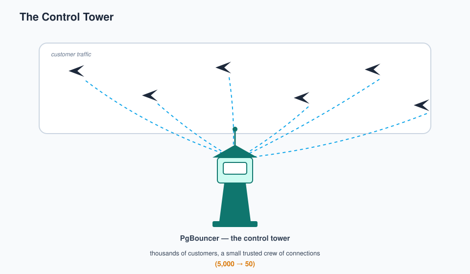

# Chapter 10 — For Everyone: How the Bank Stays Online

> *Unlearn the idea that banking features are just screens and balance numbers. Learn the real journeys, rules, and risks behind each feature. Relearn what Riverbrand actually built for people, and why it holds.*

## Recap

- **Unlearn:** The idea that staying online is a matter of buying a bigger server, and that reliability is a percentage printed on a status page.
- **Learn:** The real forces behind a bank's good days and bad days — payday traffic spikes, third-party partners going dark, receipts that must not get lost, and the night work of reconciliation — and the discipline that answers each one.
- **Relearn:** What Riverbrand actually built for people: a control tower over the bank's record room, a night shift of tireless clerks, more than one engine on every journey that cannot wait, and an honest account of what all of that does and does not promise.

## 10.1 The Airport-Tower View

Amina, a salary earner in Lagos, opens her banking app at 12:01 on the last Friday of the month. She is one of thousands doing the same thing at the same minute: checking whether salary has landed, sending rent, topping up a meter, paying school fees. In a movie about computers, this is where the system "takes the load." In real banking, this is where a very specific problem appears — and it has nothing to do with how powerful the bank's servers are.

**The naive picture.** Imagine the bank keeps its books in one enormous record room, and every customer who opens the app is handed their own private telephone line straight into that room. One customer, one line, one clerk at the other end. It works beautifully for ten customers. It works badly for a hundred. At payday volumes, the record room is asked to hold thousands of open lines at once — and a record room is a physical place with a physical limit: every open line consumes a little of its attention and memory. Past a point, the room does not slow down politely. It collapses, and every customer's action fails together.

**The tower.** Real airports solved the same problem generations ago. Five thousand airplanes converging on one runway do not dive for the strip in free-for-all; an air traffic control tower holds them in orderly stacks and lands them one at a time across the gates that physically exist. Nobody's flight is cancelled because another flight landed first. The full telling of this story — including where the analogy deliberately bends — lives in the [Analogy Atlas, §F.4](../appendices/app-f-analogy-atlas.md#f4-the-airport-control-tower-pgbouncer-multiplexing). This chapter needs only its point: **sequencing is not the same as refusing, and a small, well-run crew can serve a very large sky.**

**Figure 10.1 — The airport-tower view.** Thousands of customer conversations are held in the sky and landed, one short task at a time, onto a small crew of database connections.

Riverbrand runs its record room the same way. Up to about five thousand customer conversations can be in flight at once — that is the sky. In front of the record room sits a control tower: software the engineering team calls a connection pooler, PgBouncer in this system (the mechanics are in [§11.2](ch11-engineering-operations-manual.md#112-ports-health-and-api-documentation)). The tower admits those thousands of conversations but lands them onto a crew of just **50 database connections**, handing a connection to the next customer the instant the previous task is finished. The record room sees fifty orderly landings instead of five thousand simultaneous dives.

Three consequences follow, and all three are things Amina never sees:

- **The record room stays calm at payday.** The engineering record measures the database memory used under load with this tower in place at roughly a tenth of what the same traffic would demand without it — from an estimated fifty gigabytes of idle connections alone down to well under one.
- **Nobody gets a private line.** This sounds like a downgrade and is the opposite: a private line per customer is exactly what exhausted the record room. With the tower there is a short, fair queue instead of a crash.
- **The queue is measured, not guessed.** The tower does not decide what a customer was trying to do — application logic does that — but the length of the queue is one of the things the operations team watches, so "slow at payday" is visible before it becomes "down at payday."

**Where the story bends.** The tower sequences transactions, not people: one unusually long piece of work can hold a gate longer than a quick one, exactly as a plane with landing-gear trouble can block a runway. And "50 gates" is our configuration, not a law of nature. The [Analogy Atlas](../appendices/app-f-analogy-atlas.md#f4-the-airport-control-tower-pgbouncer-multiplexing) records those bends honestly; this chapter records the outcome: payday traffic arrives in a stack, not a storm.

**In plain words.** Thousands of customers are funnelled through a small crew of database connections the way thousands of planes are funnelled through one control tower. You are held in the sky for a heartbeat, landed safely, and sent on your way — and the runway is never torn up to make room for more planes.

## 10.2 Jobs That Run While You Sleep

While Amina sleeps, the bank does some of its most important work. Not the flashy work of moving money — that happens in the seconds she taps a button — but the quiet work of *keeping the books right*: interest that must appear overnight, receipts that must arrive eventually, records that must be checked against the outside world, old paperwork that must be shelved. In Riverbrand this work is done by a fleet of scheduled background workers, inventoried for engineers in [§11.3](ch11-engineering-operations-manual.md#113-the-background-jobs-fleet). Here is what each clerk does for a customer.

**The interest clerk.** Every night at midnight, this clerk walks the rows of active fixed-term savings — the product called Safelock — calculates the day's compounding interest, and writes the result into each saver's interest record. Nobody requests this; it is scheduled work, and it happens at midnight whether or not anyone is awake. By breakfast, the night's growth is already in the books. The arithmetic is made tangible in [§6.2](ch06-for-everyone-wealth-and-channels.md#62-compounding-made-tangible); the operational point is that the calculation is *scheduled and auditable*, not an ad-hoc script someone remembers to run.

**The receipt courier.** When money moves during the day, the system does not stop to call the email gateway, the push-notification service, or the WhatsApp channel — those calls are slow, and outside vendors have bad days. Instead, every money movement seals a small envelope — receipt, alert, confirmation — into the same lockbox, in the same stroke, as the transaction itself. Then the courier comes by: it sweeps the lockbox every few seconds and delivers each envelope to its vendor. If a vendor is down, the courier retries on a regular round, up to five attempts, and if the envelope still cannot be delivered it files it into a dead-letter holding office where a dispatcher can inspect and re-send it later. This is the "guaranteed courier" of the [Analogy Atlas, §F.2](../appendices/app-f-analogy-atlas.md#f2-the-guaranteed-postal-courier-the-transactional-outbox-and-dead-letter-queue), specified in [§5.4](ch05-engineering-transaction-engine.md#54-the-outbox-and-dead-letter-queue). The customer-visible promise is not "instant receipt" — it is the stronger one: *every receipt is eventually delivered, or visibly stranded where operators can see it.* Nothing silently disappears.

**The reconciliation clerk.** Every day, this clerk compares two versions of the truth: the bank's own books, and the statements partner banks and clearing houses publish about what they believe moved. Most of the time the two agree. When they disagree, the mismatch is raised as a named item for investigation, not buried. This is unglamorous work, and it is exactly what turns "I think we are fine" into "the books balance."

**The bill-refund clerk.** Airtime, electricity, and cable purchases are bought from outside vendors, and vendors occasionally take money and fail to deliver. The bill-reconciliation sweep checks every purchase against the vendor's own responses and initiates the refund automatically — back to the customer's wallet — instead of waiting for a complaint.

**The archivist and the snapshot clerk.** Processed message records and audit events older than three days are archived and pruned, keeping the working tables lean so the daytime system stays fast. And every night a snapshot is taken of every general-ledger account — the bank's master book — so auditors can see the state of the books as of any date without replaying the whole history. A final worker, the health-and-safety officer, watches the server process's own memory and recycles workers gracefully before they collapse from exhaustion.

**Why this matters to a customer.** None of these clerks appear on a screen. All of them appear in outcomes: interest that is correct at breakfast, receipts that arrive or are visibly pending, refunds that happen without a fight, statements that reconcile, and an audit trail already organised when someone asks a hard question. A bank that runs this crew well is boring in the best sense — and boring is the point.

## 10.3 What Reliability Honestly Means

Bank marketing loves a number: four nines, five nines, a percentage with more decimals than anyone can verify. This book refuses to print one. Not because reliability does not matter — for a bank it is the product's spine — but because a bare availability percentage is a claim without a measurement attached, and this book's standard is evidence over marketing. Instead of a number, here are the three questions reliability can honestly answer: **what we design for, what redundancy actually means, and what we measure.**

**What we design for.** Four behaviours, stated as design intent rather than promises:

- **Money never moves twice and never vanishes mid-air.** Every transfer is booked as one stroke in the bank's master book — the ledger — so a half-finished transfer is not a transfer. The concurrency guards behind this are told once in the [Analogy Atlas, §F.1](../appendices/app-f-analogy-atlas.md#f1-the-bank-vault-airlock-the-two-tier-concurrency-guard); the engineering treatment of the double-entry rule is [§5.2](ch05-engineering-transaction-engine.md#52-the-immutable-double-entry-ledger).
- **Side effects never hold money hostage.** Sending a receipt is slower and flakier than moving money, so receipts are decoupled from transfers: your transfer completes in milliseconds, and the receipt travels with the night-shift courier of [§10.2](#102-jobs-that-run-while-you-sleep). A slow email vendor cannot freeze a payment.
- **Failure is honest and visible.** When something cannot complete, the system says so — a clear error, a delayed status, a named pending item — instead of hanging on a spinner. Stranded messages sit in a holding office where operators can see them.
- **Every partner failure eventually lands somewhere named.** The reconciliation clerks exist so the answer to "where is my money?" is always a record, never a shrug.

**What redundancy means — and what it does not.** The picture to hold is the multi-engine jetliner, told once in the [Analogy Atlas, §F.5](../appendices/app-f-analogy-atlas.md#f5-the-multi-engine-jetliner-provider-failover-and-redundancy): nobody crosses an ocean on one engine. Riverbrand flies the same way on the journeys where an outage would hurt most. Virtual account numbers (the NUBANs of [§3.2](ch03-domain-primer.md#32-nuban-nip-nibss-bvn-and-nin)) are provisioned through one banking partner with a second standing by, so one partner's bad afternoon does not stop customers from receiving money. Messaging — WhatsApp, SMS, email — has more than one engine behind the same interface. What this is *not*: invisibility for free. Switching engines mid-journey leaves work in flight that must be reconciled afterwards — the maintenance log after landing, in the jetliner's language. And if every provider fails at once there is no designed glide: queued durable messaging and, at worst, an announced maintenance window. Redundancy is the refusal to depend on one engine, not a claim that engines never fail.

**What we measure.** Three layers, all visible to the operations team before customers are affected:

- **Heartbeats.** A liveness check answers "is this service awake at all?" A readiness check goes deeper, actively pinging the things the bank cannot work without — its database, its fast scratch-pad store, its mail path — so a service that is awake but crippled is marked *not ready* and kept out of traffic until it heals ([§11.2](ch11-engineering-operations-manual.md#112-ports-health-and-api-documentation)).
- **Gauges.** An internal metrics panel — engineers expose it on a private port (9095) never opened to the public internet — continuously records how many requests arrive, how long they take at the slow end, how many transactions complete per currency, and how many messages wait in the courier's queue. A backlog climbing at 3 a.m. raises an alert at 3 a.m. ([§11.4](ch11-engineering-operations-manual.md#114-observability-and-metrics)).
- **The books.** The nightly ledger snapshot and the daily reconciliation sweeps are measurements too: they say whether the money story is internally consistent, not just whether the servers are up. A system can be "online" and still be wrong; the reconciliation clerks exist for exactly that case.

**The honest ledger of numbers.** The figures this chapter quotes are the ones in the engineering record, with their context: about 5,000 customer conversations multiplexed onto 50 database connections through the tower; database memory under load reduced to roughly a tenth of the un-pooled demand; message retries up to five attempts before a human sees the envelope; the courier's sweep every few seconds; processed records archived after three days. What this documentation set does **not** contain is a verified availability percentage, measured over a stated window against a stated definition of "up" — that claim is **UNVERIFIED** and is deliberately not printed here. When this book says "designed to," it means design intent; when it says "measured at," it means the engineering record; anything stronger is badged or omitted.

**In plain words.** Reliability is not a lucky number. It is a set of habits: don't lose money in mid-air, don't let a slow text message delay a payment, say so when something fails, keep two engines on the journeys that matter, and watch the gauges and the books hard enough to notice trouble before the customers do.

## 10.4 An Incident Story

Abstract descriptions of reliability are hard to trust. So here is a concrete day — a narrated incident built from documented mechanisms. The times and figures in this story are illustrative **(UNVERIFIED)**; every behaviour it describes is grounded in the systems covered above and specified in the engineering twin.

**14:03, Tuesday.** One of the payment providers Riverbrand uses to reach the wider banking network goes dark. Not slowed — dark. No error message from their side, just requests that never come back. Tunde, who runs a small furniture workshop, is mid-way through paying a timber supplier ₦350,000 from his phone. In a naive system, his app would now show a spinner — and keep showing it — while his money sat in some invisible middle state, and Tunde would face the worst question in banking: *did it go through or not?*

**What Tunde sees.** No endless spinner. Within moments the system recognises that the provider is not answering, and the transfer surfaces as an explicit outcome: it does not pretend to succeed, and it does not vanish. His balance is unchanged by anything half-finished — either the money left his wallet and is recorded as sent, or it did not leave at all; there is no third state. When he tries again a minute later, the app says honestly that outbound transfers to other banks are delayed while a provider issue is being worked. What he never sees: a double debit, a "successful" transfer that landed nowhere, or a support article telling him to retry and hope.

**What the system does.** Several things at once. The gauges of [§10.3](#103-what-reliability-honestly-means) show error rates climbing on that provider's routes within seconds, and an alert reaches the on-call engineer — this is the scenario runbooks exist for ([§11.6](ch11-engineering-operations-manual.md#116-runbooks-and-troubleshooting-playbook)). Wherever the journey has a second engine, work is routed to it: account numbers that would have been provisioned through the dark provider fall back to the standby partner (the Providus-to-Fincra fallback of [§3.2](ch03-domain-primer.md#32-nuban-nip-nibss-bvn-and-nin)), and messaging is routed through another gateway. Where a journey has only one engine, the honest behaviour above takes over: clear errors, no phantom states, no lost money. Meanwhile every completed transaction continues to seal its receipt envelopes into the lockbox — nothing about the outage can retroactively un-seal a transaction that already committed.

**15:10.** The provider reports partial recovery. New transfers are retried against it carefully — an engine that just restarted is watched before it is trusted — while the standby engines keep carrying what they carried during the dark window. Some customers saw a visible delay of over an hour. No customer saw a wrong balance.

**23:40, while Tunde sleeps.** This is where the incident actually ends. The reconciliation clerk compares the provider's settlement statements against Riverbrand's own books and produces a named list: transfers the provider settled that the books show as delayed, transfers the books show as sent that the provider never settled, and anything in neither record. Every item is completed, reversed, or escalated — one of the three, not "looked at." The bill-refund clerk automatically refunds the vendors' confirmed failures. And the courier's dead-letter office is emptied by replay: envelopes stranded while a gateway was sick are delivered now, hours late but not lost, exactly as designed.

**08:00 Wednesday.** The books balance. Tunde's supplier payment is settled — slightly late, fully recorded — and his receipt arrived before breakfast. The postmortem writes down what failed, how long customers saw delays, and which runbook steps worked. The next incident gets a better playbook.

**What this story is really about.** Not that nothing ever goes wrong — partners go dark, cables get cut, vendors have bad days — but that a provider's outage stays *their* outage. It does not become Tunde's lost money or Tunde's three-week interbank trace. The damage is bounded to honest delay, and the night shift closes the books by morning. That is what "the bank stays online" means when said carefully: not that the sky is always clear, but that no single failing engine brings the flight down, and every flight lands into a book that balances.

## 10.5 What We Built, Why, and Where It Goes

**What we built.** A reliability discipline with four visible behaviours: an airport tower in front of the bank's record room so payday traffic queues instead of crashing ([§10.1](#101-the-airport-tower-view), told in the [Analogy Atlas](../appendices/app-f-analogy-atlas.md#f4-the-airport-control-tower-pgbouncer-multiplexing)); a night shift of scheduled clerks that accrues interest, delivers receipts, reconciles the books, refunds failed bills, and archives old records ([§10.2](#102-jobs-that-run-while-you-sleep)); redundant engines on the journeys where a single partner would be a single point of failure, with queued durable messaging as the backstop ([Appendix F, §F.5](../appendices/app-f-analogy-atlas.md#f5-the-multi-engine-jetliner-provider-failover-and-redundancy)); and instrumentation honest enough to state its own limits — heartbeats, gauges, and nightly books, with unverified claims badged instead of printed ([§10.3](#103-what-reliability-honestly-means)).

**Why it matters.** For Amina at 12:01 on payday, it is the difference between banking and praying. For Tunde during a provider outage, it is the difference between an honest delay and a lost payment. For the bank and its auditors, it is the difference between "we believe we are fine" and a reconciled book with named, replayable records behind every movement.

**What we aim for.** Boring banking: payday is uneventful, outages are bounded to honest delay, receipts are eventually delivered or visibly stranded, and the answer to "where is my money?" is always a record. Not a published percentage we cannot stand behind — a behaviour set we can demonstrate, and a measurement practice that notices trouble before customers do.

**The approach ahead.** The roadmap sharpens rather than replaces this posture: an event backbone that moves work in sub-second streams instead of sweeps, geographically distributed copies of the book for regional resilience, and tracing that follows one request across every service it touches — planned directions detailed in [Chapter 14 — For Everyone: The Future of Autonomous Global Banking](ch14-for-everyone-future-roadmap.md). The mechanisms underneath every claim here are specified in [Chapter 11 — Engineering: Developer and Operations Manual](ch11-engineering-operations-manual.md).

## Key Takeaways

- **Reliability is sequencing, not brute strength.** The airport tower funnels thousands of customer conversations through a small crew of database connections (about 5,000 onto 50); payday queues instead of crashing — see [Appendix F, §F.4](../appendices/app-f-analogy-atlas.md#f4-the-airport-control-tower-pgbouncer-multiplexing).
- **A night shift of clerks keeps the books right while you sleep:** interest accrues at midnight, receipts are delivered or visibly stranded, partners' statements are reconciled daily, failed bills are refunded automatically, and old records are archived.
- **Redundancy means more than one engine** on journeys that cannot wait — not a claim that engines never fail; work in flight is reconciled after any switch ([Appendix F, §F.5](../appendices/app-f-analogy-atlas.md#f5-the-multi-engine-jetliner-provider-failover-and-redundancy)).
- **Honest metrics over marketing percentages:** we design for graceful degradation, measure heartbeats, latency, throughput, and backlog on an internal gauge panel, and reconcile the books nightly; a verified availability figure is **UNVERIFIED** and deliberately not printed here.
- **In an incident, the damage is bounded:** money never moves twice or vanishes mid-air, customers see explicit outcomes instead of hanging spinners, and the night shift closes the books by morning ([§10.4](#104-an-incident-story)).

## Frequently Asked Questions

### Will my transfer fail if one of your partners has a bad day?

Usually not. On journeys that have more than one partner — receiving money through a virtual account number, for example — the system routes around a failing partner to the standby. On journeys that currently have only one partner, you may see an honest delay and an explicit status instead of a silent failure. Either way your balance cannot end up wrong: the money either left your wallet and is recorded, or it did not leave at all ([§10.3](#103-what-reliability-honestly-means)).

### What happens to a receipt that never arrives?

It is not lost. Every receipt is sealed into the same lockbox as the transaction itself, so it cannot be forgotten after it. The courier retries delivery up to five attempts; after that the envelope is filed in a dead-letter holding office where it is inspected and replayed. A receipt can arrive late — minutes or hours during a vendor outage — but it will arrive or show up as a named, visible item on the operations side. The courier story lives in [Appendix F, §F.2](../appendices/app-f-analogy-atlas.md#f2-the-guaranteed-postal-courier-the-transactional-outbox-and-dead-letter-queue).

### Why won't this book print a downtime percentage like other banks do?

Because a bare percentage is a claim without a measurement attached. This book quotes only figures that exist in the engineering record — the 5,000-onto-50 pooling, the memory reduction under load, the retry and archival cadences — and badges anything unverified. A real availability figure requires a stated definition of "up," a stated window, and an independent measurement; until that exists in the documentation set, the claim is marked **UNVERIFIED** rather than marketed ([§10.3](#103-what-reliability-honestly-means)).

### Do these background jobs touch my money while I sleep?

They touch your money the way a bank's night staff do: they add interest the bank owes you, take snapshots of the books for auditors, and check that outside partners agree with our records. What they cannot do is move money out of your wallet on a whim — every movement of value is a recorded transaction with the same double-entry discipline as anything you initiate yourself ([§6.2](ch06-for-everyone-wealth-and-channels.md#62-compounding-made-tangible)). Boring night staff is what you want.

### The app says my transfer is delayed. What should I do?

First, look at the status itself: an explicit "delayed" or "pending" message means the system knows and is working the queue — this is the incident behaviour of [§10.4](#104-an-incident-story). Avoid sending the same payment repeatedly; if the first completes later, you could pay twice. If the delay runs past the same day, contact support with the timestamp — the reconciliation clerks can look the item up by name and tell you where it stands. Delayed is not lost.

## Where to Go Next

*For engineers, see [Chapter 11 — Engineering: Developer and Operations Manual](ch11-engineering-operations-manual.md).* The stories this chapter cites live once, in full, in [Appendix F: Analogy Atlas](../appendices/app-f-analogy-atlas.md).
