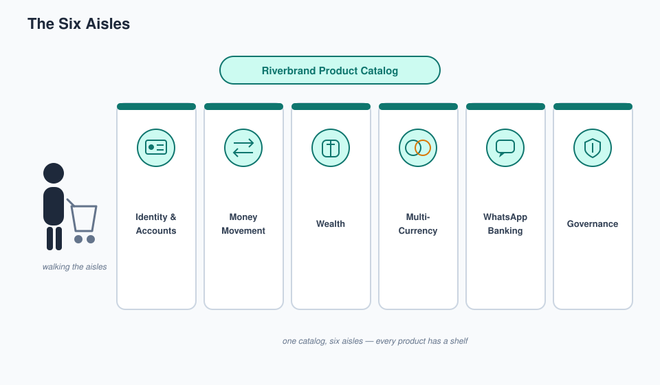

# Chapter 12 — For Everyone: The Product Catalog

> *Unlearn the idea that banking features are just screens and balance numbers. Learn the real journeys, rules, and risks behind each feature. Relearn what Riverbrand actually built for people, and why it holds.*

## Recap

- **Unlearn:** The idea that a banking product catalog is a list of screens — a transfer button here, a balance tile there — each feature standing alone.
- **Learn:** That every feature is really a journey with rules underneath: who you are, how much you may move today, which rail carries the money, and what happens when something fails mid-flight.
- **Relearn:** Riverbrand's catalog as six aisles of one supermarket — identity, everyday money, wealth, global currencies, chat banking, and governance — all served by one honest record of who owns what.

## 12.1 How to Read This Menu

Amina is a salary earner in Lagos. On the morning her pay lands she does something that would have been impossible a decade ago without a bank branch, a queue, and three separate apps: she receives her salary into an account number that is genuinely hers, moves part of it to her mother in another city, buys electricity for her flat, sets aside a slice for rent in a savings pot, and checks her dollar wallet — all before her tea gets cold. This chapter is the menu behind that morning. It is written for the product manager sizing a roadmap, the executive asking "what did we actually build?", the compliance officer checking coverage, and the curious customer who wants to know what the bank can do for them.

Think of the catalog as a supermarket directory. A good supermarket is not a random pile of goods; it is aisles, each aisle with a job, each shelf labelled in plain words, and every price and rule visible before you reach the till. Riverbrand organizes its capabilities the same way: **six aisles**, one per section of this chapter.

| Aisle | What you will find there | Where |
|---|---|---|
| 1. Identity, Accounts, and Virtual Numbers | Opening an account, proving who you are, and getting your own account number to receive money | [§12.2](#122-identity-accounts-and-virtual-numbers) |
| 2. Everyday Money Movement and Bills | Transfers to any bank, free transfers to fellow customers, airtime, TV, and electricity | [§12.3](#123-everyday-money-movement-and-bills) |
| 3. Wealth and Compounding Savings | Safelock, Target Savings, AutoSave, and interest that works while you sleep | [§12.4](#124-wealth-and-compounding-savings) |
| 4. Global Multi-Currency Wallets | Naira, dollars, pounds, euros, and Canadian dollars side by side | [§12.5](#125-global-multi-currency-wallets) |
| 5. 24/7 WhatsApp Banking | The whole bank inside a chat window, no app download required | [§12.6](#126-247-whatsapp-banking) |
| 6. Enterprise Governance and Admin | Staff roles, approvals, reconciliation, and the audit trail | [§12.7](#127-enterprise-governance-and-admin) |

Four words appear throughout the book and are worth pinning down here, in plain language:

- A **wallet** is a digital pocket that holds money in one currency. You can have several pockets — one for naira, one for dollars — and they all sit on the same account.
- A **ledger** is the bank's permanent written record of who owns what. Every movement of money is written into it once, in balanced pairs, and never quietly edited afterwards (see [§3.1](ch03-domain-primer.md#31-double-entry-in-plain-words)).
- A **NUBAN** — Nigeria Uniform Bank Account Number — is a standard ten-digit bank account number. Other banks can pay into it exactly as they would pay into any ordinary account (see [§3.2](ch03-domain-primer.md#32-nuban-nip-nibss-bvn-and-nin)).
- **KYC** means "know your customer" — the identity checks the regulator requires before an account may move larger amounts (see [§3.4](ch03-domain-primer.md#34-kyc-tiers-and-limits)).

Every capability in this chapter gets the same two lines: **what it does** and **why it matters**. That pairing is deliberate. A feature without a reason is a screen; a feature with a reason is a product.

## 12.2 Identity, Accounts, and Virtual Numbers

The first aisle answers the oldest question in banking: *who are you, and where does money sent to you land?* Riverbrand answers it without a branch visit.

**Opening an account from a phone.** *What it does:* A customer signs up with a phone number and a name, receives a one-time code to prove the number is real, and is onboarded — in the app or entirely inside a chat window. *Why it matters:* In the markets Riverbrand serves, a heavyweight app download or a branch trip is a real barrier; onboarding friction measured in seconds instead of afternoons changes who gets a bank account at all.

**Your own account number for receiving money.** *What it does:* Once the phone number is verified, the bank automatically issues the customer a dedicated NUBAN — a real, ten-digit account number issued through partner banks (Providus, with Fincra as a second route if the first is unavailable). *Why it matters:* A salary payer, a client, or a relative at another bank can send money to that number as if it were an ordinary bank account, and it lands directly in the customer's wallet — no "transfer to our collection account and send us the receipt" dance.

**Instant identity verification (KYC).** *What it does:* The customer submits their national identity numbers — the BVN (Bank Verification Number) and NIN (National Identification Number) — and the system checks them against the national identity databases in seconds, through a verification partner rather than a branch clerk. *Why it matters:* Verification that once meant a day off work now happens in a lunch break, and it unlocks higher limits immediately.

**Verification levels with honest ceilings.** *What it does:* Accounts are graded by how much identity has been proven. A phone-verified account (Tier 1) may move up to ₦50,000 a day; a BVN-and-NIN-verified account (Tier 2) up to ₦200,000; a fully verified account with address and photo ID (Tier 3) ₦5,000,000 and above. *Why it matters:* Limits are regulatory law, not bank stinginess — publishing them openly is what keeps the customer's expectations and the regulator's rules in the same room.

| Level | What you prove | Daily ceiling | What opens up |
|---|---|---|---|
| Tier 1 | Phone number | ₦50,000 | Receive money, small transfers, bills |
| Tier 2 | BVN and NIN | ₦200,000 | Everyday salary flows, savings products |
| Tier 3 | Address and government photo ID | ₦5,000,000+ | Large volumes, business-sized flows |

**The holding area for money above your limit.** *What it does:* If a legitimate payment arrives above your current ceiling, the bank credits what you may receive today and parks the excess safely to one side, notifying you — then releases it automatically the moment your verification level rises. *Why it matters:* The naive alternative — freezing the whole account or bouncing the payment into a two-week limbo — is precisely how banks lose customers' trust. The full story of this holding area is told in [§4.4](ch04-for-everyone-how-money-moves.md#44-the-quarantined-balance) and the customer-facing rules in [§8.3](ch08-for-everyone-safety-and-compliance.md#83-what-a-kyc-tier-means-for-a-customer).

**Saved recipients.** *What it does:* A single directory remembers the commercial bank accounts, phone numbers, and fellow-customer tags you pay often, across every channel. *Why it matters:* Retyping a ten-digit account number on a small screen is how wrong-number transfers happen; remembering recipients safely removes that failure mode.

## 12.3 Everyday Money Movement and Bills

This is the busiest aisle — the one Amina uses every month. It answers *how does money leave me, and how do the boring bills get paid?*

**Transfers to any bank.** *What it does:* Sends money instantly to any commercial or microfinance bank in Nigeria over the national instant-payment rails. *Why it matters:* "Instant" is the expectation now; a transfer that hangs with no explanation is the single most common way a bank loses a customer.

**Free transfers between Riverbrand customers.** *What it does:* Moves money to another customer using a phone number, an email, or a username, with no transfer fee. *Why it matters:* For families splitting rent and friends splitting dinner, the fee is not the point — not needing the other person's account number is.

**Airtime and mobile data.** *What it does:* Tops up phone credit and buys data bundles for all four Nigerian networks — MTN, Airtel, Glo, and 9mobile. *Why it matters:* Airtime is the most frequent small payment in the market; making it a two-tap action inside the bank (or a chat message) keeps the customer's money and attention in one place.

**TV subscriptions.** *What it does:* Renews DSTV, GOTV, and Startimes subscriptions, validating the smartcard number before any money moves. *Why it matters:* A wrong smartcard number that still debits the customer is a support ticket and a refund dance; validating first is a small kindness that saves both sides.

**Electricity.** *What it does:* Pays both prepaid and postpaid electricity bills — for prepaid meters it generates and returns the recharge token immediately. *Why it matters:* The prepaid token is the receipt that matters; delivering it in the same breath as the payment (often inside the chat window) is the difference between a bill paid and a bill paid *and* lights on.

| Bill | What you need handy | What you get back |
|---|---|---|
| Airtime / data | Phone number, network | Instant top-up confirmation |
| TV (DSTV, GOTV, Startimes) | Smartcard number | Subscription renewal |
| Prepaid electricity | Meter number | Recharge token |
| Postpaid electricity | Meter / account number | Settlement receipt |

*What it feels like:* You pick the bill, type the number, confirm with your secret four-digit PIN (a short code only you know, used to authorise money leaving your account), and the receipt arrives — as a clean card in chat, a notification, or a line in your history. Validation happens *before* the debit, so mistakes are caught while they are still free. Who it is for: everyone with a phone bill, a family decoder, or a meter — which is to say, everyone.

**Reconciliation while you sleep.** *What it does:* Overnight, the bank matches its own records of transfers and bill purchases against the records kept by the payment networks and bill providers. *Why it matters:* Two books that silently disagree are how money goes missing; routine matching turns discrepancies into found, fixable items instead of customer complaints (see [§10.2](ch10-for-everyone-reliability.md#102-jobs-that-run-while-you-sleep)).

## 12.4 Wealth and Compounding Savings

Traditional banks pay almost nothing on everyday balances, and standalone savings apps cannot pay your bills. Riverbrand puts both on the same rails. The full stories live in [Chapter 6](ch06-for-everyone-wealth-and-channels.md); here is the menu.

**Safelock fixed deposits.** *What it does:* Locks an amount away for a fixed term — 30, 90, 180, or 365 days — with the yield stated upfront, returning principal plus interest to your wallet at maturity. *Why it matters:* The lock is the product: money you cannot reach on a weak moment's impulse is money that is still there in December.

*In plain words:* Safelock is the tin under the floorboards with a time lock. You choose the tin and the date; until then, even you cannot open it. What you get back is agreed at the start, so there is no guessing.

**Target Savings goals.** *What it does:* Creates a named goal — "Rent Fund", "Wedding", "Master's Degree" — and sweeps scheduled deposits (daily, weekly, or monthly) toward it, with progress you can watch. *Why it matters:* A goal with a name and a schedule is how intention becomes discipline; the bank does the remembering.

*In plain words:* This is the labelled envelope on the shelf. The label matters as much as the money: a pot called "school fees" is harder to raid than a number on a screen.

**AutoSave sweeps.** *What it does:* Periodically moves idle cash from your everyday wallet into your savings pot — every Friday, or at month-end, on the rule you set. *Why it matters:* Saving what is left over never works; sweeping first, before the month spends it, does.

*In plain words:* AutoSave is a broom with a schedule. It sweeps the loose coins off the counter into the pot before they vanish into small purchases.

**Compounding interest.** *What it does:* Yield is calculated every night on the growing balance and recorded into a permanent log — the balance compounds rather than sitting flat. *Why it matters:* The nightly cadence is what turns a marketing percentage into actual money; the interest story is told step by step in [§6.2](ch06-for-everyone-wealth-and-channels.md#62-compounding-made-tangible).

| Product | Locks away | Best for | You choose |
|---|---|---|---|
| Safelock | A fixed sum, fixed term | Impulse-proof savings | Amount and tenure |
| Target Savings | Scheduled deposits to a named goal | Dreams with deadlines | Goal name, amount, schedule |
| AutoSave | Idle wallet balance | Effortless discipline | Sweep day and amount |

**Who it is for.** The saver who has tried and failed to save by willpower alone; the freelancer with uneven income who needs a Friday sweep to smooth it; the parent building a school-fees pot over two years. What it feels like: choosing the product once, and finding the money — plus its earnings — where you left it, in your own currency, with a history you can read.

## 12.5 Global Multi-Currency Wallets

Some customers earn in one currency and live in another. Riverbrand keeps five currencies side by side: **NGN** (Nigerian naira), **USD** (US dollars), **GBP** (British pounds), **EUR** (euros), and **CAD** (Canadian dollars). Each is its own pocket — its own wallet — on one account.

**Hold, receive, and send in five currencies.** *What it does:* Each currency wallet holds its own balance and receives inbound payments as if it were a local account of that currency. *Why it matters:* Diaspora money should not have to land in a naira account and lose value on the way in.

**In-app currency conversion.** *What it does:* Swaps value between your wallets at a recorded, published exchange rate — a swap is itself a proper movement of value in the ledger, not a cosmetic number change. *Why it matters:* If the rate is not recorded, the customer can never audit the swap; if the swap is not a ledger movement, the books cannot balance.

**Cross-border reception.** *What it does:* Clears diaspora inflows — remittances, tuition support, client payments — into the matching foreign-currency wallet. *Why it matters:* For many families, a euro or pound balance held intact is the entire point of the account.

Who needs each, and why — the five journeys the product was designed around (told in full in [§1.3](ch01-riverbrand-story.md#13-what-riverbrand-is-the-product-map)):

| Currency | Who it serves | What it does for them |
|---|---|---|
| NGN | Tunde, a professional in Lagos | Salary in, bills and transfers out, everyday life |
| USD | Sarah, a remote consultant | Dollar earnings held and locked in savings without converting to naira first |
| EUR | Amara, a student in Nigeria | Tuition and living support from Europe, kept in euros until needed |
| GBP | David, a freelance engineer | British client income saved toward a Master's degree |
| CAD | Ken, an import-export manager in Toronto | Invoice payments in Canadian dollars for cross-border trade |

*What it feels like:* Opening a second currency wallet is as simple as turning on a second pocket; a conversion is a recorded line in your history with the rate attached; a payment from abroad lands in the currency it was sent in. For the mechanic underneath — including what happens when a conversion rate changes mid-request — see [§7.5](ch07-engineering-channel-fabric.md#75-multi-currency-wallet-semantics) and [§3.3](ch03-domain-primer.md#33-wallets-and-the-five-currencies).

## 12.6 24/7 WhatsApp Banking

The flagship aisle is not a screen at all — it is a conversation. WhatsApp is already on nearly every smartphone in the market, often on free carrier data; Riverbrand turns that chat window into a complete bank.

**Banking with zero app download.** *What it does:* Customers open an account, verify identity, receive money, transfer money, pay bills, save, and check balances entirely inside WhatsApp. *Why it matters:* When device storage is tight and data is expensive, "install our 400 MB app first" is a decision that quietly excludes people.

**Interactive menus and receipts.** *What it does:* The chat shows tappable buttons and lists — bank lists, data plans, bill types — and returns clean, readable receipt cards the moment a payment completes. *Why it matters:* A receipt you can read in the chat where you made the payment beats a screenshot hunt through three apps.

**Transfers and bills in conversation.** *What it does:* Money movement follows the same rules as every other channel — recipient name shown before you confirm, the same PIN to authorise, the same limits — just as chat messages. *Why it matters:* A channel that is convenient but rules-free would be a liability; one that is convenient and identical in behaviour is a distribution advantage.

**Balance and statement access.** *What it does:* Answers balance inquiries across all currency wallets on demand and offers statement downloads. *Why it matters:* "What is my balance?" is the most-asked question in banking; answering it in seconds, in chat, is table stakes done well.

**Automated support, day and night.** *What it does:* Frequent questions — limits, failed bills, how to upgrade verification — are answered automatically, 24 hours a day, without a teller queue. *Why it matters:* Human support is precious and slow at 2 a.m.; automation keeps the human queue for the problems that truly need a human.

**Onboarding in the chat itself.** *What it does:* A brand-new customer can register, confirm their email with a code, verify their identity, set their payment PIN, and receive their own account number — all by conversation. *Why it matters:* The first ten minutes decide whether a product exists for a customer at all.

| In chat you can… | And you get back… |
|---|---|
| Open an account and verify identity | Your own account number |
| Send money to any bank | A receipt card |
| Buy airtime, data, TV, electricity | Confirmation (and the meter token) |
| Ask for a balance | The answer in seconds |
| Set aside savings | Progress toward your goal |

*What it feels like:* Telling a careful, patient teller what you need, in short messages, at any hour — and getting a clean answer rather than a spinner. The channel design and its failover behaviour live in [§6.3](ch06-for-everyone-wealth-and-channels.md#63-banking-in-a-chat-window) and [§6.4](ch06-for-everyone-wealth-and-channels.md#64-when-a-provider-fails); what happens when a message provider stutters is honestly covered there.

## 12.7 Enterprise Governance and Admin

The last aisle is for the bank's own people — and for the customers who are protected by them. A bank that cannot govern its staff cannot be trusted with anyone's money.

**Executive dashboard.** *What it does:* Gives leadership real-time visibility into total customer liabilities, held reserves, and how fast money is moving through the platform. *Why it matters:* "How much do we owe our customers right now?" should be a glance, not a week-long spreadsheet exercise.

**Roles and permissions.** *What it does:* Every staff member sees and can do only what their job requires — a support agent cannot move money, an auditor cannot edit records. *Why it matters:* Most internal fraud needs both bad intent *and* excessive permission; roles cut the second half of that sentence (see [§8.5](ch08-for-everyone-safety-and-compliance.md#85-regulatory-posture-and-governance)).

**Approvals on sensitive actions.** *What it does:* High-impact actions — identity document decisions, large administrative changes, suspensions — go through defined review rather than one person's single click. *Why it matters:* Two pairs of eyes on the dangerous doors is cheaper than one incident report.

**The audit trail.** *What it does:* Records every staff action — every click, approval, and modification — in permanent records that cannot be quietly rewritten. *Why it matters:* When a question arises months later ("who changed this limit, and when?"), the answer must exist independent of anyone's memory (see [§8.4](ch08-for-everyone-safety-and-compliance.md#84-the-audit-trail)).

**Manual identity review and limits.** *What it does:* Staff can review documents that automation cannot settle, and manage the benefit and limit settings attached to each verification level. *Why it matters:* Automation is fast but not wise; the human review desk is the appeal court of KYC.

**Financial liability and account governance.** *What it does:* Tracks what the bank owes, and lets staff suspend or restore accounts under policy — with every such act recorded. *Why it matters:* Suspension is a powerful, frightening button; it must exist, and its use must be visible.

**Reconciliation reporting.** *What it does:* Surfaces the results of the overnight matching between the bank's books and its providers, so operations can resolve mismatches. *Why it matters:* Finding a ₦ discrepancy on a Tuesday is routine; finding it after a quarter is a crisis.

| Control | What it protects | Plain-words effect |
|---|---|---|
| Roles and permissions | Customer money and data | Staff can only touch what their job requires |
| Approvals | Dangerous actions | Sensitive changes need defined review |
| Audit trail | Everyone | Actions are written down, permanently |
| Reconciliation | The books | Provider mismatches surface as work items |
| Session control | Your account | A password reset closes the doors behind you |

*In plain words:* Governance is the bank's own accounting of its own power — who may do what, what they did, and what the books say should have happened. The customer never sees the machinery, but feels it as the answer to "could a staff member just move my money?" The honest answer is that the design makes that hard to do and impossible to hide, and the reasoning is laid out in [Chapter 8](ch08-for-everyone-safety-and-compliance.md).

## 12.8 What We Built, Why, and Where It Goes

**What we built.** One catalog of banking capability in six aisles: identity and account numbers for receiving money, everyday transfers and bill payments, compounding savings products, five currency wallets, full banking inside WhatsApp, and an enterprise governance suite behind all of it. Every aisle runs on the same record of who owns what — the same ledger, the same limits, the same receipts — whether the customer arrives through an app, a browser, or a chat window.

**Why it matters.** Each aisle answers a documented failure of ordinary banking: branch-bound onboarding that excludes people, transfers that hang without explanation, savings that cannot sit still beside spending money, foreign currency that arrives in the wrong pocket, heavy apps that people cannot download, and staff power that nobody can audit. The catalog is not a feature count; it is a set of answers to those failures.

**What we aim for.** A customer who can receive a salary, pay a meter, fund a goal, hold dollars, and get help at midnight — from one account, with rules that are the same in every channel and limits that are explained rather than sprung. And a bank whose staff can run it with roles, approvals, and records that survive an audit.

**The approach ahead.** The aisles are designed to grow rather than be rebuilt: new rails and currencies, open banking access, and more automation on top of the same engine are the road described in [Chapter 14](ch14-for-everyone-future-roadmap.md). The catalog you just read is the foundation those additions stand on.

## Key Takeaways

- Riverbrand's product catalog is organized as six aisles — identity, everyday money, wealth, global currencies, WhatsApp banking, and governance — all backed by one honest ledger.
- Every customer gets a real account number (a NUBAN) to receive money, and a clear ladder of verification levels with published daily ceilings.
- Money movement and bills validate before they debit, so mistakes are caught while they are still free; savings products make discipline automatic.
- Five currency wallets (NGN, USD, GBP, EUR, CAD) serve earners and families whose money crosses borders; conversions are recorded movements, not cosmetic.
- WhatsApp banking carries the full capability set without an app download, under the same rules as every other channel.
- Governance — roles, approvals, audit, reconciliation — is what makes "your money is safe from our own staff" an honest claim.

## Frequently Asked Questions

### Do I need to download an app to bank with Riverbrand?

No. The complete capability set — opening an account, receiving money, transfers, bills, savings, and balances — is available inside WhatsApp, which most smartphones already carry. The mobile app and web portal exist for customers who prefer them, and all three channels show the same account because they read the same record ([§12.6](#126-247-whatsapp-banking)).

### Is my NUBAN a real bank account number?

It is a real, standard ten-digit account number issued through partner banks, which any other bank can pay into. What makes it different is that behind it sits your Riverbrand wallet rather than a traditional branch ledger — so incoming money lands in your account immediately, ready to spend or save (see [§3.2](ch03-domain-primer.md#32-nuban-nip-nibss-bvn-and-nin)).

### Why are there different limits at different verification levels?

Daily ceilings — ₦50,000 at phone-only verification, ₦200,000 once your identity is checked, ₦5,000,000 and above at full verification — are regulatory requirements designed to keep unverified accounts from moving large sums. The levels are a ladder: each step of identity you prove raises the ceiling (see [§8.3](ch08-for-everyone-safety-and-compliance.md#83-what-a-kyc-tier-means-for-a-customer)).

### What happens to money that arrives above my limit?

It is never lost and never bounced into limbo. The portion you may receive today is credited immediately; the excess is parked safely aside with a notification, and released automatically into your balance the moment your verification level rises ([§4.4](ch04-for-everyone-how-money-moves.md#44-the-quarantined-balance)).

### Which currency wallet should I use, and can I hold more than one?

You can hold all five — NGN, USD, GBP, EUR, and CAD — as separate pockets on one account. Naira is for everyday Nigerian life; dollars for remote work and dollar savings; euros and pounds for European and British inflows such as tuition and client payments; Canadian dollars for North American trade. Conversions between them are available in-app at a recorded rate ([§12.5](#125-global-multi-currency-wallets)).

### Can a Riverbrand staff member move my money?

Not as an ordinary action. Staff see and do only what their role requires, sensitive actions go through defined review, and every staff action is written into a permanent audit record. The design goal is that misuse would be both hard to do and impossible to hide ([§8.4](ch08-for-everyone-safety-and-compliance.md#84-the-audit-trail)).

## Where to Go Next

*For engineers, see [Chapter 13 — Engineering: The Service Catalog](ch13-engineering-service-catalog.md).*
