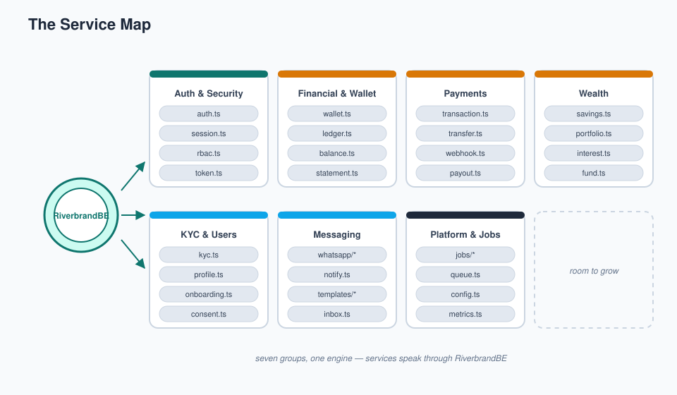
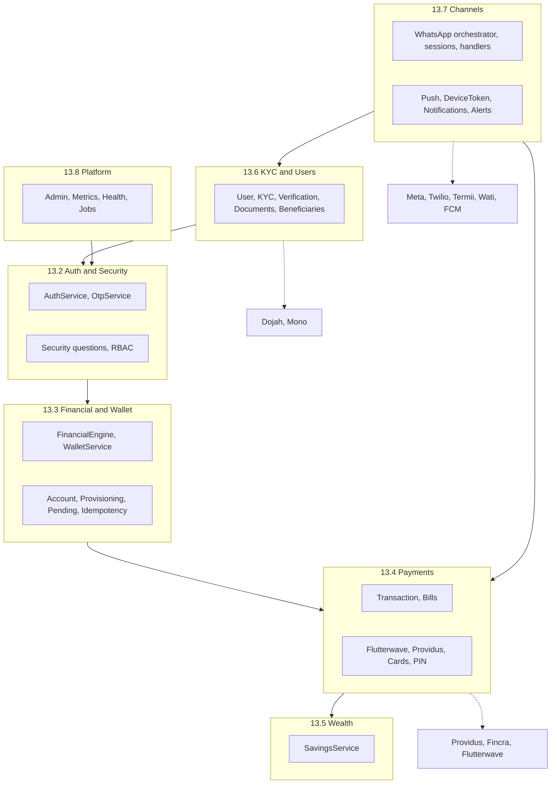

# Chapter 13 — Engineering: The Service Catalog

> *Unlearn the naive implementation you would write first. Learn the failure modes and race conditions that break it. Relearn the architecture Riverbrand ships instead.*

## Recap

- **Unlearn:** The idea that a service catalog is just a directory listing — class names, file paths, and a shrug about what anything does.
- **Learn:** That every service is a boundary around one business responsibility, with documented methods, the tables it dares to touch, the errors it raises, and the external vendors it cannot control.
- **Relearn:** RiverbrandBE as 39 catalogued capabilities in seven groups — from authentication to the jobs that run while you sleep — with the failure modes and fallbacks documented next to the code that owns them.

## 13.1 How to Read a Service Entry

The naive first implementation of a banking backend puts SQL inside HTTP handlers: the controller that receives a transfer request also writes the debit, calls the bill vendor, and patches the balance. It demos well and dies badly. Vendor calls stall inside customer requests; money logic becomes untestable without HTTP; swapping a payment provider means surgery across the whole codebase. RiverbrandBE draws hard lines instead: **controllers** validate HTTP concerns (schema, tokens, rate limits), **services** own business rules and transactions, and **repositories** handle persistence. Every domain service is a dependency-injected unit (TypeDI constructor injection) — isolated, testable, and able to emit events asynchronously through the event bus and outbox relay rather than inline side effects (the outbox mechanism itself is [§5.4](ch05-engineering-transaction-engine.md#54-the-outbox-and-dead-letter-queue)).

This chapter is the reference for every capability the backend implements. The source catalog records **39 numbered capability entries**; several entries deliberately bundle tightly coupled classes — `RoleService` with `PermissionService`, `FlutterwaveCardService` with `UserCardService`, `KycService` with `VerificationService`, `AdminService` with `AdminAccountService` — so the underlying class count runs above the entry count. Nothing documented has been dropped: if the entry exists in the source catalog, it exists below. Entries whose name fights the shell grouping of this chapter sit in the best-fit group (for example, `PinService` is authentication-adjacent but owns a payment-authorisation concern, so it lives with payments in [§13.4](#134-payment-and-transaction-services)).

Every entry uses the same shape:

- **Responsibility** — the business purpose in one or two sentences.
- **Key methods** — the documented public surface, with signatures where the source catalog records them.
- **Tables touched** — the persistent models the service reads or writes, named exactly as they appear in the schema. Legacy prefixes (`savings_*`, `user_user`) are flagged to-be-renamed; the canonical prefix map is [§3.5](ch03-domain-primer.md#35-the-schema-prefix-map), and the full column-level view is the [Data Dictionary](../appendices/app-c-data-dictionary.md).
- **Errors** — documented error codes and lockout behaviour. Where the source catalog itemises none, the entry says so rather than inventing codes.
- **External dependencies and guards** — vendor gateways and the security mechanism the entry relies on.

**Dependency matrix at a glance.** The source catalog's summary matrix, condensed:

| Service entry | Primary models | External gateway | Key security mechanism |
|---|---|---|---|
| `AuthService` | `user_user`, session control | None | Argon2id + sidecar `jwtVersion` |
| `OtpService` | `riverbrand_sms_otp` | Termii / Twilio SMS | 6-digit random + 10-minute expiry |
| `FinancialEngine` | `Wallet`, `Transaction` | None | Redis lock + SQL `$transaction` |
| `UserProvisioningService` | `userAccountDetails` | ProvidusBank / Fincra | NUBAN gateway failover |
| `PendingBalanceService` | `rbp_brand_pending_balance` | None | Audit trail (`pending_audit`) |
| `TransactionService` | `payment_transaction` | Interbank clearing | Reference idempotency |
| `SavingsService` | `Target`, `savings_config` | None | Daily compound yield math |
| `KycService` | `user_user` | Dojah / Mono API | BVN and NIN verification |
| `WhatsAppBankingService` | `user_user`, `Wallet` | Meta / Twilio / Termii / Wati | HMAC signature + PIN auth |
| `WhatsAppSessionService` | Redis (`wa:session:*`) | In-memory Redis 7 | 30-minute TTL + 3-attempt lockout |
| `WhatsAppTransferHandler` | `Wallet`, `Transaction` | Interbank clearing | Distributed Redlock + PIN |
| `WhatsAppRegistrationHandler` | `user_user`, `userAccountDetails` | Dojah / Providus / Fincra | Email OTP + BVN match |
| `PushNotificationService` | `sys_device_tokens` | Firebase FCM | Self-healing token invalidation |

The seven groups below are the service map in words. Their boundaries, and the journeys that cross them, are also traced in [§16.5](ch16-engineer-onboarding.md#165-the-service-map-and-where-to-change-what).

**Figure 13.2 — The seven service groups and their external edges.**

Two architectural facts travel with almost every entry and are documented at length elsewhere: the **two-tier concurrency guard** (a Redis distributed lock plus a single-commit database transaction — the bank-vault airlock of [§5.1](ch05-engineering-transaction-engine.md#51-the-two-tier-concurrency-guard) and [Appendix F](../appendices/app-f-analogy-atlas.md)), and **dual-token client isolation** with the sidecar session kill-switch ([§9.1](ch09-engineering-security-architecture.md#91-dual-token-client-isolation), [§9.2](ch09-engineering-security-architecture.md#92-sidecar-session-control-and-the-kill-switch)). They are not repeated per entry unless the entry is their owner.

## 13.2 Authentication and Security Services

These five entries answer who is calling, on what kind of client, with what authority. Read them together with [Chapter 9](ch09-engineering-security-architecture.md); this section is the inventory, that chapter is the threat model.

### 1. `AuthService` (`src/services/auth.ts`)

- **Responsibility.** Core authentication orchestrator: user sign-up, sign-in validation, JWT access-token generation, password resets, and sidecar session control.
- **Key methods.**
  - `signUp(dto: SignUpDTO)` — creates the user in `user_user`, hashes the password with Argon2id/bcrypt, initialises the default `NGN` wallet, provisions the sidecar session record in `river_brand_sys_user_session_control`, and emits a `UserRegistered` event.
  - `signIn(dto: SignInDTO)` — validates credentials, checks suspension status, verifies the client token type (`x-client-type: mobile` versus web), fetches `jwtVersion` from the sidecar table, and issues signed JWT access tokens carrying the `jv` claim.
  - `signOut(userId: bigint)` — increments `jwtVersion` in the sidecar table, instantly revoking active access tokens across every device the user holds.
- **Tables touched.** `user_user`, `river_brand_sys_user_session_control`, `Wallet`.
- **Errors.** `INVALID_CREDENTIALS` (401), `USER_SUSPENDED` (403), `ACCOUNT_ALREADY_EXISTS` (409).
- **Guards.** Argon2id password hashing; dual-token isolation so a leaked web token cannot impersonate a mobile session ([§9.1](ch09-engineering-security-architecture.md#91-dual-token-client-isolation)); sidecar `jwtVersion` bump as the kill-switch behind every password reset and sign-out — the hotel-keycard re-key of [Appendix F](../appendices/app-f-analogy-atlas.md#f3-the-electronic-hotel-master-keycard-sidecar-session-revocation).

### 2. `OtpService` (`src/services/otp.ts`)

- **Responsibility.** Generates, stores, delivers, and validates 6-digit cryptographically secure one-time passwords over SMS and email.
- **Key methods.**
  - `requestOtp(userId: bigint, phone: string, context: string)` — generates a 6-digit random code, inserts a record into `riverbrand_sms_otp` with a 10-minute TTL, and routes the SMS via the Termii gateway with Twilio as fallback.
  - `verifyOtp(userId: bigint, phone: string, pin: string, context: string)` — validates the active code, marks `is_verified = true`, and invalidates the consumed code.
- **Tables touched.** `riverbrand_sms_otp`.
- **Errors.** No code list itemised in the source catalog; expired and already-consumed codes fail verification by design of the TTL and invalidation.
- **External dependencies.** `termiiClient.ts` (primary), `twilioClient.ts` (fallback) — provider failover is the multi-engine pattern of [Appendix F](../appendices/app-f-analogy-atlas.md#f5-the-multi-engine-jetliner-provider-failover-and-redundancy).

### 3. `SecurityQuestionService` (`src/services/securityQuestion.ts`)

- **Responsibility.** Manages customer recovery security questions and answer verification.
- **Key methods.**
  - `getPublicQuestions()` — fetches the active question library from `rbp_brand_security_question`.
  - `setUserAnswers(userId: bigint, answers: SecurityAnswerDTO[])` — hashes answers with bcrypt into `rbp_brand_user_security_question_answer`.
  - `verifyUserAnswer(userId: bigint, questionId: bigint, answer: string)` — compares a candidate answer against the stored hash during account recovery.
- **Tables touched.** `rbp_brand_security_question`, `rbp_brand_user_security_question_answer`.
- **Errors.** Not itemised in the source catalog.
- **Notes.** Answers are stored only as hashes; recovery compares hashes, never plaintext.

### 4. `AdminSecurityQuestionService` (`src/services/adminSecurityQuestion.ts`)

- **Responsibility.** Lets administrative staff manage the master security-question library and its multiple-choice options.
- **Key methods.** `createQuestion()`, `updateQuestion()`, `deleteQuestion()`, `addOption()`.
- **Tables touched.** The master question tables managed alongside `rbp_brand_security_question` (column detail in the [Data Dictionary](../appendices/app-c-data-dictionary.md)).
- **Errors.** Not itemised in the source catalog.
- **Notes.** This entry is the staff-side counterpart to entry 3: customers answer questions; this service curates them.

### 5. `RoleService` (`src/services/RoleService.ts`) and `PermissionService` (`src/services/PermissionService.ts`)

- **Responsibility.** Role-Based Access Control (RBAC) definitions and the staff permission matrix: which role may call which administrative capability.
- **Key methods.** Not itemised per method in the source catalog; the pair owns role CRUD, permission assignment, and the evaluation used by admin routes.
- **Tables touched.** `sys_roles`, `sys_permissions`, `sys_role_permissions`, `sys_user_roles`.
- **Errors.** Not itemised in the source catalog.
- **Guards.** Every administrative handler consults this matrix; the reasoning — why staff power must be scoped and recorded — is [§9.4](ch09-engineering-security-architecture.md#94-role-based-access-control).

## 13.3 Core Financial and Wallet Engines

The money core. If you read only one section of this chapter, read this one alongside [Chapter 5](ch05-engineering-transaction-engine.md): there the mechanisms are explained; here is who owns them.

### 6. `FinancialEngine` (`src/services/monetary/financialEngine.ts`)

- **Responsibility.** Master double-entry accounting engine handling low-level atomic ledger entries, balance additions, deductions, and cross-currency conversions.
- **Key methods.**
  - `executeLedgerMovement(params: LedgerMovementDTO)` — executes atomic SQL balance mutations inside `$transaction` blocks while evaluating Redis distributed lock keys (`lock:wallet:{walletId}`).
- **Tables touched.** `Wallet`, `Transaction`, `payment_transaction`.
- **Errors.** Not itemised in the source catalog; failed lock acquisition or transaction abort leaves balances untouched by construction of the single-commit pattern.
- **Guards.** The two-tier concurrency guard: Redis lock first, single-commit database transaction second ([§5.1](ch05-engineering-transaction-engine.md#51-the-two-tier-concurrency-guard)). Every other money-moving service ultimately delegates value transfer to this engine.

### 7. `WalletService` (`src/services/monetary/wallet/wallet.ts`)

- **Responsibility.** Manages multi-currency customer wallets — balances, exchange rates, and wallet creation.
- **Key methods.**
  - `getWalletBalance(userId: bigint, currency: string)` — returns available and pending balances for one currency pocket.
  - `convertCurrency(amount: Decimal, fromCurrency: string, toCurrency: string)` — fetches the rate from the `ExchangeRate` matrix and computes the net conversion value.
- **Tables touched.** `Wallet`, `WalletCurrency`, `ExchangeRate`.
- **Errors.** Not itemised in the source catalog.
- **Notes.** The documented method surface names NGN, USD, EUR, and GBP; the product commitment includes CAD wallets as well (see [§7.5](ch07-engineering-channel-fabric.md#75-multi-currency-wallet-semantics)) — the CAD provisioning path is not itemised in the source catalog (**UNVERIFIED**). Conversion is a ledger movement at a recorded rate, not a cosmetic display change.

### 8. `AccountService` (`src/services/monetary/account/account.ts`)

- **Responsibility.** Manages virtual NUBAN account records and the dashboard summary displays built on them.
- **Key methods.** Not itemised per method in the source catalog; the service owns NUBAN record reads and account-summary assembly for the customer dashboards.
- **Tables touched.** `userAccountDetails`, `user_user`.
- **Errors.** Not itemised in the source catalog.

### 9. `UserProvisioningService` (`src/services/userProvisioning.ts`)

- **Responsibility.** Automated provisioning of a dedicated virtual NUBAN for each user at registration.
- **Key methods.**
  - `provisionVirtualAccount(userId: bigint)` — requests NUBAN generation from the ProvidusBank API; if Providus is in outage, falls back automatically to the Fincra gateway; writes the result to `userAccountDetails` and tracks the reference in `rbp_brand_references`.
- **Tables touched.** `userAccountDetails`, `rbp_brand_references`.
- **Errors.** Not itemised as codes; the documented failure behaviour is the dual-gateway failover rather than an error list.
- **External dependencies.** ProvidusBank API (primary), Fincra API (fallback). The lifecycle this entry starts — provisioning through inbound credit — is traced in [§5.5](ch05-engineering-transaction-engine.md#55-virtual-nuban-lifecycle).

### 10. `PendingBalanceService` (`src/services/monetary/pendingBalance.ts`)

- **Responsibility.** Enforces KYC daily transaction ceilings: when an inbound deposit exceeds the customer's tier limit, the excess is held in the pending-balance tank and released automatically on tier upgrade.
- **Key methods.**
  - `holdPendingBalance(userId: bigint, amount: Decimal, reference: string)` — places funds in pending hold and appends an entry to `rbp_brand_pending_balance_audit`.
  - `releasePendingBalances(userId: bigint)` — triggered by `KycTierUpgradedHandler`; releases held funds into the primary wallet balance.
- **Tables touched.** `rbp_brand_pending_balance`, `rbp_brand_pending_balance_audit`.
- **Errors.** Not itemised in the source catalog.
- **Notes.** The ceilings themselves (₦50k / ₦200k / ₦5M tiers) and the customer story are [§5.6](ch05-engineering-transaction-engine.md#56-the-pending-balance-holding-tank-and-kyc-ceilings); the release trigger is the documented tier-upgrade event handler.

### 11. `IdempotencyService` (`src/services/monetary/idempotency.ts`)

- **Responsibility.** Deduplicates financial operations using cryptographic references recorded in `rbp_brand_references`, so a retried request cannot move money twice.
- **Key methods.** Not itemised per method in the source catalog; the service owns reference issuance and replay detection for money-moving operations.
- **Tables touched.** `rbp_brand_references`.
- **Errors.** Not itemised; a duplicate submission is rejected or answered with the original result by idempotency semantics.
- **Notes.** Why duplicate submissions are inevitable (webhook retries, double taps, reconnects) is [§5.3](ch05-engineering-transaction-engine.md#53-idempotency-references).

## 13.4 Payment and Transaction Services

Everything that moves value out of — or into — a customer wallet through an external rail. The naive version of this section calls vendors inline from controllers and hopes the webhook is right; the entries below show the documented split between intent, provider call, and verified settlement.

### 12. `TransactionService` (`src/services/monetary/transaction/transaction.ts`)

- **Responsibility.** Interbank transfers, peer-to-peer transfers, transaction history queries, and receipt generation.
- **Key methods.** Not itemised per method in the source catalog; the service owns transfer initiation, history pagination, and receipt assembly.
- **Tables touched.** `Transaction`, `payment_transaction`, `user_user`.
- **Errors.** Not itemised in the source catalog.
- **Guards.** Reference idempotency (entry 11) and the interbank clearing dependency from the summary matrix; value transfer itself resolves through `FinancialEngine` (entry 6).

### 13. `BillPaymentService` (`src/services/monetary/transaction/BillPaymentService.ts`)

- **Responsibility.** Airtime, mobile data, electricity, and cable TV bill payments. Validates customer meter and smartcard numbers **before** executing wallet debits.
- **Key methods.** Not itemised per method in the source catalog; the documented contract is validate-first, debit-second, then deliver the vendor token or confirmation.
- **Tables touched.** Not itemised separately in the source catalog; bill purchases settle through the payment/transaction models of entries 6 and 12.
- **Errors.** Not itemised in the source catalog; failed vendor purchases are reconciled and refunded by `BillReconciliationJob` (see [§13.8](#138-platform-admin-and-job-services)).
- **Notes.** Validate-before-debit is what makes a mistyped meter number free instead of expensive.

### 14. `FlutterwaveTransactionService` (`src/services/monetary/transaction/flutterwaveTransaction.ts`)

- **Responsibility.** Handles Flutterwave debit-card top-ups, webhook verification for those top-ups, and external payout clearing.
- **Key methods.** Not itemised per method in the source catalog; the service owns the card-funding flow, inbound webhook signature verification, and payout dispatch.
- **Tables touched.** Not itemised separately; funding outcomes land in the wallet/transaction models of entries 6–7.
- **Errors.** Not itemised in the source catalog.
- **External dependencies.** Flutterwave gateway. Inbound notifications are verified before crediting — the same principle entry 15 applies to Providus.

### 15. `ProvidusTransactionService` (`src/services/monetary/transaction/providusTransaction.ts`)

- **Responsibility.** Validates inbound ProvidusBank deposit webhooks, verifying transaction signatures before crediting user wallets.
- **Key methods.** Not itemised per method in the source catalog; the service owns signature verification and the credit-on-verified path for inbound NUBAN deposits.
- **Tables touched.** Not itemised separately; verified credits post through `FinancialEngine` (entry 6).
- **Errors.** Not itemised in the source catalog; unverified signatures are rejected before any balance moves.
- **Guards.** Signature verification is the whole entry: a webhook proves a notification arrived, not that it is genuine (the duplicate-credit failure this prevents is [§5.3](ch05-engineering-transaction-engine.md#53-idempotency-references) and Chapter 1's failure table).

### 16. `FlutterwaveCardService` and `UserCardService`

- **Responsibility.** Tokenises saved debit cards (`UserCard`) for one-click wallet funding: one service drives the gateway tokenisation, the other owns the customer's saved-card records.
- **Key methods.** Not itemised per method in the source catalog.
- **Tables touched.** `UserCard` (saved-card records); funding settlement runs through the Flutterwave path of entry 14.
- **Errors.** Not itemised in the source catalog.
- **Notes.** The source catalog records no file paths for this bundled pair — the paths are therefore **UNVERIFIED**. Tokenisation means the card number itself is not retained for repeat funding; the gateway keeps the token.

### 17. `PinService` (`src/services/monetary/pin/pin.ts`)

- **Responsibility.** Manages the 4-digit secret transaction PINs that authorise money leaving a wallet.
- **Key methods.** Not itemised per method in the source catalog; the service owns PIN set/change, bcrypt hashing, and verification at authorisation time.
- **Tables touched.** Not itemised separately in the source catalog.
- **Errors.** Documented behaviour: temporary lockout after 3 invalid attempts (a code list is not itemised).
- **Guards.** PINs are stored hashed, never in clear; the same lockout discipline appears in the WhatsApp session layer (entry 25). The broader password/PIN policy is [§9.3](ch09-engineering-security-architecture.md#93-pin-and-password-protection).

## 13.5 Wealth and Investment Services

One entry owns all three savings products and the interest engine. That concentration is deliberate: Safelock, Target Savings, and AutoSave are not three apps but three behaviours over the same ledger and the same yield math.

### 18. `SavingsService` (`src/services/monetary/savings/savings.ts`)

- **Responsibility.** Manages Safelock fixed deposits, Target Savings goals, AutoSave sweeps, and daily compounding interest accrual.
- **Key methods.**
  - `createSafelock(userId: bigint, amount: Decimal, tenureDays: int)` — debits the wallet and locks funds in the `Target` table with `savingsType = SAFELOCK`.
  - `processDailyInterestAccrual()` — executed by the nightly job (`src/job/savings.ts`); accrues daily yield and writes interest logs to `savings_usersavinginterestlog`.
  - `liquidateMaturedSafelock(safelockId: bigint)` — pays principal plus interest back to the user wallet on the maturity date.
- **Tables touched.** `Target`, `savings_config`, `savings_usersavinginterestlog`. Legacy `savings_*` prefixes are flagged to-be-renamed ([§3.5](ch03-domain-primer.md#35-the-schema-prefix-map)).
- **Errors.** Not itemised in the source catalog.
- **Notes.** The accrual writes a log row rather than mutating a balance — the same append-not-overwrite discipline as the ledger. The compounding math and the job schedule are derived in [§7.1](ch07-engineering-channel-fabric.md#71-savingsjob-and-the-compounding-math); the customer-facing products are [§6.1](ch06-for-everyone-wealth-and-channels.md#61-safelock-target-savings-and-autosave-stories). Tenures documented at product level: 30, 90, 180, and 365 days.

## 13.6 KYC, Verification, and User Services

Identity and profile: who the customer is, what they have proven, and what they have saved. Tier semantics (₦50k / ₦200k / ₦5M ceilings) live at the engine level ([§5.6](ch05-engineering-transaction-engine.md#56-the-pending-balance-holding-tank-and-kyc-ceilings)); these entries own the evidence and the upgrades.

### 19. `UserService` (`src/services/user.ts`)

- **Responsibility.** User profile management, avatar uploads to S3/Cloudinary, address updates, and account-deletion requests.
- **Key methods.** Not itemised per method in the source catalog.
- **Tables touched.** `user_user` (profile fields); document blobs go to object storage rather than the database.
- **Errors.** Not itemised in the source catalog.

### 20. `KycService` (`src/services/kyc.ts`) and `VerificationService` (`src/services/verification.ts`)

- **Responsibility.** Verifies BVN and NIN identity details via the Dojah Identity Gateway and Mono API, and upgrades the user to Tier 2 on success.
- **Key methods.** Not itemised per method in the source catalog; the pair owns identity submission, gateway verification, and the tier-upgrade write.
- **Tables touched.** `user_user` (tier/status fields); identity evidence is held per the verification records described in the [Data Dictionary](../appendices/app-c-data-dictionary.md).
- **Errors.** Not itemised in the source catalog.
- **External dependencies.** Dojah Identity Gateway (primary path), Mono API (documented as second identity dependency). A successful upgrade emits the tier-upgrade event that releases pending balances (entry 10).

### 21. `UserDocumentService` (`src/services/userDocument.ts`)

- **Responsibility.** Handles Tier 3 proof-of-address and government photo-ID document uploads (`UserDocument`).
- **Key methods.** Not itemised per method in the source catalog; the service owns upload, storage, and status of customer documents.
- **Tables touched.** `UserDocument`.
- **Errors.** Not itemised in the source catalog.
- **Notes.** Tier 3 is the ₦5,000,000+ daily ceiling; this table is the evidence behind it.

### 22. `AdminKycService` (`src/services/adminKyc.ts`)

- **Responsibility.** Staff manual document-verification portal and daily-limit settings management (`rbp_brand_kyc_benefit`).
- **Key methods.** Not itemised per method in the source catalog; the service owns review decisions on submitted documents and the benefit/limit rows attached to each tier.
- **Tables touched.** `rbp_brand_kyc_benefit`, `UserDocument` (review side of entry 21).
- **Errors.** Not itemised in the source catalog.
- **Guards.** Staff reach this portal only through the RBAC matrix (entry 5), and every review action lands in the admin audit trail ([§9.5](ch09-engineering-security-architecture.md#95-the-non-blocking-audit-trail)).

### 23. `BeneficiaryService` (`src/services/beneficiary.ts`)

- **Responsibility.** Consolidated beneficiary directory (`rbp_brand_beneficiaries`) spanning commercial-bank accounts, airtime numbers, and peer-to-peer tags.
- **Key methods.** Not itemised per method in the source catalog; the service owns save, list, and resolve for every beneficiary kind.
- **Tables touched.** `rbp_brand_beneficiaries`.
- **Errors.** Not itemised in the source catalog.

## 13.7 Communication, WhatsApp, and Messaging Services

The channel fabric: one conversational orchestrator, pluggable gateways, and the handlers that turn chat turns into real bank operations. The narrative version of this stack — including the conversation state machine and provider failover — is [Chapter 7](ch07-engineering-channel-fabric.md); here is the inventory.

### 24. `WhatsAppBankingService` (`src/whatsapp-banking/services/WhatsAppBankingService.ts`)

- **Responsibility.** Core conversational banking orchestrator. Receives normalised inbound messages from `WhatsAppController`, queries and updates Redis conversational state via `WhatsAppSessionService`, pairs sender phone numbers to `user_user` accounts, and delegates input execution to the specialised domain step handlers (entries 28–32).
- **Key methods.**
  - `handleIncomingMessage(parsedMessage: ParsedWhatsAppMessage)` — ingestion pipeline that deduplicates message IDs, checks the 30-minute brute-force lockout status, maps phone numbers to verified database users, detects global navigation keywords (`HI`, `MENU`, `CANCEL`, `RESET`), and dispatches to registered step handlers.
  - `handleIdleStep(to: string, command: string, session: WhatsAppUserSession)` — renders contextual interactive menus based on authentication status (guest onboarding menu versus authenticated dashboard menu).
- **Tables touched.** `user_user`, `Wallet`, `userAccountDetails`.
- **Cache.** Redis: `wa:session:*`, `wa:lockout:*`, `wa:msg:*`.
- **Errors.** Not itemised as codes; duplicate message IDs are dropped by deduplication and three failed PIN attempts trigger the lockout of entry 25.
- **Guards.** HMAC signature verification on inbound webhooks plus PIN auth on money movement (summary matrix). Message-deduplication is what makes provider webhook retries harmless.

### 25. `WhatsAppSessionService` (`src/whatsapp-banking/services/WhatsAppSessionService.ts`)

- **Responsibility.** Manages stateful conversational sessions across WhatsApp chat turns without database overhead — the state machine's home.
- **Key methods.**
  - `getSession(phoneNumber: string)` — retrieves or initialises a `WhatsAppUserSession` with a 30-minute TTL.
  - `saveSession(session: WhatsAppUserSession)` — persists step state and dynamic `sessionData`, refreshing the TTL.
  - `isDuplicateMessage(messageId: string)` — deduplicates webhook retries with 24-hour Redis key markers.
  - `recordFailedPinAttempt(phoneNumber: string)` — increments the failed-attempt counter; a count of 3 triggers a 30-minute lockout.
  - `clearSession(phoneNumber: string)` — resets the session to `WhatsAppStep.IDLE`.
- **Tables touched.** None by design — session state lives in Redis (`wa:session:*`), not the relational schema.
- **Errors.** Documented behaviour: 30-minute lockout on the third failed PIN; 30-minute session TTL forcing re-authentication of idle conversations.
- **Notes.** State in memory means chat turns never wait on a session write; the trade-off is that sessions evaporate on cache loss, which fails safe (the user simply starts again). The state machine itself is [§7.3](ch07-engineering-channel-fabric.md#73-the-conversation-state-machine).

### 26. `WhatsAppResponseService` (`src/whatsapp-banking/services/WhatsAppResponseService.ts`)

- **Responsibility.** Visual and interactive message formatting for WhatsApp — the renderer every handler calls.
- **Key methods.**
  - `sendInteractiveButtons(to, bodyText, buttons, footerText)` — interactive button message cards.
  - `sendInteractiveList(to, title, bodyText, buttonText, sections)` — multi-section selectable lists (bank lists, telco plans).
  - `sendTopLevelMenu(to, userFullName, isAuthenticated)` — dynamic home-screen menus with emoji headers.
  - `sendReceiptCard(to, receiptDetails)` — monospaced financial receipt cards.
- **Tables touched.** None — pure formatting and dispatch.
- **Errors.** Not itemised in the source catalog.

### 27. `WhatsAppProviderFactory` (`src/whatsapp-banking/providers/WhatsAppProviderFactory.ts`)

- **Responsibility.** Dependency-injection factory that resolves the active WhatsApp gateway adapter (`IWhatsAppProvider`) from environment configuration — `meta`, `twilio`, `termii`, `wati`, `interakt`, `360dialog`.
- **Key methods.** Not itemised per method; the documented contract is configuration-driven adapter resolution behind one interface.
- **Tables touched.** None.
- **Errors.** Not itemised in the source catalog.
- **Notes.** Supported provider implementations are Meta, Twilio, Termii, Wati, Interakt, and 360dialog — one interface, six adapters, so a provider outage is a configuration change rather than a rewrite ([§7.2](ch07-engineering-channel-fabric.md#72-the-whatsapp-provider-factory), [Appendix F](../appendices/app-f-analogy-atlas.md#f5-the-multi-engine-jetliner-provider-failover-and-redundancy)).

### 28. `WhatsAppRegistrationHandler` (`src/whatsapp-banking/services/handlers/WhatsAppRegistrationHandler.ts`)

- **Responsibility.** End-to-end chat onboarding workflow: captures customer name, dispatches and validates the email OTP, verifies BVN with Dojah, captures a photo selfie, hashes the secret 4-digit transaction PIN, and triggers automatic Providus/Fincra NUBAN provisioning.
- **Key methods.** Not itemised per method; the documented contract is the full registration conversation as a handler of the orchestrator (entry 24).
- **Tables touched.** `user_user`, `userAccountDetails` (summary matrix).
- **Errors.** Not itemised; OTP failure and BVN mismatch are the documented rejection points.
- **External dependencies.** Dojah (BVN), ProvidusBank / Fincra (NUBAN), email OTP delivery. This one handler is the WhatsApp-native path through entries 2, 9, 17, and 20.

### 29. `WhatsAppTransferHandler` (`src/whatsapp-banking/services/handlers/WhatsAppTransferHandler.ts`)

- **Responsibility.** Conversational money movement: NUBAN account entry, live bank account-name resolution, multi-currency wallet selection (NGN, USD, EUR, GBP), PIN authorisation, distributed `Redlock` acquisition, and atomic ledger execution.
- **Key methods.** Not itemised per method; the documented contract is the transfer conversation, ending in `FinancialEngine` execution.
- **Tables touched.** `Wallet`, `Transaction` (summary matrix).
- **Errors.** Not itemised as codes; the documented guards are the failure points — PIN lockout (entry 25) and lock refusal under contention (entry 6).
- **Guards.** Distributed Redlock plus PIN, then single-commit execution — the same two-tier guard as [§5.1](ch05-engineering-transaction-engine.md#51-the-two-tier-concurrency-guard), reached from chat. Name resolution before confirmation is what prevents wrong-number transfers.

### 30. `WhatsAppAirtimeHandler` (`src/whatsapp-banking/services/handlers/WhatsAppAirtimeHandler.ts`)

- **Responsibility.** Chat-based mobile top-up and data-bundle purchase across MTN, Airtel, Glo, and 9mobile, with PIN authentication.
- **Key methods.** Not itemised per method; the documented contract is the airtime/data conversation delegating to the bill-payment path.
- **Tables touched.** Not itemised separately; purchases settle through the bill/transaction models (entries 12–13).
- **Errors.** Not itemised in the source catalog; failed purchases fall to `BillReconciliationJob` refunds ([§13.8](#138-platform-admin-and-job-services)).

### 31. `WhatsAppBillPaymentHandler` (`src/whatsapp-banking/services/handlers/WhatsAppBillPaymentHandler.ts`)

- **Responsibility.** Utility bill payments from chat: electricity prepaid token generation, postpaid settlement, and DSTV/GOTV smartcard renewals.
- **Key methods.** Not itemised per method; the documented contract is the bill conversation, including meter/smartcard validation before debit.
- **Tables touched.** Not itemised separately; same settlement path as entries 12–13.
- **Errors.** Not itemised in the source catalog; vendor failures are reconciled and refunded by `BillReconciliationJob`.

### 32. `WhatsAppKycHandler` (`src/whatsapp-banking/services/handlers/WhatsAppKycHandler.ts`)

- **Responsibility.** Chat-based KYC verification (NIN submission, selfie document capture) and real-time multi-currency wallet balance inquiries.
- **Key methods.** Not itemised per method; the documented contract is the verification conversation plus balance reads across currency wallets.
- **Tables touched.** Not itemised separately; submissions feed the verification path of entry 20 and the document store of entry 21.
- **Errors.** Not itemised in the source catalog.

### 33. `PushNotificationService` (`src/services/PushNotificationService.ts`)

- **Responsibility.** FCM multi-platform push notification dispatcher with self-healing invalidation when apps are uninstalled (`sys_device_tokens`).
- **Key methods.** Not itemised per method; the service owns send, fan-out per device, and token invalidation on delivery failure.
- **Tables touched.** `sys_device_tokens`.
- **Errors.** Not itemised as codes; documented behaviour is self-healing token invalidation — an uninstalled app's dead token is removed rather than retried forever.
- **External dependencies.** Google Firebase Cloud Messaging. The notification matrix this feeds is [§7.4](ch07-engineering-channel-fabric.md#74-push-notifications-and-the-notification-matrix).

### 34. `DeviceTokenService` (`src/services/DeviceTokenService.ts`)

- **Responsibility.** Multi-device FCM token registration across iOS, Android, and Web platforms.
- **Key methods.** Not itemised per method; the service owns token registration, association to user, and supersession when a device re-registers.
- **Tables touched.** `sys_device_tokens`.
- **Errors.** Not itemised in the source catalog.

### 35. `NotificationService` (`src/services/notification.ts`)

- **Responsibility.** In-app inbox notifications and dispute ticket submissions.
- **Key methods.** Not itemised per method; the service owns inbox reads/mark-read and dispute ticket creation.
- **Tables touched.** Not itemised separately in the source catalog (inbox and dispute records are described in the [Data Dictionary](../appendices/app-c-data-dictionary.md)).
- **Errors.** Not itemised in the source catalog.

### 36. `AlertDispatcherService` (`src/services/alerting/AlertDispatcherService.ts`)

- **Responsibility.** Pluggable alert dispatcher broadcasting platform alerts to Slack, email, and webhook receivers.
- **Key methods.** Not itemised per method; the documented contract is one dispatch surface with three pluggable receiver kinds.
- **Tables touched.** None — dispatch only.
- **Errors.** Not itemised in the source catalog.
- **Notes.** Receiver implementations documented: Slack, email, and generic webhooks. This is the operations-facing sibling of the customer notification stack (entries 33–35).

## 13.8 Platform, Admin, and Job Services

The last group is the bank watching and governing itself: executive dashboards, metrics, health probes, and the scheduled jobs that do overnight what no request should do inline.

### 37. `AdminService` (`src/services/AdminService.ts`) and `AdminAccountService` (`src/services/adminAccount.ts`)

- **Responsibility.** Executive platform dashboard metrics, user suspension and unsuspension, and financial-liability statistics.
- **Key methods.** Not itemised per method in the source catalog; the pair owns dashboard metric assembly and the suspend/restore actions on accounts.
- **Tables touched.** Not itemised separately in the source catalog; reads span wallet and user models for liability totals.
- **Errors.** Not itemised in the source catalog.
- **Guards.** RBAC-scoped (entry 5); every suspension and unsuspension is written to the audit trail ([§9.5](ch09-engineering-security-architecture.md#95-the-non-blocking-audit-trail)). Customer-facing framing of the same controls is [§8.5](ch08-for-everyone-safety-and-compliance.md#85-regulatory-posture-and-governance).

### 38. `MetricsService` (`src/services/metrics/metricsService.ts`)

- **Responsibility.** Prometheus counter, gauge, and histogram metric collection via `prom-client`, served on port `9095`.
- **Key methods.** Not itemised per method; the service owns metric registration, increment/observe calls across the codebase, and the exposition endpoint.
- **Tables touched.** None.
- **Errors.** Not itemised in the source catalog.
- **Notes.** The exposition endpoint is `http://localhost:9095/metrics` in the dev stack ([§11.4](ch11-engineering-operations-manual.md#114-observability-and-metrics)).

### 39. `HealthCheckService` (`src/services/health/healthCheckService.ts`)

- **Responsibility.** System health diagnostics pinging PostgreSQL, Redis, Mailpit SMTP, and the outbox queues, exposed as `/health/liveness` and `/health/readiness`.
- **Key methods.** The two HTTP probes above: liveness answers "is the process up?", readiness answers "can it serve traffic?" — including its dependencies.
- **Tables touched.** None directly; readiness reflects dependency reachability.
- **Errors.** Not itemised; a failing dependency flips readiness, which is what keeps a broken instance out of rotation ([§11.2](ch11-engineering-operations-manual.md#112-ports-health-and-api-documentation)).

### The Scheduled Job Fleet

Seven jobs carry the overnight work. They are not HTTP services — they are the platform's second surface, documented in the operations manual ([§11.3](ch11-engineering-operations-manual.md#113-the-background-jobs-fleet)) and summarised here for completeness of the platform group:

| Job | Schedule / trigger | What it does |
|---|---|---|
| `OutboxJob` | PostgreSQL `LISTEN/NOTIFY` plus a safety cron (`*/5 * * * * *`) | Processes pending outbox events on database commit; batch sweeps use `FOR UPDATE SKIP LOCKED` so competing workers never double-deliver ([§5.4](ch05-engineering-transaction-engine.md#54-the-outbox-and-dead-letter-queue)). |
| `DlqJob` | Scheduled cron (`*/15 * * * *`) | Sweeps dead-letter records (`rbp_brand_deadletter`) past max retries, alerts operators, and enables automated replay. |
| `SavingsJob` | Daily at midnight (`0 0 * * *`) | Accrues daily compounding interest on active Safelock deposits into `savings_usersavinginterestlog` (drives `processDailyInterestAccrual`, entry 18). |
| `ReconciliationJob` | Daily automated sweep | Reconciles internal transactions against commercial-bank clearing settlement statements, detecting mismatched records. |
| `BillReconciliationJob` | Daily automated sweep | Reconciles airtime, electricity, and cable TV purchases against vendor aggregator responses; initiates automated refunds for failed bills. |
| `ArchivalJob` | Daily at midnight (`0 0 * * *`) | Archives and prunes processed outbox and audit events older than three days, keeping primary tables lean. |
| `GeneralLedgerJob` | Daily snapshot | Snapshots all double-entry general ledger accounts into `GLBalanceSnapshot`. |

**Ports in the documented stack.** API `8010`, Mailpit SMTP UI `8026`, PgBouncer `6432`, Prometheus metrics `9095` — the run-local view is [§11.2](ch11-engineering-operations-manual.md#112-ports-health-and-api-documentation), and the jobs' operational story is [Chapter 11](ch11-engineering-operations-manual.md) as a whole.

## Key Takeaways

- RiverbrandBE is catalogued as 39 capability entries in seven groups; some entries bundle tightly coupled classes, so the class count runs higher than the entry count.
- Every entry documents four things: responsibility, key methods, tables touched, and errors — and says so explicitly when the source catalog itemises none, rather than inventing contracts.
- The money core concentrates in `FinancialEngine` (single-commit, Redis-locked ledger movements) and `IdempotencyService` (cryptographic references); everything that moves value goes through them.
- External vendors are fenced behind verify-first edges: Providus/Fincra NUBAN failover, signed deposit webhooks, validate-before-debit bills, and a six-adapter WhatsApp provider factory.
- Security is owned in depth: Argon2id plus sidecar `jwtVersion` kill-switch, hashed PINs with 3-attempt lockout, HMAC-verified webhooks, RBAC, and a non-blocking audit trail.
- The seven-job fleet does the overnight work — outbox delivery, dead-letter replay, interest accrual, reconciliation, archival, and ledger snapshots — so no customer request ever waits on it.

## Frequently Asked Questions

### Why do some entries bundle two classes instead of one?

Because the classes change together and mean one thing. `RoleService` and `PermissionService` are two halves of RBAC; `KycService` and `VerificationService` are submission and verification of the same identity claim. Splitting them into separate catalog entries would double the inventory without adding a boundary anyone must respect.

### Where do I look first when a money bug is reported?

Start with `FinancialEngine` (entry 6) and `IdempotencyService` (entry 11) — every value movement passes through them — then the channel that initiated it (`TransactionService`, `BillPaymentService`, or `WhatsAppTransferHandler`). [Chapter 5](ch05-engineering-transaction-engine.md) explains the invariants those services enforce, and [Chapter 16](ch16-engineer-onboarding.md#163-trace-one-transfer-end-to-end) traces one transfer end to end.

### Several entries say "not itemised in the source catalog". Should I trust them?

That phrasing is deliberate: the source documentation records a responsibility (and often tables and guards) but not a method-by-method or error-code contract. The responsibility is migrated as documented; anything absent is marked rather than guessed. Where a path or behaviour genuinely could not be confirmed — like the file paths for the saved-card pair in entry 16 — the chapter says **UNVERIFIED**.

### How do the WhatsApp handlers relate to the core services?

They are thin conversational fronts on the same domain services. `WhatsAppTransferHandler` ends in `FinancialEngine`; `WhatsAppRegistrationHandler` drives OTP, KYC, PIN, and provisioning services. Nothing the chat can do is a capability the engine cannot also serve the app and web — the channel changes the ergonomics, not the rules ([§7.3](ch07-engineering-channel-fabric.md#73-the-conversation-state-machine)).

### Why is the job fleet part of the service catalog at all?

Because the platform's contract includes work no request performs: interest accrual, reconciliation, archival, and outbox delivery. A service that silently depends on `OutboxJob` or `SavingsJob` is only half-specified; the table in [§13.8](#138-platform-admin-and-job-services) closes that gap and cross-links the runbook detail in [Chapter 11](ch11-engineering-operations-manual.md).

## Where to Go Next

*For everyone, see [Chapter 12 — For Everyone: The Product Catalog](ch12-for-everyone-product-catalog.md).*
