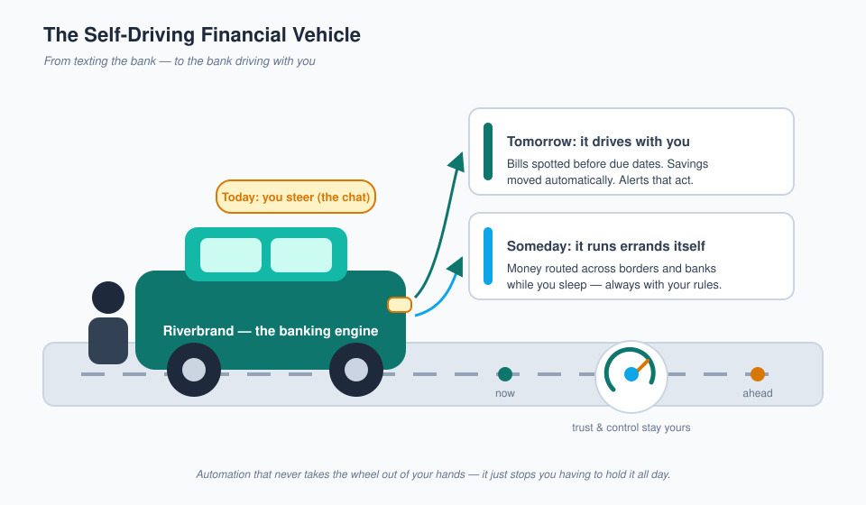

# Chapter 14 — For Everyone: The Future of Autonomous Global Banking

> *Unlearn the idea that banking features are just screens and balance numbers. Learn the real journeys, rules, and risks behind each feature. Relearn what Riverbrand actually built for people, and why it holds.*

## Recap

- **Unlearn:** The idea that the future of banking is simply more screens, more buttons, and more apps to tap through.
- **Learn:** The real journeys behind the roadmap — a bank that speaks first, money that crosses borders like local transfers, and other businesses plugging into the bank — along with the rules and risks each journey carries.
- **Relearn:** What Riverbrand actually built today, what is planned next, and what is still vision — each marked honestly, so a plan never reads like a promise.

This chapter is the plain-language half of the book's final pair. Everything up to here has described what Riverbrand ships today — how money moves ([Chapter 4](ch04-for-everyone-how-money-moves.md)), how wealth is built ([Chapter 6](ch06-for-everyone-wealth-and-channels.md)), how customers are protected ([Chapter 8](ch08-for-everyone-safety-and-compliance.md)), how the bank stays online ([Chapter 10](ch10-for-everyone-reliability.md)), and everything on the product menu ([Chapter 12](ch12-for-everyone-product-catalog.md)). This chapter describes what comes next. It is written for the same reader as the rest of the everyday track: no engineering vocabulary, honest readiness labels, and a clear line between what exists, what is being built, and what is still hope. The engineering twin of this chapter — the mechanism behind every item here — is [Chapter 15](ch15-engineering-roadmap.md).

A word on how to read every claim below. Three labels appear throughout: **Ships today** means the capability exists in the system this book documents; **Planned** means it sits in the roadmap's near or middle phase; **Vision** means it is the far-horizon ambition of the original roadmap documents, and it carries an **UNVERIFIED** marker wherever it is stated as fact. Dates from those planning documents are quoted as planning windows, not as commitments.

## 14.1 From Chat Bank to Autonomous Bank

Amina, a salary earner in Lagos — the same Amina whose salary landing opened [§4.1](ch04-for-everyone-how-money-moves.md#41-aminas-salary-lands-a-persona-story) — already banks by chat. When her salary lands, she opens WhatsApp, taps through a menu, asks for her balance, and tells the bank to move money to her sister. Today, the conversation always starts the same way: Amina speaks first. She notices things herself — a bill coming due, a strange debit, money sitting idle that should be saved — and then she goes and tells the bank about them.

The comfortable mental model is that banking is a set of menus, and that the future of banking is a nicer set of menus. That model is worth discarding. The real shift ahead is from a bank that waits to be asked to a bank that speaks first — what this chapter calls **proactive finance**. Tomorrow, the sequence can run the other way: the bank notices the pattern, and the bank texts Amina first.

**What proactive finance means, in plain words.** With Amina's permission, the bank watches the shape of her money life — when salary arrives, which bills repeat, which subscriptions she forgot, how her spending drifts month to month. When something useful or suspicious appears, the bank sends a short, explainable message before Amina thinks to ask: *"Your DSTV renewal is due in three days — pay it now?"*; *"This debit does not look like your usual pattern — was this you?"*; *"You have ₦80,000 sitting idle beyond your monthly buffer — lock it in a Safelock?"* Each message carries a reason and a one-tap response. Nothing moves money without her confirmation. Proactive does not mean autonomous-without-permission; it means the bank carries the noticing work, and Amina keeps the deciding work.

**What ships today.** The chat channel itself is real and documented: WhatsApp banking with menus and guided flows ([§12.6](ch12-for-everyone-product-catalog.md#126-247-whatsapp-banking)), the savings and transfer stories of [§6.3](ch06-for-everyone-wealth-and-channels.md#63-banking-in-a-chat-window), and push notifications when something happens to an account ([§7.4](ch07-engineering-channel-fabric.md#74-push-notifications-and-the-notification-matrix)). Behind the chat window sits a strict conversation flow — engineers call it a state machine — that knows which question the bank may ask next, so a session never guesses ([§7.3](ch07-engineering-channel-fabric.md#73-the-conversation-state-machine)). Alerts that speak first already exist in one direction: a push notification after an event. What does not ship today is the noticing layer — the part that reads patterns and initiates useful conversation.

**What is being built toward.** The original roadmap documents describe a conversational assistant that understands one long sentence with several instructions in it. Their canonical example: *"Hey Riverbrand, I just got paid ₦1,500,000. Keep ₦400,000 for everyday spending, convert $500 to my USD Safelock, and send ₦50,000 to my sister Tolu."* In that vision, the assistant parses each instruction, checks the rate and the balance, shows one summary card, and asks for confirmation once — then the whole multi-step flow executes as one approved action. They also describe voice notes in English, Pidgin, Yoruba, Hausa, Igbo, and French, answered in voice. Both capabilities are **Vision** — **UNVERIFIED** against anything shipped. They are stated here because they shape the horizon, not because they exist.

**Why the guardrails still matter.** A bank that speaks first is a bank that could nudge wrongly, so the roadmap keeps the protections this book has already described: every action still passes the limits and identity tiers of [§3.4](ch03-domain-primer.md#34-kyc-tiers-and-limits), every movement is still recorded in the unchangeable book of [§3.1](ch03-domain-primer.md#31-double-entry-in-plain-words), and every sensitive action still asks for a step-up confirmation — a PIN today, a passkey later (see [§15.6](ch15-engineering-roadmap.md#156-open-banking-passkeys-and-post-quantum-crypto)). Proactivity changes who starts the conversation. It does not change who is accountable for the money.

**In plain words.** Today you text the bank; tomorrow the bank can text you first — not to spend your money, but to tell you what it notices, and to ask before anything moves.

## 14.2 New Rails: Pan-African and Cross-Border

Money has no borders; payment systems do. That gap is the whole problem of this section.

**The railway analogy.** Sending money across Africa today is like sending a parcel between two African cities when no direct railway exists: the parcel is routed through foreign hubs — the planning documents describe transfers detouring through correspondent banks in New York or London — taking days and losing value at every handover where currencies are converted (**UNVERIFIED** as to exact timing and cost; the detour itself is the documented pattern). The receiver gets less than the sender sent, later than both of them expected. A local transfer, by contrast, is a direct train: one rail, one currency, minutes.

The roadmap's answer is to build the direct lines.

**PAPSS — the Pan-African line.** PAPSS (Pan-African Payment and Settlement System) is a shared clearing house for African countries: a bank in Nigeria can pay a bank in Ghana or Kenya directly, in local currencies, without the payment first travelling to a foreign hub and converting twice. For Amina, it would mean sending money to her sister Tolu in Accra with the feel of a local transfer — the same shape of journey she already knows from the domestic account number and instant rail described in [§3.2](ch03-domain-primer.md#32-nuban-nip-nibss-bvn-and-nin). PAPSS is the **same idea scaled to a continent**: one shared railway instead of many bilateral detours.

**SEPA and Faster Payments — the European lines.** SEPA (Single Euro Payments Area) is the euro zone's equivalent: a euro transfer from Berlin to Lisbon behaves like a domestic transfer — one rail, one currency, one fee logic. The United Kingdom's Faster Payments plays the same role for sterling. For a customer paid by a European client — a freelancer in Lagos invoicing a studio in Berlin, for example — a SEPA connection means euros arrive on the euro rail rather than through a chain of intermediaries. The roadmap pairs these with wider global messaging formats (a standard called ISO 20022) so that international banks can understand Riverbrand's payment instructions without translation friction.

**Where this honestly stands.** None of these rails ship today. Riverbrand's shipped money-movement story is the domestic one: a per-customer account number (a **NUBAN**), the national instant rail behind it, and the wallet and ledger machinery described in earlier chapters. PAPSS, SEPA, UK Faster Payments, and the wider global formats are **Planned** integrations — the original roadmap places them in its middle phase, with a planning window of Q3–Q4 2027 (**UNVERIFIED**: planning windows are not commitments). The corridor arithmetic behind them — how much cheaper or faster a direct line is than the detour — is directionally sensible but unmeasured in this documentation record.

**What changes for Amina, concretely.** Today: Tolu sends a request, Amina converts within her wallets at the bank's set rate ([§3.3](ch03-domain-primer.md#33-wallets-and-the-five-currencies)), transfers domestically, and Tolu's receipt depends on whichever cross-border service sits in the middle. Horizon 2: Amina sends from her naira wallet to Tolu's cedi account over the Pan-African line, and the two of them see one rate and one arrival time stated up front. Same journey shape — new railway underneath.

**In plain words.** Sending money across Africa and to Europe should feel like sending money across town: one railway, local currency at both ends, and a stated arrival time you can trust. PAPSS is the new African line; SEPA is the European one. The tracks are being planned, not yet driven.

## 14.3 Open Banking and Banking-as-a-Service

**The airline-wings metaphor.** Some companies build an entire aircraft. Others build only the engine — and airlines fly it under their own livery, with their own paint, their own crew uniforms, their own route map. The passengers may never see the engine maker's name. Riverbrand's engine is the banking machinery this book has described: the ledger, the wallets, the identity checks, the limits, the audit record. **Banking-as-a-Service** is the plan to let other businesses fly that engine under their own livery.

**What that means in plain words.** A fintech startup, an online retailer, a logistics company, or a savings cooperative could launch its own branded banking features — wallets, account numbers, transfers, savings — inside an app their customers already love, while Riverbrand runs the banking behind it. Their customers see the partner's name on the screen; Riverbrand keeps the money straight underneath. The original roadmap describes white-labelled apps, dedicated account numbers per partner, automated compliance checks, and per-partner fee settings — as a multi-tenant platform, meaning many partner businesses share one engine while their records stay properly separated. That platform is **Vision** (Phase 3 in the original timeline) and **UNVERIFIED** as a shipped capability.

**Why separation matters even in the vision.** Multi-tenant does not mean shared mixing. The engine's core discipline — every movement recorded twice in an unchangeable ledger ([§3.1](ch03-domain-primer.md#31-double-entry-in-plain-words)), identity and limits enforced per customer ([§3.4](ch03-domain-primer.md#34-kyc-tiers-and-limits)), every sensitive action recorded for audit ([§8.4](ch08-for-everyone-safety-and-compliance.md#84-the-audit-trail)) — is exactly what a partner is buying. They are buying the discipline, not just the screens.

**Open banking is the other direction.** Where Banking-as-a-Service lets businesses *build on* Riverbrand, **open banking** lets licensed outside apps *ask Riverbrand things on your behalf* — with your explicit permission. Imagine connecting a budgeting app to your Riverbrand account: it can read your balances and recent movements to draw you a spending picture, or — with a second, specific permission — start a payment from your account. You approve the connection, you see what it may do, and you can revoke it at any time. This kind of third-party access is exactly where regulators require strong protections, and the roadmap targets compliance with a strict bank-grade API security standard that engineers call FAPI, with consent flows built on the industry's standard identity protocols. The planned API hub — a single, governed front door for outside developers — is **Planned**, not shipped, and **UNVERIFIED** as to its delivery date.

**What connects the two.** Both directions rest on one idea: the bank as trustworthy infrastructure. A partner will only build on an engine that keeps its books straight; a customer will only grant consent to a bank that enforces it. The product catalog of [Chapter 12](ch12-for-everyone-product-catalog.md) is the menu for one brand today. Banking-as-a-Service is that menu, offered as an engine. Open banking is the door that lets carefully chosen outsiders in — under rules the customer controls.

**In plain words.** Banking-as-a-Service is our engine under someone else's livery: their brand on the outside, our bookkeeping underneath. Open banking is the opposite door — outside apps, allowed in by you, allowed to see or do only what you approved.

## 14.4 What Customers Will Notice

Roadmaps are made of infrastructure words; customers live in journeys. Here is what the same four journeys feel like across the three horizons — today, next, and later.

**Sending money to family across Africa.** *Today:* Amina sends to Tolu through services that sit outside the bank's own rails; the arrival time and the final amount depend on intermediaries. *Horizon 2:* the transfer runs over the Pan-African line — one currency conversion, one stated fee, one arrival estimate, as easy as a local transfer ([§14.2](#142-new-rails-pan-african-and-cross-border)). *Horizon 3:* Amina simply tells the bank — in a chat sentence or a voice note — *"send ₦50,000 to Tolu,"* and the assistant picks the rail, shows one summary, and asks once (**Vision**, **UNVERIFIED**).

**Getting paid from Europe.** *Today:* a European client pays Amina's account details; the euros travel a correspondent chain and land in her euro wallet when they land. *Horizon 2:* the payment arrives over the European rail with a matched reference and a visible fee (**Planned**). *Horizon 3:* a European accounting tool, granted open-banking permission, reconciles the invoice against the deposit automatically (**Vision**, **UNVERIFIED**).

**When something looks wrong.** *Today:* limits and identity tiers cap how much can move ([§3.4](ch03-domain-primer.md#34-kyc-tiers-and-limits)), unusual activity is caught by rules, and Amina can see every movement recorded in the bank's book. *Horizon 2:* the fraud engine reads the *shape* of transactions — not just their size — and can pause a suspicious flow for a second confirmation before money leaves (**Planned**; see [§15.5](ch15-engineering-roadmap.md#155-multi-agent-ai-and-fraud-detection)). *Horizon 3:* the bank's protection adapts to how Amina herself behaves — her typing rhythm, her usual devices — so strangers face a higher wall than she does (**Vision**, **UNVERIFIED**).

**Saving without thinking about it.** *Today:* Safelock and target savings already run on schedules the customer sets ([§6.1](ch06-for-everyone-wealth-and-channels.md#61-safelock-target-savings-and-autosave-stories)). *Horizon 2:* the bank suggests the sweep amounts — *"you can lock ₦20,000 more this month without missing rent"* — and Amina approves or declines in one tap (**Planned** direction, timing **UNVERIFIED**). *Horizon 3:* the personal-finance assistant runs the whole monthly plan under rules Amina sets in advance (**Vision**, **UNVERIFIED**).

**Banking inside other apps.** *Today:* banking happens in Riverbrand's own channels. *Horizon 2–3:* a partner's app — an airline, a marketplace, a school portal — offers accounts and transfers powered by the same engine, under that partner's name ([§14.3](#143-open-banking-and-banking-as-a-service)) (**Vision**, **UNVERIFIED**).

**In plain words.** The journeys do not change — sending, getting paid, being protected, saving, banking where you already are. What changes is how little friction each journey carries, and how much of the noticing work the bank does for you.

## 14.5 Three Strategic Horizons

The original roadmap documents organise the future into three horizons. This chapter keeps that structure and adds the one thing roadmaps usually omit: an honest readiness marker on every item.

**Horizon 1 — polish what ships today.** The first horizon is refinement, not reinvention: a stronger daily-limit engine, richer guided flows in the chat channel, better read capacity for busier days, and a pilot replacing today's PIN confirmation with a passkey — a cryptographic confirmation using your face, fingerprint, or security key. These are **Planned** near-term items in the original roadmap, with a planning window of Q1–Q2 2027 (**UNVERIFIED** as to dates). Readiness marker: *built on machinery that already exists* — the channels of [Chapter 6](ch06-for-everyone-wealth-and-channels.md), the limits of [§3.4](ch03-domain-primer.md#34-kyc-tiers-and-limits), the reliability habits of [Chapter 10](ch10-for-everyone-reliability.md). Whether any single Horizon 1 item is already under construction is **UNVERIFIED**; the documentation record does not say.

**Horizon 2 — automation and new rails.** The middle horizon is where the customer-visible future mostly lives: the Pan-African and European rails of [§14.2](#142-new-rails-pan-african-and-cross-border), a smarter fraud engine that reads transaction patterns rather than just amounts ([§15.5](ch15-engineering-roadmap.md#155-multi-agent-ai-and-fraud-detection)), and a shared message backbone beneath the platform that lets the bank react to events as they happen rather than in batches ([§15.1](ch15-engineering-roadmap.md#151-the-event-backbone)). Readiness marker: *planned, engineering-shaped, not customer-visible until the rails connect* — original roadmap window Q3–Q4 2027, **UNVERIFIED** as to dates.

**Horizon 3 — autonomous, embedded, global.** The far horizon is the title of this chapter made literal: the proactive assistant of [§14.1](#141-from-chat-bank-to-autonomous-bank), voice banking in local languages, Banking-as-a-Service for partner brands ([§14.3](#143-open-banking-and-banking-as-a-service)), and full participation in global payment messaging. Readiness marker: *vision* — everything in this horizon carries **UNVERIFIED**, and the original roadmap places it in 2028 and beyond. Vision is not a dirty word in a roadmap; pretending a vision is a commitment is.

**What the horizons are not.** They are not a guarantee of sequence. Infrastructure work slips, regulatory approvals arrive on their own schedules, and a corridor that looks ready on paper can stall at integration. The honest summary: Horizon 1 extends machinery that ships today; Horizon 2 is planned work with real engineering behind it (see [Chapter 15](ch15-engineering-roadmap.md)); Horizon 3 is aspiration, marked as such.

**In plain words.** Horizon 1 makes today's bank better. Horizon 2 gives it new railways and better instincts. Horizon 3 lets it act, speak, and carry other brands. Only the first is standing on shipped ground.

## 14.6 What We Built, Why, and Where It Goes

**What we built.** Not a wish list — a standing system with a roadmap attached. The shipped half is the bank this book has documented end to end: money that moves under double-entry discipline, identity tiers and limits that scale with trust, savings that compound on schedule, chat banking that works within a strict conversation flow, and reliability habits that treat every failure as a named, handled case. The roadmap half is the same engine aimed further out: proactive conversations, direct cross-border rails, and other businesses flying under our livery — each with the readiness label it deserves.

**Why it matters.** Because a roadmap's job is not to impress but to orient. Amina can see which conveniences are real today and which are coming. A partner business can see what it might build on. An engineer can see where the load-bearing work is ([Chapter 15](ch15-engineering-roadmap.md)). And every claim in this chapter is either cited to a shipped chapter or marked **UNVERIFIED** — so nobody mistakes a horizon for a handrail.

**What we aim for.** A bank that carries more of the noticing work so people can carry the deciding work: money that crosses borders at local speed, protection that adapts to real behaviour, and an engine solid enough that other brands are willing to put their name on it.

**The approach ahead.** The sequence is deliberate: strengthen what ships first (Horizon 1), connect the new rails and the event-driven instincts next (Horizon 2), and only then turn on the autonomous, embedded, global layers (Horizon 3) — each layer earning the right to the next by holding under real load. The engineering plan underneath every one of those steps — the message backbone, the multi-region database, the platform and fraud machinery, the phased timeline with its honest benchmarks — is [Chapter 15 — Engineering: The Upgrade Roadmap](ch15-engineering-roadmap.md). Read that one next if you want the mechanism; reread [Chapter 12](ch12-for-everyone-product-catalog.md) if you want the menu as it stands today.

## Key Takeaways

- **The shift is from reactive to proactive.** Today Amina texts the bank first; the roadmap's destination is a bank that notices and speaks first — with permission, reasons, and confirmation still in her hands.
- **Cross-border rails are the next railway, not a new product.** PAPSS (Pan-African, local currencies) and SEPA (euros across Europe) are meant to make a transfer to Accra or Berlin feel like a transfer across town — planned, not yet shipped.
- **Banking-as-a-Service is our engine under someone else's livery**; open banking is the door that lets licensed outside apps in — with consent the customer can see, grant, and revoke.
- **Customers will notice journeys, not infrastructure:** faster family transfers, cleaner foreign income, sharper fraud pauses, gentler saving nudges, and banking inside apps they already use.
- **Three horizons, three honest labels:** Horizon 1 extends what ships today, Horizon 2 is planned automation and new rails, Horizon 3 is vision — marked **UNVERIFIED** wherever it is stated.
- **A roadmap earns trust by marking its seams.** Anything in this chapter without a citation to a shipped chapter carries an **UNVERIFIED** marker on purpose.

## Frequently Asked Questions

### Does "the bank texts you first" mean the bank can move my money without asking?

No. Proactivity means the bank initiates *conversation*, not *transactions*. Every movement of money still requires your confirmation and still passes the same limits and identity checks described in [§3.4](ch03-domain-primer.md#34-kyc-tiers-and-limits). What changes is who notices first.

### Is PAPSS live in Riverbrand today?

No. It is a **Planned** integration. Riverbrand's shipped money-movement story is the domestic one — a per-customer account number on the national instant rail ([§3.2](ch03-domain-primer.md#32-nuban-nip-nibss-bvn-and-nin)). The Pan-African and European rails sit in the roadmap's middle phase, with planning windows quoted in [§14.5](#145-three-strategic-horizons) and marked **UNVERIFIED** as to dates.

### If another company offers banking "powered by Riverbrand", whose bank is it?

The customer sees the partner's brand, but the money machinery underneath is Riverbrand's engine — the same ledger, identity checks, and limits this book describes. The partner is flying with our engine under their livery; the bookkeeping discipline does not change hands.

### What is "open banking" in one sentence?

Permissioned access: licensed outside apps can read your account information or start payments for you, only within what you approved, and you can revoke that access at any time.

### How much of this chapter should I treat as a promise?

None of it as a promise. Treat **Ships today** items as documentation of the present, **Planned** items as scheduled intent, and **Vision** items — every one marked **UNVERIFIED** — as direction. Planning windows are quoted from the original roadmap documents and are not commitments.

## Where to Go Next

*For engineers, see [Chapter 15 — Engineering: The Upgrade Roadmap](ch15-engineering-roadmap.md).*
