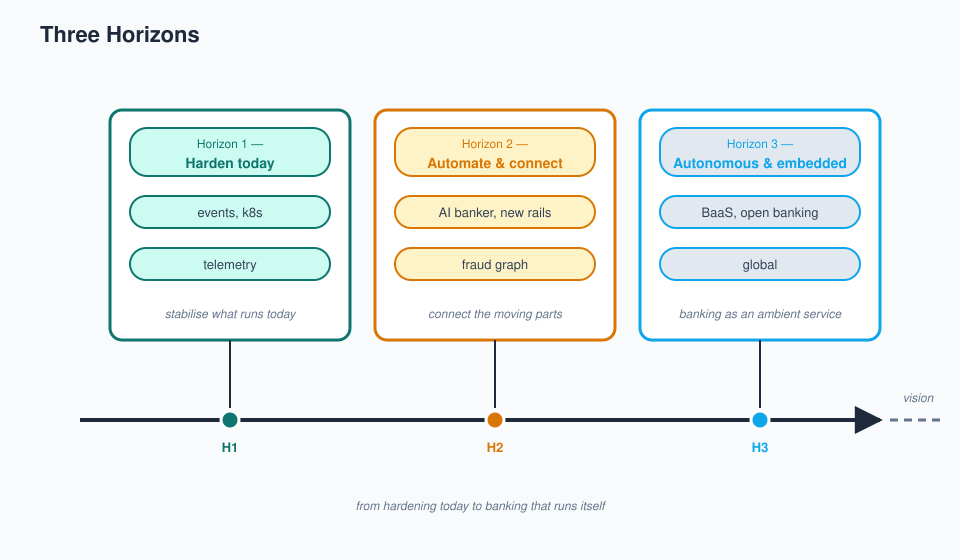
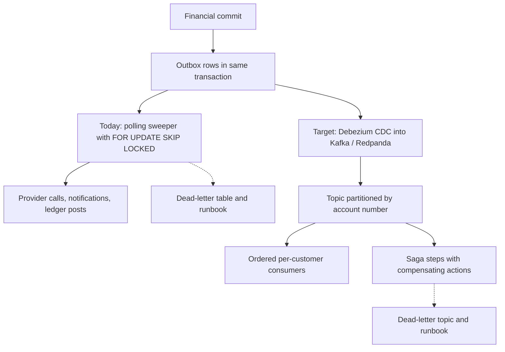
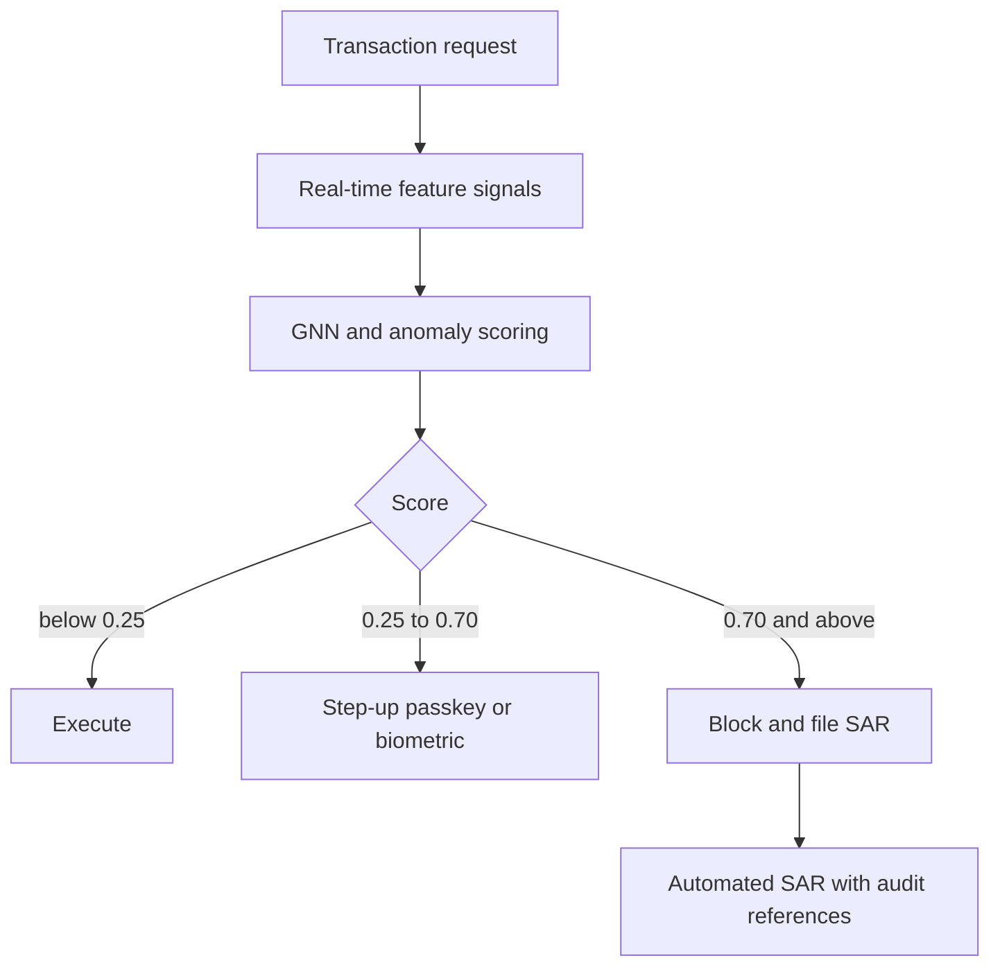

# Chapter 15 — Engineering: The Upgrade Roadmap

> *Unlearn the naive implementation you would write first. Learn the failure modes and race conditions that break it. Relearn the architecture Riverbrand ships instead.*

## Recap

- **Unlearn:** The naive implementation you would write first — a bigger monolith, a faster cron loop, a database that "just scales".
- **Learn:** The failure modes and race conditions that break those first drafts: lost events, split regions, undeployable states, untraceable requests, and fraud that reads only amounts.
- **Relearn:** The architecture Riverbrand is moving toward — an event backbone, distributed SQL, platform automation, end-to-end telemetry, pattern-aware fraud, and hardened identity — with every migration risk named.

This chapter is the engineering twin of [Chapter 14](ch14-for-everyone-future-roadmap.md). Where that chapter states the customer-visible horizon, this one states the mechanism: what runs today, what replaces it, and what can go wrong in the replacement. The structure is the same in every section: **current state**, grounded in a shipped chapter of this book; **target state**, taken from the original upgrade roadmap documents; and **migration risk**, because a target state that ignores its transition is a drawing, not a plan.

One honesty convention applies throughout. Facts grounded in the shipped chapters are cited. Facts that come from the roadmap documents' aspirations — hyper-scale benchmarks, zero-data-loss failover, autonomous agents, delivery dates — carry an inline **UNVERIFIED** marker. Planning windows (Q1–Q2 2027, Q3–Q4 2027, 2028 and beyond) are quoted in [§15.7](#157-phased-timeline-and-target-benchmarks) as the original documents state them; they are planning windows, not commitments.



## 15.1 The Event Backbone

**Current state.** Riverbrand's asynchronous work runs on a transactional outbox: when a financial transaction commits, the side effects it owes the world — a provider call, a notification, a downstream posting — are written as rows *inside the same database transaction*, then swept by background workers. The full mechanism is [§5.4](ch05-engineering-transaction-engine.md#54-the-outbox-and-dead-letter-queue): the sweeper claims batches with `FOR UPDATE SKIP LOCKED`, listens for wakeups over `LISTEN/NOTIFY`, retries with backoff, and files unrecoverable rows into the dead-letter table (`rbp_brand_deadletter`) for the runbook of [§11.6](ch11-engineering-operations-manual.md#116-runbooks-and-troubleshooting-playbook). The worker fleet is named in [§11.3](ch11-engineering-operations-manual.md#113-the-background-jobs-fleet) — `OutboxJob`, `DlqJob`, `SavingsJob`, `ReconciliationJob`, `BillReconciliationJob`, `ArchivalJob`, `GeneralLedgerJob` — and delivery is at-least-once with consumer idempotency enforced by reference records ([§5.3](ch05-engineering-transaction-engine.md#53-idempotency-references)).

This design is correct for a modular monolith and it is not a placeholder to be ashamed of. Its guarantee — *a side effect is never lost, because it is written in the same commit as the fact that created it* — is exactly the guarantee the target design must preserve.

**Target state.** The roadmap's target replaces polling workers with a streaming event log: **Apache Kafka / Redpanda** as the event backbone, with three moves stacked in order.

1. **Outbox to log via change capture.** Nothing breaks on day one. PostgreSQL's write-ahead log is captured by **Debezium CDC** (change data capture) and published to topics; the outbox table becomes the durable staging ground, and the log becomes the distribution fabric. Engineers call this evolution *outbox → log* — the commit-time guarantee of [§5.4](ch05-engineering-transaction-engine.md#54-the-outbox-and-dead-letter-queue) stays, and the polling sweeper is retired only after consumers read from the log.
2. **Partitioned ledger events.** Topics are partitioned by `account_number` (or `user_id`) so every event for one account lands in one partition and keeps strict per-customer ordering, while different customers process in parallel across partitions. The partition key is the same mental model as the partition-keyed execution the roadmap describes for the ledger service: order where order matters, parallelism everywhere else.
3. **Saga choreography and binary RPC.** Multi-step journeys — interbank transfer → fee deduction → ledger posting → notification — move from hand-rolled orchestration to saga choreography with explicit compensating actions on downstream failure. Internal calls move to gRPC over HTTP/2 with Protocol Buffers, a binary contract format for service-to-service messages; the roadmap claims sub-millisecond internal round trips (**UNVERIFIED**: no load-test record exists in this documentation).

**Figure 15.2 — Outbox today, event log tomorrow.**



A minimal event envelope the target can carry — shape illustrative of the roadmap's intent, not a shipped contract (**UNVERIFIED**):

```protobuf
message LedgerEvent {
  string event_id = 1;        // idempotency key, echoes rbp_brand_references
  string account_number = 2;  // partition key — order preserved per account
  string event_type = 3;      // TRANSFER_POSTED | FEE_CHARGED | ...
  int64  posted_at_ms = 4;
  bytes  payload = 5;
}
```

**Migration risk.** Three risks dominate. *Ordering during cutover:* while both the sweeper and the log run, a single account's side effects can be observed out of order unless consumers deduplicate by `event_id` and both paths write through one ordering domain — the per-account partition is only a promise after the sweeper is gone. *Dead-letter semantics:* the DLQ table has a runbook and a replay job today ([§11.6](ch11-engineering-operations-manual.md#116-runbooks-and-troubleshooting-playbook)); a dead-letter *topic* needs the same replay tooling or the guarantee silently weakens. *Schema evolution:* Protobuf tolerates added fields, but consumers pinned to old shapes will break on renamed ones — the boring discipline of schema registries and compatibility tests has to be built, not assumed.

| Failure | Today's behaviour (outbox) | Target behaviour (event log) |
| :--- | :--- | :--- |
| Consumer crash mid-work | Row remains claimed/visible; sweeper retries | Offset not committed; consumer group rebalances |
| Poison message | Row routes to `rbp_brand_deadletter` after max attempts | Message routes to dead-letter topic after max attempts |
| Duplicate delivery | Reference records absorb it ([§5.3](ch05-engineering-transaction-engine.md#53-idempotency-references)) | Same — idempotent consumers, keyed `event_id` |
| Broker / database outage | Commits stall; no partial side effects escape | Ingest stalls at CDC; committed rows remain the source of truth |

## 15.2 Geo-Distributed SQL

**Current state.** Riverbrand runs on **PostgreSQL 15** — one primary, read replicas, and **PgBouncer** on port `6432` pooling connections so the API layer on `8010` never chokes the database ([§11.1](ch11-engineering-operations-manual.md#111-prerequisites-environment-and-docker-compose), [§11.2](ch11-engineering-operations-manual.md#112-ports-health-and-api-documentation)). Balance safety does not come from the database alone: it comes from the two-tier concurrency guard of [§5.1](ch05-engineering-transaction-engine.md#51-the-two-tier-concurrency-guard) — a Redis **Redlock** distributed lock per account, then a single-commit database transaction for the debit/credit pair — and from the immutable double-entry discipline of [§5.2](ch05-engineering-transaction-engine.md#52-the-immutable-double-entry-ledger). Table naming across the schema is mapped in [§3.5](ch03-domain-primer.md#35-the-schema-prefix-map).

**Target state.** The roadmap's target is a distributed SQL engine — **CockroachDB** or **Google Cloud Spanner** — with nodes across regions and continents, coordinated by **Raft consensus** so that a quorum of replicas acknowledges every commit. The intended properties, stated as the roadmap states them: active-active multi-region deployment (no single region owns the writes), strict serializable transactions preserved across physical nodes, an **RPO target of zero seconds** and an **RTO target under five seconds** for a full-region loss (**UNVERIFIED** — both are aspirations in the source document, with no failover drill recorded in this documentation). Alongside it, a **geo-replicated Redis Enterprise** cluster using CRDTs (conflict-free replicated data types — data structures that merge concurrent edits without a referee) for session validation and rate limiting across regions, with the distributed lock extended to multi-region form (**UNVERIFIED**: whether the Redlock assumptions of [§5.1](ch05-engineering-transaction-engine.md#51-the-two-tier-concurrency-guard) survive a multi-region CRDT topology is an open engineering question this book cannot answer from the record).

**Why, honestly.** The single primary is the current single-region risk: a region loss costs at least a replica-promotion gap and, on the old benchmark table, an RPO stated at under fifteen minutes ([§15.7](#157-phased-timeline-and-target-benchmarks)). Distributed SQL buys regional survivability and a consistency story auditors recognise. The price is write latency: every commit now pays a cross-region consensus round, and the naive "make the database global" move often makes the *customer* slower. The engineering answer the roadmap implies is locality-aware placement — pin each account's leaseholder (the replica that leads its Raft group) near its owner — but that is design intent, not a measured configuration (**UNVERIFIED**).

**Trade-offs to decide before migrating.**

- **Latency vs. survivability.** Synchronous cross-region Raft raises tail latency on writes; accept it, or place data by region and accept cross-region journeys as slower paths.
- **Dialect and ORM compatibility.** The data layer's Prisma models and raw queries assume PostgreSQL semantics; CockroachDB's PostgreSQL wire compatibility is broad but not identical — collations, schema changes, and some isolation details need a compatibility pass before any production write.
- **Cost.** Multi-region consensus multiplies infrastructure spend; the roadmap's own table frames this as a hyper-scale move, which implies hyper-scale budgeting.
- **The lock layer.** If the ledger keeps its two-tier guard ([§5.1](ch05-engineering-transaction-engine.md#51-the-two-tier-concurrency-guard)), the Redis tier must be as global as the database tier, or the guard becomes a regional bottleneck inside a global system.

**Migration risk.** The cutover itself is the danger zone: dual-running PostgreSQL and distributed SQL splits the ordering domain in two, and a naive dual-write loses the single-commit property that [§5.2](ch05-engineering-transaction-engine.md#52-the-immutable-double-entry-ledger) depends on. The safer shape is replicative migration (logical replication or a bulk cutover window with the ledger frozen), a long read-only shadow period against production traffic, and the Redlock/commit pairing re-verified under the new isolation level before any money moves. Failure modes worth a table in the migration plan: *silent isolation downgrade* (reads that were serializable become merely snapshot), *leaseholder thrash* under region imbalance, and *PgBouncer misrouting* if connection pooling is carried over without re-tuning for the new latency profile.

## 15.3 Kubernetes and GitOps

**Current state.** Riverbrand deploys as a modular monolith — the Fastify application with its auth, ledger, wallet, transfer, and WhatsApp surfaces in one process — on **Docker Compose** (and PM2 in some environments), per the deployment row of the roadmap's benchmark table and the local setup of [§11.1](ch11-engineering-operations-manual.md#111-prerequisites-environment-and-docker-compose). Supporting processes are pinned by port: API `8010`, Mailpit `8026` for local mail, PgBouncer `6432`, Prometheus `9095` ([§11.2](ch11-engineering-operations-manual.md#112-ports-health-and-api-documentation)). The background fleet of [§11.3](ch11-engineering-operations-manual.md#113-the-background-jobs-fleet) runs beside the API as long-lived workers, and the service surface behind it is the 39-service catalog of [Chapter 13](ch13-engineering-service-catalog.md).

**Target state.** The roadmap's target is **Kubernetes** on managed control planes — **EKS** on AWS or **GKE** on Google Cloud — with **ArgoCD** implementing GitOps: the desired state of every workload lives in Git, and the cluster converges toward it rather than being hand-patched. The wider target picture in the source documents includes an edge and proxy tier (Cloudflare Workers, Envoy, Kong — **UNVERIFIED** as selected technology) and continuous resilience testing with **Chaos Mesh**-style fault injection, replacing today's automated integration tests as the resilience proof. Microservice decomposition (core ledger service, settlement gateway, identity engine, channel hub, wealth engine — see [§15.1](#151-the-event-backbone)) is what Kubernetes would actually be scheduling; without the decomposition, Kubernetes is mostly an expensive way to restart one container.

**Why GitOps specifically.** The argument in the roadmap is not "containers are nice" but *drift control*: a banking platform that survives audit can answer "what was deployed, from what commit, when" without archaeology. GitOps makes that answer a query against version control. The same property gives the sidecar session kill-switch of [§9.2](ch09-engineering-security-architecture.md#92-sidecar-session-control-and-the-kill-switch) a disciplined companion: security-sensitive runtime changes are configuration with history, not console clicks.

**Migration risk.** Stateful components are the trap. PostgreSQL, PgBouncer, and Redis are not "just workloads" — they carry the Redlock guard ([§5.1](ch05-engineering-transaction-engine.md#51-the-two-tier-concurrency-guard)) and the session state of [§7.3](ch07-engineering-channel-fabric.md#73-the-conversation-state-machine); a careless reschedule or a rolling restart can invalidate locks or drop in-flight conversations. The jobs fleet becomes CronJobs or dedicated worker deployments, and its retry/idempotency contract ([§5.3](ch05-engineering-transaction-engine.md#53-idempotency-references)) must survive restart semantics it never faced under Compose. Secrets move from an env file to a managed store — and every secret rotation path (see the dual-token story of [§9.1](ch09-engineering-security-architecture.md#91-dual-token-client-isolation)) needs a rehearsed runbook before, not after, cutover. The honest sequencing the roadmap implies: stateless API first on Kubernetes with the database still managed outside, stateful migration last, Compose kept for local development indefinitely.

## 15.4 OpenTelemetry and Observability

**Current state.** Observability today is the Prometheus stack described in [§11.4](ch11-engineering-operations-manual.md#114-observability-and-metrics): application metrics scraped from port `9095`, health endpoints for liveness and readiness ([§11.2](ch11-engineering-operations-manual.md#112-ports-health-and-api-documentation)), and the debugging habits of [§11.5](ch11-engineering-operations-manual.md#115-whatsapp-webhook-debugging) for the channel path. The audit trail of [§9.5](ch09-engineering-security-architecture.md#95-the-non-blocking-audit-trail) records who did what — deliberately *outside* the request path so it cannot slow a transfer down. Metrics answer "how much"; logs answer "what exactly"; neither answers "where did this request go".

**Target state.** The roadmap names **OpenTelemetry** as the observability layer: traces, metrics, and logs under one context-propagation standard, so a single transfer can be followed from the WhatsApp webhook entry at [§7.2](ch07-engineering-channel-fabric.md#72-the-whatsapp-provider-factory) through the conversation state machine ([§7.3](ch07-engineering-channel-fabric.md#73-the-conversation-state-machine)), the two-tier guard ([§5.1](ch05-engineering-transaction-engine.md#51-the-two-tier-concurrency-guard)), the ledger commit ([§5.2](ch05-engineering-transaction-engine.md#52-the-immutable-double-entry-ledger)), and the outbox sweep ([§5.4](ch05-engineering-transaction-engine.md#54-the-outbox-and-dead-letter-queue)) — as one timeline rather than five dashboards. Note carefully what "replacing" means: traces replace *forensics by grep* as the primary question-answering tool; the Prometheus metrics and health endpoints stay, because fleet health and capacity still need cheap, aggregate signals. The saga choreography of [§15.1](#151-the-event-backbone) is the forcing function: once one business journey crosses several services and a message log, a trace ID is the only thing that still holds the story together.

**What a target trace makes possible.** The roadmap's failure-mode questions become queryable: which span ate the tail latency of the P99 ledger write, whether a provider call inside the settlement path retried three times before succeeding, whether the Redlock wait or the database commit dominates the guard path of [§5.1](ch05-engineering-transaction-engine.md#51-the-two-tier-concurrency-guard). Those are the questions [§5.7](ch05-engineering-transaction-engine.md#57-failure-mode-matrix) raises in table form; a trace answers them per incident.

**Migration risk.** *Context loss across async boundaries* is the first and most certain problem: outbox workers, the jobs fleet ([§11.3](ch11-engineering-operations-manual.md#113-the-background-jobs-fleet)), and webhook ingress do not inherit request context unless the trace ID is stored on the outbox row and rehydrated on pickup — a schema change to `rbp_brand_outbox` and a discipline change for every job author. *Cardinality explosion* is the second: putting `account_number` or `user_id` as a metric label is a bill nobody budgets for; those belong on span attributes, sampled. *Third, PII in spans* — a WhatsApp message body or a BVN must never enter a span attribute, or the telemetry store becomes a compliance liability instead of an asset ([§8.4](ch08-for-everyone-safety-and-compliance.md#84-the-audit-trail) is the record; traces are not).

## 15.5 Multi-Agent AI and Fraud Detection

**Current state.** Protection today is rules, tiers, and records. KYC tiers and daily ceilings — ₦50,000 / ₦200,000 / ₦5,000,000 — gate volume per customer ([§3.4](ch03-domain-primer.md#34-kyc-tiers-and-limits), mechanics in [§5.6](ch05-engineering-transaction-engine.md#56-the-pending-balance-holding-tank-and-kyc-ceilings)); the pending-balance holding tank quarantines overflow rather than rejecting it; idempotency references stop double-execution ([§5.3](ch05-engineering-transaction-engine.md#53-idempotency-references)); RBAC and the non-blocking audit trail ([§9.4](ch09-engineering-security-architecture.md#94-role-based-access-control), [§9.5](ch09-engineering-security-architecture.md#95-the-non-blocking-audit-trail)) record every privileged action. Provider-side risk is handled by the failover philosophy of [§6.4](ch06-for-everyone-wealth-and-channels.md#64-when-a-provider-fails). What today's posture does *not* do is read the shape of behaviour: a limit engine sees amounts, not intent.

**Target state.** Two distinct tracks appear in the roadmap documents, and conflating them is how fraud projects fail.

*Track one — conversational agents.* A multi-agent core: an intent-and-action-planning agent that compiles a natural-language instruction (the canonical example from the planning documents: *"Send 15,000 Naira to Uncle Tunde for electricity and lock 50,000 in my 90-day Safelock"*) into verified API payloads; a personal-finance agent that flags recurring subscriptions and recommends savings allocations; a dispute agent that assembles chargeback evidence from clearing-switch logs. Multimodal voice support across English, Pidgin, Yoruba, Hausa, Igbo, and French is stated alongside. All of this is **UNVERIFIED** aspiration — no agent runtime is part of the shipped record — but its engineering contract is already visible: every agent action must pass the same step-up authentication and ledger discipline as a human tap.

*Track two — fraud and AML.* The roadmap's real-time fraud core reads a feature store of 200-plus telemetry signals (**UNVERIFIED** as to exact count) and scores each transaction through two novel models: a **graph neural network (GNN)** that analyses the transaction-topology graph — who pays whom, how fast, in what clusters — to catch synthetic identities and pass-through mule-account rings before funds leave the bank; and **behavioural biometrics** that evaluate typing cadence, screen-swipe velocity, device hardware attestation, and IP geo-velocity, so a legitimate customer in their usual rhythm is scored differently from an imposter with their password. The scoring bands from the source document:

| Risk score | Action |
| :--- | :--- |
| `< 0.25` | Execute without friction |
| `0.25 – 0.70` | Step-up authentication (FIDO2 passkey / biometric) |
| `≥ 0.70` | Block and compile a suspicious activity report |

**Figure 15.3 — Risk bands and their actions.**



The last band drives **automated suspicious activity reporting**: compilations formatted to regulatory standards (the source documents name NFIU and FinCEN) with cryptographic audit-trail references attached — turning the audit record of [§9.5](ch09-engineering-security-architecture.md#95-the-non-blocking-audit-trail) into evidence packages rather than raw logs.

**Migration risk.** Fraud systems fail quietly, so their risks deserve sharper names than usual. *False positives at the step-up band* convert directly into customer friction and support load; the band boundaries (`0.25`, `0.70`) are stated in the source document without a calibration record (**UNVERIFIED**). *Model drift and data hunger* — GNN mule detection needs labelled mule rings to train on, and behavioural biometrics need per-customer baselines, which means a cold-start period where the models know nothing and must not be trusted. *Regulatory acceptance* of an automated SAR as filed is jurisdiction-dependent and **UNVERIFIED**. *Latency budget*: in-flight scoring must fit inside the transfer path or the P99 ledger write target of [§15.7](#157-phased-timeline-and-target-benchmarks) becomes fiction — which argues for scoring on the event stream of [§15.1](#151-the-event-backbone) for secondary checks, with only the cheap signals inline. And through all of it, the existing rules stay: the GNN is a second opinion layered on the KYC ceilings of [§5.6](ch05-engineering-transaction-engine.md#56-the-pending-balance-holding-tank-and-kyc-ceilings), not a replacement for them.

## 15.6 Open Banking, Passkeys, and Post-Quantum Crypto

**Current state.** Identity and access today are the layered posture of [Chapter 9](ch09-engineering-security-architecture.md): dual-token client isolation so a web session cannot act as a local-service token ([§9.1](ch09-engineering-security-architecture.md#91-dual-token-client-isolation)); the sidecar session control and `jwt_version` kill-switch that can revoke every session in one increment ([§9.2](ch09-engineering-security-architecture.md#92-sidecar-session-control-and-the-kill-switch)); Argon2id-hashed PINs and passwords ([§9.3](ch09-engineering-security-architecture.md#93-pin-and-password-protection)); role-based access control for privileged surfaces ([§9.4](ch09-engineering-security-architecture.md#94-role-based-access-control)); and the non-blocking audit trail ([§9.5](ch09-engineering-security-architecture.md#95-the-non-blocking-audit-trail)). External APIs exist — the service catalog of [Chapter 13](ch13-engineering-service-catalog.md) enumerates them — but they are first-party APIs, not a governed open-banking surface.

**Target state.** Three evolutions, all from the roadmap documents, all aspirational as shipped capability.

*An FAPI-compliant open-banking hub.* **FAPI** (Financial-grade API) is a hardened security profile for OAuth2/OIDC-based financial APIs: sender-constrained tokens, explicit consent, strict TLS. The target is a REST and GraphQL API hub compliant with FAPI 1.0/2.0, where licensed third-party providers initiate payments and aggregate statements only under customer consent flows — the engineering half of the open-banking story told in plain language at [§14.3](ch14-for-everyone-future-roadmap.md#143-open-banking-and-banking-as-a-service). Its consent revocation should reuse the property [§9.2](ch09-engineering-security-architecture.md#92-sidecar-session-control-and-the-kill-switch) already proved: revocation is one write that invalidates every downstream token.

*FIDO2 passkeys.* Hardware-backed cryptographic passkeys (Face ID, Touch ID, YubiKey — WebAuthn) replace the 4-digit PIN as the step-up factor, first as a pilot ([§15.7](#157-phased-timeline-and-target-benchmarks)). The gain is phishing resistance: a passkey cannot be replayed against a lookalike site the way a PIN can. The migration cost is recovery design — what happens when the phone with the passkey is at the bottom of the lagoon — and a coexistence window where both factors must be honoured without weakening [§9.3](ch09-engineering-security-architecture.md#93-pin-and-password-protection)'s current guarantees.

*Cryptographic evolution.* Master signing and encryption keys move into an **HSM** vault (the source document specifies FIPS 140-2 Level 3 modules — **UNVERIFIED** as a procurement fact), and TLS ciphers and signatures upgrade toward **post-quantum cryptography** (ML-KEM for key establishment, ML-DSA for signatures) against the harvest-now-decrypt-later threat. Hybrid TLS (classical plus post-quantum in one handshake) is the realistic transition shape; library maturity and handshake cost are open engineering risks (**UNVERIFIED**).

**Migration risk.** The hub is the widest surface: every consent, token, and third-party integration is new attack area, and FAPI compliance is a profile to be tested, not a badge to be claimed — certification evidence belongs in the runbooks of [§11.6](ch11-engineering-operations-manual.md#116-runbooks-and-troubleshooting-playbook). Passkeys change the recovery and support flows more than the login flow; the fraud bands of [§15.5](#155-multi-agent-ai-and-fraud-detection) already assume step-up FIDO2 exists, so passkey delivery is a dependency of the fraud roadmap, not a cosmetic upgrade. And the PQC migration is the one with a deadline nobody controls: data captured today can be decrypted later, so the TLS upgrade path deserves a dated plan even while the exact cipher suite stays provisional.

## 15.7 Phased Timeline and Target Benchmarks

**The timeline, in the shape the old documents give it.** The original upgrade roadmap phases the work into three windows. They are reproduced here with their honest shape — planning windows, not commitments; every date is **UNVERIFIED** as a delivery promise.

| Phase | Planning window | Items stated in the source roadmap |
| :--- | :--- | :--- |
| **Phase 1** | Q1–Q2 2027 | PgBouncer and read replicas; advanced daily-limit engine; dynamic WhatsApp flow forms; passkey (FIDO2) auth pilot |
| **Phase 2** | Q3–Q4 2027 | Distributed Kafka event mesh; multi-service split (ledger first); GNN real-time fraud engine; PAPSS and SEPA FX corridors |
| **Phase 3** | 2028 and beyond | Active-active distributed SQL; autonomous AI voice banking; multi-tenant Banking-as-a-Service platform; full ISO 20022 SWIFT hub |

Note the ordering logic worth keeping even if the dates move: *polish the monolith first* (Phase 1 items all extend machinery already documented in this book — pooling and replicas behind [§11.1](ch11-engineering-operations-manual.md#111-prerequisites-environment-and-docker-compose), limits on the engine of [§5.6](ch05-engineering-transaction-engine.md#56-the-pending-balance-holding-tank-and-kyc-ceilings), WhatsApp flows on the factory of [§7.2](ch07-engineering-channel-fabric.md#72-the-whatsapp-provider-factory), passkeys on the PIN stack of [§9.3](ch09-engineering-security-architecture.md#93-pin-and-password-protection)); *then decompose and connect* (Phase 2 is where [§15.1](#151-the-event-backbone) and [§15.5](#155-multi-agent-ai-and-fraud-detection) land); *only then go global and multi-tenant* (Phase 3). Reordering that — BaaS before the event backbone, distributed SQL before the service split — is how the migration risks in each section above turn into outages.

**Target benchmarks.** The source document carries a benchmark table comparing a stated current state with a hyper-scale target. It is reproduced faithfully, with one column added: the evidence status of each figure as far as this documentation record goes. The **current** column is quoted from the roadmap document's own table and has not been independently re-measured for this book; the **target** column is aspiration throughout — every cell **UNVERIFIED**.

| Metric | Stated current benchmark | Hyper-scale target benchmark | Evidence status |
| :--- | :--- | :--- | :--- |
| Peak throughput | 2,500 transactions/second | 100,000+ transactions/second | Targets **UNVERIFIED** |
| P99 ledger write latency | under 45 ms | under 8 ms (memory-partitioned) | Targets **UNVERIFIED** |
| System availability | 99.9 percent | 99.999 percent (five nines) | Targets **UNVERIFIED** |
| Disaster recovery RPO | under 15 minutes | 0 seconds (via Raft consensus) | Targets **UNVERIFIED** |
| Disaster recovery RTO | under 5 minutes | under 5 seconds (automated active-active failover) | Targets **UNVERIFIED** |
| Deployment model | Docker Compose / PM2 | Kubernetes (EKS/GKE) with ArgoCD | Migration path in [§15.3](#153-kubernetes-and-gitops) |
| Resilience testing | automated integration tests | continuous chaos engineering | Tooling **UNVERIFIED** |
| Region topology | single-region primary | multi-region active-active | Migration path in [§15.2](#152-geo-distributed-sql) |

**How to read this table.** The target column describes a *shape of system*, and its hardest rows are the disaster-recovery pair: an RPO target of zero seconds requires every committed transaction to survive the loss of a whole region synchronously, which is precisely the distributed-SQL consensus cost discussed in [§15.2](#152-geo-distributed-sql). The throughput row assumes the partitioned event backbone of [§15.1](#151-the-event-backbone) and the ledger split of Phase 2 — a monolith on one PostgreSQL primary does not reach it by tuning. The availability row is stated here as a target percentage with the marker this book's standard demands for unbacked claims; treat it as direction, and prefer the drillable pair (RPO/RTO) whenever someone asks what "reliable" means.

**The honest summary of the whole chapter.** Nothing in the target state is science fiction: every component named — Kafka/Redpanda, Debezium, CockroachDB/Spanner, Kubernetes, ArgoCD, OpenTelemetry, GNN scoring, FIDO2, ML-KEM — is a real technology with real operators somewhere. The work is in the transitions, which is why each section above ends with migration risk rather than a feature list. The shipped system underneath all of it — the outbox of [§5.4](ch05-engineering-transaction-engine.md#54-the-outbox-and-dead-letter-queue), the guard of [§5.1](ch05-engineering-transaction-engine.md#51-the-two-tier-concurrency-guard), the ledger of [§5.2](ch05-engineering-transaction-engine.md#52-the-immutable-double-entry-ledger), the jobs fleet of [§11.3](ch11-engineering-operations-manual.md#113-the-background-jobs-fleet) — is not being discarded; it is being given a longer runway.

## Key Takeaways

- **The outbox stays correct; the sweeper is what retires.** The event backbone (Kafka/Redpanda + Debezium CDC) evolves the outbox into a log, preserving the commit-time guarantee of [§5.4](ch05-engineering-transaction-engine.md#54-the-outbox-and-dead-letter-queue) while replacing polling with partitioned streams — order per account, parallelism across accounts.
- **Distributed SQL buys regional survivability at a latency price.** CockroachDB or Spanner with Raft consensus targets zero-second RPO (**UNVERIFIED**), but every commit pays cross-region consensus — and the two-tier guard of [§5.1](ch05-engineering-transaction-engine.md#51-the-two-tier-concurrency-guard) must become as global as the database.
- **Kubernetes plus GitOps is about drift control, not fashion.** EKS/GKE with ArgoCD answers "what was deployed, from what commit, when" — but stateful Postgres/Redis and the jobs fleet ([§11.3](ch11-engineering-operations-manual.md#113-the-background-jobs-fleet)) carry the real cutover risk.
- **OpenTelemetry adds the timeline the system currently lacks.** Traces tie a webhook, a conversation, a lock, a ledger commit, and an outbox sweep into one story; the hazards are async context loss, metric cardinality, and PII leaking into spans.
- **Fraud targets behaviour, not just amounts.** GNN mule-account detection, behavioural biometrics, and automated SAR sit in the roadmap (all **UNVERIFIED**) layered on the existing KYC ceilings — never replacing them.
- **Identity hardens at both ends: passkeys in, post-quantum out.** FIDO2 replaces PIN step-up (with recovery design as the real cost), FAPI governs third-party access, and HSM/PQC work closes the cryptographic lifecycle.
- **Timeline discipline beats timeline optimism.** Phase 1 polishes the monolith, Phase 2 decomposes and connects, Phase 3 goes global — and every benchmark target in the source table is an aspiration marked **UNVERIFIED** until a measurement is attached.

## Frequently Asked Questions

### Does the event backbone replace the outbox pattern?

Not immediately, and not its guarantee. The outbox's reason for existing — side effects written in the same commit as the fact that created them, per [§5.4](ch05-engineering-transaction-engine.md#54-the-outbox-and-dead-letter-queue) — is preserved by capturing database changes (Debezium CDC) into Kafka/Redpanda. The polling sweeper retires; the commit-time durability does not.

### Why not just shard PostgreSQL instead of moving to CockroachDB or Spanner?

Sharding scales writes but leaves regional survivability and cross-shard serializability as application problems — the exact problems the two-tier guard and the ledger's single-commit discipline ([§5.1](ch05-engineering-transaction-engine.md#51-the-two-tier-concurrency-guard), [§5.2](ch05-engineering-transaction-engine.md#52-the-immutable-double-entry-ledger)) were built to avoid handing to application code. Distributed SQL keeps one consistency story across regions; the price is commit latency and a compatibility pass against the Prisma data layer. Both routes are real; the roadmap's target is the distributed one.

### What actually breaks first in a Kubernetes migration?

Stateful scheduling. PostgreSQL, PgBouncer, and Redis carry locks and conversation state ([§7.3](ch07-engineering-channel-fabric.md#73-the-conversation-state-machine)); a careless rollout can drop both. The sequencing that manages this is the boring one: stateless API first, database kept managed outside the cluster until the patterns are proven, Compose kept for local development.

### Are the AI agents and GNN fraud engine real?

Not in the shipped record. They are aspirations of the original roadmap documents, and every claim about them in this chapter carries **UNVERIFIED**. What is real is their integration contract: any agent action must pass the same step-up authentication and ledger discipline as a human action, and any fraud score sits alongside — never instead of — the KYC ceilings of [§5.6](ch05-engineering-transaction-engine.md#56-the-pending-balance-holding-tank-and-kyc-ceilings).

### How should a new engineer use this roadmap day to day?

Read it as a map of pressure points, not a schedule. If you touch the outbox ([§5.4](ch05-engineering-transaction-engine.md#54-the-outbox-and-dead-letter-queue)), know that its consumers are heading toward a log; if you write a job ([§11.3](ch11-engineering-operations-manual.md#113-the-background-jobs-fleet)), make it idempotent and trace-friendly now ([§5.3](ch05-engineering-transaction-engine.md#53-idempotency-references), [§15.4](#154-opentelemetry-and-observability)); if you touch money movement, keep it inside the guard of [§5.1](ch05-engineering-transaction-engine.md#51-the-two-tier-concurrency-guard). Design so the Phase 2 split would not require rewriting your feature.

## Where to Go Next

*For everyone, see [Chapter 14 — For Everyone: The Future of Autonomous Global Banking](ch14-for-everyone-future-roadmap.md).*

